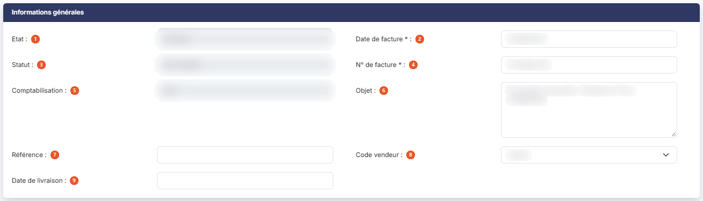
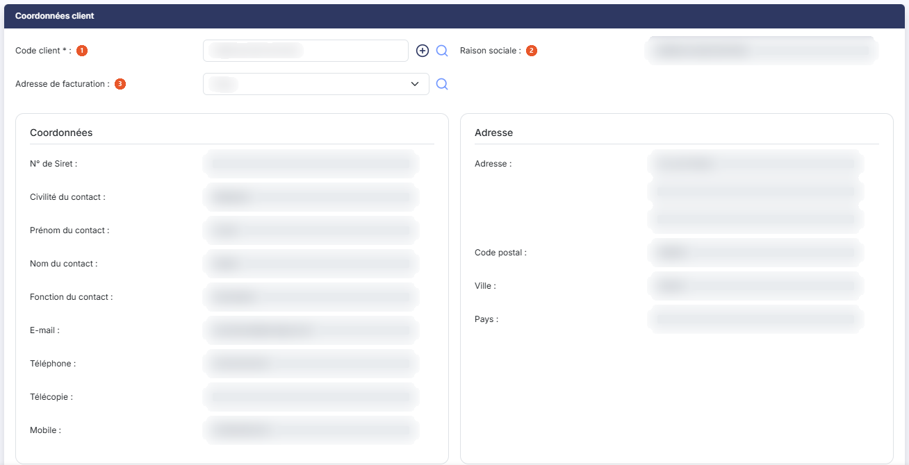
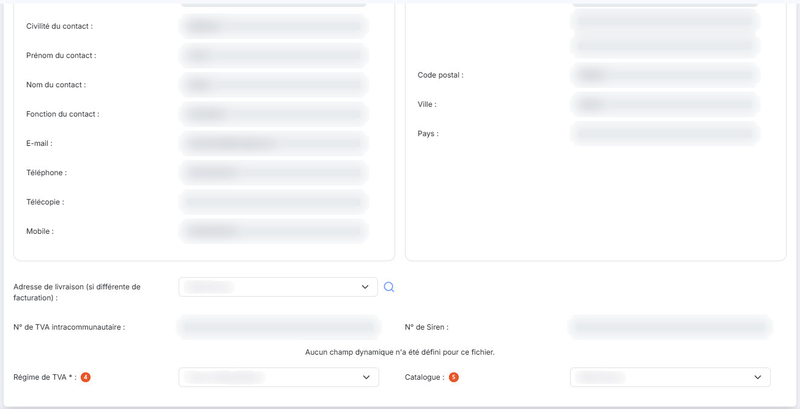
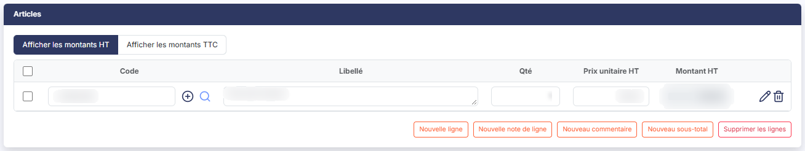
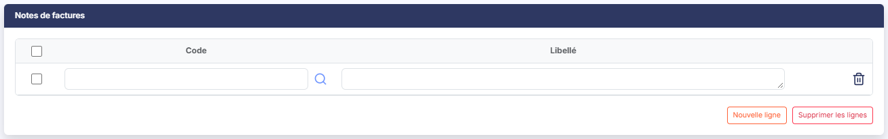
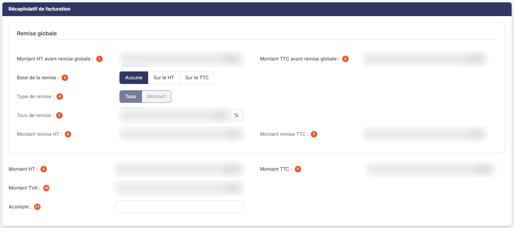
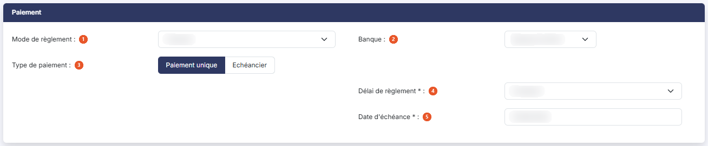
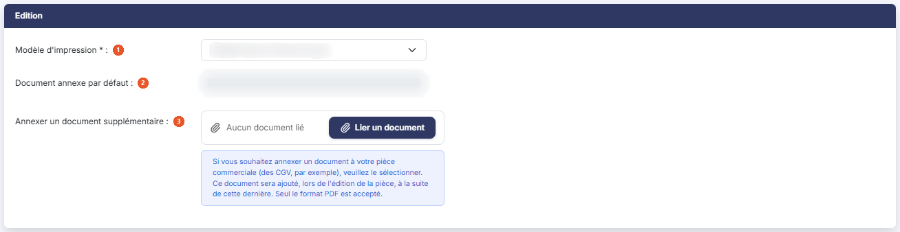

# Factures clients


**Où le trouver :** Menu **Ventes › Factures**



**En bref** — Cet écran donne accès aux factures clients du dossier annuel en cours : vous les saisissez, les validez, les envoyez et enregistrez leurs règlements. À l'ouverture, seules les factures non réglées sont affichées.

* Pour créer une facture : bouton \[Créer une facture], en bas à droite de l'écran, puis renseignez la fiche.
* Pour figer une facture terminée : bouton \[Valider] dans sa fiche.
* Pour retrouver une facture déjà réglée : bouton \[Filtres spéciaux], puis désactivez l'interrupteur Factures non réglées.


Cette option donne accès aux factures clients du dossier annuel en cours. A l'ouverture, la liste ne contient toutefois que les factures qui restent à régler : le filtre rapide « Non réglées » du groupe « Règlement » est retenu, comme décrit ci-dessous. Les factures non validées (les brouillons) s'affichent avec « Non réglées » comme avec « Toutes », mais pas avec « Réglées ». Une facture peut être saisie directement ici, ou générée depuis un devis, un bon de commande ou un bon de livraison.

<figure><figcaption>
Écran « Factures » de la nouvelle interface
</figcaption></figure>

Vous pouvez restreindre la liste à l'aide des zones de recherche et des filtres situés au-dessus du tableau. bouton **\[Filtres]** ouvre un volet « Filtrer » qui permet de filtrer colonne par colonne : ces filtres se cumulent avec les zones de recherche et avec les deux groupes de filtres rapides, décrits ci-dessous.

A l'ouverture, les factures sont classées par numéro de pièce, de la plus récente à la plus ancienne.

## Les filtres au-dessus de la liste

| Champ                       | Ce qu'il faut savoir                                                                                                                                                                                                                                                                                                                                                                                                                                                                                                                                                                                                                                                                                                                                                                                                                                                                                                                                                                                                                                                                                                                                                                                                                                                                                                                                                                                                                                                                                                                                                                          |
| --------------------------- | --------------------------------------------------------------------------------------------------------------------------------------------------------------------------------------------------------------------------------------------------------------------------------------------------------------------------------------------------------------------------------------------------------------------------------------------------------------------------------------------------------------------------------------------------------------------------------------------------------------------------------------------------------------------------------------------------------------------------------------------------------------------------------------------------------------------------------------------------------------------------------------------------------------------------------------------------------------------------------------------------------------------------------------------------------------------------------------------------------------------------------------------------------------------------------------------------------------------------------------------------------------------------------------------------------------------------------------------------------------------------------------------------------------------------------------------------------------------------------------------------------------------------------------------------------------------------------------------- |
| **Rechercher une facture…** | Zone de recherche rapide, à gauche de la barre d'outils.                                                                                                                                                                                                                                                                                                                                                                                                                                                                                                                                                                                                                                                                                                                                                                                                                                                                                                                                                                                                                                                                                                                                                                                                                                                                                                                                                                                                                                                                                                                                      |
| **Rechercher un client…**   | Saisissez les premières lettres du code ou de la raison sociale, ou utilisez le pictogramme « Loupe » situé à droite de la zone pour ouvrir la fenêtre de recherche. Le raccourci clavier Ctrl + Alt + R ouvre cette même fenêtre.                                                                                                                                                                                                                                                                                                                                                                                                                                                                                                                                                                                                                                                                                                                                                                                                                                                                                                                                                                                                                                                                                                                                                                                                                                                                                                                                                            |
| **Filtres rapides**         | 
Il n'y a plus de menu « Filtres spéciaux » ni d'interrupteur « Factures non réglées ». Deux groupes de segments, au-dessus de la barre d'outils, restreignent la liste ; chaque segment affiche le nombre de factures qu'il retient. À gauche, le groupe « Règlement » : <strong>Toutes</strong>, <strong>Non réglées</strong> (retenu à l'ouverture de l'écran) et <strong>Réglées</strong>. À droite, le groupe « Statut » : <strong>Tous</strong> (retenu à l'ouverture), <strong>Brouillons</strong> et <strong>Validées</strong> ; les nombres de ce groupe suivent le choix fait dans « Règlement ». Par défaut, la liste ne contient donc que les factures qui restent à régler : choisissez <strong>Toutes</strong> pour afficher aussi les factures réglées. Le lien « Tout effacer », à droite de la barre d'outils, s'affiche dès que « Règlement » n'est plus sur <strong>Toutes</strong> ou « Statut » plus sur <strong>Tous</strong>, donc dès l'ouverture de l'écran : il remet « Règlement » sur <strong>Toutes</strong> et « Statut » sur <strong>Tous</strong>. bouton <strong>[Filtres]</strong> : il ouvre le volet « Filtrer », qui annonce « Aucun critère. Choisissez une colonne pour commencer. » tant qu'aucun critère n'est posé. La liste déroulante « + Ajouter un critère sur… » propose les colonnes de la liste, y compris celles qui ne sont pas affichées par défaut (Date échéance, Reste à payer, Vendeur, Siret, Régime de TVA…). Le lien « Vider les filtres » retire les critères du volet ; bouton <strong>[Filtrer]</strong> les applique.
 |
| **Total facturé (filtré)**  | Case encadrée non saisissable, au-dessus du tableau, à droite, sur sa propre ligne, au-dessus des filtres rapides. Elle contient la somme des montants HT, remises déduites, de toutes les factures retenues par les filtres en cours.                                                                                                                                                                                                                                                                                                                                                                                                                                                                                                                                                                                                                                                                                                                                                                                                                                                                                                                                                                                                                                                                                                                                                                                                                                                                                                                                                        |

## Les colonnes de la liste

Toutes les colonnes ci-dessous peuvent servir au tri : cliquez sur leur en-tête.

| Champ              | Ce qu'il faut savoir                                                                                                                                                                                                                                                                                                                                                                                                                 |
| ------------------ | ------------------------------------------------------------------------------------------------------------------------------------------------------------------------------------------------------------------------------------------------------------------------------------------------------------------------------------------------------------------------------------------------------------------------------------ |
| **Etat**           | Pastille de couleur qui résume la situation de la facture. Elle peut prendre quatre valeurs : « Brouillon » pour une facture non validée, « Validée » pour une facture validée dont le règlement est attendu sans être en retard, « Payée » pour une facture validée dont le solde est à zéro, et « En retard » pour une facture validée dont le solde n'est pas à zéro et dont la date d'échéance est antérieure à la date du jour. |
| **Numéro**         | Le numéro de la facture.                                                                                                                                                                                                                                                                                                                                                                                                             |
| **Client**         | Le code du client.                                                                                                                                                                                                                                                                                                                                                                                                                   |
| **Raison sociale** | 
La raison sociale du client. <strong>Montant HT</strong> et <strong>Montant TTC</strong> : les montants de la facture, remises déduites.
                                                                                                                                                                                                                                                                                   |
| **Date facture**   | La date portée sur la pièce.                                                                                                                                                                                                                                                                                                                                                                                                         |
| **Statut**         | « Non validée » ou « Validée ».                                                                                                                                                                                                                                                                                                                                                                                                      |
| **Retard**         | « Oui » ou « Non ».                                                                                                                                                                                                                                                                                                                                                                                                                  |

Ne confondez pas les colonnes « Etat » et « Statut » : le statut ne dit que si la facture a été validée, tandis que l'état combine cette validation avec le règlement et l'échéance. Une facture « Brouillon » porte ainsi le statut « Non validée », et une facture « En retard » le statut « Validée ».

La liste des colonnes affichées est propre à chaque utilisateur : bouton **\[Vue]** permet de la modifier, dans sa rubrique « Colonnes affichées », et donne accès à des colonnes qui ne sont pas présentes par défaut.

## Les commandes de la barre d'outils et du pied de la liste

L'en-tête du tableau ne porte plus ni boîte à cocher ni pictogrammes de commande : ils sont remplacés par deux boutons à droite de la barre d'outils.

* bouton **\[Vue]** : il ouvre le menu des vues, avec « Mes vues » (« Enregistrer la vue actuelle ») et « Colonnes affichées » (flèches de déplacement, « Rétablir les colonnes d'origine » et « Appliquer ») ; c'est lui qui remplace le pictogramme « Configuration » ;
* bouton **\[Exporter]** : il ouvre un menu qui propose « Aperçu édition HTML », « Imprimer », « Exporter en Excel », « Exporter en PDF » et « Envoyer la liste par e-mail », avec les réglages « Portrait » / « Paysage » et « Ajustée » / « Fixe » ; c'est lui qui remplace le pictogramme « Imprimante » ;
* sous le tableau, « Sélectionner la page » retient les lignes de la page affichée et « Tout sélectionner (n) » celles de toutes les pages ;
* dès qu'une facture est sélectionnée, un bandeau s'affiche en bas de l'écran (« 1 facture sélectionnée ») avec le lien « Tout désélectionner » et bouton **\[Envoyer tout par mail]**, qui envoie par courriel toutes les factures sélectionnées. À partir de deux factures sélectionnées, le bandeau porte en plus bouton **\[Impressions groupées]** et bouton **\[Validations groupées]**, décrits plus bas ; tant qu'il est affiché, bouton **\[Créer une facture]** n'est plus visible en bas de l'écran. Le bandeau ne porte pas de bouton « Supprimer ».

## Les commandes de chaque ligne de la liste

Elles sont regroupées à droite de la ligne, dans la dernière colonne du tableau. Elles apparaissent au survol de la ligne (seuls le pictogramme « Afficher l'aperçu » et, le cas échéant, l'enveloppe avec sa pastille restent visibles au repos). Une facture en brouillon et une facture validée portent le même jeu de commandes : les pictogrammes « Afficher l'aperçu », « Télécharger », « Valider », « Régler » et « Envoyer par mail », suivis du menu « Autres actions » (trois points), qui porte « Modifier », « Dupliquer » et « Editer un relevé de comptes ». Il n'y a plus de boîte à cocher : un clic sur la ligne la sélectionne pour les traitements groupés.

* **Modifier** : (menu « Autres actions ») ouvre la fiche de la facture ;
* **Afficher l'aperçu** : affiche la facture à l'écran sans la télécharger ;
* **Dupliquer** : (menu « Autres actions ») crée une nouvelle facture reprenant les caractéristiques de celle-ci ;
* **Télécharger** : récupère la facture au format .PDF sur votre poste ;
* **Valider** : même fonction que bouton **\[Valider]** de la fiche, décrit plus bas ;
* **Régler** : même fonction que bouton **\[Régler la facture]** de la fiche, décrit plus bas ;
* **Editer un relevé de comptes** : (menu « Autres actions ») édite le relevé de comptes du client de la ligne ;
* **Envoyer par mail** : même fonction que bouton **\[Envoyer par mail]** de la fiche, décrit plus bas.

Lorsqu'une facture a déjà été envoyée par courriel, une pastille chiffrée se superpose au pictogramme « Enveloppe » de sa ligne et indique le nombre d'envois réalisés. Passez la souris dessus pour afficher le détail de ces envois, sous la forme d'un tableau à trois colonnes « Date », « Heure » et « Destinataires ». Les factures jamais envoyées ne portent pas de pastille.

## Bouton \[Créer une facture]

Situé en bas à droite de l'écran, il ouvre une fiche de facture vide. Les rubriques décrites ci-dessous s'affichent alors dans l'ordre suivant : « Informations générales », « Coordonnées client », « Articles », « Notes de factures », « Récapitulatif de facturation », « Paiement » et « Edition ».

## Rubrique « Informations générales »

<figure><figcaption>
Rubrique « Informations générales »
</figcaption></figure>

| Champ                         | Ce qu'il faut savoir                                                                                                                                                |
| ----------------------------- | ------------------------------------------------------------------------------------------------------------------------------------------------------------------- |
| 1. **Etat**                   | Reprend la valeur décrite à la rubrique des colonnes de la liste.                                                                                                   |
| 3. **Statut**                 | Indique si la facture est validée ou non. Ce champ n'est jamais saisissable.                                                                                        |
| 4. **N° de facture**          | Champ obligatoire. Le numéro est attribué automatiquement en fonction de la règle de création indiquée dans le menu « Paramètres », option « Pièces commerciales ». |
| **Trou dans la numérotation** | Pour éviter la présence de « trous » dans la numérotation des factures, il est nécessaire de décrire le fonctionnement de la numérotation.                          |

Lorsque vous créez une facture, le numéro est automatiquement affecté à la nouvelle facture. Si vous n'allez pas au bout de cette création (que vous annulez l'opération), le numéro sera libéré et réattribué à la prochaine facture.

Par contre, si vous créez la facture n° 100 au 12 janvier, la facture 101 au 14 janvier et enfin la facture 102 au 18 janvier et que vous ne les validiez pas, si vous détruisez la facture 100, ce numéro ne sera pas réutilisé car non seulement les numéros de factures doivent se suivre mais ils doivent respecter la chronologie.

En revanche, dans ce même exemple, si vous détruisez ensuite les factures 101 et 102, la prochaine facture sera bien créée cette fois avec le n° 100 car il n'y a plus de facture suivant ce numéro.


Notez que si un trou apparaît dans la numérotation et que les factures sont à la même date, vous pouvez combler ce trou en vous rendant dans le menu « Paramètres », option « Pièces commerciales » et en modifiant le numéro séquentiel de la facture pour indiquer celui du trou. Une fois la facture créée et le trou comblé, modifiez à nouveau le numéro séquentiel.


Pour visualiser les trous dans la numérotation des factures, rendez-vous dans le menu « Editions » et lancez l'édition « Diagnostic ».

| Champ                    | Ce qu'il faut savoir                                                                                                                                                                                                      |
| ------------------------ | ------------------------------------------------------------------------------------------------------------------------------------------------------------------------------------------------------------------------- |
| 2. **Date de facture**   | Champ obligatoire. Le logiciel vous propose par défaut la date du jour ; le calendrier s'ouvre au clic dans le champ.                                                                                                     |
| 5. **Comptabilisation**  | Indique si les écritures comptables relatives à la facture ont été générées ou non. Ce champ n'est jamais saisissable.                                                                                                    |
| 6. **Objet**             | Champ facultatif, saisi sur plusieurs lignes. Si la facture a été créée à partir d'un devis, d'un bon de commande ou d'un bon de livraison, la référence à cette pièce figure dans l'objet, mais vous pouvez la modifier. |
| 7. **Référence**         | Champ facultatif.                                                                                                                                                                                                         |
| 8. **Code vendeur**      | Champ facultatif. Il se présente sous la forme d'un sélecteur ; si le fichier des vendeurs compte plus de dix vendeurs, la saisie se fait par autocomplétion.                                                             |
| 9. **Date de livraison** | 
Champ facultatif ; le calendrier s'ouvre au clic dans le champ. Trois champs supplémentaires apparaissent une fois la facture validée :
                                                                         |
| **Montant TTC**          | Il s'agit du montant à payer lors de la validation de la facture.                                                                                                                                                         |
| **Montant réglé**        | Il s'agit de la somme de tous les règlements reçus et enregistrés pour la facture. Le pictogramme « Œil », dont l'infobulle est « Visualiser les règlements validés », permet d'en visualiser le détail dans une fenêtre. |
| **Reste à payer**        | C'est la différence entre le montant TTC et le montant réglé.                                                                                                                                                             |

Sur une facture en brouillon, ces trois champs et le pictogramme « Œil » ne sont pas affichés du tout.

## Rubrique « Coordonnées client »

<figure><figcaption>
Rubrique « Coordonnées client »
</figcaption></figure>

<figure><figcaption>
Rubrique « Coordonnées client »
</figcaption></figure>

| Champ                         | Ce qu'il faut savoir                                                                                                                                                                                                                                                                                                                                                                                                                                                                                                                                                                                                                                                                                                                                                                                                                                                                                                                                                                                                                                                                                                                                                                                                                                                                                                                                                                                                                                                                                                                                                                                                       |
| ----------------------------- | -------------------------------------------------------------------------------------------------------------------------------------------------------------------------------------------------------------------------------------------------------------------------------------------------------------------------------------------------------------------------------------------------------------------------------------------------------------------------------------------------------------------------------------------------------------------------------------------------------------------------------------------------------------------------------------------------------------------------------------------------------------------------------------------------------------------------------------------------------------------------------------------------------------------------------------------------------------------------------------------------------------------------------------------------------------------------------------------------------------------------------------------------------------------------------------------------------------------------------------------------------------------------------------------------------------------------------------------------------------------------------------------------------------------------------------------------------------------------------------------------------------------------------------------------------------------------------------------------------------------------- |
| 1. **Code client**            | Il est obligatoire. Vous pouvez le rechercher de deux manières : en tapant ses premières lettres dans la cellule de saisie, le logiciel vous proposera les clients dont le code ou la raison sociale contiennent ces lettres ; ou en cliquant sur le pictogramme « Loupe » pour afficher la fenêtre de recherche. Le pictogramme « Plus » situé à côté permet de créer directement un nouveau client.                                                                                                                                                                                                                                                                                                                                                                                                                                                                                                                                                                                                                                                                                                                                                                                                                                                                                                                                                                                                                                                                                                                                                                                                                      |
| 2. **Raison sociale**         | Reprise de la fiche client, en lecture seule.                                                                                                                                                                                                                                                                                                                                                                                                                                                                                                                                                                                                                                                                                                                                                                                                                                                                                                                                                                                                                                                                                                                                                                                                                                                                                                                                                                                                                                                                                                                                                                              |
| 3. **Adresse de facturation** | 
Choisissez-la dans le sélecteur, ou utilisez le pictogramme « Loupe » pour visualiser les adresses disponibles ; cette fenêtre permet également de modifier une adresse ou d'en créer une nouvelle. Si vous avez défini une adresse par défaut pour ce client, c'est elle qui s'affiche et tous les champs qui en dépendent sont renseignés. Les champs suivants sont alors remplis depuis la fiche client et ne sont pas saisissables ici : <strong>N° de Siret</strong>, <strong>Civilité du contact</strong>, <strong>Prénom du contact</strong>, <strong>Nom du contact</strong>, <strong>Fonction du contact</strong>, <strong>E-mail</strong>, <strong>Téléphone</strong>, <strong>Télécopie</strong>, <strong>Mobile</strong>, <strong>Adresse</strong> (sur deux lignes), <strong>Code postal</strong>, <strong>Ville</strong> et <strong>Pays</strong>. Ce même ensemble de champs est repris une seconde fois sous <strong>Adresse de livraison (si différente de facturation) :</strong>, lorsque la marchandise est livrée ailleurs qu'au lieu de facturation. Il ne s'agit pas d'un simple sous-titre : c'est un sélecteur, accompagné du pictogramme « Loupe » ; les champs qui le suivent ne sont affichés qu'une fois une adresse retenue. La rubrique se termine par : <strong>N° de TVA intracommunautaire</strong> et <strong>N° de Siren :</strong> repris de la fiche client, en lecture seule. Une zone est réservée aux champs dynamiques du fichier des factures. Si aucun n'a été créé, le message « Aucun champ dynamique n'a été défini pour ce fichier. » y est affiché.
 |
| 4. **Régime de TVA**          | Champ obligatoire qui permet de gérer tous les cas de facturation en local ou à l'export, que l'entreprise soit domiciliée en France métropolitaine ou en France d'outre-mer. Il est normalement attribué dans la fiche client ; si ce n'est pas le cas, vous devrez en indiquer un ici.                                                                                                                                                                                                                                                                                                                                                                                                                                                                                                                                                                                                                                                                                                                                                                                                                                                                                                                                                                                                                                                                                                                                                                                                                                                                                                                                   |
| 5. **Catalogue**              | Le sélecteur de catalogues n'est affiché que si vous avez activé la gestion des catalogues dans le menu « Paramètres », option « Articles ». Si vous avez affecté un catalogue par défaut au client, il est automatiquement sélectionné mais reste modifiable. Tous les articles se verront affecter les prix indiqués dans leur fiche pour le catalogue considéré.                                                                                                                                                                                                                                                                                                                                                                                                                                                                                                                                                                                                                                                                                                                                                                                                                                                                                                                                                                                                                                                                                                                                                                                                                                                        |

## Rubrique « Articles »

<figure><figcaption>
Rubrique « Articles »
</figcaption></figure>

C'est dans cette rubrique que sont saisies les lignes de la facture. La saisie peut se faire de manière simplifiée, directement dans le tableau, ou de manière très détaillée en utilisant la commande « Modifier » (un crayon) présente à la fin de la ligne.

Deux boutons-bascule, au-dessus du tableau, commandent l'affichage : « Afficher les montants HT » masque les colonnes « Prix unitaire TTC » et « Montant TTC » ; « Afficher les montants TTC » masque à l'inverse les colonnes « Prix unitaire HT » et « Montant HT ». Les colonnes du tableau sont, dans l'ordre : « Code », « Libellé », « Qté », « Prix unitaire HT », « Prix unitaire TTC », « Montant HT » et « Montant TTC ».

**La saisie simplifiée**

| Champ                     | Ce qu'il faut savoir                                                                                                                                                                                                                                                                                                                                                                                                                                                                                                                                                                                                                                                                                                                                                                                                                                                                                                        |
| ------------------------- | --------------------------------------------------------------------------------------------------------------------------------------------------------------------------------------------------------------------------------------------------------------------------------------------------------------------------------------------------------------------------------------------------------------------------------------------------------------------------------------------------------------------------------------------------------------------------------------------------------------------------------------------------------------------------------------------------------------------------------------------------------------------------------------------------------------------------------------------------------------------------------------------------------------------------- |
| **Code**                  | Il est obligatoire. Vous pouvez le rechercher de deux manières : en tapant ses premières lettres dans la cellule de saisie, le logiciel vous proposera les articles dont le code ou le libellé contiennent ces lettres ; ou en cliquant sur le pictogramme « Loupe » pour afficher la fenêtre de recherche. Cette fenêtre permet également de créer un nouvel article. Le raccourci clavier Ctrl + Alt + R ouvre cette même recherche.                                                                                                                                                                                                                                                                                                                                                                                                                                                                                      |
| **Libellé**               | Il est repris depuis la fiche article mais reste modifiable.                                                                                                                                                                                                                                                                                                                                                                                                                                                                                                                                                                                                                                                                                                                                                                                                                                                                |
| **Qté**                   | 
La quantité doit être supérieure à zéro. Le nombre de décimales pour les quantités est paramétrable dans le menu « Paramètres », option « Multimodules ». <strong>Prix unitaire HT</strong> et <strong>Prix unitaire TTC :</strong> ils ne sont modifiables que si deux conditions sont remplies : que vous ayez indiqué dans le menu « Paramètres », option « Pièces commerciales », que les prix pouvaient être modifiés dans les pièces commerciales, et que vous ayez fait la même chose dans la fiche de l'article considéré. <strong>Montant HT</strong> et <strong>Montant TTC :</strong> ils sont affichés automatiquement, sans possibilité de modification. Les lignes d'articles peuvent être déplacées à l'aide de la souris. Pour cela, il suffit de cliquer dans une zone de la ligne, en dehors des cellules de saisie, et de glisser-déposer la ligne à l'endroit souhaité dans le tableau.
 |
| **La saisie détaillée**   | La commande « Modifier » de la ligne ouvre une fenêtre qui reprend les champs ci-dessus et y ajoute les suivants.                                                                                                                                                                                                                                                                                                                                                                                                                                                                                                                                                                                                                                                                                                                                                                                                           |
| **Catalogue**             | Le sélecteur de catalogues n'est affiché que si vous avez activé la gestion des catalogues dans le menu « Paramètres », option « Articles ». Si l'en-tête de la facture contient un catalogue, il est repris pour chaque ligne d'article, où il reste modifiable en saisie détaillée. Le changement de code catalogue entraîne l'affectation du prix et éventuellement du code TVA du nouveau catalogue à l'article.                                                                                                                                                                                                                                                                                                                                                                                                                                                                                                        |
| **Code TVA**              | Il est repris de la fiche article mais reste modifiable.                                                                                                                                                                                                                                                                                                                                                                                                                                                                                                                                                                                                                                                                                                                                                                                                                                                                    |
| **Taux de TVA**           | Il est affiché automatiquement, sans possibilité de modification, en fonction du code TVA choisi.                                                                                                                                                                                                                                                                                                                                                                                                                                                                                                                                                                                                                                                                                                                                                                                                                           |
| **Unité**                 | 
C'est un champ facultatif de la fiche article, affiché automatiquement sans possibilité de modification. <strong>Montant HT avant remise</strong> et <strong>Montant TTC avant remise :</strong> ils sont affichés automatiquement, sans possibilité de modification.
                                                                                                                                                                                                                                                                                                                                                                                                                                                                                                                                                                                                                                             |
| **Base de la remise**     | Elle n'est modifiable que si deux conditions sont remplies : que vous ayez indiqué dans le menu « Paramètres », option « Pièces commerciales », que vous autorisiez la saisie de remise par article, et que vous ayez fait la même chose dans la fiche de l'article considéré.                                                                                                                                                                                                                                                                                                                                                                                                                                                                                                                                                                                                                                              |
| **Type de remise**        | Indiquez si vous souhaitez saisir un taux de remise ou un montant.                                                                                                                                                                                                                                                                                                                                                                                                                                                                                                                                                                                                                                                                                                                                                                                                                                                          |
| **Taux de remise**        | Il est à saisir si vous avez choisi le type par taux.                                                                                                                                                                                                                                                                                                                                                                                                                                                                                                                                                                                                                                                                                                                                                                                                                                                                       |
| **Montant de remise HT**  | Il est à saisir si vous avez choisi la base de remise HT et le type par montant.                                                                                                                                                                                                                                                                                                                                                                                                                                                                                                                                                                                                                                                                                                                                                                                                                                            |
| **Montant de remise TTC** | Il est à saisir si vous avez choisi la base de remise TTC et le type par montant.                                                                                                                                                                                                                                                                                                                                                                                                                                                                                                                                                                                                                                                                                                                                                                                                                                           |
| **Montant de TVA**        | Il est affiché automatiquement, sans possibilité de modification.                                                                                                                                                                                                                                                                                                                                                                                                                                                                                                                                                                                                                                                                                                                                                                                                                                                           |

Si vous avez créé des champs dynamiques dans le fichier des articles, vous pouvez les saisir dans cette fenêtre ; ils figurent toujours au bas de celle-ci.

Un pictogramme « Plus » en tête de ligne signale qu'elle provient d'une autre pièce. Son infobulle affiche un tableau intitulé « Origine », qui donne le numéro de la pièce d'origine sur trois lignes : « Devis », « BC » et « BL ». Les lignes sans pièce d'origine restent vides.

Les boutons de la rubrique sont les suivants :

bouton **\[Nouvelle ligne]** : il ajoute un article à la facture. Une nouvelle ligne est toujours ajoutée en fin de liste, mais vous pouvez la déplacer par glisser-déposer.

bouton **\[Nouvelle note de ligne]** : il ajoute une note rattachée au premier article situé au-dessus d'elle. Le code fonctionne en autocomplétion sur le code et le libellé du fichier « Notes de factures », et le texte n'est accessible qu'une fois un code renseigné. La liste des articles d'une facture ne peut pas commencer par une note de ligne : la validation serait refusée.

bouton **\[Nouveau commentaire]** : il crée une nouvelle ligne dont seul le libellé sera obligatoire. La ligne de commentaire est ensuite déplaçable à l'aide de la souris comme une ligne d'article. Si vous avez saisi des commentaires types dans le menu « Fichiers », option « Commentaires types », vous pouvez en sélectionner un à l'aide du pictogramme « Loupe ».

bouton **\[Nouveau sous-total]** : il ajoute une ligne de sous-total, elle aussi déplaçable par glisser-déposer.

bouton **\[Supprimer les lignes]** : il supprime en une seule fois toutes les lignes qui ont été sélectionnées avec les boîtes à cocher.

Sur une facture validée, aucun de ces boutons n'est affiché et la seule commande disponible sur les lignes est « Visualiser détails » : les articles ne sont plus ni modifiables, ni supprimables.

## Rubrique « Notes de factures »

<figure><figcaption>
Rubrique « Notes de factures »
</figcaption></figure>

Cette rubrique permet de rattacher à la facture entière des commentaires venant du fichier « Notes de factures » du menu « Fichiers ». Elles sont imprimées en pied de facture, à la suite des lignes, comme si elles avaient été saisies en tant que commentaires.

Le tableau comporte deux colonnes, « Code » et « Libellé ». Le code fonctionne en autocomplétion sur le code et le libellé des notes de factures, et le libellé reste modifiable une fois chargé.

bouton **\[Nouvelle ligne]** ajoute une note et bouton **\[Supprimer les lignes]** retire celles qui ont été cochées. Sur une facture validée, ces deux boutons ne sont pas affichés.

## Rubrique « Récapitulatif de facturation »

<figure><figcaption>
Rubrique « Récapitulatif de facturation »
</figcaption></figure>

| Champ                                   | Ce qu'il faut savoir                                                                                                                                                                                                                                 |
| --------------------------------------- | ---------------------------------------------------------------------------------------------------------------------------------------------------------------------------------------------------------------------------------------------------- |
| 1. **Montant HT avant remise globale**  | Il s'agit du total HT des lignes de la facture, net des éventuelles remises affectées à chacune des lignes d'articles.                                                                                                                               |
| 2. **Montant TTC avant remise globale** | Il s'agit du total TTC des lignes de la facture, net des éventuelles remises affectées à chacune des lignes d'articles.                                                                                                                              |
| 3. **Base de la remise**                | Trois choix sont proposés, « Aucune », « Sur le HT » et « Sur le TTC ». La base de la remise n'est modifiable que si vous avez indiqué dans le menu « Paramètres », option « Pièces commerciales », que vous autorisiez la saisie de remise globale. |
| 4. **Type de remise**                   | Indiquez si vous souhaitez saisir un « Taux » de remise ou un « Montant ».                                                                                                                                                                           |
| 5. **Taux de remise**                   | Il est à saisir si vous avez choisi le type par taux. Il est suivi du signe pour cent.                                                                                                                                                               |
| 6. **Montant remise HT**                | Il est à saisir si vous avez choisi la base de remise HT et le type par montant.                                                                                                                                                                     |
| 7. **Montant remise TTC**               | Il est à saisir si vous avez choisi la base de remise TTC et le type par montant.                                                                                                                                                                    |
| 8. **Montant HT**                       | Il correspond au montant HT avant remise globale moins l'éventuel montant de remise HT. Il n'est pas directement modifiable.                                                                                                                         |
| 9. **Montant TTC**                      | Il correspond au montant TTC avant remise globale moins l'éventuel montant de remise TTC. Il n'est pas directement modifiable.                                                                                                                       |
| 10. **Montant TVA**                     | Il est affiché automatiquement, sans possibilité de modification.                                                                                                                                                                                    |
| 11. **Acompte**                         | C'est un montant en saisie libre, informatif, qui ne tient pas compte des règlements imputés à la facture. Le champ qui tient compte de ces règlements s'intitule « Reste à payer ».                                                                 |

## Rubrique « Paiement »

<figure><figcaption>
Rubrique « Paiement »
</figcaption></figure>

| Champ                                        | Ce qu'il faut savoir                                                                                                                                                                                                                                                                                                                                                 |
| -------------------------------------------- | -------------------------------------------------------------------------------------------------------------------------------------------------------------------------------------------------------------------------------------------------------------------------------------------------------------------------------------------------------------------- |
| 1. **Mode de règlement**                     | Champ facultatif.                                                                                                                                                                                                                                                                                                                                                    |
| 2. **Banque**                                | Elle est facultative. La faire figurer vous permettra d'afficher vos coordonnées bancaires sur la facture, si elles ont été prévues dans le modèle d'impression.                                                                                                                                                                                                     |
| 3. **Type de paiement**                      | Deux boutons-bascule, « Paiement unique » et « Echéancier ». Le logiciel propose « Paiement unique » ; le choix commande la liste des champs affichés en dessous.                                                                                                                                                                                                    |
| 4. **Délai de règlement**                    | 
Champ obligatoire, quel que soit le type de paiement. Si vous avez affecté un délai de règlement par défaut au client, il est automatiquement sélectionné mais reste modifiable pour la facture en cours. <strong>Cas d'un paiement unique</strong>
                                                                                                        |
| 5. **Date d'échéance**                       | Champ obligatoire. Elle est calculée automatiquement en fonction du délai de règlement indiqué.                                                                                                                                                                                                                                                                      |
| **Cas d'un paiement en plusieurs échéances** | Les trois champs suivants et le tableau des échéances ne sont affichés que si vous avez retenu « Echéancier ».                                                                                                                                                                                                                                                       |
| **Nombre d'échéances**                       | Champ obligatoire. L'échéancier est immédiatement mis à jour avec un nombre de lignes correspondant au nombre indiqué.                                                                                                                                                                                                                                               |
| **Périodicité**                              | Champ obligatoire. Si vous choisissez la périodicité manuelle, vous devrez indiquer la date d'échéance pour chaque ligne de l'échéancier.                                                                                                                                                                                                                            |
| **Date première échéance**                   | 
Champ obligatoire. Le tableau des échéances comporte quatre colonnes : « N° échéance », « Montant échéance », « Date » et « Reste à payer ». Le montant de chaque échéance correspond au montant à payer divisé par le nombre d'échéances, mais il est modifiable échéance par échéance ; les dates sont calculées en fonction de la périodicité indiquée.
 |
| **Statut Chorus Pro**                        | Ce champ en lecture seule n'apparaît que sur une facture validée. Le pictogramme « Œil » placé à sa droite, dont l'infobulle est « Visualiser l'historique des statuts Chorus Pro », en affiche l'historique.                                                                                                                                                        |


Attention : sur une facture dont le type de paiement est « Paiement unique », le statut Chorus Pro n'est pas affiché, alors qu'il n'a aucun rapport avec le mode de paiement. Pour consulter le statut d'une telle facture, utilisez l'option « Utilisation de Chorus Pro » du menu « Chorus Pro ».


## Rubrique « Edition »

<figure><figcaption>
Rubrique « Edition »
</figcaption></figure>

| Champ                                     | Ce qu'il faut savoir                                                                                                                                                                                                                                                                                                                                                                                                                                                                                                                                                                                              |
| ----------------------------------------- | ----------------------------------------------------------------------------------------------------------------------------------------------------------------------------------------------------------------------------------------------------------------------------------------------------------------------------------------------------------------------------------------------------------------------------------------------------------------------------------------------------------------------------------------------------------------------------------------------------------------- |
| 1. **Modèle d'impression**                | Champ obligatoire. Il s'agit du gabarit d'édition de la facture. Le logiciel contient plusieurs modèles pour chaque type de pièce commerciale, mais vous avez la possibilité de les modifier ou d'en créer de nouveaux ; reportez-vous pour cela à l'aide du menu « Paramètres », option « Modèles d'impression ». Si vous avez défini un modèle de facture par défaut dans le menu « Paramètres », option « Pièces commerciales », c'est celui-là qui est proposé, sauf si un modèle de facture a été défini dans la fiche client. Dans tous les cas, le modèle d'impression est modifiable pour chaque facture. |
| 2. **Document annexe par défaut**         | Vous avez la possibilité de joindre systématiquement un autre document au fichier .PDF de la facture. Le choix de ce document s'effectue dans le menu « Paramètres », option « Pièces commerciales », rubrique « Editions ». Si vous l'avez fait, le nom du document apparaît ici, accompagné de la commande qui permet de le retirer.                                                                                                                                                                                                                                                                            |
| 3. **Annexer un document supplémentaire** | Cette option vous permet d'annexer, en plus du fichier .PDF de la facture et de l'éventuel document annexe systématique, un autre document qui ne sera joint qu'à la seule facture en cours. Utilisez bouton **\[Lier un document]** pour le désigner : tant qu'aucun document n'est lié, la zone affiche « Aucun document lié ». Seul le format .PDF est accepté, ce que rappelle un message d'aide sous la zone.                                                                                                                                                                                                |
| **Modèle d'impression du duplicata**      | Ce sélecteur n'apparaît que sur une facture validée. Il permet d'éditer le duplicata selon un modèle différent de celui utilisé avant la validation.                                                                                                                                                                                                                                                                                                                                                                                                                                                              |

## Bouton \[Enregistrer]

<figure><figcaption>
Bouton [Enregistrer]
</figcaption></figure>

Il enregistre la facture sans la valider. Elle reste alors à l'état « Brouillon » et demeure modifiable et supprimable.


Attention : ce bouton reste visible et actif sur une facture validée, bien que tous les champs y soient en lecture seule et qu'aucune ligne ne puisse plus être ajoutée ni supprimée.


## Bouton \[Valider]

<figure><figcaption>
Bouton [Valider]
</figcaption></figure>

Ce bouton n'est présent que sur une facture qui n'est pas encore validée. La validation fige la facture, y compris dans sa forme, avec le modèle d'impression qui lui a été attribué. Une facture validée ne peut plus être supprimée.

La validation déclenche également la génération des écritures comptables correspondantes. Si vous avez indiqué que les écritures devaient être générées en comptabilité, dans le menu « Paramètres », option « Connexion comptabilité », le logiciel vérifie :

* que le journal de réception n'est pas en cours d'utilisation par une autre personne, c'est-à-dire qu'un autre utilisateur n'a pas ouvert le journal pour le mois considéré. Si c'est le cas, il vous l'indique par un message et refuse la validation jusqu'à ce que le journal de destination ne soit plus utilisé ;
* que la date de la facture est bien comprise dans la période de saisie définie pour le dossier annuel en cours ; dans le cas contraire, la validation est refusée.


Notez que si le journal configuré pour recevoir les écritures a été paramétré comme gérant les quantités, les quantités et les unités seront renseignées dans les écritures depuis les lignes de détail des factures.


La facture au format .PDF est attachée à chaque ligne d'écriture générée.

**Affectation d'un règlement** : si, pour le client dont vous validez la facture, il existe des règlements qui n'ont pas été totalement affectés, le logiciel affiche une fenêtre vous proposant d'en affecter un à la facture. Si vous souhaitez le faire, choisissez le règlement dans le sélecteur, qui fait apparaître la liste des règlements non totalement affectés, puis cliquez sur bouton **\[Valider]**. Si vous ne souhaitez pas le faire à ce stade, répondez « Non » à la proposition avant de valider. Si vous cliquez sur bouton **\[Annuler]**, la procédure de validation n'est pas lancée.

La commande « Valider » présente sur la ligne de la facture donne accès à la même fonction.

## Bouton \[Dévalider]

Ce bouton n'est présent que sur une facture validée, et seulement si votre profil vous en donne le droit. L'écriture comptable correspondante est supprimée de la comptabilité et, si elle était lettrée avec d'autres écritures, les lettrages sont eux aussi supprimés. L'événement éventuellement créé dans le module de gestion bancaire est également supprimé, afin qu'une nouvelle validation ne le fasse pas apparaître en double.

## Boutons \[Edition], \[Edition originale] et \[Edition duplicata]

bouton **\[Edition]** : il n'est présent que sur une facture non validée et en édite l'état provisoire.

bouton **\[Edition originale]** : il remplace le précédent une fois la facture validée et permet l'édition de la facture telle qu'elle a été validée, avec le même modèle d'impression.

bouton **\[Edition duplicata]** : lui aussi réservé à une facture validée, il permet l'édition de la facture en tenant compte, d'une part, de l'éventuel nouveau modèle d'impression du duplicata indiqué dans la rubrique « Edition », et d'autre part, de l'évolution du solde de la facture en fonction des règlements enregistrés et affectés à la facture.

## Bouton \[Envoyer par mail]

<figure><figcaption>
Bouton [Envoyer par mail]
</figcaption></figure>

Cette fonction vous permet d'envoyer par courriel la facture en cours. Le pictogramme « Enveloppe » de la ligne fait la même chose, et bouton **\[Envoyer tout par mail]**, du bandeau de sélection, traite toutes les factures sélectionnées.

| Champ                                | Ce qu'il faut savoir                                                                                                                                                                                                                                       |
| ------------------------------------ | ---------------------------------------------------------------------------------------------------------------------------------------------------------------------------------------------------------------------------------------------------------- |
| **Sélection des destinataires**      | Cochez les adresses des destinataires auxquels vous souhaitez adresser le courriel ; ils peuvent apparaître dans plusieurs onglets.                                                                                                                        |
| **Version du document**              | Vous avez le choix entre l'édition originale, telle que la facture a été validée, et l'édition d'un duplicata. Le duplicata tient compte de l'évolution du solde de la facture en fonction des règlements enregistrés et affectés à la facture.            |
| **Modèle d'impression du duplicata** | Cette option n'est disponible que si vous avez choisi « Duplicata » comme version du document. Elle vous permet de générer la facture selon un modèle d'impression différent de celui utilisé avant la validation.                                         |
| **Envoyer en format .zip**           | Si le fichier .PDF comprenant la facture, ou les factures, et les éventuels documents joints est trop lourd, vous avez la possibilité de générer un fichier compressé à la place du .PDF.                                                                  |
| **Autres destinataires**             | Vous pouvez adresser le courriel à d'autres destinataires. Les adresses doivent être séparées par des points-virgules.                                                                                                                                     |
| **Recevoir une copie**               | Si vous répondez « Oui », vous recevrez une copie du courriel à l'adresse à laquelle vous êtes enregistré dans le fichier des utilisateurs.                                                                                                                |
| **Modèle d'e-mail**                  | Si vous avez paramétré des modèles de courriels à l'aide de l'option « Modèles d'e-mails » du menu « Paramètres », vous pouvez en choisir un à l'aide du sélecteur. Si vous avez désigné un modèle par défaut, c'est lui qui est proposé systématiquement. |

**Objet de l'e-mail** et **Corps de l'e-mail** : vous avez la possibilité de modifier l'objet et le corps du courriel pour l'envoi en cours. Le modèle de courriel n'est pas altéré par les modifications faites ici.

Cliquez sur bouton **\[Envoyer]** pour déclencher l'envoi, qui est réalisé immédiatement.

Tous les envois sont mémorisés et vous pouvez en éditer la liste à l'aide du générateur d'états d'édition.

## Bouton \[Générer un avoir]

Ce bouton n'est présent que sur une facture validée. Vous avez la possibilité de générer un avoir qui aura exactement les mêmes caractéristiques que la facture. Le logiciel vous indique le numéro de l'avoir généré et vous positionne automatiquement sur cet avoir, que vous pouvez modifier.

## Bouton \[Régler la facture]

Ce bouton n'est présent que sur une facture validée et vous permet de saisir un règlement la concernant.

La commande « Régler » présente sur la ligne de la facture donne accès à la même fonction.

## Bouton \[Facture électronique]

Ce bouton n'est présent que sur une facture validée. Il génère la facture au format Factur-X, c'est-à-dire un fichier .PDF auquel les données de la facture sont jointes de façon exploitable par un logiciel, et le télécharge sur votre poste.

## Bouton \[Ecriture]

Ce bouton n'est présent que sur une facture validée, et seulement si votre profil vous donne le droit d'intervenir sur les écritures. Il affiche dans une fenêtre l'écriture comptable correspondant à la facture.

## Bouton \[Choix des champs]

<figure><figcaption>
Bouton [Choix des champs]
</figcaption></figure>

Il ouvre une fenêtre à deux colonnes, « Libellé » et « Afficher », qui recense tous les champs susceptibles d'être affichés dans la fiche d'une facture. Désactivez l'interrupteur de ceux que vous n'utilisez jamais : ils disparaîtront du formulaire. Pour les champs obligatoires, la colonne « Afficher » porte le texte « Oui » à la place de l'interrupteur, sans pouvoir être modifiée, et une rubrique dont tous les champs ont été masqués n'est plus affichée du tout.

Les colonnes des tableaux de lignes, articles et notes de factures, ne sont pas concernées par ce réglage.

## Retour à la liste

La flèche « Revenir en arrière », à gauche du fil d'Ariane, quitte la fiche et ramène à la liste des factures, sans enregistrer les modifications en cours.

## Bouton \[Validations groupées] et Bouton \[Dévalidations groupées]

Dans le bandeau de sélection qui s'affiche en bas de l'écran, bouton **\[Validations groupées]** (comme bouton **\[Impressions groupées]**, décrit plus bas) n'apparaît que lorsque deux factures au moins sont sélectionnées.

bouton **\[Validations groupées]** : pour éviter de valider les factures une à une, vous avez la possibilité de les valider pour une période de dates donnée et pour une sélection de clients.

Par défaut, le logiciel traite les factures de tous les clients, mais vous avez la possibilité de restreindre le traitement en indiquant les seuls clients concernés. Pour les choisir, saisissez quelques caractères du nom recherché et retenez l'un de ceux qui vous sont alors proposés ; répétez l'opération pour sélectionner plusieurs clients. Vous pouvez également utiliser le pictogramme « Loupe » et les sélectionner dans la fenêtre. Cliquez ensuite sur bouton **\[Valider]** pour lancer le traitement.

bouton **\[Dévalidations groupées]** : il n'est présent que si votre profil vous en donne le droit et dévalide en une seule fois toutes les factures validées que vous avez cochées. Si aucune facture validée n'est cochée, le message « Vous devez sélectionner au moins une facture validée. » est affiché. Dans le cas contraire, le logiciel vous demande de confirmer la dévalidation du nombre de factures concernées, les factures non validées cochées étant déduites du compte. Certaines factures peuvent ne pas être dévalidables, par exemple si un paiement leur a été affecté : le message de fin vous indique alors combien de factures ont été dévalidées et combien ne l'ont pas été.

## Bouton \[Impressions groupées]

Il apparaît dans le bandeau de sélection dès que deux factures au moins sont sélectionnées.

## Bouton \[Champs dynamiques]

Rangé dans le menu à trois points situé en bas à droite de la liste, il donne accès aux champs dynamiques du fichier des factures, c'est-à-dire aux champs supplémentaires que vous avez créés pour compléter la fiche standard. Ce bouton n'est présent que si votre profil vous en donne le droit.

Deux points ne sont pas traités ici. L'import d'un fichier de factures provenant d'un autre logiciel de facturation ou de gestion commerciale se fait depuis le menu « Traitements », option « Import », dont l'aide décrit la trame d'import et ses contrôles. La liste des colonnes disponibles dans la personnalisation du tableau n'est pas énumérée : elle dépend de votre paramétrage.
