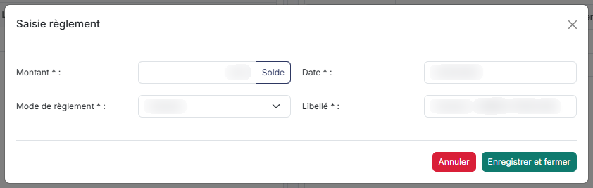

# Règlements clients


**Où le trouver :** Menu **Ventes › Règlements**



**En bref** — Cet écran sert à affecter les règlements encaissés aux factures qu'ils payent, client par client : règlements à gauche, factures non totalement réglées à droite.

* Pour enregistrer un encaissement : choisissez le client en haut à gauche, puis bouton \[Créer un règlement].
* Pour imputer un règlement : indiquez les montants sur les factures, puis bouton \[Valider l'affectation].


La gestion des règlements a plusieurs objectifs :

<figure><figcaption>
Écran « Règlements » de la nouvelle interface
</figcaption></figure>

* le suivi des paiements des factures,
* la gestion des relances clients en manuel ou en automatique,
* la génération des écritures comptables.

Cet écran n'est pas une liste de pièces : c'est un écran d'affectation, où vous rapprochez les règlements que vous avez encaissés des factures qu'ils viennent payer. Il est divisé en deux volets : à gauche, les règlements enregistrés ; à droite, les factures qui n'ont pas été totalement réglées.

Les éléments affichés concernent toujours un seul client, celui dont le code figure en haut à gauche. Une poignée entre les deux volets permet d'élargir ou de réduire le volet de gauche, et la flèche « Chevron » située en haut à droite de ce volet permet de le replier entièrement pour travailler à l'aise sur les factures.

La gestion des règlements fonctionne de manière différente en fonction de ce que vous avez indiqué dans le menu « Paramètres », option « Connexion comptabilité » concernant la génération ou non des écritures de règlement.

En effet, si vous utilisez le module « Teogest Banque », vous pourrez directement récupérer vos écritures de règlement clients via votre relevé bancaire ; vous n'aurez donc pas besoin de générer vos écritures de règlement clients depuis la facturation. Néanmoins, vous devrez saisir les règlements ici pour suivre le solde de vos factures et gérer les relances clients.

## Le bandeau du haut de l'écran

| Champ                               | Ce qu'il faut savoir                                                                                                                                                                                                                                                                                                                                                                                                                                                                                                                                                    |
| ----------------------------------- | ----------------------------------------------------------------------------------------------------------------------------------------------------------------------------------------------------------------------------------------------------------------------------------------------------------------------------------------------------------------------------------------------------------------------------------------------------------------------------------------------------------------------------------------------------------------------- |
| 1. **Éléments totalement affectés** | Cet interrupteur se trouve sur la ligne du client, à droite de sa raison sociale (il n'y a plus de menu « Filtres spéciaux ») ; son infobulle est « Afficher les éléments totalement affectés ». Il est désactivé à l'ouverture de l'écran. Le logiciel ne vous présente donc que ce qui reste à traiter : les règlements qui ne sont pas totalement affectés et les factures qui ne sont pas totalement réglées. Activez-le pour afficher également l'historique.                                                                                                      |
| **Client**                          | Les deux volets ne concernent jamais qu'un seul client à la fois, et ce client peut déjà être renseigné à l'ouverture de l'écran : vérifiez-le avant de conclure qu'il ne reste rien à affecter. Pour en changer, saisissez les premières lettres de son code, le logiciel vous propose les clients correspondants ; vous pouvez aussi utiliser le pictogramme dont l'infobulle est « Recherche avancée » pour ouvrir la fenêtre de recherche. Le champ du client porte l'indication « Rechercher un client… ». La raison sociale du client s'affiche à droite du code. |
| **Total à affecter**                | Somme des « reste à affecter » de tous les règlements qui ne sont pas encore totalement affectés. Ce montant évolue au fur et à mesure des affectations que vous préparez à l'écran, avant même que vous ne les validiez.                                                                                                                                                                                                                                                                                                                                               |
| **Solde global à régler**           | Affiché avec « Total à affecter » dans le bloc encadré de gauche, au-dessus des volets, c'est le total des soldes à régler des lignes affichées dans le volet de droite. Il porte donc sur les factures ou sur les remboursements, selon l'onglet que vous avez activé, et il se met à jour au fur et à mesure de vos affectations.                                                                                                                                                                                                                                     |

En haut à droite, deux cases encadrées, « Montant affecté (sélection) » et « Affectations précédentes (sélection) », vous rappellent, pour le règlement que vous venez de sélectionner, son **Montant affecté** et ses **Affectations précédentes**. Il n'y a plus d'encadré « Règlement sélectionné ». Tant que vous n'avez sélectionné aucun règlement, les deux cases affichent « — ».

## Le volet de gauche : « Règlements en cours »

Ce volet présente les règlements et les remboursements que vous avez enregistrés pour le client, avec les colonnes **Montant**, **Date**, **Mode de règlement**, **Libellé** et **Reste à affecter**.

C'est ici que vous sélectionnez le règlement que vous souhaitez imputer.

Chaque ligne porte un pictogramme « Modifier » qui ouvre le règlement, et un pictogramme « Supprimer » qui le supprime. Lorsque la ligne correspond à un avoir, le logiciel intercale entre les deux un pictogramme « Œil », dont l'infobulle est « Visualiser l'avoir », qui vous permet de visualiser la pièce.

## Le volet de droite : deux onglets

Le volet de droite comporte deux onglets. C'est par eux que vous choisissez de travailler sur les factures ou sur les remboursements.

**Onglet « Factures à régler »** — c'est l'onglet affiché par défaut. Il présente les colonnes **Date pièce**, **N° pièce**, **Montant**, **Règlements précédents**, **Montant affecté**, **Solde à régler** et **Echéance**. Chaque ligne porte une case à cocher et le pictogramme « Visualiser la facture », qui vous permet de visualiser la facture sans quitter l'écran. La case à cocher de l'en-tête sélectionne d'un coup toutes les factures de la page, et le logiciel refait alors les mêmes calculs que si vous les aviez cochées une par une.

**Onglet « Remboursements »** — il présente les colonnes **Montant**, **Date**, **Mode de remboursement**, **Libellé**, **Règlements précédents**, **Montant affecté** et **Solde à régler**.

## Bouton \[Créer un règlement]

<figure><figcaption>
Bouton [Créer un règlement]
</figcaption></figure>

Ce bouton, placé dans la barre du bas lorsque l'onglet « Factures à régler » est affiché (il y est remplacé par Bouton \[Créer un remboursement] sur l'onglet « Remboursements »), ouvre la fenêtre « Saisie règlement » et permet d'enregistrer un nouveau règlement qui sera directement rattaché au client sélectionné.

## Bouton \[Créer un remboursement]

Ce bouton, placé dans la barre du bas lorsque l'onglet « Remboursements » est affiché, permet d'enregistrer un nouveau remboursement qui sera directement rattaché au client sélectionné.

## Bouton \[Valider l'affectation]

La validation de l'affectation concerne aussi bien les règlements clients que les remboursements. Pour choisir l'un ou l'autre, utilisez les onglets « Factures à régler » et « Remboursements » dans le volet de droite.

Pour réaliser une affectation de règlement, vous devez sélectionner dans le volet de gauche le règlement à imputer. Ensuite, vous devez choisir dans le volet de droite la facture à laquelle le règlement est affecté.

Si le montant du règlement est inférieur au solde à payer de la facture choisie, le règlement sera totalement affecté ; le solde à régler de la facture ne sera quant à lui réduit que du montant du règlement affecté.

Si le montant du règlement est supérieur au solde à payer de la facture choisie, le règlement sera affecté à la facture pour son solde à régler et vous pourrez sélectionner une nouvelle facture pour lui imputer également le règlement, et ainsi de suite jusqu'à la complète affectation du règlement.

Si le règlement n'est pas totalement affecté, le solde à affecter sera mémorisé pour une affectation ultérieure à d'autres factures.

Quand l'imputation est terminée, cliquez sur bouton **\[Valider l'affectation]**. Si le règlement a été totalement affecté, il disparaîtra de la liste de gauche, tout comme les factures dont le solde à payer sera passé à 0 disparaîtront de la liste de droite.

L'affectation d'un remboursement fonctionne exactement de la même manière.

## Suppression d'un règlement

Vous pouvez supprimer un règlement que vous avez enregistré, à l'aide du pictogramme « Supprimer » présent sur sa ligne dans le volet de gauche. Cependant, conformément à l'attestation qui vous est délivrée dans le cadre de la loi anti-fraude TVA — BOI-TVA-DECLA-30-10-30-20160803, toutes les suppressions de règlements sont mémorisées.

Ces suppressions sont éditables depuis le générateur d'états d'édition, en choisissant le fichier « Règlements supprimés ».

Avant la validation de la suppression, vous avez la possibilité de saisir un commentaire qui sera lui aussi éditable.

La suppression d'un règlement n'entraîne pas la suppression des éventuelles écritures comptables qui auront été générées lors de sa validation ; il vous appartient donc de faire les ajustements nécessaires en comptabilité.
