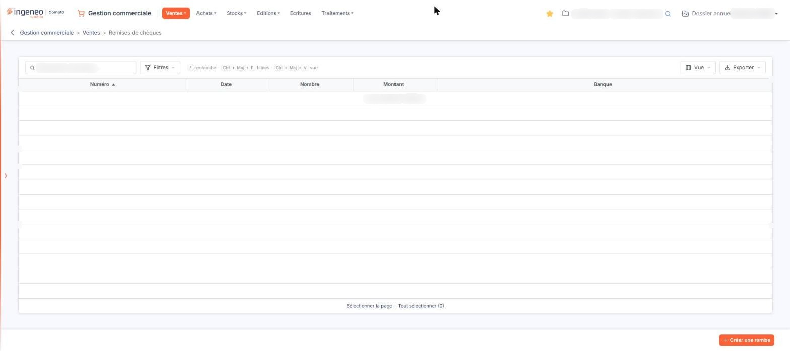
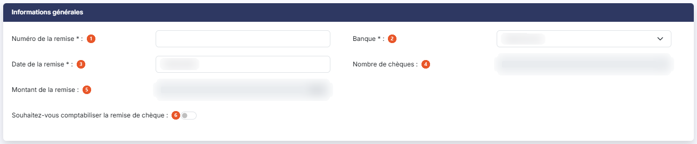
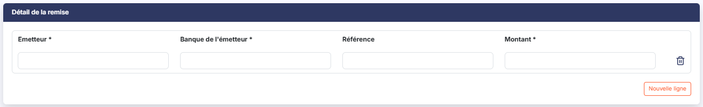

# Remises de chèques


**Où le trouver :** Menu **Ventes › Remises de chèques**



**En bref** — Cet écran permet de saisir et d'imprimer vos bordereaux de remise de chèques en banque, avec une comptabilisation facultative de chaque remise.

* Pour saisir une remise : bouton \[Créer une remise], renseignez la fiche, puis bouton \[Enregistrer].
* Pour rendre la remise définitive : bouton \[Valider].
* Pour imprimer le bordereau : bouton \[Edition].


Cette option permet la saisie et l'impression du document de remise de chèques pour la banque.

<figure><figcaption>
Écran « Remises de chèques » de la nouvelle interface
</figcaption></figure>

La comptabilisation de la remise est facultative : un interrupteur de la fiche vous permet de choisir, remise par remise, si elle doit ou non donner lieu à une écriture. C'est ce choix qui commande l'affichage des zones comptables décrites au paragraphe c).

Le même écran est proposé dans plusieurs modules du logiciel.

## La liste des remises

La liste présente une ligne par remise, avec cinq colonnes : **Numéro**, **Date**, **Nombre** (le nombre de chèques de la remise), **Montant** et **Banque**.

Toutes ces colonnes sont triables ; la liste s'ouvre triée sur le numéro de remise, par ordre croissant.

Au-dessus de la liste, la zone « Rechercher une remise… » et les boutons \[Filtres], \[Vue] et \[Exporter] permettent de rechercher, filtrer, personnaliser et exporter la liste ; tant qu'aucun critère n'est posé, elle affiche toutes les remises du dossier annuel en cours. Les boutons \[Sélectionner la page] et \[Tout sélectionner (n)] sélectionnent les lignes ; un clic sur une ligne la sélectionne.

Le bouton \[Créer une remise] figure en bas à droite de l'écran, hors de la liste.

## Rubrique « Informations générales »

<figure><figcaption>
Rubrique « Informations générales »
</figcaption></figure>

| Champ                                                   | Ce qu'il faut savoir                                                                                                                                                                             |
| ------------------------------------------------------- | ------------------------------------------------------------------------------------------------------------------------------------------------------------------------------------------------ |
| 1. **Numéro de la remise**                              | Il permet de différencier les remises.                                                                                                                                                           |
| 2. **Banque**                                           | Le sélecteur propose les banques que vous avez créées dans le panneau Paramètres, rubrique « Données », option « Banques ». Les coordonnées de la banque retenue sont reprises sur le bordereau. |
| 3. **Date de la remise**                                | Le logiciel propose la date du jour, mais elle est modifiable, directement ou en cliquant dans le champ, qui ouvre le calendrier.                                                                |
| 4. **Nombre de chèques**                                | Zone non modifiable, alimentée par le logiciel en fonction des lignes saisies dans le détail de la remise.                                                                                       |
| 5. **Montant de la remise**                             | Zone non modifiable, alimentée de la même façon à partir des montants du détail.                                                                                                                 |
| 6. **Souhaitez-vous comptabiliser la remise de chèque** | Interrupteur positionné sur « Non » à l'ouverture d'une nouvelle remise. Voir le paragraphe suivant.                                                                                             |

## L'option de comptabilisation

Lorsque vous positionnez l'interrupteur **Souhaitez-vous comptabiliser la remise de chèque** sur « Oui », le logiciel complète l'écran de trois zones :

| Champ                | Ce qu'il faut savoir                                                                                                                                              |
| -------------------- | ----------------------------------------------------------------------------------------------------------------------------------------------------------------- |
| **Code journal**     | Journal dans lequel l'écriture de la remise sera enregistrée.                                                                                                     |
| **Numéro de compte** | Compte de banque à mouvementer. Le pictogramme « Loupe » donne accès au plan comptable, le pictogramme « Plus » permet de créer le compte sans quitter la remise. |

Une colonne supplémentaire, **Compte de l'émetteur**, apparaît en tête du tableau du détail de la remise ; elle disparaît si vous repassez l'interrupteur sur « Non ».

## Rubrique « Détail de la remise »

<figure><figcaption>
Rubrique « Détail de la remise »
</figcaption></figure>

Il faut créer autant de lignes de détail qu'il y a de chèques à remettre en banque. Une ligne vierge vous est proposée à l'ouverture d'une nouvelle remise.

| Champ                    | Ce qu'il faut savoir                                                                                                                                                                                  |
| ------------------------ | ----------------------------------------------------------------------------------------------------------------------------------------------------------------------------------------------------- |
| **Compte de l'émetteur** | Affiché uniquement si vous avez choisi de comptabiliser la remise. Comme la zone de même nature de la rubrique précédente, il est accompagné d'un pictogramme « Loupe » et d'un pictogramme « Plus ». |
| **Emetteur**             | Il s'agit du nom de l'émetteur du chèque.                                                                                                                                                             |
| **Banque de l'émetteur** | Il s'agit du nom de la banque de l'émetteur.                                                                                                                                                          |
| **Référence**            | Facultative.                                                                                                                                                                                          |
| **Montant**              | Montant unitaire du chèque de l'émetteur.                                                                                                                                                             |

Un bouton \[Nouvelle ligne] figure sous ce tableau : il ajoute une ligne de détail. Le pictogramme « Effacer » (une corbeille), sur chaque ligne, la retire de la remise.

## Boutons \[Créer une remise] et \[Nouvelle ligne]

Le bouton \[Créer une remise], en bas à droite de la liste, ouvre la fiche d'une nouvelle remise. Le bouton \[Nouvelle ligne], sous le tableau du détail, ajoute une ligne de chèque : les deux portent désormais des libellés différents.

## Bouton \[Enregistrer]

<figure><figcaption>
Bouton [Enregistrer]
</figcaption></figure>

Il enregistre la remise et son détail sans la rendre définitive.

## Bouton \[Valider]

<figure><figcaption>
Bouton [Valider]
</figcaption></figure>

Il rend la remise définitive.

## Bouton \[Edition]

<figure><figcaption>
Bouton [Edition]
</figcaption></figure>

Il permet l'impression du bordereau de remise en banque, en reprenant les coordonnées de la banque de remise et toutes les informations saisies.

## Bouton \[Supprimer]

Il se trouve dans le bandeau de sélection, qui apparaît dès que vous sélectionnez une ou plusieurs remises dans la liste, et il supprime en une seule fois toutes les remises sélectionnées. Il n'est plus proposé sous la liste.

## Flèche « Revenir en arrière »

Située à gauche du fil d'Ariane, elle revient à la liste des remises sans conserver les modifications en cours.
