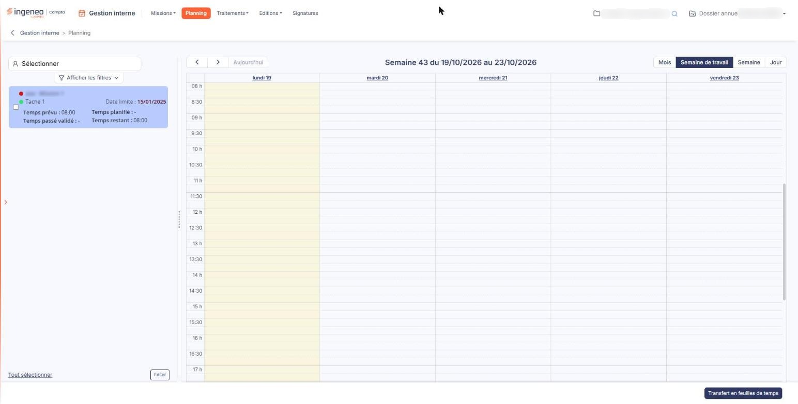
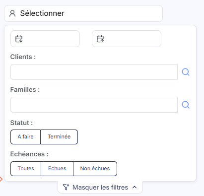
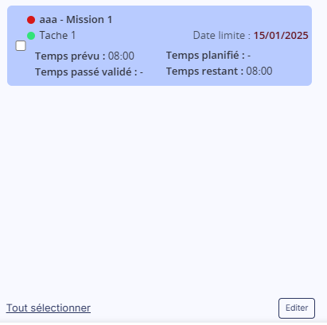

# Planning — liste des échéances


**Où le trouver :** Menu **Planning**



**En bref** — La partie gauche du planning liste les échéances des tâches confiées au collaborateur : ce sont les tâches à positionner dans son agenda.

* Pour restreindre la liste : dépliez ▼ Afficher les filtres ▼ et modifiez un critère, la liste se recharge d'elle-même.
* Pour agir sur toutes les tâches affichées : bouton \[Tout sélectionner], puis bouton \[Fin de tâche] ou bouton \[Restaurer tâche] selon le statut retenu.


La partie gauche de l'écran du planning présente la liste des échéances des tâches confiées au collaborateur dont vous affichez le planning : ce sont les tâches à positionner dans son agenda.

<figure><figcaption>
Écran « Planning » de la nouvelle interface
</figcaption></figure>

Une tâche placée dans l'agenda reste dans cette liste, et le logiciel la met à jour à chaque placement, déplacement ou changement de durée d'un créneau.

## Restreindre la liste

<figure><figcaption>
Rubrique « Les filtres »
</figcaption></figure>

Au-dessus de la liste, les filtres vous permettent de ne retenir que certaines échéances : une période, des clients, des familles de tâches, un statut, des échéances échues ou non. Vous les dépliez par **▼ Afficher les filtres ▼** ; aucun bouton ne les applique, la liste se rechargeant d'elle-même dès que vous modifiez l'un d'eux. Ces critères ne portent que sur la liste, jamais sur l'agenda.

Chacun d'eux est décrit dans la page « Planning », rubrique « b) Les filtres ».

## Agir sur plusieurs tâches

<figure><figcaption>
Rubrique « Les commandes de la partie gauche »
</figcaption></figure>

Chaque tâche de la liste porte une case à cocher. Le bouton **\[Tout sélectionner]** les coche toutes d'un coup ; si vous avez restreint la liste par les filtres, seules les tâches affichées sont cochées.

Selon le critère **Statut** retenu dans les filtres, le logiciel vous propose ensuite le bouton **\[Fin de tâche]**, pour terminer les tâches cochées, ou le bouton **\[Restaurer tâche]**, pour les remettre en cours. Le bouton **\[Editer]**, lui, produit une édition de la liste des échéances. Ces trois boutons sont décrits dans la page « Planning », rubrique « c) Les commandes de la partie gauche ».
