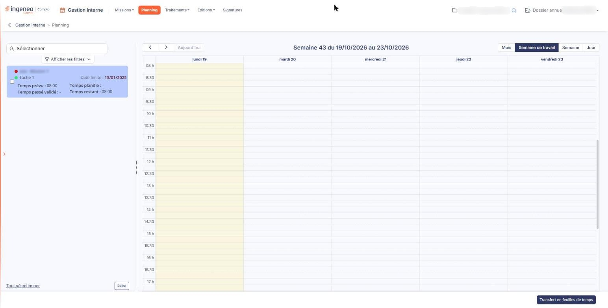
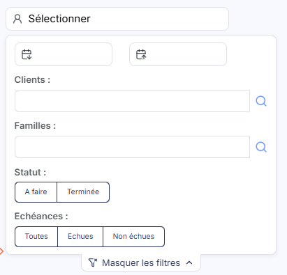
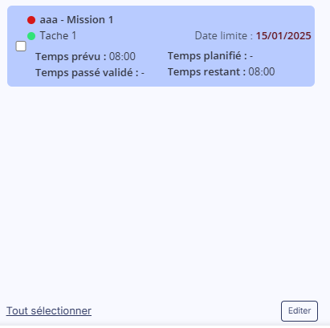

# Planning — positionnement des tâches


**Où le trouver :** Menu **Planning**



**En bref** — Positionner une tâche, c'est lui réserver un créneau dans l'agenda du collaborateur, en la faisant glisser depuis la liste de gauche.

* Pour placer une tâche : faites-la glisser à la souris de la liste de gauche vers le jour et l'heure voulus de l'agenda.
* Pour la déplacer ou changer sa durée : faites glisser son créneau, ou étirez-le ; la modification est enregistrée aussitôt.


Positionner une tâche, c'est lui réserver un créneau dans l'agenda du collaborateur. Les tâches à positionner sont celles de la liste qui occupe la partie gauche de l'écran du planning.

<figure><figcaption>
Écran « Planning » de la nouvelle interface
</figcaption></figure>

## Placer une tâche dans l'agenda

Vous faites glisser la tâche, à la souris, de la liste de gauche vers l'agenda, et vous la déposez sur le jour et l'heure voulus. Le créneau ainsi créé reprend le temps prévu de l'échéance ; une échéance sans temps prévu occupe une heure.

La tâche reste dans la liste après avoir été placée : vous pouvez donc la placer en plusieurs fois, sur plusieurs créneaux.

Deux créneaux de l'agenda ne peuvent pas se chevaucher.

## Modifier une tâche placée

Vous pouvez déplacer une tâche placée vers un autre créneau en la faisant glisser à la souris, et modifier sa durée en étirant ou en réduisant son créneau. Chaque modification est enregistrée aussitôt, et le logiciel met à jour la liste des tâches de la partie gauche.

Un clic sur une tâche placée ouvre la fenêtre d'édition de l'événement. Dans l'affichage par semaine ou par jour, le créneau porte aussi une case à cocher : un clic sur cette case sélectionne la tâche, ou la désélectionne, sans ouvrir la fenêtre. C'est cette sélection qu'utilisent les boutons du bas de l'écran.

## Une tâche transférée en feuilles de temps

Une fois transférée en feuilles de temps, la tâche placée est verrouillée : elle ne peut plus être ni déplacée, ni modifiée, et un clic sur son créneau n'ouvre plus la fenêtre d'édition. Un cadenas le signale dans le créneau.

Le transfert en feuilles de temps et la suppression de tâches placées se font par les boutons du bas de l'écran, décrits dans la page « Planning », rubrique « e) Les boutons au bas de l'écran ».

## Autres vues de l'écran

<figure><figcaption>
Les filtres
</figcaption></figure>

<figure><figcaption>
Les commandes de la partie gauche
</figcaption></figure>
