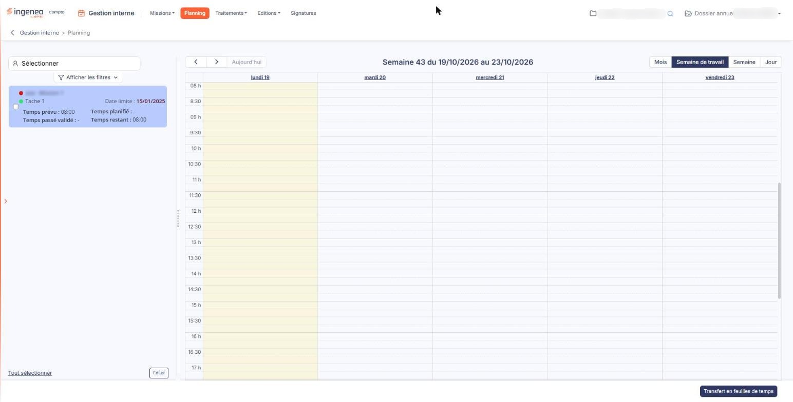
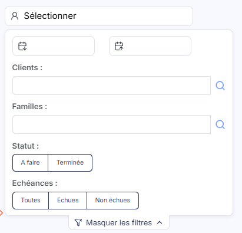
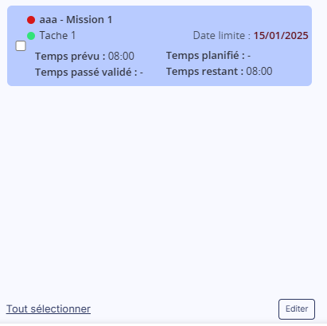

# Planning


**Où le trouver :** Menu **Planning**



**En bref** — Le planning vous permet d'organiser dans le temps les tâches confiées à un collaborateur : la liste de ses tâches à placer à gauche, son agenda à droite.

* Pour afficher le planning d'un collaborateur : choisissez-le dans la liste en haut de la partie gauche, puis restreignez les tâches par ▼ Afficher les filtres ▼.
* Pour terminer des tâches : retenez le statut « A faire » dans les filtres, cochez les tâches, puis bouton \[Fin de tâche].
* Pour reporter des événements dans votre feuille de temps : sélectionnez-les dans l'agenda, puis bouton \[Transfert en feuilles de temps].


Le planning vous permet d'organiser dans le temps les tâches confiées à un collaborateur : vous y voyez ce qu'il a déjà à faire, et vous placez chaque tâche au jour et à l'heure qui conviennent.

<figure><figcaption>
Écran « Planning » de la nouvelle interface
</figcaption></figure>

L'écran se lit en deux parties : à gauche, le collaborateur dont vous vous occupez, les filtres et les commandes qui s'y rapportent ; à droite, son agenda.

Le planning suppose que vous soyez vous-même inscrit comme collaborateur. Si ce n'est pas le cas, le logiciel vous accueille par une fenêtre portant le message « _Vous devez être inscrit en tant que collaborateur pour pouvoir utiliser le planning._ », que vous fermez par le bouton **\[OK]**. L'écran s'affiche alors normalement, mais la liste **Collaborateur** ne vous propose personne : vous ne pouvez donc afficher aucun planning tant que vous n'êtes pas vous-même inscrit comme collaborateur.

## Choisir le collaborateur

**Collaborateur** : la liste placée en haut de la partie gauche, sans libellé à l'écran (son nom n'apparaît qu'en infobulle, et elle affiche « _Sélectionner_ » tant que personne n'est choisi), désigne celui dont vous affichez le planning. À l'ouverture, le logiciel se place sur le collaborateur correspondant à votre propre compte.

## Les filtres

<figure><figcaption>
Rubrique « Les filtres »
</figcaption></figure>

Les filtres sont repliés par défaut. Vous les dépliez par **▼ Afficher les filtres ▼**, et le libellé devient alors **▲ Masquer les filtres ▲** pour les replier.

Ils restreignent la liste des tâches à placer, jamais l'agenda lui-même.

Le bloc vous propose cinq critères, dans cet ordre.

Deux dates, sans libellé à l'écran, que leur infobulle désigne comme **Date de début** et **Date de fin** : la période sur laquelle vous cherchez des tâches. Chacune des deux dates se saisit directement ou se choisit dans un calendrier.

| Champ         | Ce qu'il faut savoir                                                                                                                                                                                 |
| ------------- | ---------------------------------------------------------------------------------------------------------------------------------------------------------------------------------------------------- |
| **Clients**   | Les clients dont vous voulez voir les tâches. Le champ accepte plusieurs clients à la fois : vous saisissez les premières lettres et le logiciel vous propose ceux qui correspondent.                |
| **Familles**  | Les familles de tâches à retenir, de la même façon et également en nombre. Ces familles se gèrent dans le panneau Paramètres, sous « Données » > « Organisation et temps » > « Familles de tâches ». |
| **Statut**    | Deux choix, **A faire** et **Terminée**. Aucun des deux n'est retenu tant que vous n'en choisissez pas un. Ce critère commande aussi les boutons décrits à la rubrique suivante.                     |
| **Echéances** | Trois choix, **Toutes**, **Echues** et **Non échues**. Aucun des trois n'est retenu tant que vous n'en choisissez pas un.                                                                            |

Aucun bouton n'applique les critères : la liste des tâches à placer se recharge d'elle-même dès que vous modifiez l'un d'eux.

## Les commandes de la partie gauche

<figure><figcaption>
Rubrique « Les commandes de la partie gauche »
</figcaption></figure>

bouton **\[Tout sélectionner]**

Il coche d'un coup toutes les tâches de la liste. Son libellé devient alors **Tout désélectionner**, et un second clic les décoche toutes.

bouton **\[Editer]**

Malgré son nom, il ne sert pas à modifier une tâche : il ouvre une fenêtre de paramètres d'où vous produisez une édition de la liste des échéances.

bouton **\[Fin de tâche]** et bouton **\[Restaurer tâche]**

Ces deux boutons ne sont pas présents en permanence : c'est le critère **Statut** des filtres qui décide lequel s'affiche, et il prend effet dès que vous le modifiez, la liste se rechargeant aussitôt.

* tant qu'aucun statut n'est retenu, aucun des deux n'apparaît ;
* si vous retenez **A faire**, le bouton **\[Fin de tâche]** apparaît : il termine les tâches que vous avez cochées dans la liste, après vous avoir proposé d'y joindre un message ;
* si vous retenez **Terminée**, c'est le bouton **\[Restaurer tâche]** qui apparaît, et il remet en cours les tâches cochées.

Dans les deux cas, si vous n'avez coché aucune tâche, le logiciel vous le signale et n'exécute rien.

## L'agenda

L'agenda occupe la partie droite de l'écran. Les jours sont en colonnes et les heures en lignes, de **00 h** à **23:30** par demi-heures ; à l'ouverture, il est positionné sur le début de la matinée, pour vous éviter de faire défiler.

Quatre boutons commandent ce qui est affiché : bouton **\[Mois]**, bouton **\[Semaine de travail]**, bouton **\[Semaine]** et bouton **\[Jour]**. **Semaine de travail** est le mode par défaut : il présente la semaine en cours, du lundi au vendredi, sans les samedis ni les dimanches, que **Semaine** ajoute. La période affichée est rappelée au-dessus de l'agenda, sous la forme « _Semaine 38 du 14/09/2026 au 18/09/2026_ ».

Deux flèches vous déplacent vers la période précédente et la période suivante, et le bouton **\[Aujourd'hui]** vous ramène à la date du jour.

## Les boutons au bas de l'écran

Deux boutons y figurent, chacun soumis à une autorisation particulière : ils n'apparaissent donc que si votre profil vous les accorde.

bouton **\[Transfert en feuilles de temps]**

Il reporte vers votre feuille de temps les événements que vous avez sélectionnés dans l'agenda, après vous en avoir demandé confirmation. Si vous n'en avez sélectionné aucun, le logiciel vous répond « Veuillez sélectionner des événements à transférer vers votre feuille de temps. ».

bouton **\[Supprimer]**

Il supprime les événements que vous avez sélectionnés dans l'agenda, après vous en avoir demandé confirmation. Si vous n'en avez sélectionné aucun, le logiciel vous répond « Veuillez sélectionner des événements à supprimer. ».
