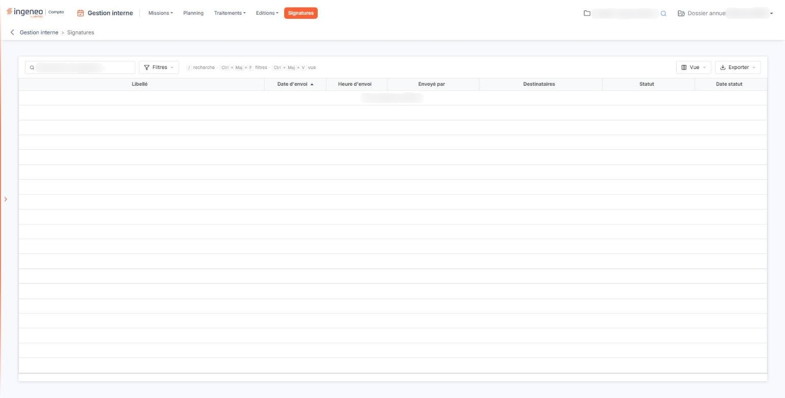

# Signatures


**Où le trouver :** Menu **Signatures**



**En bref** — Cette option vous permet de suivre les lettres de mission adressées en signature électronique et leur état d'avancement.

* Pour suivre une demande : comparez sa Date statut à sa Date d'envoi dans la liste.
* Pour rafraîchir l'avancement d'une demande et récupérer le document signé : utilisez le pictogramme de la ligne qui interroge le service de signature électronique.


Cette option vous permet de suivre les lettres de mission que vous avez adressées en signature électronique. C'est un écran de consultation : la liste s'alimente d'elle-même, chaque envoi en signature y inscrivant une ligne dont l'état d'avancement est ensuite tenu à jour.

<figure><figcaption>
Écran « Signatures » de la nouvelle interface
</figcaption></figure>

Tant que vous n'avez adressé aucune lettre de mission en signature, la liste est vide et affiche « Aucun élément à afficher. ».

Le même écran existe dans d'autres modules, chacun présentant les documents qui lui sont propres : vous ne trouvez donc ici que des lettres de mission.

## La liste des demandes de signature

La liste présente sept colonnes.

| Champ             | Ce qu'il faut savoir                                                                                                                                                                                                                                                                                                                                                                                                                                                                                                       |
| ----------------- | -------------------------------------------------------------------------------------------------------------------------------------------------------------------------------------------------------------------------------------------------------------------------------------------------------------------------------------------------------------------------------------------------------------------------------------------------------------------------------------------------------------------------- |
| **Libellé**       | 
Le nom du document adressé en signature. Pour une lettre de mission, le logiciel le compose lui-même à partir du libellé de la mission et du code du client, sous la forme « LM &#x3C;libellé de la mission> pour le client &#x3C;code client> ». Vous retrouvez donc la mission d'origine sans avoir à ouvrir le document. <strong>Date d'envoi</strong> et <strong>Heure d'envoi :</strong> le moment où la demande de signature a été adressée. La date et l'heure sont portées par deux colonnes distinctes.
 |
| **Envoyé par**    | L'utilisateur qui a demandé la signature.                                                                                                                                                                                                                                                                                                                                                                                                                                                                                  |
| **Destinataires** | Les adresses de courrier électronique auxquelles la demande a été adressée.                                                                                                                                                                                                                                                                                                                                                                                                                                                |
| **Statut**        | L'état d'avancement de la signature. Ce n'est pas le logiciel qui le détermine : c'est le service de signature électronique qui le lui renvoie, et le logiciel l'affiche tel quel.                                                                                                                                                                                                                                                                                                                                         |
| **Date statut**   | La date à laquelle cet état a été constaté pour la dernière fois. Rapprochez-la de la date d'envoi pour savoir depuis combien de temps une demande n'a pas progressé.                                                                                                                                                                                                                                                                                                                                                      |

En tête de liste, trois pictogrammes vous permettent respectivement de choisir les colonnes affichées, d'ouvrir les filtres de colonne et d'imprimer la liste.

## Les commandes de chaque ligne

Chaque ligne peut porter trois pictogrammes, chacun soumis à une autorisation particulière : ils n'apparaissent que si votre profil vous les accorde. L'un vous permet de visualiser le document à l'écran, un autre de le télécharger sur votre poste de travail ; le troisième interroge le service de signature électronique, met à jour le statut et la date de statut de la ligne, et récupère le document signé lorsqu'il est disponible. C'est par lui que vous rafraîchissez l'avancement d'une demande.
