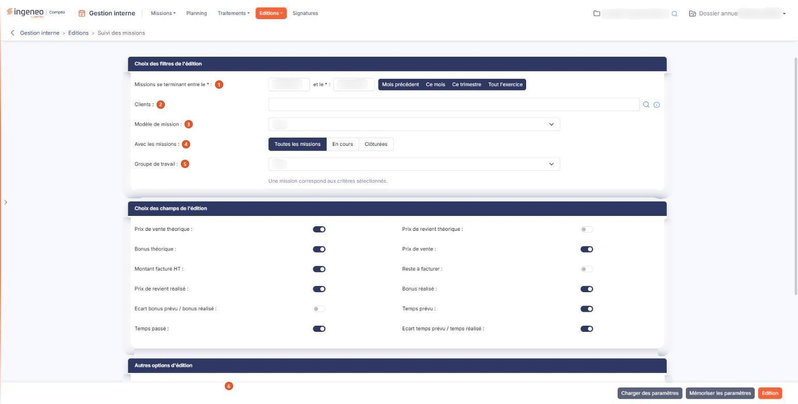
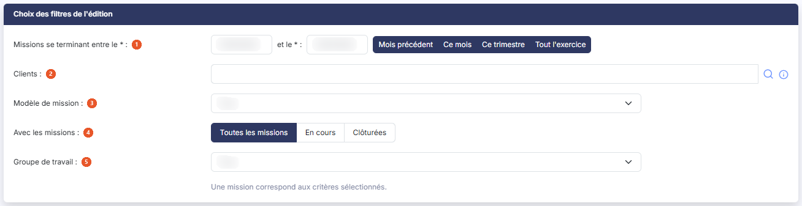
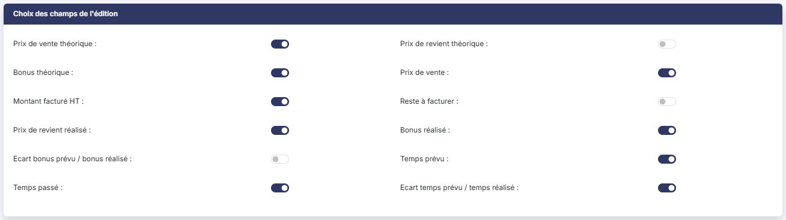
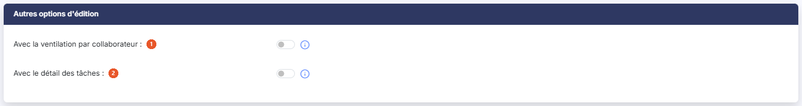
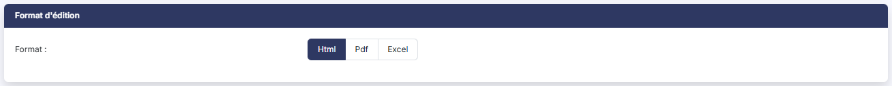

# Suivi des missions


**Où le trouver :** Menu **Editions › Suivi des missions**



**En bref** — Cette édition dresse le bilan de vos missions sur une période : ce qui était prévu, ce qui a été réalisé et l'écart entre les deux.

* Pour produire l'édition : renseignez les dates (ou bouton \[Tout l'exercice]), activez les champs voulus, choisissez le format, puis bouton \[Edition].
* Pour réutiliser vos critères plus tard : bouton \[Mémoriser les paramètres], puis bouton \[Charger des paramètres] pour les retrouver.


Cette édition dresse le bilan de vos missions sur une période : ce qui était prévu, ce qui a été réalisé, et l'écart entre les deux.

<figure><figcaption>
Écran « Suivi des missions » de la nouvelle interface
</figcaption></figure>

Vous choisissez d'abord les missions à retenir, puis les informations à faire figurer dans l'édition, enfin le format du document produit. L'écran est organisé en quatre rubriques, présentées ci-dessous dans l'ordre où elles s'affichent.

## Rubrique « Choix des filtres de l'édition »

<figure><figcaption>
Rubrique « Choix des filtres de l'édition »
</figcaption></figure>

Cette rubrique détermine **quelles missions** entrent dans l'édition.

| Champ                                         | Ce qu'il faut savoir                                                                                                                                                                                                                                                                                                                                                                                                                                                                                                                                                                                                                                                                                          |
| --------------------------------------------- | ------------------------------------------------------------------------------------------------------------------------------------------------------------------------------------------------------------------------------------------------------------------------------------------------------------------------------------------------------------------------------------------------------------------------------------------------------------------------------------------------------------------------------------------------------------------------------------------------------------------------------------------------------------------------------------------------------------- |
| 1. **Missions se terminant entre le… et le…** | 
Les deux dates sont obligatoires ; elles portent sur la <strong>date de fin</strong> de la mission. À l'ouverture de l'écran, le logiciel les pré-remplit avec les dates de l'exercice en cours ; vous restez libre de les modifier. Quatre boutons vous évitent de saisir les dates les plus courantes : - bouton <strong>[Mois précédent]</strong> : du premier au dernier jour du mois qui précède le mois en cours ; - bouton <strong>[Ce mois]</strong> : du premier au dernier jour du mois en cours ; - bouton <strong>[Ce trimestre]</strong> : du premier au dernier jour du trimestre civil en cours ; - bouton <strong>[Tout l'exercice]</strong> : les dates de l'exercice en cours.
 |
| 2. **Clients**                                | Restreint l'édition aux missions des clients que vous désignez. Laissé vide, il ne restreint rien.                                                                                                                                                                                                                                                                                                                                                                                                                                                                                                                                                                                                            |
| 3. **Modèle de mission**                      | Restreint l'édition aux missions issues d'un même modèle. La valeur « Tous » ne restreint rien.                                                                                                                                                                                                                                                                                                                                                                                                                                                                                                                                                                                                               |
| 4. **Avec les missions**                      | Trois valeurs — « Toutes les missions », « En cours », « Clôturées ».                                                                                                                                                                                                                                                                                                                                                                                                                                                                                                                                                                                                                                         |
| 5. **Groupe de travail**                      | Restreint l'édition aux missions d'un groupe de travail. La valeur « Tous » ne restreint rien.                                                                                                                                                                                                                                                                                                                                                                                                                                                                                                                                                                                                                |

Sous ces filtres, le logiciel affiche en permanence le nombre de missions retenues : « _Une mission correspond aux critères sélectionnés._ », et « _Aucune mission ne correspond aux critères sélectionnés._ » lorsque aucune ne convient.

## Rubrique « Choix des champs de l'édition »

<figure><figcaption>
Rubrique « Choix des champs de l'édition »
</figcaption></figure>

Cette rubrique détermine **ce que l'édition montre** de chaque mission retenue. Douze interrupteurs vous sont proposés ; chacun activé ajoute sa colonne à l'édition, chacun désactivé la retire.

Ils se lisent en trois familles.

**Le théorique** — ce qui était prévu quand la mission a été montée : **Prix de vente théorique**, **Prix de revient théorique**, et **Bonus théorique**, qui est la différence des deux.

**Le réalisé** — ce que la mission a effectivement produit : **Prix de vente**, **Montant facturé HT**, **Reste à facturer** (le prix de vente diminué du montant déjà facturé), **Prix de revient réalisé**, et **Bonus réalisé**, qui est le montant facturé diminué du prix de revient réalisé. Deux champs de durée s'y rattachent : **Temps prévu** et **Temps passé**.

**Les écarts** — la comparaison des deux familles précédentes : **Ecart bonus prévu / bonus réalisé**, soit le bonus réalisé diminué du bonus théorique, et **Ecart temps prévu / temps réalisé**, soit le temps passé diminué du temps prévu.

## Rubrique « Autres options d'édition »

<figure><figcaption>
Rubrique « Autres options d'édition »
</figcaption></figure>

| Champ                                        | Ce qu'il faut savoir                                                                                                                                                                                                                                                                                                                                                                                                                                 |
| -------------------------------------------- | ---------------------------------------------------------------------------------------------------------------------------------------------------------------------------------------------------------------------------------------------------------------------------------------------------------------------------------------------------------------------------------------------------------------------------------------------------- |
| 1. **Avec la ventilation par collaborateur** | 
L'édition inclut le détail des temps de chaque collaborateur dans une colonne distincte. Cette option n'est proposée que si vous avez retenu au moins un des trois champs de temps de la rubrique précédente — <strong>Temps prévu</strong>, <strong>Temps passé</strong> ou <strong>Ecart temps prévu / temps réalisé</strong>. Si vous les désactivez tous les trois, le logiciel la désactive : il n'y aurait plus de temps à ventiler.
 |
| 2. **Avec le détail des tâches**             | L'édition inclut le détail des tâches de chaque mission.                                                                                                                                                                                                                                                                                                                                                                                             |

## Rubrique « Format d'édition »

<figure><figcaption>
Rubrique « Format d'édition »
</figcaption></figure>

Trois formats vous sont proposés : **Html**, **Pdf** et **Excel**.

## Les boutons au bas de l'écran

Trois boutons y figurent, chacun soumis à une autorisation particulière : ils n'apparaissent donc que si votre profil vous les accorde.

bouton **\[Edition]**

Il produit l'édition, dans le format retenu à la rubrique précédente.

bouton **\[Mémoriser les paramètres]**

Il ouvre une fenêtre qui vous demande de donner un titre au jeu de critères en cours, pour le retrouver ensuite sans avoir à tout ressaisir.

bouton **\[Charger des paramètres]**

Il ouvre la fenêtre « Chargement des paramètres », qui présente vos jeux mémorisés dans une liste à une seule colonne, **Titre**.

Cliquez sur une ligne pour recharger le jeu correspondant : l'écran se repositionne alors sur ses critères. Le pictogramme « Supprimer » de la ligne efface le jeu mémorisé, et le bouton **\[Fermer]** referme la fenêtre sans rien changer.
