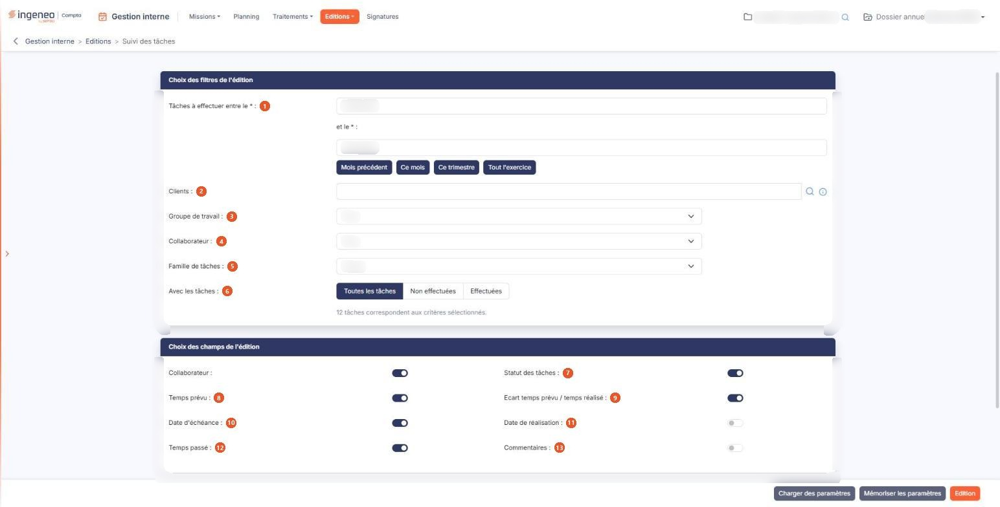
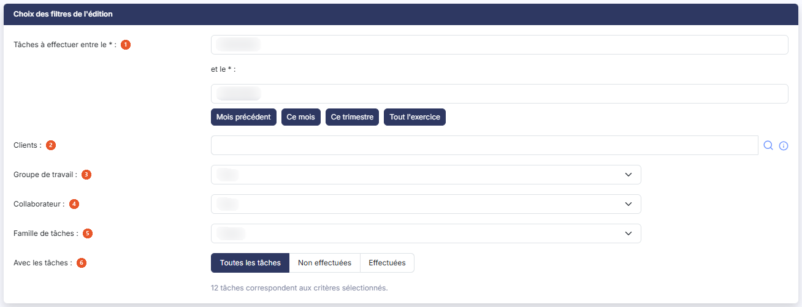
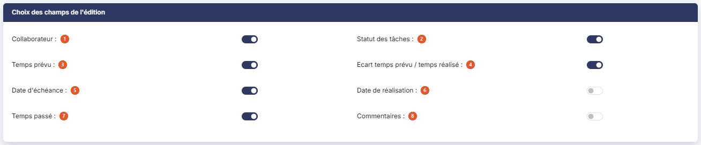
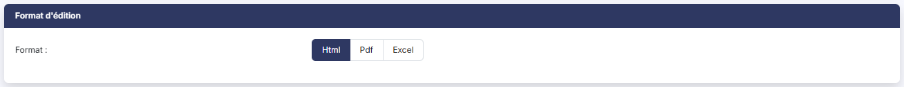

# Suivi des tâches


**Où le trouver :** Menu **Editions › Suivi des tâches**



**En bref** — Cette édition dresse la liste des tâches de vos missions sur une période : qui devait les faire, pour quand, le temps prévu et le temps passé.

* Pour produire l'édition : renseignez les dates (ou bouton \[Ce mois]), choisissez le groupe de travail avant le collaborateur, activez les champs voulus, puis bouton \[Edition].
* Pour réutiliser vos critères plus tard : bouton \[Mémoriser les paramètres], puis bouton \[Charger des paramètres] pour les retrouver.


Cette édition dresse la liste des tâches de vos missions sur une période : qui devait les faire, pour quand, combien de temps elles devaient prendre et combien elles en ont pris.

<figure><figcaption>
Écran « Suivi des tâches » de la nouvelle interface
</figcaption></figure>

Elle est bâtie comme l'édition « Suivi des missions » : vous choisissez d'abord les tâches à retenir, puis les informations à faire figurer dans l'édition, enfin le format du document produit. L'écran est organisé en rubriques, présentées ci-dessous dans l'ordre où elles s'affichent.

## Rubrique « Choix des filtres de l'édition »

<figure><figcaption>
Rubrique « Choix des filtres de l'édition »
</figcaption></figure>

Cette rubrique détermine **quelles tâches** entrent dans l'édition.

| Champ                                      | Ce qu'il faut savoir                                                                                                                                                                                                                                                                                                                                                                                                                                                                                                                                                                                                                                                                                            |
| ------------------------------------------ | --------------------------------------------------------------------------------------------------------------------------------------------------------------------------------------------------------------------------------------------------------------------------------------------------------------------------------------------------------------------------------------------------------------------------------------------------------------------------------------------------------------------------------------------------------------------------------------------------------------------------------------------------------------------------------------------------------------- |
| 1. **Tâches à effectuer entre le… et le…** | 
Les deux dates sont obligatoires ; elles portent sur la <strong>date d'échéance</strong> de la tâche. À l'ouverture de l'écran, le logiciel les pré-remplit avec les dates de l'exercice en cours ; vous restez libre de les modifier. Quatre boutons vous évitent de saisir les dates les plus courantes : - bouton <strong>[Mois précédent]</strong> : du premier au dernier jour du mois qui précède le mois en cours ; - bouton <strong>[Ce mois]</strong> : du premier au dernier jour du mois en cours ; - bouton <strong>[Ce trimestre]</strong> : du premier au dernier jour du trimestre civil en cours ; - bouton <strong>[Tout l'exercice]</strong> : les dates de l'exercice en cours.
 |
| 2. **Clients**                             | Restreint l'édition aux tâches des clients que vous désignez. Laissé vide, il ne restreint rien.                                                                                                                                                                                                                                                                                                                                                                                                                                                                                                                                                                                                                |
| 3. **Groupe de travail**                   | Restreint l'édition aux tâches d'un groupe de travail. La valeur « Tous » ne restreint rien.                                                                                                                                                                                                                                                                                                                                                                                                                                                                                                                                                                                                                    |
| 4. **Collaborateur**                       | Restreint l'édition aux tâches d'un collaborateur. Attention à l'ordre de saisie : dès que vous changez le groupe de travail, le logiciel reconstruit cette liste avec les seuls collaborateurs du groupe retenu, et le collaborateur que vous aviez choisi est perdu. Choisissez donc le groupe d'abord, le collaborateur ensuite.                                                                                                                                                                                                                                                                                                                                                                             |
| 5. **Famille de tâches**                   | Restreint l'édition à une famille. La valeur « Toutes » ne restreint rien.                                                                                                                                                                                                                                                                                                                                                                                                                                                                                                                                                                                                                                      |
| 6. **Avec les tâches**                     | Trois valeurs — « Toutes les tâches », « Non effectuées », qui ne retient que les tâches restant à faire, et « Effectuées », qui ne retient que les tâches terminées.                                                                                                                                                                                                                                                                                                                                                                                                                                                                                                                                           |

Sous ces filtres, le logiciel affiche en permanence le nombre de tâches retenues, sous la forme « _… tâches correspondent aux critères sélectionnés._ », et « _Aucune tâche ne correspond aux critères sélectionnés._ » lorsque aucune ne convient.

## Rubrique « Choix des champs de l'édition »

<figure><figcaption>
Rubrique « Choix des champs de l'édition »
</figcaption></figure>

Cette rubrique détermine **ce que l'édition montre** de chaque tâche retenue. Huit interrupteurs vous sont proposés ; chacun activé ajoute son information à l'édition, chacun désactivé la retire.

Ils vous sont présentés dans cet ordre.

| Champ                                    | Ce qu'il faut savoir                                       |
| ---------------------------------------- | ---------------------------------------------------------- |
| 1. **Collaborateur**                     | Celui à qui la tâche est affectée.                         |
| 2. **Statut des tâches**                 | Indique si la tâche est effectuée ou non.                  |
| 3. **Temps prévu**                       | La durée prévue pour la tâche.                             |
| 4. **Ecart temps prévu / temps réalisé** | Le temps passé diminué du temps prévu.                     |
| 5. **Date d'échéance**                   | La date à laquelle la tâche devait être faite.             |
| 6. **Date de réalisation**               | La date à laquelle elle l'a été.                           |
| 7. **Temps passé**                       | La durée réellement constatée.                             |
| 8. **Commentaires**                      | Ajoute à l'édition les commentaires portés sur les tâches. |

## Rubrique « Format d'édition »

<figure><figcaption>
Rubrique « Format d'édition »
</figcaption></figure>

Trois formats vous sont proposés : **Html**, **Pdf** et **Excel**.

## Les boutons au bas de l'écran

Trois boutons y figurent, chacun soumis à une autorisation particulière : ils n'apparaissent donc que si votre profil vous les accorde.

bouton **\[Edition]**

Il produit l'édition, dans le format retenu à la rubrique précédente.

bouton **\[Mémoriser les paramètres]**

Il ouvre une fenêtre qui vous demande de donner un titre au jeu de critères en cours, pour le retrouver ensuite sans avoir à tout ressaisir.

bouton **\[Charger des paramètres]**

Il ouvre la fenêtre « Chargement des paramètres », qui présente vos jeux mémorisés dans une liste à une seule colonne, **Titre**.

Cliquez sur une ligne pour recharger le jeu correspondant. Le pictogramme « Supprimer » de la ligne efface le jeu mémorisé, et le bouton **\[Fermer]** referme la fenêtre sans rien changer.
