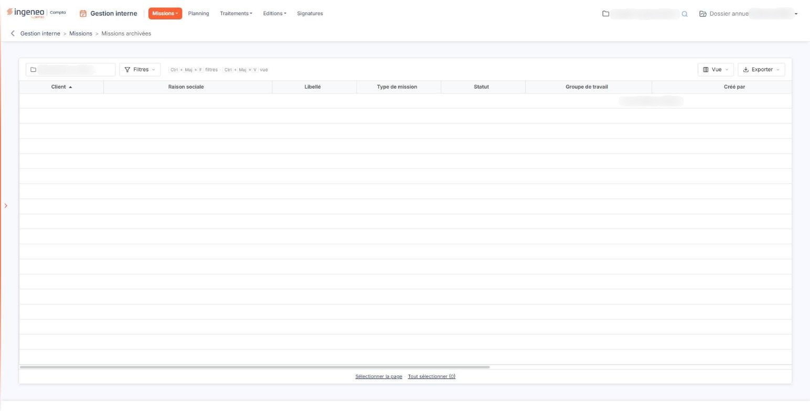

# Missions archivées


**Où le trouver :** Menu **Missions › Missions archivées**



**En bref** — Cette option présente vos missions clôturées, consultables seulement ; elle est le pendant de l'option « Missions en cours ».

* Pour retrouver les missions d'un client : saisissez une partie de son code ou de sa raison sociale dans la zone « Client », puis validez par Entrée.
* Pour remettre des missions en cours : cochez-les, puis bouton \[Déclôturer].


Cette option vous présente les missions clôturées. Elle est le pendant de l'option « Missions en cours » : les deux listes se partagent l'ensemble de vos missions, une mission figurant dans l'une ou dans l'autre selon qu'elle est clôturée ou non.

<figure><figcaption>
Écran « Missions archivées » de la nouvelle interface
</figcaption></figure>

Tant qu'aucune mission n'a été clôturée, la liste affiche « Aucun élément à afficher. ».

## Le critère de sélection

Au-dessus de la liste, un seul critère vous est proposé.

**Client** : la zone n'a pas de libellé à l'écran ; elle affiche « _Client_ » tant qu'elle est vide, et son nom apparaît en infobulle. Vous y saisissez le client dont vous voulez voir les missions archivées. Ce critère porte à la fois sur le code du client et sur sa raison sociale, et il se contente d'une partie du libellé.

Aucun bouton n'applique le critère : la liste se recharge dès que vous validez votre saisie par la touche Entrée ou que vous quittez la zone. Tant que vous ne saisissez rien, la liste présente toutes les missions clôturées.

À gauche de la zone, le pictogramme « Réinitialiser les filtres » est présent en permanence : il vide le critère **Client** et réaffiche la liste complète.

## La liste des missions archivées

La liste présente les mêmes douze colonnes que celle des missions en cours, dans le même ordre : **Client**, **Raison sociale**, **Libellé**, **Type de mission**, **Statut**, **Groupe de travail**, **Créé par**, **Créé le**, **Modèle de lettre de mission**, **Date début**, **Date fin** et **Descriptif**. Le sens de chacune est donné dans la page de l'option « Missions en cours ».

Les deux écrans se présentant de la même façon, retenez ce qui les distingue : ce n'est pas leur contenu visible, c'est le statut des missions qu'ils retiennent. Une mission passe de l'un à l'autre lorsqu'elle est clôturée.

Une mission archivée s'ouvre en consultation seule : le logiciel ne vous laisse pas la modifier tant qu'elle n'est pas déclôturée.

## Le bouton au bas de l'écran

L'écran ne propose qu'un seul bouton, et il n'apparaît que si votre profil vous accorde le droit de clôturer une mission.

bouton **\[Déclôturer]**

Il repasse au statut « en cours » les missions que vous avez cochées dans la liste. La mission quitte alors cette liste pour celle des missions en cours. Si vous n'avez coché aucune ligne, le logiciel vous répond « Veuillez sélectionner au moins une mission à déclôturer. ».
