# Missions en cours


**Où le trouver :** Menu **Missions › Missions en cours**



**En bref** — Cette option liste les missions non clôturées que vous suivez pour vos clients. C'est le point d'entrée du module pour créer, ouvrir, reconduire ou clôturer une mission.

* Pour créer une mission : bouton \[Nouveau].
* Pour clôturer des missions terminées : cochez-les, puis bouton \[Clôturer] et, si des tâches restent ouvertes, bouton \[Confirmer la clôture].
* Pour reconduire des missions : cochez-les, puis bouton \[Reconduire].


Cette option vous présente la liste des missions que vous suivez pour vos clients et qui ne sont pas clôturées. C'est le point d'entrée du module : c'est d'ici que vous ouvrez une mission pour la consulter ou la mettre à jour.

<figure>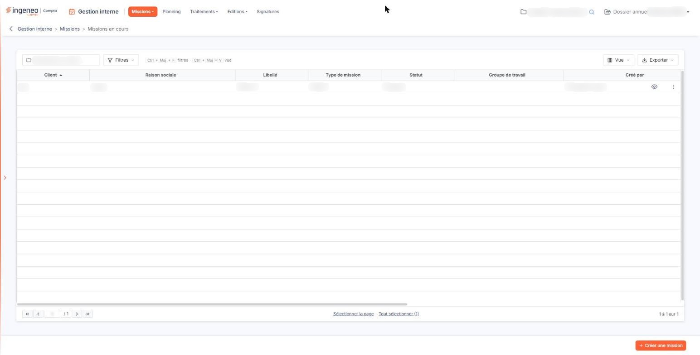<figcaption>
Écran « Missions en cours » de la nouvelle interface
</figcaption></figure>

Une mission clôturée ne figure plus dans cette liste : vous la retrouvez dans l'option « Missions archivées » du même menu.

## Le critère de sélection

Au-dessus de la liste, un seul critère vous est proposé.

**Client** : la zone n'a pas de libellé à l'écran ; elle affiche « _Client_ » tant qu'elle est vide, et son nom apparaît en infobulle. Vous y saisissez le client dont vous voulez voir les missions. Ce critère porte à la fois sur le code du client et sur sa raison sociale, et il se contente d'une partie du libellé : la saisie d'un fragment suffit donc à retrouver un client dont vous ne connaissez pas le code exact.

Aucun bouton n'applique le critère : la liste se recharge dès que vous validez votre saisie par la touche Entrée ou que vous quittez la zone. Tant que vous ne saisissez rien, la liste présente toutes les missions non clôturées.

À gauche de la zone, un pictogramme en forme d'entonnoir barré, infobulle « Réinitialiser les filtres », est présent en permanence : il vide le critère **Client** et réaffiche la liste complète.

## La liste des missions

<figure>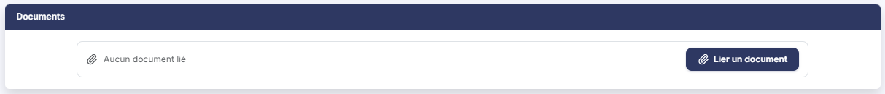<figcaption>
Rubrique « Documents »
</figcaption></figure>

La liste présente douze colonnes, dans cet ordre.

| Champ                           | Ce qu'il faut savoir                                                                                                                                                                                                                                                                                                                                                                                  |
| ------------------------------- | ----------------------------------------------------------------------------------------------------------------------------------------------------------------------------------------------------------------------------------------------------------------------------------------------------------------------------------------------------------------------------------------------------- |
| **Client**                      | Le code du client pour lequel la mission est menée.                                                                                                                                                                                                                                                                                                                                                   |
| **Raison sociale**              | La raison sociale de ce client.                                                                                                                                                                                                                                                                                                                                                                       |
| **Libellé**                     | Le nom que vous avez donné à la mission.                                                                                                                                                                                                                                                                                                                                                              |
| **Type de mission**             | Le modèle de mission sur lequel elle a été bâtie. Ces modèles se gèrent dans le panneau « Paramètres », qui s'ouvre depuis l'entrée « Paramètres » de la barre latérale (affichée en permanence sur le tableau de bord ; sur les autres écrans, elle est masquée et s'ouvre d'un clic sur le bord gauche de l'écran) : choisissez « Modèles », puis, dans l'onglet « Divers », l'entrée « Missions ». |
| **Statut**                      | L'état d'avancement de la mission.                                                                                                                                                                                                                                                                                                                                                                    |
| **Groupe de travail**           | Le groupe auquel la mission est rattachée. La colonne reste vide tant qu'aucun groupe ne lui est affecté.                                                                                                                                                                                                                                                                                             |
| **Créé par**                    | L'utilisateur qui a créé la mission, et **Créé le :** la date de cette création.                                                                                                                                                                                                                                                                                                                      |
| **Modèle de lettre de mission** | 
Le modèle qui sert à produire la lettre de mission. Ces modèles se gèrent dans le panneau « Paramètres », qui s'ouvre depuis l'entrée « Paramètres » de la barre latérale : choisissez « Modèles », puis, dans l'onglet « Documents », l'entrée « Lettres de mission ». <strong>Date début</strong> et <strong>Date fin :</strong> la période couverte par la mission.
                      |
| **Descriptif**                  | Le texte libre que vous avez saisi sur la mission.                                                                                                                                                                                                                                                                                                                                                    |

En tête de liste, trois pictogrammes vous permettent respectivement de choisir les colonnes affichées, d'ouvrir les filtres de colonne et d'imprimer la liste. Une case à cocher y sélectionne toutes les lignes de la page, une seconde étend la sélection à toutes les pages.

## Les commandes d'une ligne

Chaque ligne porte une case à cocher, qui la sélectionne, puis cinq pictogrammes. Ils n'apparaissent que si vos droits vous y autorisent, et chacun porte une infobulle :

* le pictogramme « Crayon », infobulle « Accéder aux paramètres de la mission » : il ouvre la fiche de la mission,
* le pictogramme « Œil », infobulle « Accéder au détail des tâches » : il ouvre le détail des tâches de la mission,
* le pictogramme « Dupliquer », qui recopie la mission,
* le pictogramme « Editer le grand livre » : il ouvre la fenêtre « Edition du Grand Livre » pour le client de la mission. Si la mission n'est rattachée à aucun client, le logiciel affiche le message « Aucun client associé à cette mission. »,
* un pictogramme en forme de corbeille, infobulle « Supprimer ».

## Les boutons au bas de l'écran

<figure><figcaption>
Bouton [Nouveau]
</figcaption></figure>

Quatre boutons y figurent : \[Nouveau], \[Reconduire], \[Clôturer] et \[Supprimer]. Les trois derniers agissent sur les missions que vous avez cochées dans la liste.

bouton **\[Nouveau]**

Il ouvre la fiche d'une nouvelle mission.

bouton **\[Reconduire]**

Il ouvre la fenêtre « Reconduction de missions » pour les missions cochées. Si vous n'en avez coché aucune, le logiciel vous répond « Veuillez sélectionner au moins une mission à reconduire. ».

bouton **\[Clôturer]**

Il clôture les missions cochées, qui quittent alors cette liste pour celle des missions archivées. Si vous n'en avez coché aucune, le logiciel vous répond « Veuillez sélectionner au moins une mission. ».

Si l'une des missions cochées porte des tâches non terminées, le logiciel ouvre la fenêtre « Tâches non terminées » et vous avertit que ces tâches passeront au statut « Terminée » sans affectation de temps et seront supprimées des plannings. Cette fenêtre vous propose deux boutons.

bouton **\[Confirmer la clôture]**

Il poursuit la clôture malgré les tâches non terminées.

bouton **\[Annuler]**

Il ferme la fenêtre sans rien clôturer.

bouton **\[Supprimer]**

Il supprime les missions cochées.

## Autres vues de l'écran

<figure>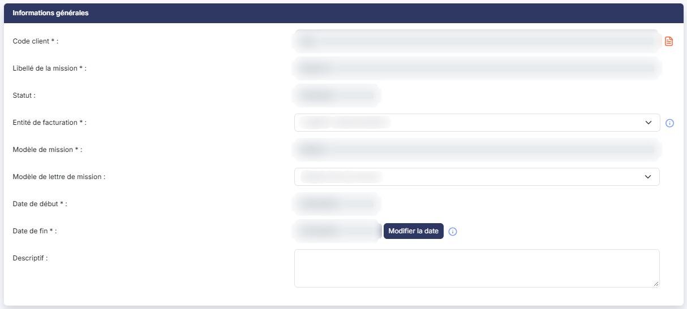<figcaption>
Informations générales
</figcaption></figure>

<figure>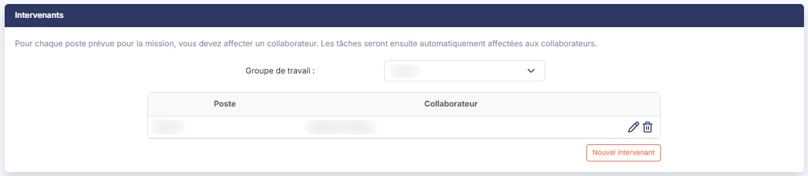<figcaption>
Intervenants
</figcaption></figure>

<figure>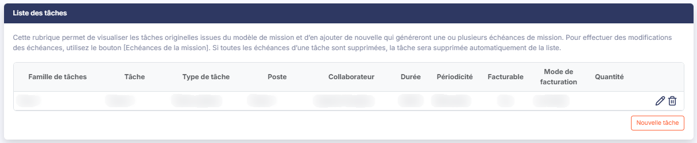<figcaption>
Liste des tâches
</figcaption></figure>

<figure>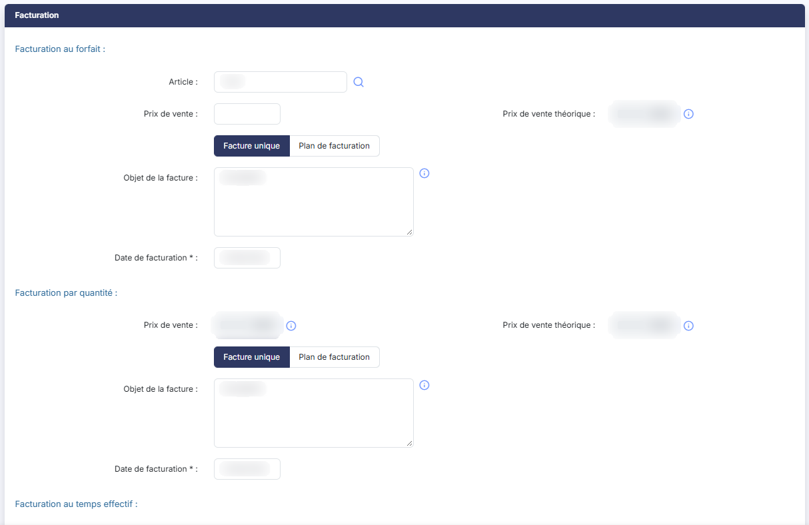<figcaption>
Facturation
</figcaption></figure>

<figure>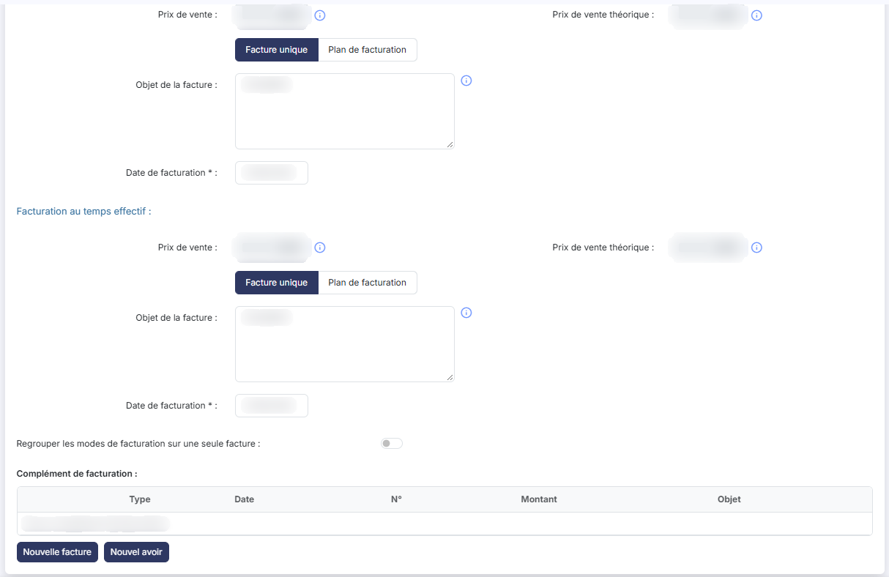<figcaption>
Facturation
</figcaption></figure>

<figure>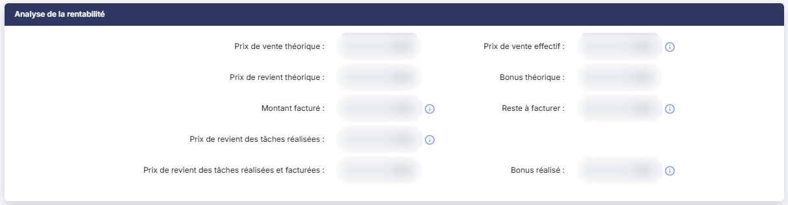<figcaption>
Analyse de la rentabilité
</figcaption></figure>

<figure>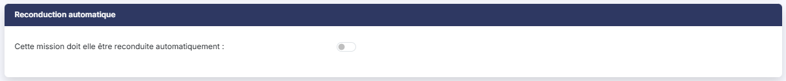<figcaption>
Reconduction automatique
</figcaption></figure>

<figure>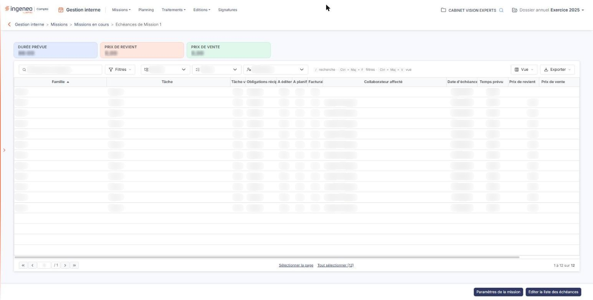<figcaption>
Les totaux de la mission
</figcaption></figure>

<figure>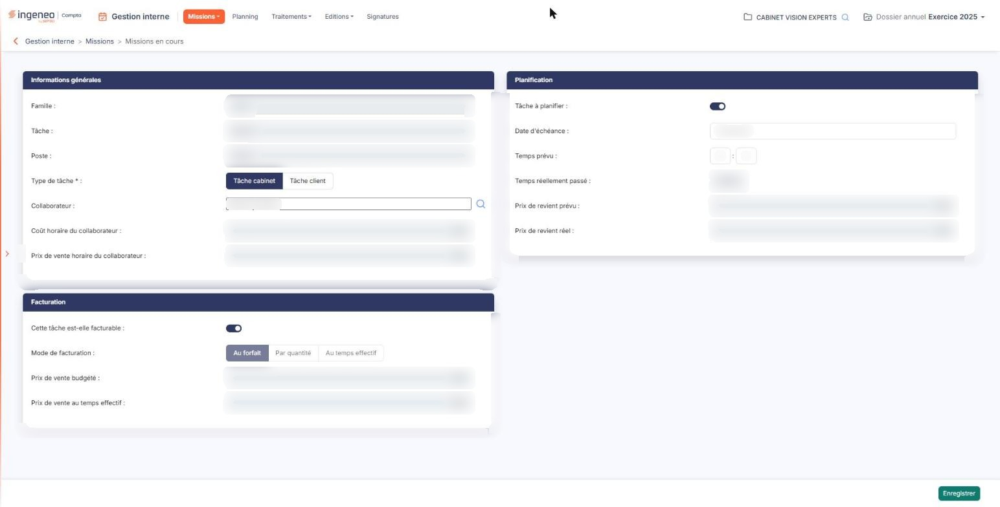<figcaption>
La fiche d'une échéance
</figcaption></figure>

<figure>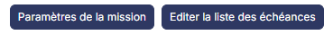<figcaption>
Bouton [Paramètres de la mission]
</figcaption></figure>
