# Missions — échéances des tâches


**Où le trouver :** Menu **Missions › Missions en cours**



**En bref** — L'écran des échéances de la mission présente toutes les échéances de ses tâches, avec leurs temps et montants, et vous permet de les modifier une à une ou de les supprimer.

* Pour modifier une échéance : pictogramme « Crayon » de sa ligne, ajustez la date ou le temps prévu, puis bouton \[Enregistrer].
* Pour supprimer des échéances : cochez-les, puis bouton \[Supprimer].
* Pour revenir à la fiche de la mission : bouton \[Paramètres de la mission].


## Les totaux de la mission

<figure>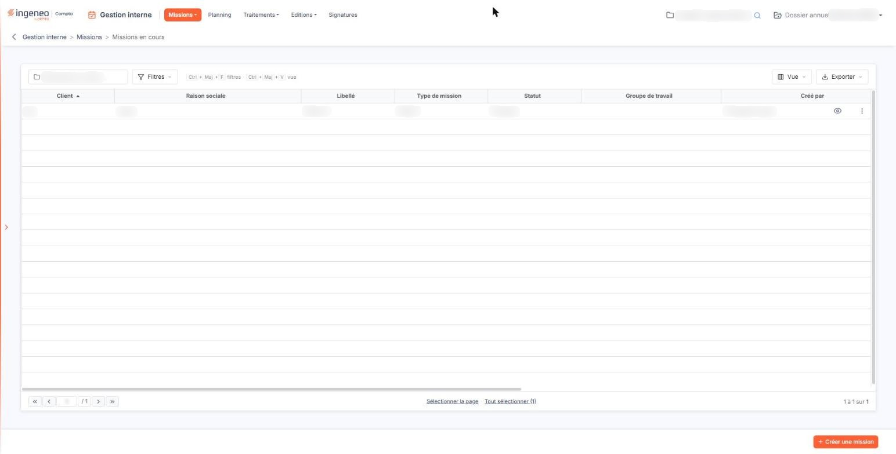<figcaption>
Écran « Missions en cours » de la nouvelle interface
</figcaption></figure>

<figure>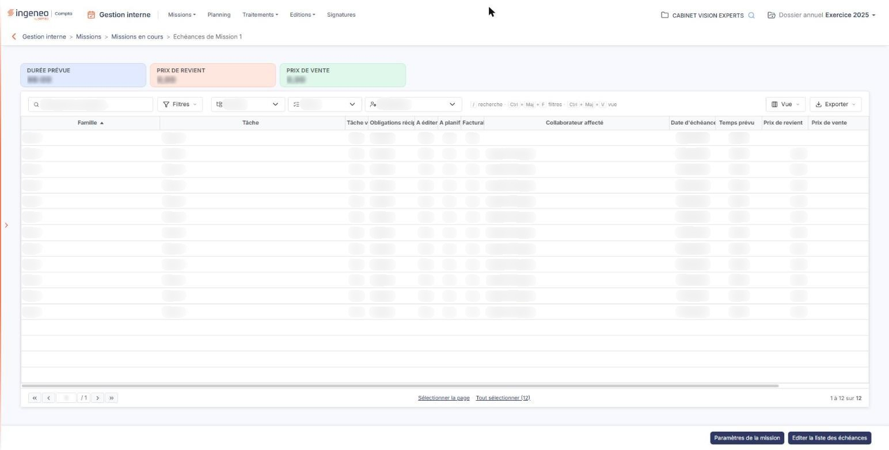<figcaption>
Rubrique « Les totaux de la mission »
</figcaption></figure>

En tête d'écran, trois montants récapitulent l'ensemble des échéances, sans pouvoir être saisis : la **Durée prévue**, le **Prix de revient** et le **Prix de vente**.

## Les filtres

Trois listes, en haut de l'écran, vous permettent de restreindre les échéances affichées. Elles ne portent pas de libellé à l'écran : leur infobulle les nomme. Tant que vous n'y avez rien choisi, une liste retient toutes les échéances.

| Champ           | Ce qu'il faut savoir                                                                                                                                                                                                                                                                  |
| --------------- | ------------------------------------------------------------------------------------------------------------------------------------------------------------------------------------------------------------------------------------------------------------------------------------- |
| **Famille**     | La famille de tâches. Sans choix, la liste affiche « Famille ».                                                                                                                                                                                                                       |
| **Tâche**       | Une tâche de la mission, ou « Toutes ».                                                                                                                                                                                                                                               |
| **Affectation** | À qui l'échéance revient — sans choix, la liste affiche « Affectation » ; sinon « Client » pour les tâches qui incombent au client, « Cabinet - Non affectées » pour les tâches du cabinet qui n'ont pas encore de collaborateur, ou le nom de l'un des collaborateurs de la mission. |

## La liste des échéances

Chaque ligne correspond à une échéance, et porte une case à cocher qui la sélectionne. Les colonnes rappellent la famille et la tâche, puis décrivent l'échéance :

* sa nature : si la tâche est validée, si elle relève des obligations réciproques (cabinet ou client), si elle est à éditer, à planifier, facturable ;
* son affectation et sa date : le **Collaborateur affecté** et la **Date d'échéance** ;
* ses temps et ses montants : le **Temps prévu**, le **Prix de revient**, le **Prix de vente** et le **Temps passé** ;
* son **Statut**, par exemple « A faire ».

Chaque ligne porte un pictogramme « Crayon », infobulle « Modifier », qui ouvre la fiche de l'échéance, et un pictogramme en forme de corbeille, infobulle « Supprimer », qui la supprime.

## La fiche d'une échéance

<figure>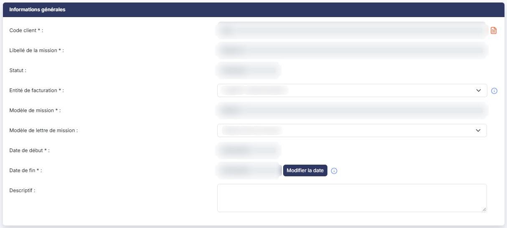<figcaption>
Rubrique « Informations générales »
</figcaption></figure>

<figure>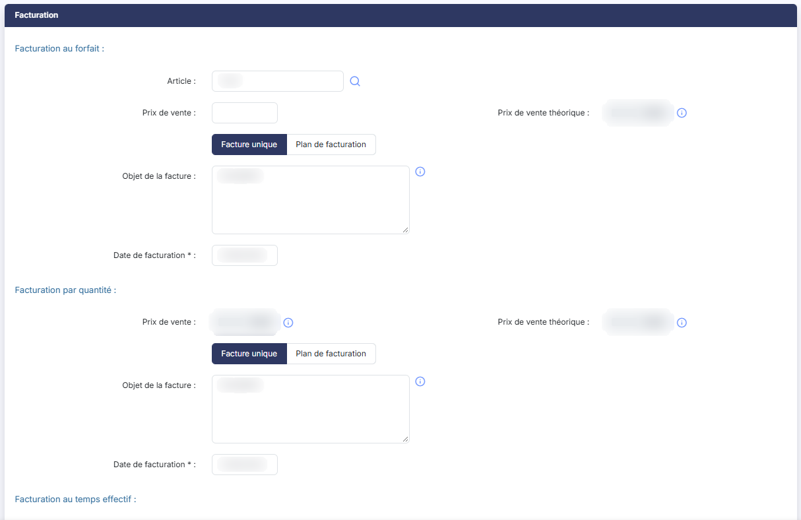<figcaption>
Rubrique « Facturation »
</figcaption></figure>

<figure>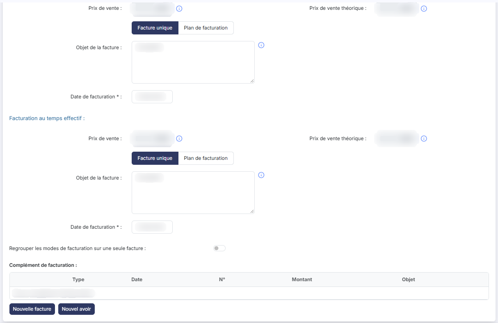<figcaption>
Rubrique « Facturation »
</figcaption></figure>

<figure>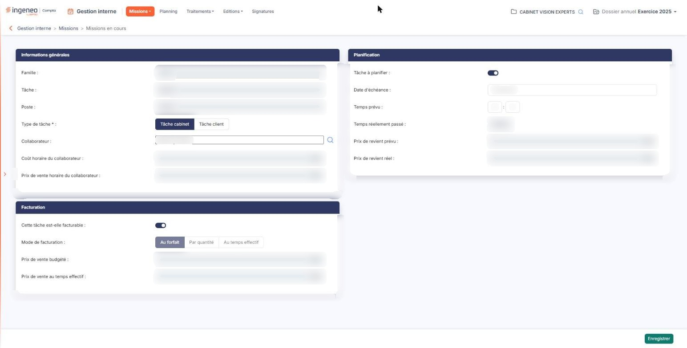<figcaption>
Rubrique « La fiche d'une échéance »
</figcaption></figure>

Elle se présente en trois rubriques.

**Rubrique « Informations générales »**

**Famille**, **Tâche** et **Poste :** affichés pour information, sans pouvoir être modifiés. Le poste est celui que le modèle de mission attribue à la tâche.

| Champ                               | Ce qu'il faut savoir                                                                                                                                                                                                                                                                                                                                                                                                                                                |
| ----------------------------------- | ------------------------------------------------------------------------------------------------------------------------------------------------------------------------------------------------------------------------------------------------------------------------------------------------------------------------------------------------------------------------------------------------------------------------------------------------------------------- |
| **Type de tâche**                   | **Tâche cabinet** ou **Tâche client** : vous pouvez réaffecter l'échéance du cabinet au client, ou inversement.                                                                                                                                                                                                                                                                                                                                                     |
| **Collaborateur**                   | 
Le collaborateur chargé de l'échéance. Vous pouvez en désigner un autre, en le recherchant par le bouton placé à droite du champ. <strong>Coût horaire du collaborateur</strong> et <strong>Prix de vente horaire du collaborateur :</strong> affichés pour information, sans pouvoir être modifiés. <strong>Rubrique « Planification »</strong>
                                                                                                       |
| **Tâche à planifier**               | 
Un interrupteur, indique si l'échéance doit être placée dans le planning. <strong>Date d'échéance</strong> et <strong>Temps prévu :</strong> vous pouvez les modifier. Le temps prévu se saisit en heures et en minutes. <strong>Temps réellement passé</strong>, <strong>Prix de revient prévu</strong> et <strong>Prix de revient réel :</strong> calculés par le logiciel, sans pouvoir être modifiés. <strong>Rubrique « Facturation »</strong>
 |
| **Cette tâche est-elle facturable** | Un interrupteur.                                                                                                                                                                                                                                                                                                                                                                                                                                                    |

**Mode de facturation :Au forfait**, **Par quantité** ou **Au temps effectif**.

**Prix de vente budgété** et **Prix de vente au temps effectif :** calculés par le logiciel, sans pouvoir être modifiés.

Le bouton **\[Enregistrer]** retient vos modifications. La fiche ne porte pas de bouton de retour : pour revenir à la liste des échéances sans rien enregistrer, cliquez sur la flèche « Revenir en arrière », à gauche du fil d'Ariane, en haut de l'écran.

## Les boutons au bas de l'écran

<figure>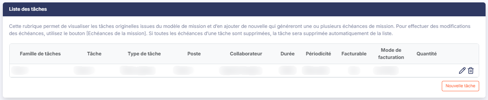<figcaption>
Rubrique « Liste des tâches »
</figcaption></figure>

<figure><figcaption>
Bouton [Paramètres de la mission]
</figcaption></figure>

bouton **\[Paramètres de la mission]**

Il vous ramène à la fiche de la mission.

bouton **\[Editer la liste des échéances]**

Il produit une édition de la liste des échéances de la mission.

bouton **\[Supprimer]**

Il supprime les échéances que vous avez cochées. Une échéance qui a déjà été placée dans le planning ne peut pas être supprimée : le logiciel vous l'indique en citant sa date, et s'arrête à cette échéance.

Lorsque toutes les échéances d'une tâche sont supprimées, la tâche disparaît de la liste des tâches de la mission.

**Revenir à la liste des missions**

L'écran ne porte pas de bouton de retour : pour revenir à la liste des missions, cliquez sur la flèche « Revenir en arrière », à gauche du fil d'Ariane, en haut de l'écran.

## Autres vues de l'écran

<figure>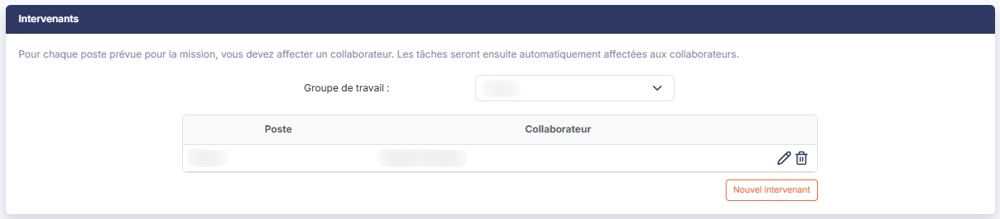<figcaption>
Intervenants
</figcaption></figure>

<figure>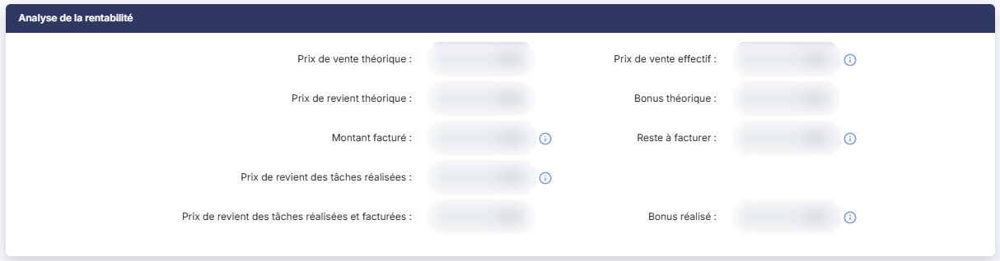<figcaption>
Analyse de la rentabilité
</figcaption></figure>

<figure>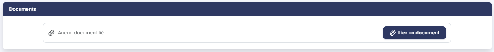<figcaption>
Documents
</figcaption></figure>

<figure>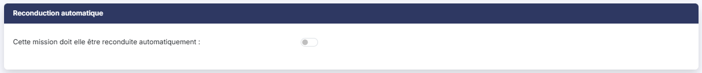<figcaption>
Reconduction automatique
</figcaption></figure>

<figure><figcaption>
Bouton [Nouveau]
</figcaption></figure>
