# Missions — paramètres de la mission


**Où le trouver :** Menu **Missions › Missions en cours**



**En bref** — La fiche d'une mission en réunit les paramètres : client, modèle, période, intervenants, tâches, facturation, rentabilité et reconduction.

* Pour créer une mission : renseignez le Code client, le Libellé de la mission et le Modèle de mission, puis bouton \[Valider les informations générales].
* Pour lancer une mission proposée : complétez intervenants et facturation, puis bouton \[Valider].
* Pour produire ou faire signer la lettre de mission : bouton \[Editer la lettre de mission] ou bouton \[Signer électroniquement].


La fiche d'une mission en réunit les paramètres : le client, le modèle sur lequel elle est bâtie, sa période, les collaborateurs qui y interviennent, ses tâches, sa facturation. Les échéances de ses tâches, elles, se consultent dans un écran distinct, que vous ouvrez par le bouton **\[Echéances de la mission]**.

<figure>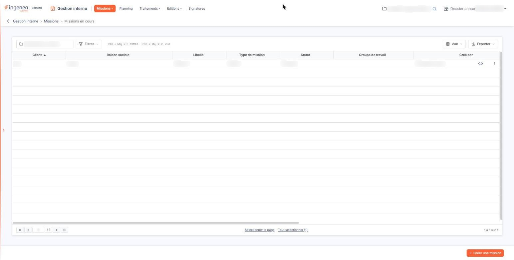<figcaption>
Écran « Missions en cours » de la nouvelle interface
</figcaption></figure>

Vous ouvrez la fiche depuis le menu « Missions », option « Missions en cours » : par le bouton **\[Nouveau]** pour créer une mission, ou par le pictogramme « Crayon » d'une ligne pour consulter et modifier une mission existante.

La fiche ne se présente pas de la même façon dans les deux cas. À la création, elle ne comporte que trois rubriques : « Informations générales », « Intervenants » et « Liste des tâches ». Les rubriques « Facturation », « Analyse de la rentabilité », « Documents » et « Reconduction automatique » s'ajoutent sur une mission déjà enregistrée. Elles sont décrites ci-dessous dans l'ordre où elles s'affichent.

## Rubrique « Informations générales »

<figure>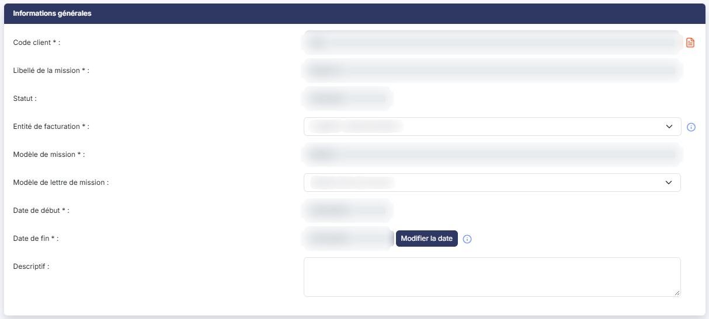<figcaption>
Rubrique « Informations générales »
</figcaption></figure>

| Champ                              | Ce qu'il faut savoir                                                                                                                                                                                                                                                                                                                                                                                                                                                                                                                                                                                                            |
| ---------------------------------- | ------------------------------------------------------------------------------------------------------------------------------------------------------------------------------------------------------------------------------------------------------------------------------------------------------------------------------------------------------------------------------------------------------------------------------------------------------------------------------------------------------------------------------------------------------------------------------------------------------------------------------- |
| 1. **Code client**                 | À la création, vous saisissez le code du client ou vous le recherchez par la loupe placée à droite du champ. Une fois la mission enregistrée, le client ne se modifie plus ; le pictogramme « Editer le grand livre », à droite du champ, vous donne alors accès à l'édition du grand livre de ce client.                                                                                                                                                                                                                                                                                                                       |
| 2. **Libellé de la mission**       | 40 caractères au plus. Un même client ne peut pas avoir deux missions portant le même libellé. Comme le client, le libellé ne se modifie plus une fois la mission enregistrée.                                                                                                                                                                                                                                                                                                                                                                                                                                                  |
| 3. **Statut**                      | Renseigné par le logiciel, vous ne le saisissez pas. Il reste vide pendant la création ; une mission enregistrée et non encore validée porte le statut « Proposée ».                                                                                                                                                                                                                                                                                                                                                                                                                                                            |
| 4. **Entité de facturation**       | C'est la société depuis laquelle les factures de la mission seront générées. L'infobulle du champ le précise : par défaut, il s'agit du cabinet, mais vous pouvez en choisir une autre si vous l'avez définie dans le module « Administration ».                                                                                                                                                                                                                                                                                                                                                                                |
| 5. **Modèle de mission**           | À la création, vous le choisissez dans la liste des modèles enregistrés dans le panneau « Paramètres », rubrique « Modèles », groupe « Divers », option « Missions » (l'écran s'intitule « Modèles de mission »). Dès que vous l'avez choisi, le logiciel remplit les rubriques « Intervenants » et « Liste des tâches » à partir du modèle. Une fois la mission enregistrée, le modèle ne se modifie plus.                                                                                                                                                                                                                     |
| 6. **Modèle de lettre de mission** | 
C'est le modèle qui servira à produire la lettre de mission ; vous le choisissez parmi ceux du panneau « Paramètres », rubrique « Modèles », groupe « Documents », option « Lettres de mission ». <strong>Date de début</strong> et <strong>Date de fin :</strong> obligatoires. À la création, le logiciel les préremplit avec les dates de début et de fin de l'exercice, et vous pouvez les modifier. Comme le rappelle l'infobulle, elles doivent couvrir toute la période pendant laquelle des tâches de la mission sont susceptibles d'être réalisées. La date de fin doit être postérieure à la date de début.
 |
| 7. **Descriptif**                  | Zone de texte libre, limitée à 1 024 caractères.                                                                                                                                                                                                                                                                                                                                                                                                                                                                                                                                                                                |

bouton **\[Modifier la date]**

Sur une mission enregistrée, les dates ne se saisissent plus directement. Tant que la mission a le statut « Proposée », ce bouton, placé à droite de la date de fin, ouvre la fenêtre « Modification de la date de fin », où vous indiquez la nouvelle date de fin. Le logiciel recalcule alors les échéances de la mission.

La nouvelle date doit être différente de l'ancienne et postérieure à la date de début ; sinon, le logiciel refuse la modification et vous en indique le motif.

## Rubrique « Intervenants »

<figure>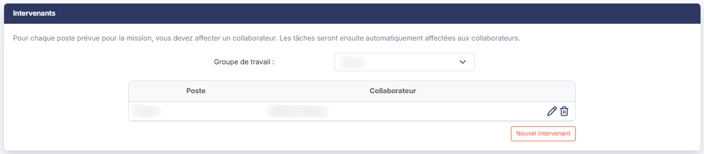<figcaption>
Rubrique « Intervenants »
</figcaption></figure>

Le modèle de mission détermine les postes qui doivent intervenir. Pour chaque poste, vous désignez le collaborateur qui le tiendra : comme l'indique le texte en tête de rubrique, les tâches sont ensuite affectées automatiquement aux collaborateurs.

**Groupe de travail** : la liste des groupes enregistrés dans le panneau « Paramètres », rubrique « Données », groupe « Organisation et temps », option « Groupes de travail (GI) ». Elle propose « Aucun » si la mission n'est rattachée à aucun groupe.

Le tableau présente deux colonnes, **Poste** et **Collaborateur**. Tant que le modèle vient d'être choisi, la colonne **Collaborateur** indique « Aucun » : c'est à vous de la compléter. Chaque ligne porte un pictogramme « Crayon », pour la modifier, et un pictogramme en forme de corbeille, infobulle « Supprimer », pour la supprimer.

Avant que le modèle de mission soit choisi, le tableau est vide.

bouton **\[Nouvel intervenant]**

Il ajoute un intervenant à la mission. Il n'apparaît qu'une fois le modèle de mission choisi.

## Rubrique « Liste des tâches »

<figure>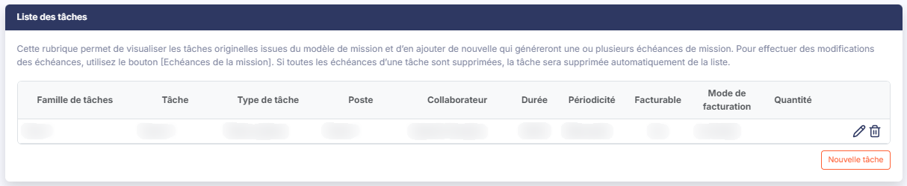<figcaption>
Rubrique « Liste des tâches »
</figcaption></figure>

La rubrique présente les tâches reprises du modèle de mission, et vous permet d'en ajouter. Chaque tâche engendre une ou plusieurs échéances, selon sa périodicité ; ce sont ces échéances que vous retrouvez ensuite par le bouton **\[Echéances de la mission]**, et c'est là qu'elles se modifient. Comme le précise le texte en tête de rubrique, une tâche dont toutes les échéances ont été supprimées disparaît automatiquement de la liste.

Le tableau présente, pour chaque tâche, sa famille et son libellé, son type (tâche cabinet ou tâche client), le poste et le collaborateur qui la tiennent, sa durée et sa périodicité, puis ses informations de facturation : si elle est facturable, son mode de facturation et la quantité.

Chaque ligne porte un pictogramme « Crayon », qui ouvre la fenêtre « Tâche », et un pictogramme en forme de corbeille, dont l'infobulle indique « Annuler ». Avant que le modèle de mission soit choisi, le tableau est vide.

**La fenêtre « Tâche »**

Elle reprend la tâche en trois parties.

* « Informations générales » : la famille et le libellé de la tâche, affichés sans pouvoir être modifiés ; puis le type de tâche (**Tâche cabinet** ou **Tâche client**), le poste, qui est obligatoire, le collaborateur, un descriptif, la durée par défaut — l'infobulle précise qu'il s'agit du temps à passer pour chaque échéance — et la couleur de la tâche.
* « Planification » : **Tâche à planifier**, un interrupteur, et la périodicité — **Personnalisée**, **Mensuelle**, **Trimestrielle**, **Annuelle** ou **Fin de mission**. Pour une périodicité mensuelle, le logiciel vous demande en outre si l'échéance tombe sur le mois en cours ou sur le mois suivant.
* « Facturation » : **Cette tâche est-elle facturable**, un interrupteur, et le mode de facturation — **Au forfait**, **Par quantité** ou **Au temps effectif**.

Le bouton **\[Enregistrer]** retient vos modifications ; le bouton **\[Annuler]** ferme la fenêtre sans rien changer.

bouton **\[Nouvelle tâche]**

Il n'ouvre pas de fenêtre : il ajoute une ligne de saisie dans le tableau. Vous y choisissez d'abord la famille de tâches, puis la tâche. La ligne se valide par son pictogramme de validation, ou s'abandonne par son pictogramme en forme de corbeille, dont l'infobulle indique « Annuler ». Comme le bouton précédent, il n'apparaît qu'une fois le modèle de mission choisi.

## Rubrique « Facturation »

<figure>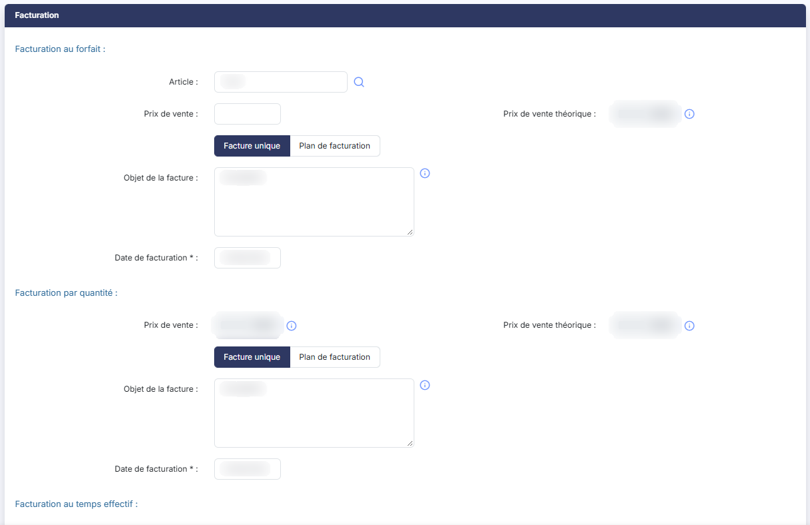<figcaption>
Rubrique « Facturation »
</figcaption></figure>

<figure>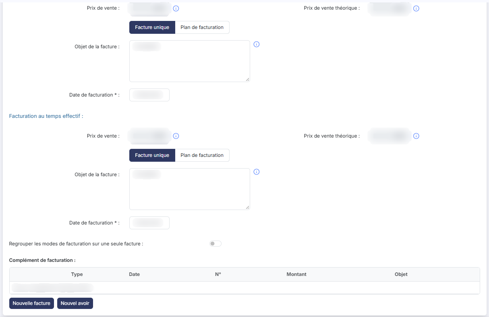<figcaption>
Rubrique « Facturation »
</figcaption></figure>

La rubrique se compose de trois blocs, un par mode de facturation : « Facturation au forfait », « Facturation par quantité » et « Facturation au temps effectif ». Ils portent les mêmes champs, à deux différences près : seul le forfait porte un **Article**, et seul le forfait vous laisse saisir le prix de vente.

| Champ                                                           | Ce qu'il faut savoir                                                                                                                                                                                                                                                                                                                                                                                                                                                                                                                                                                                                                                                                                                                                                                                                                                                                                                                                  |
| --------------------------------------------------------------- | ----------------------------------------------------------------------------------------------------------------------------------------------------------------------------------------------------------------------------------------------------------------------------------------------------------------------------------------------------------------------------------------------------------------------------------------------------------------------------------------------------------------------------------------------------------------------------------------------------------------------------------------------------------------------------------------------------------------------------------------------------------------------------------------------------------------------------------------------------------------------------------------------------------------------------------------------------- |
| 1. **Article**                                                  | Au forfait seulement, le code de l'article facturé. Vous pouvez le rechercher par le bouton placé à droite du champ.                                                                                                                                                                                                                                                                                                                                                                                                                                                                                                                                                                                                                                                                                                                                                                                                                                  |
| 2. **Prix de vente**                                            | Au forfait, vous le saisissez. Par quantité et au temps effectif, il est calculé par le logiciel : l'infobulle précise qu'il correspond à la somme des prix de vente des échéances facturées et des échéances théoriques.                                                                                                                                                                                                                                                                                                                                                                                                                                                                                                                                                                                                                                                                                                                             |
| 3. **Prix de vente théorique**                                  | 
Calculé par le logiciel. L'infobulle précise qu'il correspond à la somme des prix de vente théoriques de toutes les tâches de la mission. Vous choisissez ensuite comment la facturation s'échelonne : <strong>Facture unique</strong> ou <strong>Plan de facturation</strong>.
                                                                                                                                                                                                                                                                                                                                                                                                                                                                                                                                                                                                                                                             |
| 4. **Objet de la facture**                                      | Le texte qui figurera en objet de la facture. Vous pouvez y intégrer le contenu de certains champs de la mission en écrivant leur code entre crochets — par exemple \[GILIBMIS] pour le libellé de la mission. L'infobulle du champ vous donne la liste des champs disponibles et de leurs codes.                                                                                                                                                                                                                                                                                                                                                                                                                                                                                                                                                                                                                                                     |
| 5. **Date de facturation**                                      | 
En <strong>Facture unique</strong>, et présente dans ce seul cas. <strong>Le plan de facturation</strong> Si vous choisissez <strong>Plan de facturation</strong>, la date de facturation disparaît et vous décrivez à la place un échéancier : le <strong>Nombre d'échéances</strong>, la <strong>Périodicité</strong> — <strong>Manuelle</strong>, <strong>Hebdomadaire</strong>, <strong>Bimensuelle</strong>, <strong>Mensuelle</strong> ou <strong>Trimestrielle</strong> — et la <strong>Date première échéance</strong>. Le bouton <strong>[Appliquer]</strong> calcule alors les échéances, qui s'affichent dans un tableau indiquant pour chacune son numéro, son montant, sa date, si sa facture a été générée et validée, et le reste à payer. Le total de l'échéancier doit être égal au prix de vente de la mission, et le nombre d'échéances doit correspondre au tableau : sinon, le logiciel refuse l'enregistrement.
 |
| 6. **Regrouper les modes de facturation sur une seule facture** | Un interrupteur, désactivé par défaut. Si vous l'activez, le logiciel vous propose une seconde option, **Regrouper les factures de cette mission avec celles des autres missions du client**, elle aussi désactivée par défaut.                                                                                                                                                                                                                                                                                                                                                                                                                                                                                                                                                                                                                                                                                                                       |
| 7. **Complément de facturation**                                | Un tableau des factures et avoirs qui s'ajoutent à la facturation de la mission, avec leur type, leur date, leur numéro, leur montant et leur objet. Il s'alimente par le bouton **\[Nouvelle facture]** et par le bouton **\[Nouvel avoir]**.                                                                                                                                                                                                                                                                                                                                                                                                                                                                                                                                                                                                                                                                                                        |
| **Mentionner l'échéance dans le libellé de l'article**          | 
Un interrupteur, désactivé par défaut. <strong>Sous les trois blocs</strong>
                                                                                                                                                                                                                                                                                                                                                                                                                                                                                                                                                                                                                                                                                                                                                                                                                                                                |

## Rubrique « Analyse de la rentabilité »

<figure>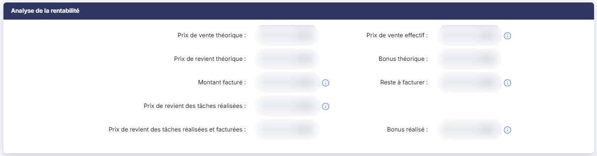<figcaption>
Rubrique « Analyse de la rentabilité »
</figcaption></figure>

Cette rubrique ne se saisit pas : le logiciel y calcule neuf montants, qui rapprochent ce que la mission rapporte de ce qu'elle coûte. D'un côté, les prix de vente — théorique et effectif — et ce qui a été facturé ou reste à facturer ; de l'autre, les prix de revient — théorique, puis celui des tâches réalisées, facturées ou non — et le bonus qui en résulte, théorique et réalisé.

Plusieurs de ces montants portent une infobulle qui en donne la définition. Par exemple, le **Reste à facturer** correspond au prix de vente effectif moins le montant facturé, et le **Bonus réalisé** au montant facturé moins le prix de revient des tâches réalisées et facturées.

## Rubrique « Documents »

<figure>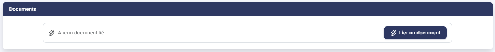<figcaption>
Rubrique « Documents »
</figcaption></figure>

Vous pouvez joindre des documents à la mission — une lettre de mission qui n'a pas été produite par le logiciel, par exemple. Le tableau présente pour chacun sa description, le nom du fichier, sa date et son auteur ; tant qu'aucun document n'est joint, la rubrique affiche « Aucun document lié ». Le bouton **\[Lier un document]** ouvre le volet « Lier un document », où vous choisissez la source du document : « Depuis mon poste » pour un fichier de votre ordinateur, ou « Depuis la GED » pour un document déjà classé dans la GED. Le bouton **\[Lier le document]** le joint à la mission ; le bouton **\[Annuler]** referme le volet sans rien joindre.

## Rubrique « Reconduction automatique »

<figure>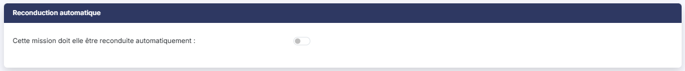<figcaption>
Rubrique « Reconduction automatique »
</figcaption></figure>

**Cette mission doit elle être reconduite automatiquement** : un interrupteur, désactivé par défaut. Activé, le logiciel crée de lui-même, le lendemain de la date de fin de celle-ci, une nouvelle mission de même durée. Comme le précise le texte affiché sous l'option, il faut pour cela que la mission ait été validée et porte le statut « En cours ». Le logiciel vous demande de décrire la nouvelle mission :

* **Statut des nouvelles missions** : obligatoire, **En cours** ou **Proposée**. Une mission créée directement « En cours » n'a pas à être validée ensuite ;
* **Libellé des nouvelles missions** : obligatoire, 40 caractères au plus ;
* **Pourcentage d'inflation** : facultatif, et réservé à une mission au forfait. Si vous le renseignez, le **Niveau de l'arrondi** (**Aucun**, **Entier**, **Dizaine**, **Centaine** ou **Millier**) et la **Borne des arrondis** (**La plus proche**, **Borne inférieure** ou **Borne supérieure**) deviennent obligatoires.

## Les boutons au bas de la fiche

Les boutons présents dépendent de l'état de la mission et de vos droits. À la création, la fiche n'en porte qu'un : le bouton **\[Valider les informations générales]**, qui enregistre la mission et fait apparaître les autres rubriques. Sur une mission au statut « Proposée », vous trouvez les boutons suivants.

bouton **\[Enregistrer]**

Il enregistre vos modifications.

bouton **\[Echéances de la mission]**

Il ouvre la liste des échéances des tâches de la mission, où vous pouvez les consulter, les modifier et les supprimer.

bouton **\[Valider]**

Il valide la mission, après vous en avoir demandé confirmation. Le logiciel enregistre d'abord les modifications en cours de la fiche, puis :

* la mission passe du statut « Proposée » au statut « En cours » ;
* toutes ses échéances sont validées ;
* si la mission a été créée pour un prospect, celui-ci devient client.

bouton **\[Editer la lettre de mission]**

Il produit la lettre de mission selon le modèle de lettre indiqué dans la rubrique « Informations générales ».

bouton **\[Signer électroniquement]**

Il adresse la lettre de mission en signature électronique. Ce bouton est soumis à une autorisation particulière. Les lettres ainsi envoyées se suivent dans le menu « Signatures ».

**Revenir à la liste des missions**

La fiche ne porte pas de bouton de retour, ni à la création ni sur une mission enregistrée : pour revenir à la liste des missions sans rien enregistrer, cliquez sur la flèche « Revenir en arrière », à gauche du fil d'Ariane, en haut de l'écran.

## Autres vues de l'écran

<figure>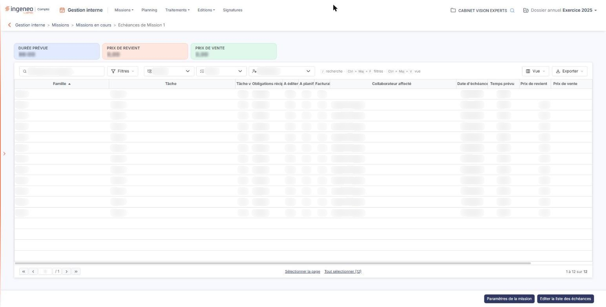<figcaption>
Les totaux de la mission
</figcaption></figure>

<figure>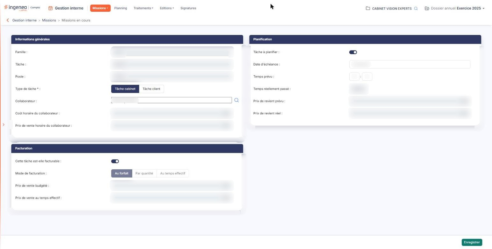<figcaption>
La fiche d'une échéance
</figcaption></figure>

<figure><figcaption>
Bouton [Paramètres de la mission]
</figcaption></figure>

<figure><figcaption>
Bouton [Nouveau]
</figcaption></figure>
