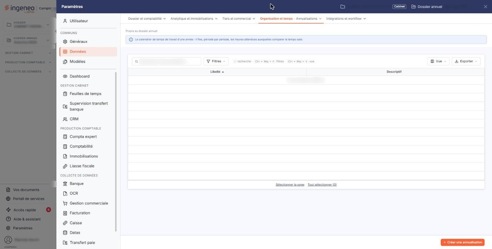
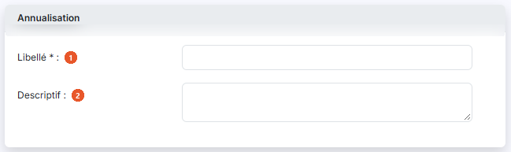
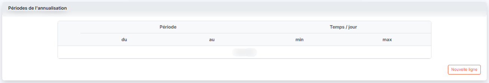

# Annualisations


**Où le trouver :** Panneau **Paramètres** › **Données** › **Organisation et temps** › **Annualisations**



**En bref** — Une annualisation répartit le temps de travail attendu d'un collaborateur sur une année civile, période par période ; elle sert de référence au plan de charge.

* Pour créer une annualisation : bouton \[Nouveau], saisissez le Libellé, puis ajoutez chaque période par le bouton \[Nouvelle ligne].
* Pour l'enregistrer : couvrez l'année du 1er janvier au 31 décembre sans chevauchement, puis bouton \[Enregistrer].


Une annualisation décrit la répartition du temps de travail d'un collaborateur sur une année civile entière : combien d'heures par jour on attend de lui, période par période.

<figure><figcaption>
Écran « Annualisations » de la nouvelle interface
</figcaption></figure>

Elle est faite pour les rythmes qui ne sont pas les mêmes toute l'année — une haute saison et une basse saison, par exemple. Vous la décrivez une fois dans ce fichier, puis vous l'affectez aux collaborateurs concernés depuis leur fiche ; elle se réapplique ensuite d'une année sur l'autre. Un collaborateur n'a pas obligatoirement d'annualisation : à défaut, c'est son horaire hebdomadaire qui fait foi.

C'est cette annualisation que le logiciel prend pour référence lorsqu'il calcule le taux d'occupation d'un collaborateur dans le plan de charge : le temps attendu de lui un jour donné est celui de la période d'annualisation qui couvre ce jour.

Tant qu'aucune annualisation n'est enregistrée, la liste affiche « Aucun élément à afficher. ».

## La liste des annualisations

<figure><figcaption>
Rubrique « Annualisation »
</figcaption></figure>

<figure><figcaption>
Bouton [Nouveau]
</figcaption></figure>

La liste présente deux colonnes.

| Champ             | Ce qu'il faut savoir                                                                                                               |
| ----------------- | ---------------------------------------------------------------------------------------------------------------------------------- |
| 1. **Libellé**    | Le nom que vous donnez à l'annualisation. C'est lui que vous retrouvez sur la fiche du collaborateur au moment de la lui affecter. |
| 2. **Descriptif** | Le commentaire libre que vous avez porté sur l'annualisation.                                                                      |

En tête de liste, un pictogramme vous permet de choisir les colonnes affichées, et une case à cocher sélectionne toutes les lignes.

Au bas de l'écran, le bouton **\[Nouveau]** ouvre la fiche d'une nouvelle annualisation et le bouton **\[Supprimer]** supprime celles que vous avez cochées.

## La fiche d'une annualisation

<figure><figcaption>
Rubrique « Périodes de l'annualisation »
</figcaption></figure>

La fiche comporte deux rubriques, dans cet ordre.

**Rubrique « Annualisation »**

| Champ                                                   | Ce qu'il faut savoir                                                   |
| ------------------------------------------------------- | ---------------------------------------------------------------------- |
| 
<strong>Libellé</strong> <em>Obligatoire</em>
 | Le nom de l'annualisation. L'astérisque indique qu'il est obligatoire. |
| **Descriptif**                                          | Une zone de commentaire libre.                                         |

**Rubrique « Périodes de l'annualisation »**

C'est ici que vous découpez l'année. Tant que vous n'avez rien saisi, le tableau affiche « Liste vide ».

Le tableau se lit sur deux niveaux d'en-tête : **Période**, qui se subdivise en **du** et **au**, et **Temps / jour**, qui se subdivise en **min** et **max**.

Le bouton **\[Nouvelle ligne]**, sous le tableau, ajoute une période. La ligne vous propose alors :

* pour le début et pour la fin de la période, un **Mois :** et un **Jour :** à choisir dans deux listes. Vous remarquerez qu'aucune année ne vous est demandée : c'est voulu, une annualisation se réapplique telle quelle d'une année sur l'autre ;
* pour le temps minimum et pour le temps maximum attendus chaque jour, deux zones, l'une en heures et l'autre en minutes.

Deux pictogrammes terminent la ligne : une coche, qui la valide, et une croix, dont l'infobulle indique « Annuler ».

bouton **\[Enregistrer]**

Il enregistre l'annualisation, après avoir contrôlé les règles décrites ci-dessous.

Pour quitter la fiche sans rien enregistrer et revenir à la liste, utilisez le chevron « Retour » placé à gauche de la barre d'onglets du panneau « Paramètres ». Si vous avez commencé une saisie, le logiciel ouvre la fenêtre « Modifications non enregistrées » : le Bouton \[Continuer sans enregistrer] abandonne la saisie et vous ramène à la liste.

## Les règles que le logiciel contrôle

Une annualisation se compose de périodes. Le logiciel refuse de l'enregistrer tant que ces périodes ne décrivent pas une année civile complète et cohérente, et il vous indique alors précisément ce qui ne va pas :

* « _Les périodes doivent couvrir une année civile entière, sans chevauchement ni interruption._ » — c'est le message général, qui s'affiche dès qu'une des règles suivantes n'est pas respectée ;
* « _Le première période doit commencer au 1 janvier._ » et « _Le dernière période doit se terminer au 31 décembre._ » — l'année doit être couverte d'un bout à l'autre ;
* « _La période doit commencer au lendemain de la période précedente._ » — aucun jour ne doit rester en dehors des périodes ;
* « _Les périodes ne peuvent se chevaucher._ » — un même jour ne peut pas appartenir à deux périodes ;
* « _La date de début d'une période ne peut être supérieure à sa date de fin._ » ;
* « _Le temps de travail minimum ne peut être supérieur au temps maximum._ ».

Une annualisation sans aucune période est refusée elle aussi.
