# Clients


**Où le trouver :** Panneau **Paramètres** › **Données** › **Tiers et commercial** › **Clients**



**En bref** — Le fichier « Clients », commun à plusieurs modules, regroupe les clients auxquels vous rattachez vos missions. Cette page décrit la fiche telle qu'elle se présente depuis la gestion interne.

* Pour créer un client : bouton \[Créer un client], renseignez le Code client, la Raison sociale et le N° de compte auxiliaire, puis bouton \[Enregistrer].
* Pour compléter la fiche à partir des informations publiques : saisissez le N° de Siren, puis bouton \[Lire Siren].
* Pour archiver des clients : sélectionnez-les dans la liste, puis bouton \[Archiver].


Le fichier « Clients » est commun à plusieurs modules d'Ingeneo Compta. Ainsi, où que vous ayez créé ou modifié un client, il sera visible de la même manière dans tous les modules. Dans la gestion interne, ce sont ces clients auxquels vous rattachez vos missions.

<figure>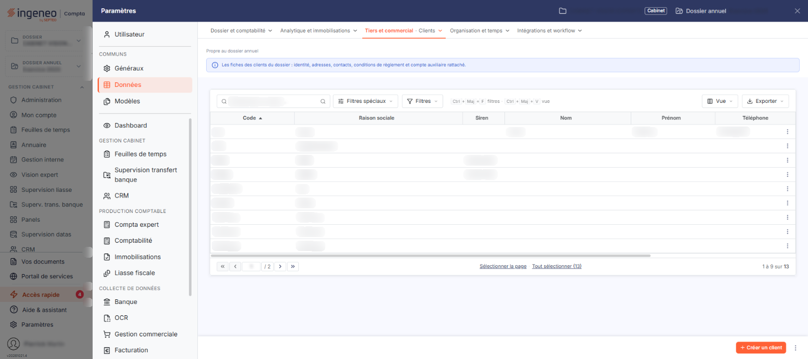<figcaption>
Écran « Clients » de la nouvelle interface
</figcaption></figure>

La fiche client ne présente pas les mêmes rubriques selon le module depuis lequel vous l'ouvrez. Ce chapitre décrit la fiche telle qu'elle se présente **depuis la gestion interne**.

## La liste des clients

La liste s'ouvre depuis l'entrée « Paramètres » de la barre latérale (affichée en permanence sur le tableau de bord ; sur les autres écrans, elle est masquée et s'ouvre d'un clic sur le bord gauche de l'écran), qui affiche le panneau « Paramètres » : choisissez « Données », puis, dans l'onglet « Tiers et commercial », l'entrée « Clients ».

Deux filtres sont proposés au-dessus de la liste.

| Champ                     | Ce qu'il faut savoir                                                                                                                                                                                      |
| ------------------------- | --------------------------------------------------------------------------------------------------------------------------------------------------------------------------------------------------------- |
| **Clients archivés**      | Désactivé par défaut. La liste ne présente alors que les clients non archivés ; activez-le (son infobulle indique « _Inclure les clients archivés_ ») pour y faire apparaître aussi les clients archivés. |
| **Rechercher un client…** | Saisissez le client recherché, ou ouvrez la recherche par le pictogramme « Loupe » : dès que vous avez choisi un client, la liste se restreint à lui.                                                     |

La liste présente sept colonnes : **Code**, **Raison sociale**, **Siren**, **Nom**, **Prénom**, **Téléphone** et **E-mail pro.** Elle est triée par défaut sur le code.

Au-dessus de la liste, le bouton **\[Filtres]** ouvre un volet où vous ajoutez des critères colonne par colonne, le bouton **\[Vue]** vous permet de choisir les colonnes affichées, et le bouton **\[Exporter]** d'imprimer la liste, de l'exporter en Excel ou en PDF, ou de l'envoyer par e-mail.

Un clic sur une ligne la sélectionne ; sous la liste, « Sélectionner la page » et « Tout sélectionner » étendent la sélection à toute la page ou à toutes les pages.

Au survol, chaque ligne porte deux pictogrammes, « Modifier », qui ouvre la fiche du client, et « Dupliquer », ainsi que le pictogramme « Autres actions », dont le menu propose « Supprimer ».

## Les boutons au bas de la liste

<figure><figcaption>
Bouton [Créer un client]
</figcaption></figure>

Le bouton **\[Créer un client]** ouvre la fiche d'un nouveau client. Le pictogramme « Autres actions » placé à sa droite propose « Champs dynamiques » et « Valeurs par défaut ».

Les autres commandes n'apparaissent que lorsque des clients sont sélectionnés, dans le bandeau de sélection au bas de la liste : le bouton **\[Archiver]**, le bouton **\[Supprimer]**, qui supprime les clients sélectionnés, et, à partir de deux clients sélectionnés, le bouton **\[Modification groupée]**.

Un client qui sert ne peut pas être supprimé : le logiciel refuse et vous répond « _Le client "…" ne peut être supprimé car il est lié à des projets, des actions, des opportunités, des pièces commerciales ou des règlements._ ». Un client auquel est rattachée une mission est concerné : dans ce message, vos missions comptent parmi les « projets ». Si vous en supprimez plusieurs à la fois, le logiciel s'arrête sur le premier client concerné.

## Rubrique « Identification »

<figure>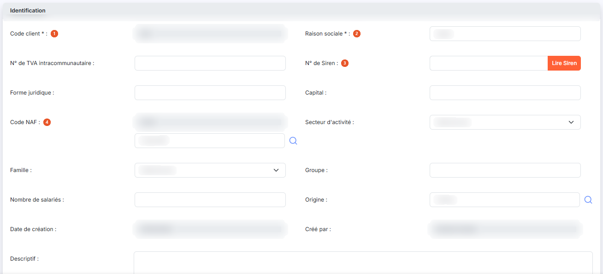<figcaption>
Rubrique « Identification »
</figcaption></figure>

<figure>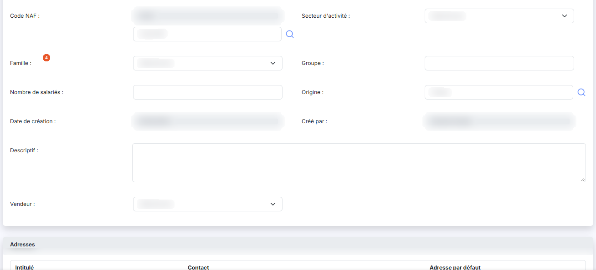<figcaption>
Rubrique « Identification »
</figcaption></figure>

| Champ                 | Ce qu'il faut savoir                                                                                                                                                                                                                                                                                           |
| --------------------- | -------------------------------------------------------------------------------------------------------------------------------------------------------------------------------------------------------------------------------------------------------------------------------------------------------------- |
| 1. **Code client**    | Vous ne le saisissez qu'à la création : sur la fiche d'un client existant, il n'est plus modifiable.                                                                                                                                                                                                           |
| 2. **Raison sociale** | 
 <strong>N° de TVA intracommunautaire</strong>, <strong>Forme juridique</strong>, <strong>Capital</strong>, <strong>Groupe</strong>, <strong>Nombre de salariés</strong>, <strong>Descriptif</strong> : facultatifs, en saisie libre.
                                                                |
| 3. **N° de Siren**    | Le bouton **\[Lire Siren]**, accolé au numéro, va chercher les informations publiques de l'entreprise correspondante : il complète le numéro de TVA intracommunautaire, la forme juridique, le capital, le code NAF, le nombre de salariés et le descriptif, et ajoute son adresse à la rubrique « Adresses ». |
| 4. **Code NAF**       | Le code n'est pas saisissable directement ; vous le choisissez par son libellé, à l'aide du pictogramme « Loupe ».                                                                                                                                                                                             |

**Secteur d'activité**, **Famille** et **Vendeur** : facultatifs, choisis dans une liste. **Origine** : facultatif, avec une loupe de recherche.

**Date de création** et **Créé par** : renseignés par le logiciel, ils ne se modifient pas.

## Rubrique « Adresses »

<figure>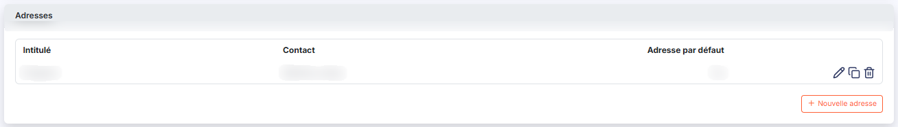<figcaption>
Rubrique « Adresses »
</figcaption></figure>

<figure>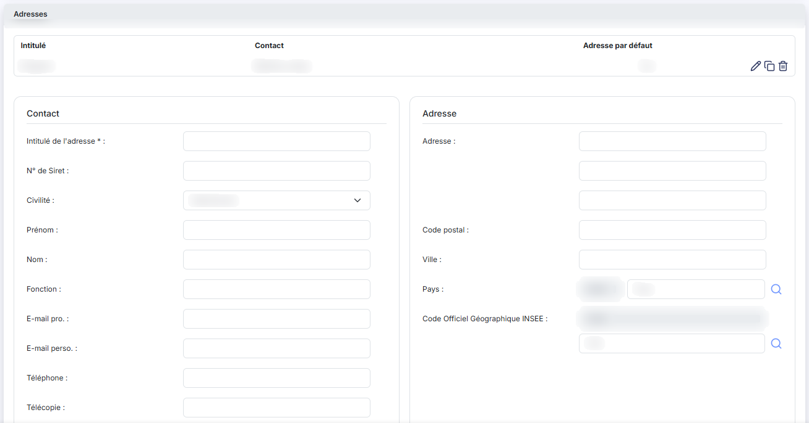<figcaption>
Rubrique « Adresses »
</figcaption></figure>

<figure>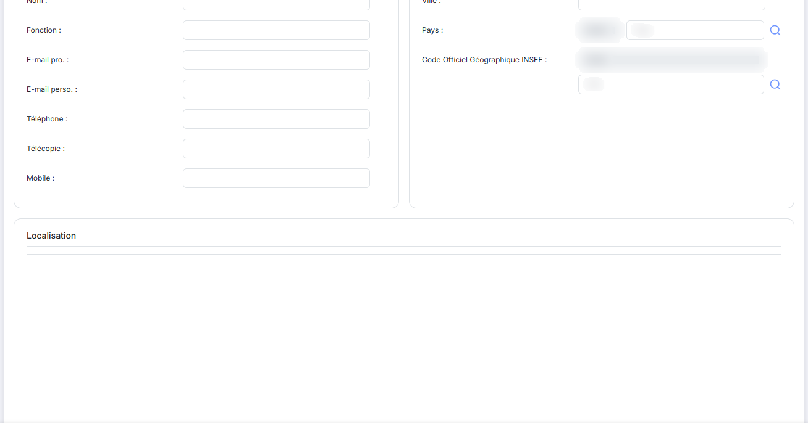<figcaption>
Rubrique « Adresses »
</figcaption></figure>

<figure>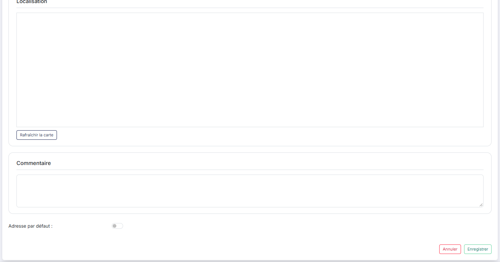<figcaption>
Rubrique « Adresses »
</figcaption></figure>

La rubrique présente les adresses du client sur trois colonnes, **Intitulé**, **Contact** et **Adresse par défaut**, et affiche « Liste vide » tant qu'aucune adresse n'a été saisie. Chaque adresse porte les commandes « Modifier », « Supprimer » et « Dupliquer », et le bouton **\[Nouvelle adresse]** (son libellé est précédé d'un « + ») en ajoute une.

## Rubrique « Informations comptables »

| Champ                       | Ce qu'il faut savoir                                                                                                                                    |
| --------------------------- | ------------------------------------------------------------------------------------------------------------------------------------------------------- |
| **N° de compte auxiliaire** | Il est suivi de son libellé, et son pictogramme d'information rappelle que « _Les caractères autorisés sont les lettres majuscules et les chiffres._ ». |
| **Compte collectif**        | Le compte général auquel se rattache le compte auxiliaire, suivi de son libellé. À la création, un bouton « + » l'accompagne.                           |

Ces deux comptes ne se saisissent qu'à la création : sur la fiche d'un client existant, ils ne sont plus modifiables.

## Rubrique « Informations générales »

<figure>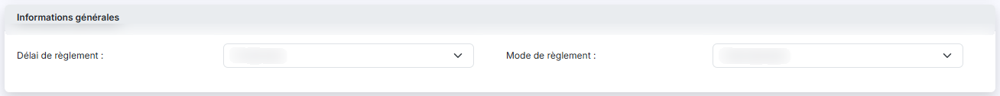<figcaption>
Rubrique « Informations générales »
</figcaption></figure>

**Délai de règlement** (par exemple « 30 jours fin de mois ») et **Mode de règlement** (par exemple « Virement ») : facultatifs, choisis dans une liste.

## Rubrique « Facturation »

<figure>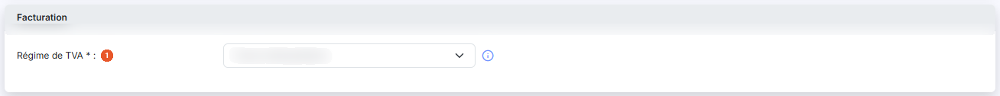<figcaption>
Rubrique « Facturation »
</figcaption></figure>

**Régime de TVA** : obligatoire. Choisissez « DOM-TOM », « Export » ou « France métropolitaine », ce dernier étant proposé par défaut. Le pictogramme d'information précise qu'il est « _Appliqué par défaut et modifiable lors de l'édition d'une pièce commerciale._ ».

## Rubrique « Relances »

<figure>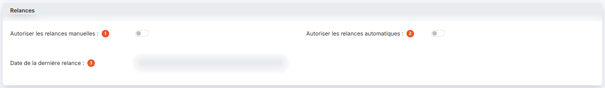<figcaption>
Rubrique « Relances »
</figcaption></figure>

| Champ                                      | Ce qu'il faut savoir                                                                                   |
| ------------------------------------------ | ------------------------------------------------------------------------------------------------------ |
| 1. **Autoriser les relances manuelles**    | Positionné sur « Non ». À « Oui », le logiciel affiche une liste **Scénario**, facultative.            |
| 2. **Autoriser les relances automatiques** | Positionné sur « Non ». À « Oui », le logiciel affiche une liste **Scénario**, obligatoire cette fois. |
| 3. **Date de la dernière relance**         | Présente seulement sur la fiche d'un client existant ; elle ne se saisit pas.                          |

## Rubrique « Coordonnées bancaires »

<figure>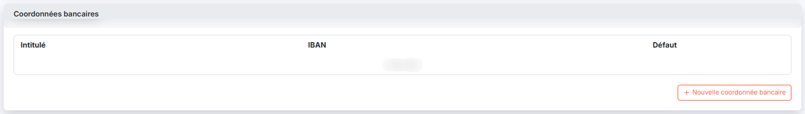<figcaption>
Rubrique « Coordonnées bancaires »
</figcaption></figure>

<figure>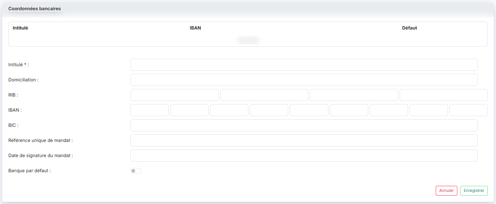<figcaption>
Rubrique « Coordonnées bancaires »
</figcaption></figure>

La rubrique présente les banques du client sur trois colonnes, **Intitulé**, **IBAN** et **Défaut**, et affiche « Liste vide » tant qu'aucune n'a été saisie. Le bouton **\[Nouvelle coordonnée bancaire]** (son libellé est précédé d'un « + ») en ajoute une.

## Rubrique « Documents »

<figure>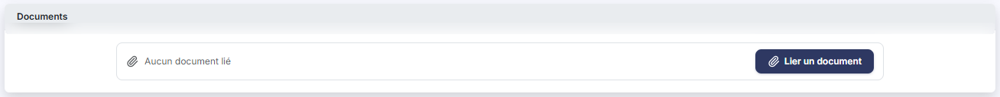<figcaption>
Rubrique « Documents »
</figcaption></figure>

La rubrique présente les documents rattachés au client sur quatre colonnes, **Description**, **Nom du fichier**, **Date** et **Créé par** ; tant qu'aucun n'est rattaché, elle affiche « Aucun document lié ». Le bouton **\[Lier un document]** vous permet d'en rattacher un.

## Rubrique « Editions »

<figure>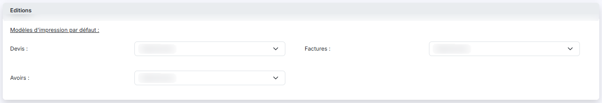<figcaption>
Rubrique « Editions »
</figcaption></figure>

Sous l'intitulé « Modèles d'impression par défaut : », vous pouvez choisir, pour les **Devis**, les **Factures** et les **Avoirs**, le modèle d'impression propre à ce client — par exemple « Modèle facture d'honoraire » pour ses factures.

## Les boutons de la fiche

<figure>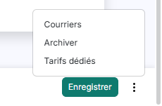<figcaption>
Rubrique « Les boutons de la fiche »
</figcaption></figure>

Le bouton **\[Enregistrer]** enregistre la fiche du client. Pour revenir à la liste sans rien enregistrer, cliquez sur le chevron « Retour », à gauche de la barre d'onglets du panneau.

Le pictogramme « Autres actions », placé à droite du bouton **\[Enregistrer]**, propose aussi « Courriers » et « Tarifs dédiés », ainsi que, sur la fiche d'un client existant seulement, « Archiver ».
