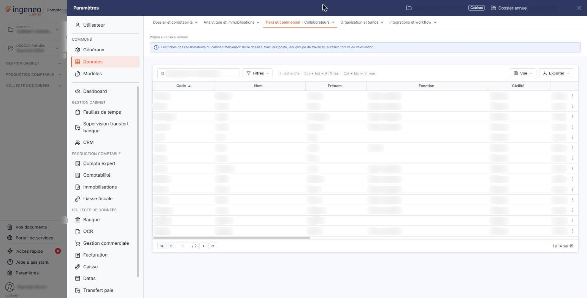
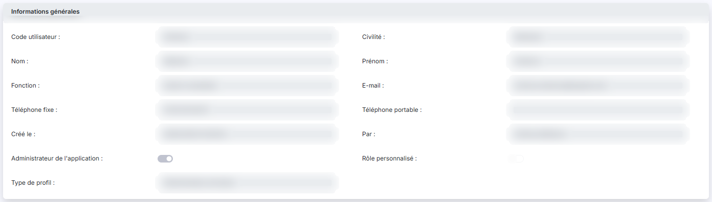
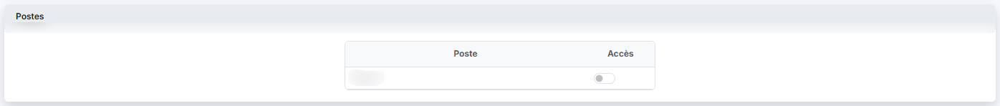
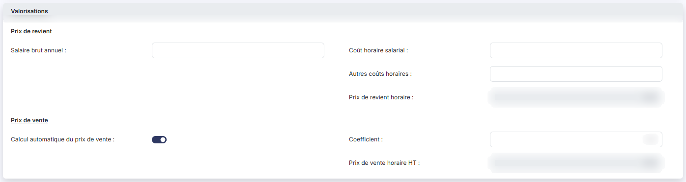
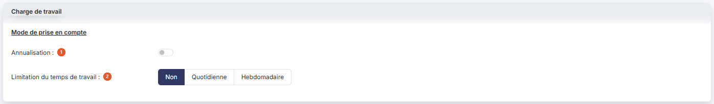
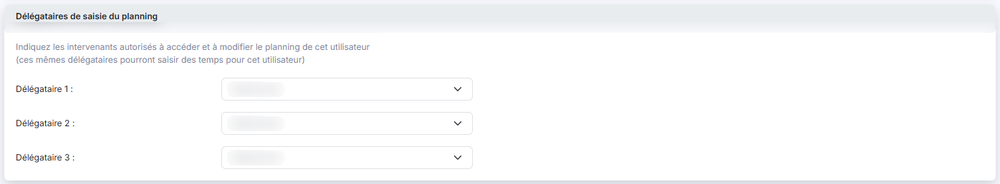

# Collaborateurs


**Où le trouver :** Panneau **Paramètres** › **Données** › **Tiers et commercial** › **Collaborateurs**



**En bref** — Ce fichier complète, pour la gestion interne, la fiche de vos collaborateurs : postes accessibles, valorisations, charge de travail et délégataires du planning. Il ne crée pas de collaborateur.

* Pour compléter un collaborateur : pictogramme « Crayon » de sa ligne, activez ses postes et renseignez ses valorisations, puis bouton \[Enregistrer].
* Pour lui affecter une annualisation : activez « Annualisation » dans la rubrique « Charge de travail », choisissez le Type d'annualisation, puis bouton \[Enregistrer].


Ce fichier complète, pour la gestion interne, la fiche de chacun de vos collaborateurs : les postes qu'il peut occuper, ses valorisations, sa charge de travail et les personnes autorisées à gérer son planning.

<figure><figcaption>
Écran « Collaborateurs » de la nouvelle interface
</figcaption></figure>

Les collaborateurs ne se créent pas ici : cet écran ne comporte aucun bouton de création ni de suppression.

Un collaborateur n'est proposé dans la composition d'un groupe de travail qu'une fois sa fiche enregistrée ici au moins une fois.

## La liste des collaborateurs

La liste est triée par défaut sur le code. Ses colonnes reprennent, dans l'ordre, l'identité du collaborateur (**Code**, **Nom**, **Prénom**, **Fonction**, **E-mail**, téléphones…), puis ses valorisations (**Salaire brut annuel**, **Prix de revient horaire**, **Prix de vente horaire HT**, **Coefficient**…), son **Type d'annualisation**, puis s'il est **Administrateur** et s'il a un **Profil Personnalisé**, par « Oui » ou « Non », et enfin l'auteur de la fiche, **Créé par**. La liste étant plus large que l'écran, faites-la défiler horizontalement pour atteindre les colonnes de droite.

En tête de liste, trois pictogrammes vous permettent de choisir les colonnes affichées, d'ouvrir la fenêtre « Filtres » — un critère par colonne, avec deux conditions combinables — et d'imprimer la liste.

Chaque ligne porte une seule commande, le pictogramme « Crayon », infobulle « Modifier », qui ouvre la fiche du collaborateur.

## Rubrique « Informations générales »

<figure><figcaption>
Rubrique « Informations générales »
</figcaption></figure>

Cette rubrique rappelle l'identité du collaborateur : **Code utilisateur**, **Civilité**, **Nom**, **Prénom**, **Fonction**, **E-mail**, téléphones, date de création et auteur, **Administrateur de l'application**, **Rôle personnalisé** et **Type de profil**. Elle est entièrement en lecture seule : aucun de ces champs ne se modifie ici.

## Rubrique « Postes »

<figure><figcaption>
Rubrique « Postes »
</figcaption></figure>

La rubrique présente, sur deux colonnes **Poste** et **Accès**, tous les postes créés dans le panneau « Paramètres », rubrique « Données », groupe « Organisation et temps », option « Postes (GI) ». Activez l'interrupteur **Accès** des postes que ce collaborateur peut occuper : ce sont les seuls qui vous seront proposés pour lui dans la composition d'un groupe de travail.

Un poste que le collaborateur occupe déjà dans un groupe de travail est affiché « Oui » sans interrupteur, avec un pictogramme d'information qui rappelle « _Ce poste est attribué, vous ne pouvez le désactiver._ ».

## Rubrique « Groupes de travail »

<figure><figcaption>
Rubrique « Groupes de travail »
</figcaption></figure>

Cette rubrique présente, sur trois colonnes **Groupe**, **Poste** et **Tête de groupe**, les groupes de travail dont le collaborateur fait partie. Tant qu'il n'est membre d'aucun groupe, elle affiche « _Ce collaborateur n'est affecté à aucun groupe._ ».

Elle se consulte sans se modifier : c'est dans la fiche du groupe de travail, panneau « Paramètres », rubrique « Données », groupe « Organisation et temps », option « Groupes de travail (GI) », que vous affectez un collaborateur à un groupe.

## Rubrique « Valorisations »

<figure><figcaption>
Rubrique « Valorisations »
</figcaption></figure>

Sous l'intitulé « Prix de revient : », vous saisissez le **Salaire brut annuel**, le **Coût horaire salarial** et les **Autres coûts horaires**. Le **Prix de revient horaire** ne se saisit pas : le logiciel le calcule en additionnant le coût horaire salarial et les autres coûts horaires.

Sous l'intitulé « Prix de vente : », l'interrupteur **Calcul automatique du prix de vente** détermine la façon d'obtenir le **Prix de vente horaire HT** :

* activé, vous saisissez un **Coefficient**, et le logiciel calcule le prix de vente en multipliant le prix de revient horaire par ce coefficient ; le prix de vente n'est alors pas saisissable ;
* désactivé, le champ **Coefficient** disparaît et vous saisissez directement le prix de vente horaire HT.

À la première ouverture de la fiche d'un collaborateur, le calcul automatique est activé et le coefficient vaut 1.

## Rubrique « Charge de travail »

<figure><figcaption>
Rubrique « Charge de travail »
</figcaption></figure>

Sous l'intitulé « Mode de prise en compte : », deux réglages sont proposés.

| Champ                                 | Ce qu'il faut savoir                                                                                                                                                                                                                                                                                                                                                                                                                                                                                                                                                       |
| ------------------------------------- | -------------------------------------------------------------------------------------------------------------------------------------------------------------------------------------------------------------------------------------------------------------------------------------------------------------------------------------------------------------------------------------------------------------------------------------------------------------------------------------------------------------------------------------------------------------------------- |
| 1. **Annualisation**                  | Désactivée par défaut. Si le temps de travail du collaborateur est annualisé, activez-la : le logiciel affiche alors la liste **Type d'annualisation**, dont le pictogramme d'information précise qu'elle « _Permet de définir le nombre d'heures affectables dans le planning_ ». Cette liste propose « Aucune » puis les annualisations créées dans le panneau « Paramètres », rubrique « Données », groupe « Organisation et temps », option « Annualisations ». Tant que l'annualisation est activée, le réglage **Limitation du temps de travail** n'est pas proposé. |
| 2. **Limitation du temps de travail** | 
Proposé lorsque l'annualisation est désactivée. Choisissez « Non », « Quotidienne » ou « Hebdomadaire ». • « Quotidienne » affiche une ligne par jour, du lundi au dimanche, où vous indiquez en heures et minutes le temps de travail de la journée ; le logiciel propose 08:00 du lundi au jeudi, 07:00 le vendredi et 00:00 le samedi et le dimanche ; • « Hebdomadaire » affiche le seul champ <strong>Temps de travail hebdomadaire maximum</strong>, en heures et minutes.
                                                                              |

## Rubrique « Délégataires de saisie du planning »

<figure><figcaption>
Rubrique « Délégataires de saisie du planning »
</figcaption></figure>

Le logiciel vous invite à indiquer « _les intervenants autorisés à accéder et à modifier le planning de cet utilisateur (ces mêmes délégataires pourront saisir des temps pour cet utilisateur)_ ». Vous pouvez en désigner trois, dans les listes **Délégataire 1**, **Délégataire 2** et **Délégataire 3**, qui proposent les autres utilisateurs actifs : le collaborateur de la fiche n'y figure pas.

Ces trois délégataires sont les mêmes que ceux du module « Feuilles de temps » : les désigner ici les désigne aussi là-bas, et inversement.

bouton **\[Enregistrer]**

Il enregistre la fiche du collaborateur et vous ramène à la liste.

Pour quitter la fiche sans rien enregistrer et revenir à la liste, utilisez le chevron « Retour » placé à gauche de la barre d'onglets du panneau « Paramètres ». Si vous avez modifié la fiche, le logiciel ouvre la fenêtre « Modifications non enregistrées » : le Bouton \[Continuer sans enregistrer] abandonne vos modifications et vous ramène à la liste.
