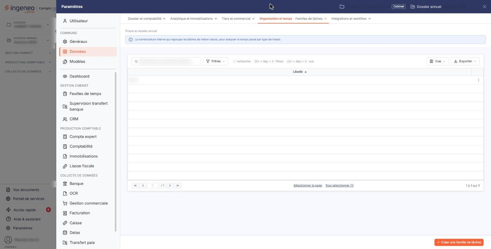
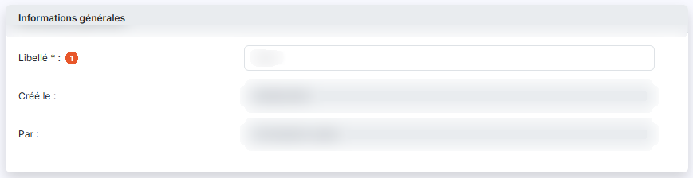

# Familles de tâches


**Où le trouver :** Panneau **Paramètres** › **Données** › **Organisation et temps** › **Familles de tâches**



**En bref** — Les familles de tâches regroupent vos tâches par nature, pour les retrouver plus vite dans une mission et restreindre l'édition « Suivi des tâches ».

* Pour créer une famille : bouton \[Nouveau], saisissez le Libellé, puis bouton \[Enregistrer].
* Pour supprimer des familles inutilisées : cochez-les dans la liste, puis bouton \[Supprimer].


Les familles de tâches servent à regrouper vos tâches par nature — la révision, le juridique, le social, ce que vous voulez. Ce regroupement vous fait ensuite gagner du temps à deux endroits : pour retrouver une tâche au moment de l'ajouter à une mission, et pour restreindre l'édition « Suivi des tâches » à une famille.

<figure><figcaption>
Écran « Familles de tâches » de la nouvelle interface
</figcaption></figure>

C'est le fichier le plus simple du module : une famille de tâches n'est rien d'autre qu'un libellé.

## La liste des familles de tâches

La liste s'ouvre depuis l'entrée « Paramètres » de la barre latérale (affichée en permanence sur le tableau de bord ; sur les autres écrans, elle est masquée et s'ouvre d'un clic sur le bord gauche de l'écran), qui affiche le panneau « Paramètres » : choisissez « Données », puis, dans l'onglet « Organisation et temps », l'entrée « Familles de tâches ».

La liste ne présente qu'une colonne.

**Libellé** : le nom de la famille. C'est lui que vous retrouvez partout où une famille de tâches vous est proposée.

En tête de liste, un pictogramme vous permet de choisir les colonnes affichées, et une case à cocher sélectionne toutes les lignes.

## Les commandes d'une ligne et les boutons au bas de l'écran

<figure><figcaption>
Bouton [Nouveau]
</figcaption></figure>

Chaque ligne porte une case à cocher, qui la sélectionne, puis deux pictogrammes : le pictogramme « Crayon », infobulle « Modifier », qui ouvre la fiche de la famille, et le pictogramme « Supprimer ».

Au bas de l'écran, le bouton **\[Nouveau]** ouvre la fiche d'une nouvelle famille et le bouton **\[Supprimer]** supprime celles que vous avez cochées.

Ces commandes n'apparaissent que si vos droits vous y autorisent.

## La fiche d'une famille de tâches

<figure><figcaption>
Rubrique « La fiche d'une famille de tâches »
</figcaption></figure>

<figure><figcaption>
Bouton [Enregistrer]
</figcaption></figure>

La fiche tient dans une seule rubrique, intitulée « Informations générales », et ne comporte qu'une zone de saisie.

**Libellé** \* : le nom de la famille. L'astérisque indique qu'il est obligatoire.

Sur une famille existante, le logiciel rappelle ensuite **Créé le :** et **Par :**. Ces deux zones ne se modifient pas.

Le bouton **\[Enregistrer]** valide la famille. Pour revenir à la liste sans rien enregistrer, cliquez sur le chevron « Retour », à gauche de la barre d'onglets du panneau.

## Les règles que le logiciel contrôle

Le libellé est obligatoire, il ne peut pas dépasser trente caractères, et deux familles ne peuvent pas porter le même. Le logiciel refuse l'enregistrement dans les trois cas et vous le signale.

Une famille qui sert ne peut pas être supprimée. Si vous tentez de supprimer une famille déjà affectée à une tâche, le logiciel refuse et affiche « _Suppression impossible car la famille … a été affectée à au moins une tâche._ ». Il en va de même si vous en supprimez plusieurs à la fois : il suffit qu'une seule d'entre elles soit affectée pour qu'aucune ne soit supprimée, et le message devient alors « _Suppression impossible car une famille au moins est affectée à une tâche._ ».

Pour supprimer une telle famille, commencez donc par affecter une autre famille aux tâches concernées.
