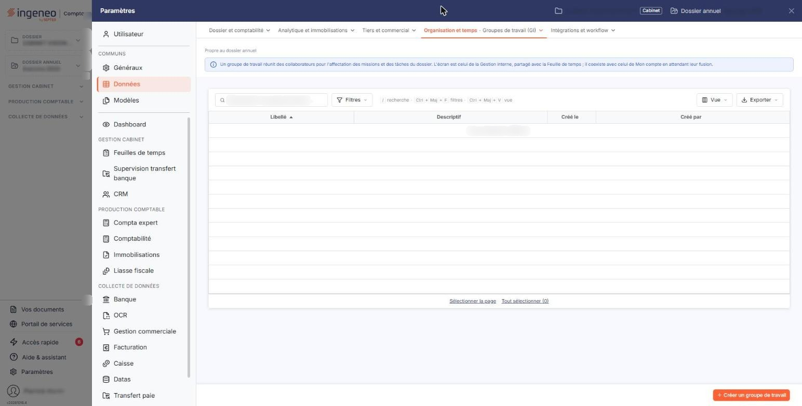
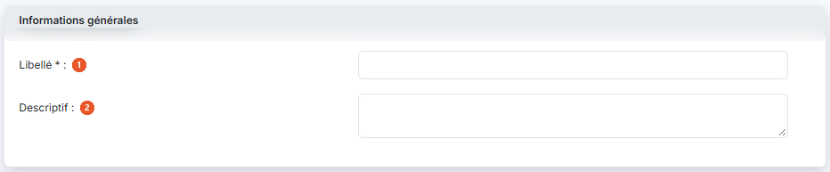
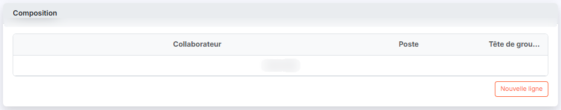

# Groupes de travail


**Où le trouver :** Panneau **Paramètres** › **Données** › **Organisation et temps** › **Groupes de travail**



**En bref** — Les groupes de travail décrivent les équipes du cabinet : des collaborateurs, chacun avec son poste, dont l'un est tête de groupe. Ils se rattachent ensuite à vos missions.

* Pour créer un groupe : bouton \[Nouveau], saisissez le Libellé, puis ajoutez chaque membre par le bouton \[Nouvelle ligne].
* Pour valider le groupe : désignez une tête de groupe, puis bouton \[Enregistrer].


Les groupes de travail décrivent les équipes de votre cabinet : un groupe réunit des collaborateurs, chacun y occupant un poste, et l'un d'eux en est la tête de groupe.

<figure><figcaption>
Écran « Groupes de travail » de la nouvelle interface
</figcaption></figure>

Une fois créés, vos groupes de travail vous sont proposés ailleurs dans le module : dans les missions, dont la liste affiche le groupe de travail de chacune, et comme critère de sélection des éditions « Suivi des missions » et « Suivi des tâches » et de l'écran « Plan de charge ».

## La liste des groupes de travail

<figure><figcaption>
Bouton [Nouveau]
</figcaption></figure>

La liste présente quatre colonnes : **Libellé**, **Descriptif**, **Créé le** et **Créé par**. Elle est triée par défaut sur le libellé. Tant qu'aucun groupe n'a été créé, elle affiche « Aucun élément à afficher. ».

En tête de liste, une case à cocher sélectionne toutes les lignes de la page, une seconde étend la sélection à toutes les pages, et un pictogramme vous permet de choisir les colonnes affichées.

bouton **\[Nouveau]**

Il ouvre la fiche d'un nouveau groupe de travail.

bouton **\[Supprimer]**

Il supprime les groupes de travail que vous avez cochés dans la liste.

Un groupe de travail rattaché à une mission ne peut pas être supprimé : le logiciel refuse et vous répond « _Le groupe de travail "…" ne peut pas être supprimé car il est liée à des missions._ ». Si vous en supprimez plusieurs à la fois, le logiciel s'arrête sur le premier groupe rattaché à une mission.

## Rubrique « Informations générales »

<figure><figcaption>
Rubrique « Informations générales »
</figcaption></figure>

| Champ             | Ce qu'il faut savoir                                                                                                    |
| ----------------- | ----------------------------------------------------------------------------------------------------------------------- |
| 1. **Libellé**    | Signalé par un astérisque. Il est limité à trente caractères, et deux groupes de travail ne peuvent pas porter le même. |
| 2. **Descriptif** | Zone de texte libre.                                                                                                    |

## Rubrique « Composition »

<figure><figcaption>
Rubrique « Composition »
</figcaption></figure>

C'est ici que vous désignez les membres du groupe. Le tableau comporte trois colonnes, **Collaborateur**, **Poste** et **Tête de groupe**, et affiche « Liste vide » tant qu'aucun membre n'y figure.

bouton **\[Nouvelle ligne]**

Placé sous le tableau, il ouvre une ligne en saisie. Vous la validez par le pictogramme « Coche », ou vous l'abandonnez par le pictogramme dont l'infobulle indique « Annuler ».

| Champ              | Ce qu'il faut savoir                                                                                                                                                                                                                                                                                                                                                                                                  |
| ------------------ | --------------------------------------------------------------------------------------------------------------------------------------------------------------------------------------------------------------------------------------------------------------------------------------------------------------------------------------------------------------------------------------------------------------------- |
| **Collaborateur**  | Saisissez le nom recherché, ou ouvrez la recherche par le pictogramme « Loupe », également accessible par le raccourci clavier Ctrl + Alt + R. Cette recherche porte sur les collaborateurs que présente l'écran « Collaborateurs » du panneau Paramètres (onglet Données, groupe « Tiers et commercial »).                                                                                                           |
| **Poste**          | Il ne se saisit pas tant qu'aucun collaborateur n'est choisi. Une fois le collaborateur choisi, le poste se choisit parmi ceux auxquels vous lui avez donné accès dans la rubrique « Postes » de sa fiche de collaborateur.                                                                                                                                                                                           |
| **Tête de groupe** | Il affiche « Non » et n'est pas modifiable tant qu'aucun collaborateur n'est choisi. Un membre ne peut être tête de groupe que si son poste est lui-même déclaré « Tête de groupe » dans l'écran « Postes (GI) » du panneau Paramètres (onglet Données, groupe « Organisation et temps »). Lorsque vous désignez un membre comme tête de groupe, le logiciel retire cette qualité au membre qui la portait jusque-là. |

bouton **\[Enregistrer]**

Il enregistre le groupe de travail et sa composition, et vous ramène à la liste. Le logiciel refuse l'enregistrement si la composition ne compte aucun membre (« _Un groupe doit comporter au moins un membre._ ») ou si aucun membre n'est tête de groupe (« _Un groupe doit obligatoirement avoir un collaborateur 'Tête de groupe'._ »).

## Revenir à la liste

Pour revenir à la liste sans rien enregistrer, cliquez le chevron « Retour », à gauche de la barre d'onglets du panneau Paramètres.
