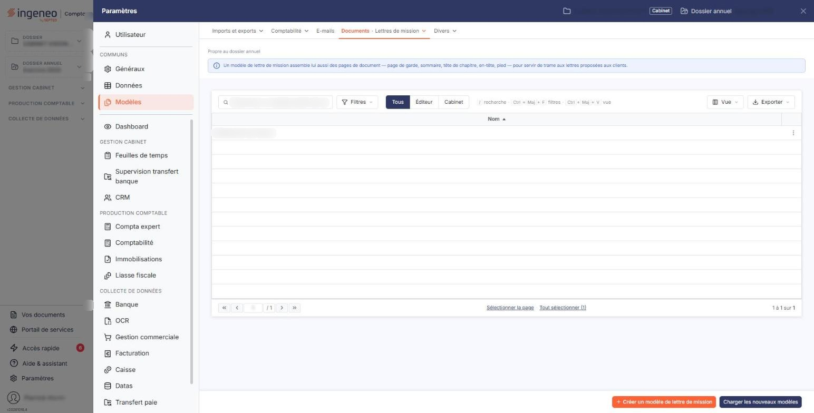
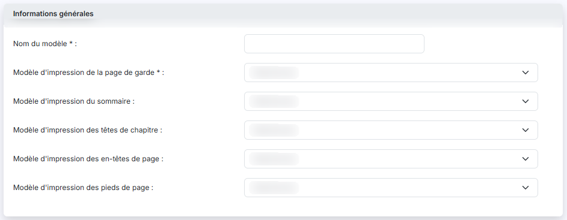
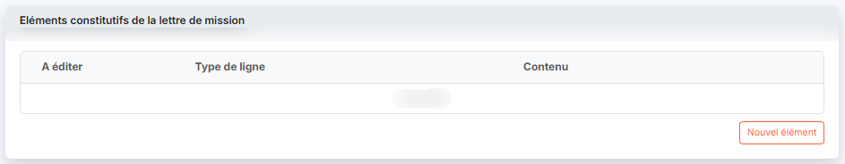
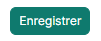

# Modèles de lettre de mission


**Où le trouver :** Panneau **Paramètres**



**En bref** — Un modèle de lettre de mission définit la composition d'une lettre de mission, à partir des modèles de page. Vous l'associez ensuite à vos modèles de mission et à vos missions.

* Pour récupérer les modèles fournis par Ingeneo Compta : bouton \[Charger les nouveaux modèles], puis choisissez ceux à charger.
* Pour créer un modèle : bouton \[Nouveau], saisissez le Nom du modèle et la page de garde, ajoutez les éléments par le bouton \[Nouvel élément], puis bouton \[Enregistrer].


Un modèle de lettre de mission définit la composition d'une lettre de mission. Sa mise en page s'appuie sur les modèles gérés dans l'entrée « Pages de document » du panneau « Paramètres ». Vous créez et gérez ici ces modèles de lettre ; vous les associez ensuite à vos modèles de mission et à vos missions.

<figure><figcaption>
Écran « Modèles de lettre de mission » de la nouvelle interface
</figcaption></figure>

L'écran s'ouvre depuis l'entrée « Paramètres » de la barre latérale (affichée en permanence sur le tableau de bord ; sur les autres écrans, elle est masquée et s'ouvre d'un clic sur le bord gauche de l'écran), qui affiche le panneau « Paramètres » : choisissez « Modèles », puis, dans l'onglet « Documents », l'entrée « Lettres de mission ». Il présente la liste des modèles de lettre de mission déjà enregistrés.

## La liste des modèles de lettre de mission

<figure><figcaption>
Bouton [Nouveau]
</figcaption></figure>

Au-dessus de la liste, trois boutons restreignent les modèles présentés : « Tous », retenu à l'ouverture, les présente tous ; « Éditeur » ne présente que les modèles mis à disposition par Ingeneo Compta, et « Cabinet » que ceux de votre cabinet.

Chaque ligne correspond à un modèle. La liste porte une seule colonne, **Nom**, qui donne le nom du modèle.

Chaque ligne porte jusqu'à trois commandes :

bouton **\[Nouveau]**

Il vous permet de créer un nouveau modèle de lettre de mission.

bouton **\[Charger les nouveaux modèles]**

Il vous permet de récupérer les modèles de lettre de mission mis à disposition par Ingeneo Compta : ceux qui sont absents de votre fichier, et ceux qu'Ingeneo Compta a mis à jour depuis que vous les avez chargés. Le logiciel vous présente ces modèles pour que vous choisissiez ceux à charger.

S'il n'y a rien à charger, il vous en informe par un message, par exemple « _Ce fichier contient déjà tous les modèles éditeur à jour._ ».

bouton **\[Supprimer]**

Il supprime en une seule fois les modèles que vous avez sélectionnés dans la liste.

## La fiche d'un modèle de lettre de mission

<figure><figcaption>
Rubrique « Informations générales »
</figcaption></figure>

<figure><figcaption>
Rubrique « Eléments constitutifs de la lettre de mission »
</figcaption></figure>

<figure><figcaption>
Bouton [Enregistrer]
</figcaption></figure>

Le bouton **\[Nouveau]** et la commande **Modifier** ouvrent la fiche du modèle. Elle comporte deux rubriques.

**Rubrique « Informations générales »**

Chacune de ces cinq listes vous propose les modèles de page du type correspondant, gérés dans l'entrée « Pages de document » du panneau « Paramètres ». Une liste qui ne propose que « _Sélectionnez_ » signifie qu'aucun modèle de page de ce type n'existe encore.

**Rubrique « Eléments constitutifs de la lettre de mission »**

Elle énumère, dans leur ordre, les éléments qui composent la lettre. La liste porte trois colonnes :

Chaque élément porte les commandes **Modifier**, **Supprimer** et **Dupliquer**.

bouton **\[Nouvel élément]**

Il ouvre la saisie d'un nouvel élément. Le modèle de page de garde doit être choisi au préalable : à défaut, le logiciel affiche « _Le champ "Modèle d'impression de la page de garde" est obligatoire._ » et n'ouvre pas la saisie.

La zone **Type de ligne** propose quatre types, et les champs de la rubrique « Contenu » changent avec le type choisi :

La fiche porte le bouton **\[Enregistrer]**. Pour revenir à la liste sans rien enregistrer, cliquez sur le chevron « Retour », à gauche de la barre d'onglets du panneau.
