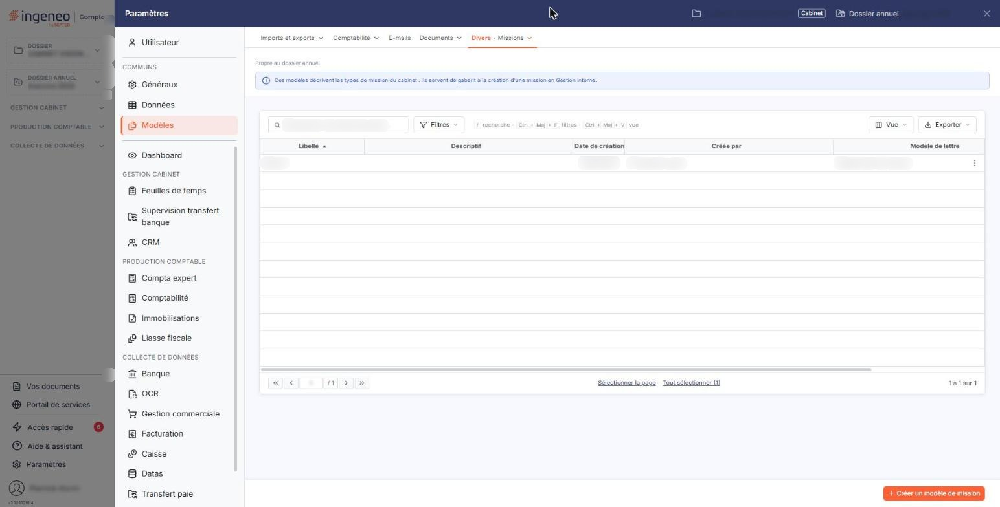
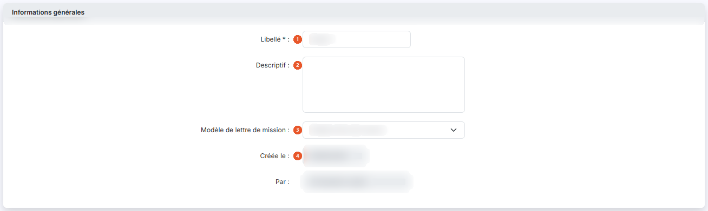
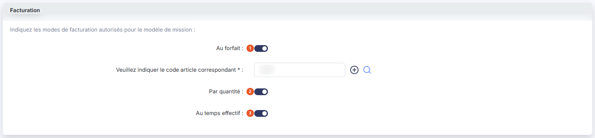
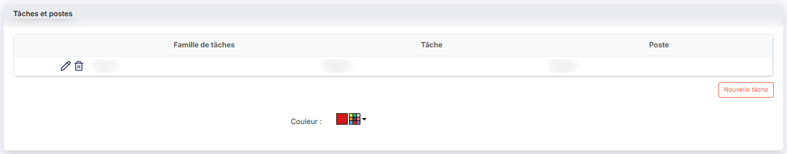
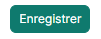

# Modèles de mission


**Où le trouver :** Panneau **Paramètres**



**En bref** — Un modèle de mission décrit une mission type : ses tâches, le poste qui tient chacune d'elles et les modes de facturation qu'elle autorise.

* Pour créer un modèle : bouton \[Nouveau], saisissez le Libellé et activez les modes de facturation autorisés (code article requis au forfait).
* Pour composer la mission type : bouton \[Nouvelle tâche], choisissez famille, tâche et poste, validez la ligne par la coche, puis bouton \[Enregistrer].


Un modèle de mission décrit une mission type : les tâches qu'elle comprend, le poste qui doit tenir chacune d'elles, et les modes de facturation qu'elle autorise. Vous créez ici ces modèles.

<figure><figcaption>
Écran « Modèles de mission » de la nouvelle interface
</figcaption></figure>

L'écran s'ouvre sur la liste des modèles déjà enregistrés. La fiche d'un modèle se présente en trois rubriques : « Informations générales », « Facturation » et « Tâches et postes ».

## La liste des modèles de mission

Chaque ligne correspond à un modèle de mission. La liste porte six colonnes :

La colonne **Mode de facturation** porte plusieurs valeurs à la fois, séparées par des virgules : ce sont les modes _autorisés_ par le modèle, et non un mode choisi. Elles reprennent en abrégé les trois interrupteurs de la rubrique « Facturation » décrite au paragraphe c) : « Forfait » pour **Au forfait**, « Quantite » pour **Par quantité**, « Temps » pour **Au temps effectif**.

bouton **\[Nouveau]**

Ouvre la fiche de création d'un modèle de mission.

bouton **\[Supprimer]**

Supprime les modèles de mission que vous avez désignés dans la liste.

Un modèle ne peut pas être supprimé dans deux cas, et le logiciel vous l'indique en nommant les modèles concernés :

Le contrôle porte sur l'ensemble de votre sélection : si l'un des modèles désignés est retenu par l'un de ces deux motifs, aucun des modèles sélectionnés n'est supprimé.

## Rubrique « Informations générales »

<figure><figcaption>
Rubrique « Informations générales »
</figcaption></figure>

| Champ                              | Ce qu'il faut savoir                                                                                                                                                                                                                                                                                                             |
| ---------------------------------- | -------------------------------------------------------------------------------------------------------------------------------------------------------------------------------------------------------------------------------------------------------------------------------------------------------------------------------- |
| 1. **Libellé**                     | C'est le nom sous lequel le modèle apparaît dans la liste. Il ne peut pas dépasser 20 caractères, et il doit être différent de celui des modèles déjà enregistrés : sinon le logiciel refuse l'enregistrement par le message « _Le libellé que vous indiquez est déjà utilisé, veuillez en choisir un autre s'il vous plait._ ». |
| 2. **Descriptif**                  | Zone libre, sur plusieurs lignes, limitée à 1 024 caractères.                                                                                                                                                                                                                                                                    |
| 3. **Modèle de lettre de mission** | La liste vous propose « Sélectionnez », puis les modèles enregistrés dans le panneau « Paramètres », rubrique « Modèles », groupe « Documents », option « Lettres de mission ».                                                                                                                                                  |
| 4. **Créée le**                    | **Par :** la date de création du modèle et son auteur. Le logiciel les renseigne lui-même ; vous ne pouvez pas les modifier.                                                                                                                                                                                                     |

## Rubrique « Facturation »

<figure><figcaption>
Rubrique « Facturation »
</figcaption></figure>

La rubrique s'ouvre sur la phrase « _Indiquez les modes de facturation autorisés pour le modèle de mission :_ » et vous propose trois interrupteurs. Vous pouvez en activer plusieurs : ce sont les modes que les missions issues de ce modèle pourront employer.

À la création d'un modèle, **Au forfait** est proposé sur « Oui », **Par quantité** et **Au temps effectif** sur « Non ».

| Champ                    | Ce qu'il faut savoir                                                                                                                                                             |
| ------------------------ | -------------------------------------------------------------------------------------------------------------------------------------------------------------------------------- |
| 1. **Au forfait**        | Lorsque vous l'activez, le logiciel fait apparaître le champ **Veuillez indiquer le code article correspondant**. Ce champ disparaît si vous ramenez l'interrupteur sur « Non ». |
| 2. **Par quantité**      | Aucun autre champ ne l'accompagne.                                                                                                                                               |
| 3. **Au temps effectif** | Aucun autre champ ne l'accompagne.                                                                                                                                               |

C'est le point à retenir de cette rubrique : **le code article n'est réclamé que par le forfait**, et il devient obligatoire dès que ce mode est autorisé. Si vous enregistrez le modèle sans l'avoir renseigné, le logiciel refuse par le message « _Code article obligatoire_ ». Le code article ne peut pas dépasser 40 caractères.

Le champ est accompagné de deux boutons : le bouton « + » vous permet de créer un article sans quitter la fiche, et la loupe de rechercher un article existant.

Les modes autorisés commandent également la rubrique suivante : la liste **Tâche** ne vous propose que les tâches compatibles avec les modes activés ici. Si vous désactivez un mode alors que des tâches figurent déjà dans le tableau, le logiciel vous demande confirmation par le message « _Si vous modifiez le mode de facturation, les tâches associées seront supprimées. Confirmez-vous la modification ?_ ». Le bouton **\[Confirmer]** désactive le mode, et les tâches qui en relevaient sont alors retirées du tableau ; le bouton **\[Annuler]** laisse l'interrupteur sur « Oui » et le tableau inchangé.

## Rubrique « Tâches et postes »

<figure><figcaption>
Rubrique « Tâches et postes »
</figcaption></figure>

<figure><figcaption>
Bouton [Enregistrer]
</figcaption></figure>

Vous définissez ici la liste des tâches qui composeront la mission. Tant qu'aucune tâche n'y figure, le tableau affiche « _Indiquez les tâches susceptibles d'être effectuées pour ce modèle de mission_ ». Il porte trois colonnes :

bouton **\[Nouvelle tâche]**

Ajoute une ligne au tableau, que vous complétez par la famille, la tâche et le poste. Vous ne saisissez qu'une ligne à la fois : le bouton ne vous est proposé de nouveau qu'une fois la ligne en cours enregistrée ou abandonnée.

La ligne en cours de saisie porte deux pictogrammes : la coche l'enregistre dans le tableau, le pictogramme « Annuler » l'abandonne. Une fois enregistrée, chaque ligne porte le crayon, qui la rouvre en modification, et le pictogramme « Supprimer », qui la retire du tableau.

**Champ « Couleur »**

Sous le tableau et le bouton \[Nouvelle tâche], la rubrique « Tâches et postes » se termine par le champ **Couleur**, où vous choisissez une couleur pour le modèle de mission. Cette couleur sert à repérer la mission dans le planning : dans la liste des tâches à placer, le nom de chaque mission issue de ce modèle est précédé d'un repère de cette couleur.

bouton **\[Enregistrer]**

Enregistre le modèle de mission.

Si une ligne du tableau « Tâches et postes » est encore en cours de saisie, le logiciel n'enregistre pas et vous avertit par une fenêtre intitulée « Tâche en cours de saisie », portant le message « _Veuillez enregistrer ou annuler la tâche en cours de saisie._ ».

Pour refermer la fiche sans enregistrer et revenir à la liste, utilisez le chevron « Retour » placé à gauche de la barre d'onglets du panneau « Paramètres ». Si vous avez modifié la fiche, le logiciel ouvre la fenêtre « Modifications non enregistrées » : le Bouton \[Continuer sans enregistrer] abandonne vos modifications et vous ramène à la liste.
