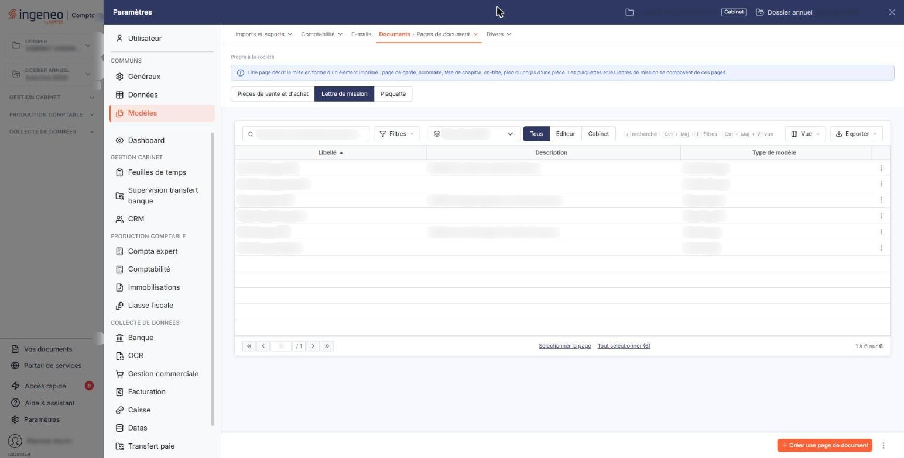
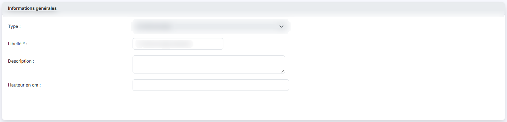
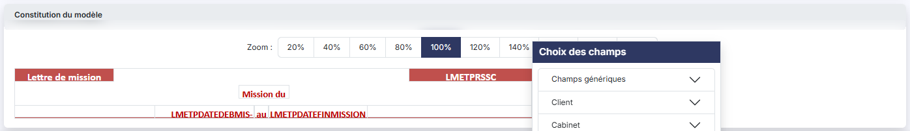

# Modèles de page


**Où le trouver :** Panneau **Paramètres**



**En bref** — Un modèle de page met en forme une partie d'un document — en-tête, page de garde, pied de page… — et sert de base à vos modèles de lettre de mission.

* Pour créer un modèle de page : bouton \[Créer une page de document], choisissez le Type, saisissez le Libellé, composez le modèle, puis bouton \[Enregistrer].
* Pour contrôler le rendu avant d'enregistrer : bouton \[Visualiser].


Un modèle de page met en forme une partie d'un document : son en-tête, sa page de garde, son pied de page… Vos modèles de lettre de mission s'appuient sur ces modèles de page. Vous créez et gérez ici ces modèles.

<figure><figcaption>
Écran « Modèles de page » de la nouvelle interface
</figcaption></figure>

L'écran s'ouvre depuis l'entrée « Paramètres » de la barre latérale (affichée en permanence sur le tableau de bord ; sur les autres écrans, elle est masquée et s'ouvre d'un clic sur le bord gauche de l'écran), qui affiche le panneau « Paramètres » : choisissez « Modèles », puis, dans l'onglet « Documents », l'entrée « Pages de document », et retenez la pastille « Lettre de mission ». Il présente la liste des modèles de page déjà enregistrés.

## La liste des modèles de page

<figure><figcaption>
Bouton [Créer une page de document]
</figcaption></figure>

Au-dessus de la liste, la zone **Type de modèle** limite l'affichage à un type : « En-tête de page », « Page de garde », « Page de sommaire », « Page tête de chapitre » ou « Pied de page ». Tant qu'aucun type n'y est choisi, la liste présente tous les modèles.

À côté, trois boutons restreignent les modèles présentés selon leur origine : « Tous », retenu à l'ouverture, les présente tous ; « Éditeur » ne présente que les modèles mis à disposition par Ingeneo Compta, et « Cabinet » que ceux de votre cabinet.

La zone « Rechercher une page de document… », le bouton **\[Filtres]**, qui ouvre un volet de critères, le bouton **\[Vue]**, qui vous permet de choisir les colonnes affichées, et le bouton **\[Exporter]**, qui vous permet d'imprimer la liste, de l'exporter en Excel ou en PDF, ou de l'envoyer par e-mail, complètent ces filtres.

Chaque ligne correspond à un modèle. La liste porte trois colonnes :

Un clic sur une ligne la sélectionne. Au survol, chaque ligne porte jusqu'à trois commandes :

bouton **\[Créer une page de document]**

Il vous permet de créer un nouveau modèle de page.

**Commande « Charger les nouveaux modèles »**

Elle se trouve dans le menu du pictogramme « Autres actions », à droite du bouton **\[Créer une page de document]**. Elle vous permet de récupérer les modèles de page mis à disposition par Ingeneo Compta : ceux qui sont absents de votre fichier, et ceux qu'Ingeneo Compta a mis à jour depuis que vous les avez chargés. Le logiciel vous présente ces modèles pour que vous choisissiez ceux à charger.

S'il n'y a rien à charger, il vous en informe par un message, par exemple « _Ce fichier contient déjà tous les modèles éditeur à jour._ ».

**Commande « Imprimer la liste des champs »**

Elle se trouve dans le même menu « Autres actions ». Elle affiche, dans un nouvel onglet de votre navigateur, la liste des champs que vous pouvez insérer dans vos modèles de page. Choisissez d'abord un type dans la zone **Type de modèle** : sans type choisi, le logiciel affiche « _Veuillez sélectionner un type de modèle, s'il vous plait._ ».

bouton **\[Supprimer]**

Il n'apparaît que lorsque des modèles sont sélectionnés, dans le bandeau de sélection au bas de la liste. Il les supprime en une seule fois, après vous avoir demandé de confirmer.

## La fiche d'un modèle de page

<figure><figcaption>
Rubrique « Informations générales »
</figcaption></figure>

<figure><figcaption>
Rubrique « Constitution du modèle »
</figcaption></figure>

<figure><figcaption>
Bouton [Enregistrer]
</figcaption></figure>

Le bouton **\[Créer une page de document]** et la commande **Modifier** ouvrent la fiche du modèle. Elle comporte deux rubriques.

**Rubrique « Informations générales »**

**Rubrique « Constitution du modèle »**

Elle présente la zone de dessin du modèle, que vous composez à l'aide des champs proposés dans la fenêtre « _Choix des champs_ ». Celle-ci les regroupe en quatre familles : Champs génériques, Client, Cabinet et Mission. Les champs génériques sont la saisie libre, le numéro de page, le nombre de pages, la date et l'heure du système, et l'image.

La fiche porte trois boutons : le bouton **\[Enregistrer]**, le bouton **\[Visualiser]** et le bouton **\[Annuler la dernière action]**. Pour revenir à la liste sans rien enregistrer, cliquez sur le chevron « Retour », à gauche de la barre d'onglets du panneau.
