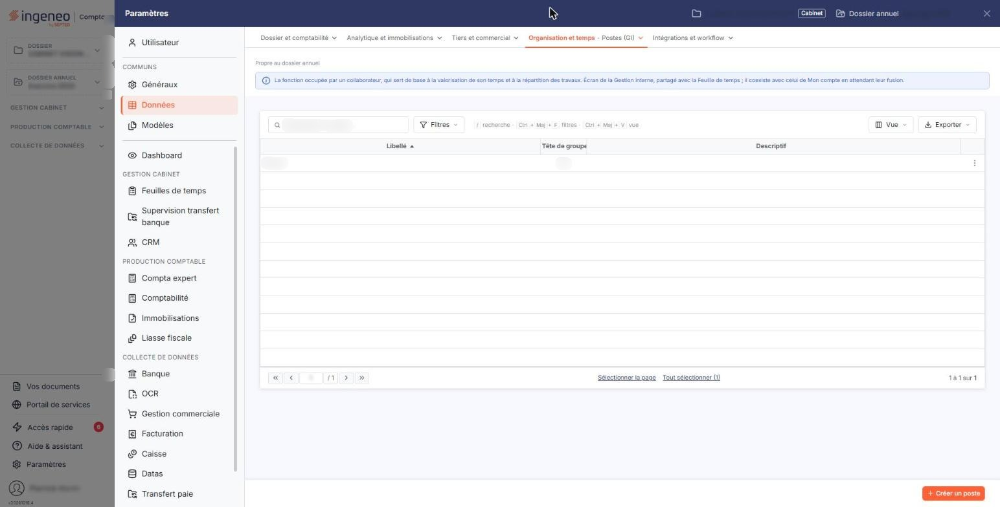
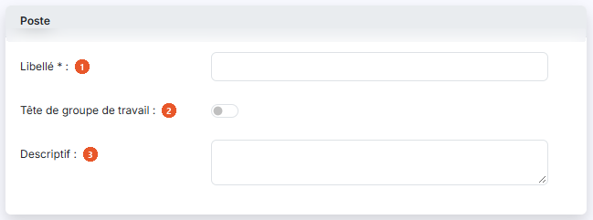

# Postes


**Où le trouver :** Panneau **Paramètres** › **Données** › **Organisation et temps** › **Postes**



**En bref** — Ce fichier tient la liste des postes, c'est-à-dire les rôles que vos collaborateurs peuvent tenir dans un groupe de travail ; l'un au moins doit être déclaré tête de groupe.

* Pour créer un poste : bouton \[Nouveau], saisissez le Libellé, réglez « Tête de groupe de travail », puis bouton \[Enregistrer].
* Pour supprimer des postes inutilisés : cochez-les dans la liste, puis bouton \[Supprimer].


Les postes décrivent les rôles que vos collaborateurs peuvent tenir — chef de mission, assistant, réviseur, ce que votre organisation distingue.

<figure><figcaption>
Écran « Postes » de la nouvelle interface
</figcaption></figure>

Un poste ne s'attache pas à une personne une fois pour toutes : c'est dans la composition d'un groupe de travail que vous indiquez quel collaborateur y tient quel poste. Un même collaborateur peut donc occuper un poste dans un groupe et un autre poste dans un autre groupe.

Ce fichier se contente de tenir la liste de ces postes.

## La liste des postes

<figure><figcaption>
Rubrique « Poste »
</figcaption></figure>

La liste présente trois colonnes.

| Champ                 | Ce qu'il faut savoir                                                                                                                                                              |
| --------------------- | --------------------------------------------------------------------------------------------------------------------------------------------------------------------------------- |
| 1. **Libellé**        | Le nom du poste. C'est lui que vous retrouvez partout où un poste vous est proposé.                                                                                               |
| 2. **Tête de groupe** | « Oui » ou « Non ». Un poste répondant « Oui » peut tenir le rôle de tête de groupe dans un groupe de travail. Il doit toujours exister au moins un poste déclaré tête de groupe. |
| 3. **Descriptif**     | Le commentaire libre que vous avez porté sur le poste.                                                                                                                            |

En tête de liste, un pictogramme vous permet de choisir les colonnes affichées, et une case à cocher sélectionne toutes les lignes.

## Les commandes d'une ligne et les boutons au bas de l'écran

<figure><figcaption>
Bouton [Nouveau]
</figcaption></figure>

Chaque ligne porte une case à cocher, qui la sélectionne, puis deux pictogrammes : le pictogramme « Crayon », infobulle « Modifier », qui ouvre la fiche du poste, et le pictogramme « Supprimer ».

Au bas de l'écran, deux boutons : le bouton **\[Nouveau]**, qui ouvre la fiche d'un nouveau poste, et le bouton **\[Supprimer]**, qui supprime les postes que vous avez cochés dans la liste.

Ces commandes n'apparaissent que si vos droits vous y autorisent.

## La fiche d'un poste

La fiche tient dans une seule rubrique, intitulée « Poste ».

| Champ                                                   | Ce qu'il faut savoir                                                                                                                                                                                                                                                                                                                                            |
| ------------------------------------------------------- | --------------------------------------------------------------------------------------------------------------------------------------------------------------------------------------------------------------------------------------------------------------------------------------------------------------------------------------------------------------- |
| 
<strong>Libellé</strong> <em>Obligatoire</em>
 | Le nom du poste. L'astérisque indique qu'il est obligatoire.                                                                                                                                                                                                                                                                                                    |
| **Tête de groupe de travail**                           | Activez ou désactivez l'interrupteur — c'est la valeur que reprend la colonne **Tête de groupe** de la liste. Un pictogramme d'information vous rappelle qu'« _Il doit exister au moins une tête de groupe._ ». Lorsque le poste que vous ouvrez est le seul à porter cette qualité, le logiciel verrouille l'interrupteur : vous ne pouvez pas la lui retirer. |
| **Descriptif**                                          | Une zone de commentaire libre.                                                                                                                                                                                                                                                                                                                                  |

Sur un poste existant, le logiciel rappelle enfin **Créé le :** et **par :**. Ces deux zones ne se modifient pas.

bouton **\[Enregistrer]**

Il enregistre le poste et vous ramène à la liste.

## Revenir à la liste

La fiche ne porte pas de bouton de retour : pour revenir à la liste sans rien enregistrer, cliquez le chevron « Retour », à gauche de la barre d'onglets du panneau Paramètres.

## Les règles que le logiciel contrôle

Le libellé est obligatoire et ne peut pas dépasser trente caractères. Deux postes ne peuvent pas porter le même : le logiciel refuse alors l'enregistrement et vous répond « _Le libellé de poste que vous indiquez est déjà créé, veuillez en choisir un autre s'il vous plait._ ».

Un poste qui sert ne peut pas être supprimé. Si vous tentez de supprimer un poste déjà affecté à un collaborateur, le logiciel refuse et affiche « _Suppression impossible car le poste … a été affecté à au moins un collaborateur._ ». Si vous en supprimez plusieurs à la fois, il suffit qu'un seul soit affecté pour qu'aucun ne soit supprimé, et le message devient « _Suppression impossible car un poste au moins est affecté à un collaborateur._ ».

Pour supprimer un tel poste, retirez-le d'abord des compositions de groupes de travail où il figure.

Le logiciel refuse de même de supprimer le dernier poste déclaré tête de groupe, et répond alors « _Suppression impossible car le poste … est le seul poste défini comme "Tête de groupe"._ », ou « _Suppression impossible car la selection contient tous les postes définis comme "Tête de groupe"._ » si votre sélection les contient tous. Déclarez un autre poste tête de groupe avant de supprimer celui-ci.
