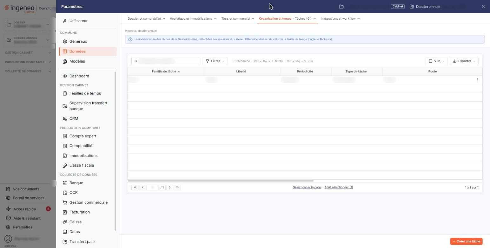
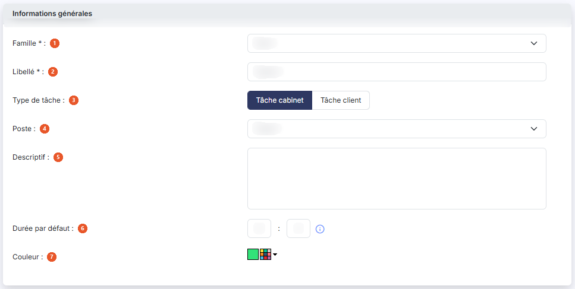
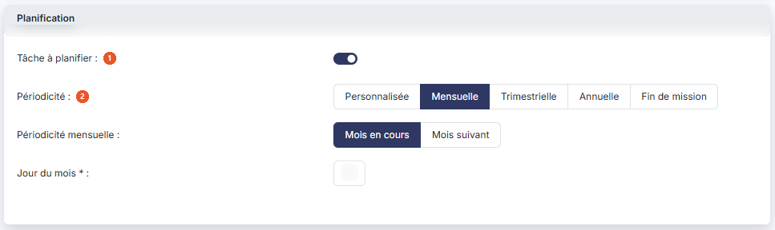
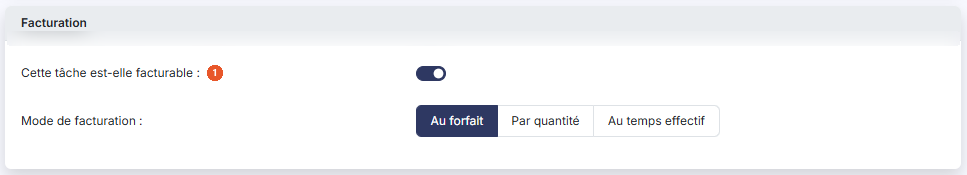
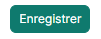

# Tâches


**Où le trouver :** Panneau **Paramètres** › **Données** › **Organisation et temps** › **Tâches**



**En bref** — Les tâches décrivent les travaux que le cabinet accomplit pour ses clients : qui les réalise, leur durée, leur périodicité et leur facturation. Elles composent vos modèles de mission.

* Pour créer une tâche : bouton \[Nouveau], choisissez la Famille, saisissez le Libellé, la périodicité et la facturation, puis bouton \[Enregistrer].
* Pour créer une tâche voisine sans tout ressaisir : pictogramme « Dupliquer » de la ligne, adaptez la fiche, puis bouton \[Enregistrer].


Les tâches décrivent les travaux que votre cabinet accomplit pour ses clients : qui les réalise, combien de temps elles demandent, à quelle fréquence elles reviennent et comment elles se facturent. Ce sont elles qui composent vos modèles de mission, puis les échéances de vos missions et votre planning.

<figure><figcaption>
Écran « Tâches » de la nouvelle interface
</figcaption></figure>

## La liste des tâches

<figure><figcaption>
Bouton [Nouveau]
</figcaption></figure>

La liste est triée par défaut sur la famille de tâche. Ses colonnes reprennent les caractéristiques de chaque tâche, dans cet ordre : **Famille de tâche**, **Libellé**, **Périodicité**, **Type de tâche**, **Poste**, durée, puis ses paramètres de facturation (**Mode de facturation**, **Prix de vente unitaire**…), et enfin **A planifier** et **Facturable**, par « Oui » ou « Non ».

En tête de liste, une case à cocher sélectionne toutes les lignes de la page, une seconde étend la sélection à toutes les pages, et trois pictogrammes vous permettent de choisir les colonnes affichées, de filtrer la liste et de l'imprimer.

Chaque ligne porte trois pictogrammes : « Modifier », qui ouvre la fiche de la tâche, « Supprimer », et « Dupliquer », qui ouvre une nouvelle fiche reprenant les caractéristiques de la tâche, pour créer une tâche voisine sans tout ressaisir.

bouton **\[Nouveau]**

Il ouvre la fiche d'une nouvelle tâche.

bouton **\[Supprimer]**

Il supprime les tâches que vous avez cochées dans la liste.

Une tâche qui sert ne peut pas être supprimée. Le logiciel refuse la suppression d'une tâche utilisée dans un modèle de mission, dans les échéances d'une mission ou dans le planning, et vous l'indique par l'un de ces messages :

* « _La tâche "…" ne peut pas être supprimée car elle est liée à des modèles de mission._ » ;
* « _La tâche "…" ne peut pas être supprimée car elle est liée à des échéances de mission._ » ;
* « _La tâche "…" ne peut pas être supprimée car elle est liée à un planning._ ».

Si vous en supprimez plusieurs à la fois, le logiciel s'arrête sur la première tâche utilisée.

## Rubrique « Informations générales »

<figure><figcaption>
Rubrique « Informations générales »
</figcaption></figure>

| Champ                   | Ce qu'il faut savoir                                                                                                                                                      |
| ----------------------- | ------------------------------------------------------------------------------------------------------------------------------------------------------------------------- |
| 1. **Famille**          | La liste propose les familles créées dans le panneau « Paramètres », rubrique « Données », groupe « Organisation et temps », option « Familles de tâches ».               |
| 2. **Libellé**          | Limité à trente-cinq caractères.                                                                                                                                          |
| 3. **Type de tâche**    | Choisissez « Tâche cabinet » ou « Tâche client », selon que le travail est réalisé par votre cabinet ou par le client. Le choix « Tâche cabinet » est proposé par défaut. |
| 4. **Poste**            | Le poste qui réalise la tâche, choisi parmi ceux du panneau « Paramètres », rubrique « Données », groupe « Organisation et temps », option « Postes (GI) ».               |
| 5. **Descriptif**       | Zone de texte libre.                                                                                                                                                      |
| 6. **Durée par défaut** | En heures et minutes. Le pictogramme d'information rappelle que « _La durée par défaut correspond au temps à passer pour chaque échéance._ ».                             |
| 7. **Couleur**          | Choisissez la couleur de la tâche dans le sélecteur.                                                                                                                      |

Pour une tâche client, les champs **Poste**, **Durée par défaut** et **Couleur** disparaissent, de même que toute la rubrique « Facturation ».

## Rubrique « Planification »

<figure><figcaption>
Rubrique « Planification »
</figcaption></figure>

| Champ                    | Ce qu'il faut savoir                                                                                                                                                                                                                                                                                                                                                                                                                                                                                                                                                                                                                                                                                                                                                                                                                                                                                                                                                                                                                                                                                                                                                                                                         |
| ------------------------ | ---------------------------------------------------------------------------------------------------------------------------------------------------------------------------------------------------------------------------------------------------------------------------------------------------------------------------------------------------------------------------------------------------------------------------------------------------------------------------------------------------------------------------------------------------------------------------------------------------------------------------------------------------------------------------------------------------------------------------------------------------------------------------------------------------------------------------------------------------------------------------------------------------------------------------------------------------------------------------------------------------------------------------------------------------------------------------------------------------------------------------------------------------------------------------------------------------------------------------- |
| 1. **Tâche à planifier** | Activez ou désactivez l'interrupteur. Pour une tâche client, le logiciel le désactive et vous ne pouvez pas le modifier : une tâche client ne se planifie pas.                                                                                                                                                                                                                                                                                                                                                                                                                                                                                                                                                                                                                                                                                                                                                                                                                                                                                                                                                                                                                                                               |
| 2. **Périodicité**       | 
Proposée lorsque la tâche est à planifier. Choisissez entre « Personnalisée », « Mensuelle », « Trimestrielle », « Annuelle » et « Fin de mission » ; le logiciel affiche en dessous les champs correspondants. • « Personnalisée » : un tableau <strong>N° échéance</strong> / <strong>Jour</strong>, où vous indiquez pour chaque échéance le jour et le mois. Le bouton <strong>[Nouvelle ligne]</strong> ajoute une échéance et le bouton <strong>[Supprimer ligne]</strong> en retire une. Si vous venez d'une périodicité qui comporte déjà un tableau, comme « Trimestrielle », le tableau reprend ses échéances ; si vous venez de « Mensuelle », il s'ouvre vide. • « Mensuelle » : choisissez « Mois en cours » ou « Mois suivant » dans <strong>Périodicité mensuelle</strong>, puis indiquez le <strong>Jour du mois</strong>, obligatoire, compris entre 1 et 31. • « Trimestrielle » : un tableau de quatre échéances, dont vous indiquez le jour et le mois. • « Annuelle » : choisissez « Année en cours » ou « Année suivante » dans <strong>Périodicité annuelle</strong>, puis indiquez le jour et le mois de l'unique échéance. • « Fin de mission » : aucun champ supplémentaire.
 |

## Rubrique « Facturation »

<figure><figcaption>
Rubrique « Facturation »
</figcaption></figure>

**Cette tâche est-elle facturable** : activez ou désactivez l'interrupteur. Activé, choisissez le **Mode de facturation** : « Au forfait », « Par quantité » ou « Au temps effectif ».

« Au forfait » n'appelle aucun autre champ.

« Par quantité » et « Au temps effectif » affichent les mêmes cinq champs, tous obligatoires sauf le dernier :

* **Veuillez indiquer le code de l'article correspondant à cette tâche pour la facturation** : saisissez le code, ou recherchez l'article par le pictogramme « Loupe », également accessible par le raccourci clavier Ctrl + Alt + R. Lorsque vous choisissez un article, le logiciel reprend son unité et son prix de vente hors taxe dans les champs suivants, et positionne le nombre d'unités à 1 ; ces valeurs restent modifiables ;
* **Unité de facturation** : vingt caractères au plus ;
* **Prix de vente unitaire** : supérieur à zéro ;
* **Nombre d'unités prévu par échéance** : supérieur à zéro ;
* **Prix de vente total** : il ne se saisit pas ; le logiciel le calcule en multipliant le prix de vente unitaire par le nombre d'unités prévu par échéance.

## Une nouvelle tâche

<figure><figcaption>
Bouton [Enregistrer]
</figcaption></figure>

La fiche d'une nouvelle tâche comporte les mêmes rubriques et les mêmes champs. Elle s'ouvre sur une tâche cabinet, à planifier, de périodicité « Annuelle » (« Année en cours », une échéance à renseigner), facturable au forfait ; la famille et le poste restent à choisir.

bouton **\[Enregistrer]**

Il enregistre la tâche et vous ramène à la liste.

Pour quitter la fiche sans rien enregistrer et revenir à la liste, utilisez le chevron « Retour » placé à gauche de la barre d'onglets du panneau « Paramètres ». Si vous avez modifié la fiche, le logiciel ouvre la fenêtre « Modifications non enregistrées » : le Bouton \[Continuer sans enregistrer] abandonne vos modifications et vous ramène à la liste.
