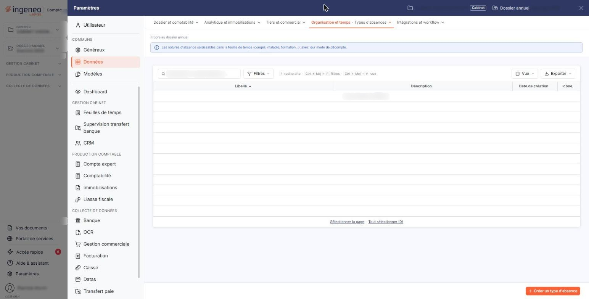
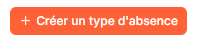
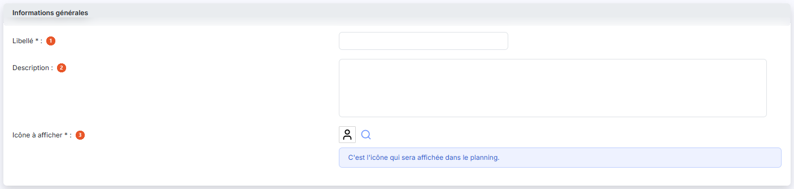
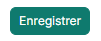

# Types d'absences


**Où le trouver :** Panneau **Paramètres** › **Données** › **Organisation et temps** › **Types d'absences**



**En bref** — Ce fichier recense les motifs d'absence de vos collaborateurs, chacun avec une icône et une couleur qui le signalent dans le planning. Il est commun au module des feuilles de temps.

* Pour créer un type d'absence : bouton \[Nouveau], renseignez le Libellé, la Couleur de fond, l'icône et sa couleur, puis bouton \[Enregistrer].
* Pour supprimer des types d'absences : cochez-les dans la liste, puis bouton \[Supprimer].


Ce fichier recense les motifs d'absence de vos collaborateurs : congés payés, récupération, formation, et tout autre motif que vous souhaitez distinguer.

<figure><figcaption>
Écran « Types d'absences » de la nouvelle interface
</figcaption></figure>

Chaque type porte une icône et une couleur, qui sont celles sous lesquelles les absences apparaissent dans le planning : c'est ce qui vous permet de reconnaître d'un coup d'œil la nature d'une absence sans avoir à l'ouvrir.

Ce fichier est commun au module des feuilles de temps : un type d'absence défini ici est celui que ce module emploie, et inversement. Tant qu'aucun type n'est enregistré, la liste affiche « Aucun élément à afficher. ».

## La liste des types d'absences

La liste s'ouvre depuis l'entrée « Paramètres » de la barre latérale (affichée en permanence sur le tableau de bord ; sur les autres écrans, elle est masquée et s'ouvre d'un clic sur le bord gauche de l'écran), qui affiche le panneau « Paramètres » : choisissez « Données », puis, dans l'onglet « Organisation et temps », l'entrée « Types d'absences ».

La liste présente cinq colonnes.

| Champ                | Ce qu'il faut savoir                                                                                   |
| -------------------- | ------------------------------------------------------------------------------------------------------ |
| **Libellé**          | Le nom du motif d'absence. C'est lui que vous retrouvez partout où un type d'absence vous est proposé. |
| **Description**      | Le commentaire libre que vous avez porté sur le type.                                                  |
| **Date de création** | La date à laquelle le type a été créé.                                                                 |
| **Icône**            | Le pictogramme retenu pour ce motif.                                                                   |
| **Couleur Icône**    | La couleur qui lui est associée.                                                                       |

En tête de liste, un pictogramme vous permet de choisir les colonnes affichées, et une case à cocher sélectionne toutes les lignes.

Les colonnes qui vous sont présentées dépendent du module depuis lequel vous ouvrez cet écran : le module des feuilles de temps en affiche moins. Les types d'absences, eux, sont les mêmes des deux côtés.

## Les commandes d'une ligne et les boutons au bas de l'écran

<figure><figcaption>
Bouton [Nouveau]
</figcaption></figure>

Chaque ligne porte une case à cocher, qui la sélectionne, et deux pictogrammes, l'un pour ouvrir la fiche du type d'absence et l'autre pour le supprimer.

Au bas de l'écran, le bouton **\[Nouveau]** ouvre la fiche d'un nouveau type d'absence et le bouton **\[Supprimer]** supprime ceux que vous avez cochés.

Ces commandes n'apparaissent que si vos droits vous y autorisent.

## La fiche d'un type d'absence

<figure><figcaption>
Rubrique « La fiche d'un type d'absence »
</figcaption></figure>

<figure><figcaption>
Bouton [Enregistrer]
</figcaption></figure>

La fiche tient dans une seule rubrique, intitulée « Informations générales ». Quatre des cinq zones sont obligatoires : l'astérisque vous l'indique.

| Champ                                                               | Ce qu'il faut savoir                                                                                                                                                                                                                                                                                                                                                                                                                                                                                     |
| ------------------------------------------------------------------- | -------------------------------------------------------------------------------------------------------------------------------------------------------------------------------------------------------------------------------------------------------------------------------------------------------------------------------------------------------------------------------------------------------------------------------------------------------------------------------------------------------- |
| 
1. <strong>Libellé</strong> <em>Obligatoire</em>
          | Le nom du motif d'absence.                                                                                                                                                                                                                                                                                                                                                                                                                                                                               |
| 2. **Description**                                                  | Une zone de commentaire libre. C'est la seule qui ne soit pas obligatoire.                                                                                                                                                                                                                                                                                                                                                                                                                               |
| 
3. <strong>Icône à afficher</strong> <em>Obligatoire</em>
 | Le pictogramme qui représentera l'absence dans le planning. La zone ne se saisit pas au clavier : cliquez sur la loupe placée à sa droite, et le logiciel ouvre la fenêtre « Icônes », une planche de pictogrammes portant chacun son nom, en anglais. La zone de recherche placée en tête de la fenêtre restreint la planche aux pictogrammes dont le nom contient votre saisie, et le logiciel indique combien de pictogrammes sont affichés. La croix placée dans l'en-tête de la fenêtre la referme. |
| 
<strong>Couleur de fond</strong> <em>Obligatoire</em>
     | La couleur sur laquelle l'absence se détachera dans le planning. Vous la choisissez dans un nuancier.                                                                                                                                                                                                                                                                                                                                                                                                    |
| 
<strong>Couleur de l'icône</strong> <em>Obligatoire</em>
  | La couleur de ce pictogramme, choisie elle aussi dans un nuancier.                                                                                                                                                                                                                                                                                                                                                                                                                                       |

Sous chacune des trois dernières zones, un encadré rappelle son rôle dans le planning.

Le bouton **\[Enregistrer]** valide le type d'absence. La fiche ne porte pas de bouton de retour : pour revenir à la liste sans rien enregistrer, cliquez le chevron « Retour », à gauche de la barre d'onglets du panneau Paramètres.

Ici encore, les zones qui vous sont proposées dépendent du module depuis lequel vous ouvrez la fiche : celle du module des feuilles de temps en comporte moins.
