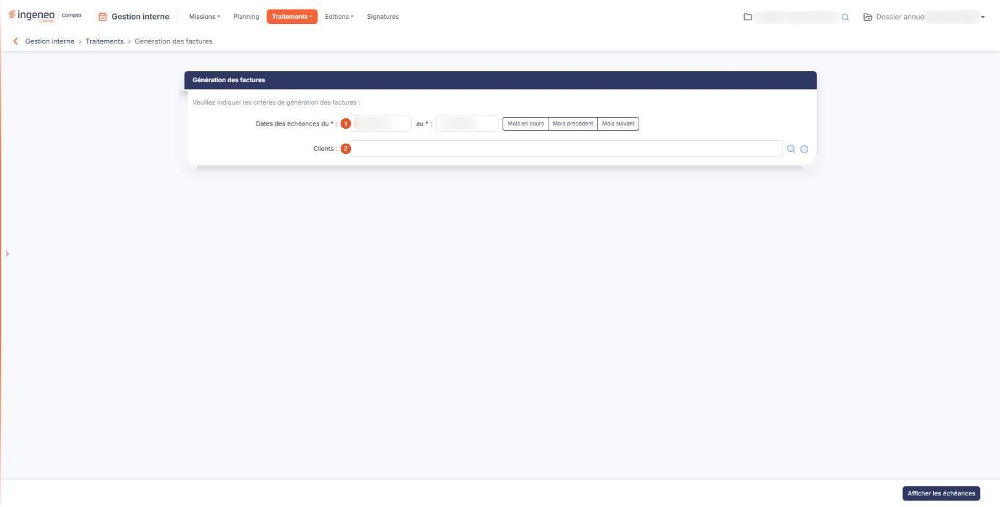
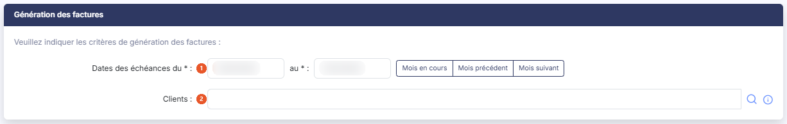

# Génération des factures


**Où le trouver :** Menu **Traitements › Génération des factures**



**En bref** — Ce traitement produit en une seule fois les factures correspondant aux échéances de vos missions sur une période donnée, sans les établir une à une.

* Pour voir ce qui sera facturé : renseignez les dates des échéances (ou bouton \[Mois en cours]), puis bouton \[Afficher les échéances].
* Pour facturer : cochez les échéances voulues dans la liste, puis bouton \[Générer les factures].
* Pour changer de critères : bouton \[Retour].


Ce traitement vous permet de produire en une seule fois les factures correspondant aux échéances de vos missions sur une période donnée, sans les établir une à une.

<figure><figcaption>
Écran « Génération des factures » de la nouvelle interface
</figcaption></figure>

Vous indiquez d'abord vos critères, vous affichez les échéances qui y répondent, puis vous lancez la génération des factures.

## Rubrique « Génération des factures »

<figure><figcaption>
Rubrique « Génération des factures »
</figcaption></figure>

La rubrique s'ouvre sur la phrase « _Veuillez indiquer les critères de génération des factures :_ ».

| Champ                         | Ce qu'il faut savoir                                                                                                                                                                                                                                  |
| ----------------------------- | ----------------------------------------------------------------------------------------------------------------------------------------------------------------------------------------------------------------------------------------------------- |
| 1. **Dates des échéances du** | **au :** obligatoires toutes les deux. Elles délimitent la période sur laquelle le logiciel recherche les échéances à facturer. À l'ouverture de l'écran, le logiciel vous propose les dates de début et de fin de saisie du dossier annuel en cours. |
| 2. **Clients**                | Laissé vide, il ne restreint rien : le logiciel retient tous les clients qui ont une échéance à facturer sur la période. Vous pouvez au contraire désigner un ou plusieurs clients pour limiter la recherche à ceux-là.                               |

La loupe placée à droite du champ ouvre le panneau « _Clients_ », qui s'affiche sur la droite de l'écran : la zone **Rechercher** filtre la liste au fur et à mesure de votre saisie, et cette liste présente le **Code client** et le **Libellé** de chaque client. Cliquez sur une ligne pour la retenir : le pied du panneau indique alors le nombre de clients sélectionnés (par exemple « 1 client sélectionné ») et propose le bouton **\[+ Ajouter le client]**, tandis que les liens « Désélectionner la page » et « Tout désélectionner » annulent la sélection. Le panneau n'a ni Bouton \[Valider] ni Bouton \[Annuler] : la croix, en haut à droite du panneau, le referme.

Trois raccourcis vous aident à renseigner la période d'un seul geste : le bouton **\[Mois en cours]**, le bouton **\[Mois précédent]** et le bouton **\[Mois suivant]**. Chacun inscrit à votre place le premier et le dernier jour du mois concerné.

bouton **\[Afficher les échéances]**

Le logiciel vérifie d'abord les deux dates : s'il en manque une, il vous le signale par un bandeau rouge en haut de l'écran, portant le message « _Veuillez saisir une date de début._ » ou « _Veuillez saisir une date de fin._ », et ne va pas plus loin.

Il affiche ensuite, à la place de vos critères, la liste des échéances qui y répondent. Cet affichage ne produit encore aucune facture : il vous permet de vérifier ce qui sera facturé. Chaque ligne correspond à une échéance, et la liste porte sept colonnes :

Si aucune échéance ne répond à vos critères, la liste affiche « _Aucun élément à afficher._ ».

Une fois les échéances affichées, vos critères ne sont plus à l'écran : ni les dates, ni les clients, ni les trois raccourcis de période. Le bouton **\[Afficher les échéances]** laisse alors la place au bouton **\[Générer les factures]** et au bouton **\[Retour]**, qui n'apparaissent qu'à ce moment. Pour changer de critères, utilisez le bouton **\[Retour]**.

bouton **\[Générer les factures]**

Il lance la génération des factures. Le traitement ne porte que sur les échéances que vous avez sélectionnées dans la liste : affichez donc d'abord les échéances, puis cochez la case de celles que vous voulez facturer ; la case placée en tête de la liste les coche toutes.

Une fois le traitement terminé, le logiciel réaffiche l'écran de saisie des critères et vous indique combien de factures ont été générées.

bouton **\[Retour]**

Il vous ramène à l'écran de saisie des critères. Les dates y reprennent les valeurs proposées à l'ouverture de l'écran : celles que vous aviez saisies ne sont pas conservées.
