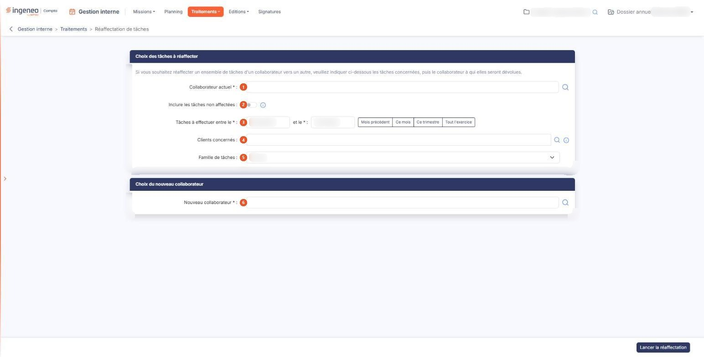
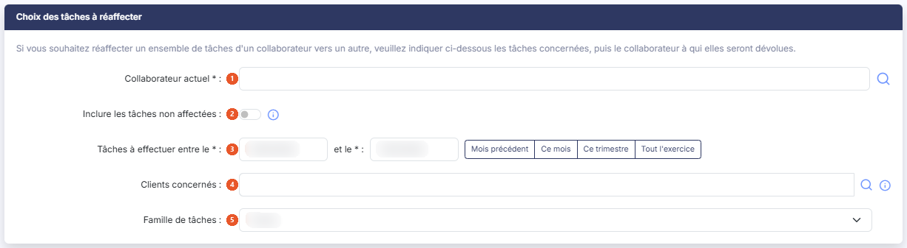

# Réaffectation de tâches


**Où le trouver :** Menu **Traitements › Réaffectation de tâches**



**En bref** — Ce traitement transfère en une seule fois les tâches d'un collaborateur vers un autre, sans reprendre les missions une à une, par exemple en cas d'absence.

* Pour préparer le transfert : indiquez le Collaborateur actuel, la période (ou bouton \[Ce mois]) et le Nouveau collaborateur, puis bouton \[Lancer la réaffectation].
* Pour effectuer le transfert après contrôle de la liste proposée : bouton \[Valider la réaffectation].
* Pour reprendre aussi les tâches sans collaborateur : placez « Inclure les tâches non affectées » sur « Oui » avant de lancer la réaffectation.


Ce traitement vous permet de transférer en une seule fois les tâches d'un collaborateur vers un autre, sans reprendre les missions une à une.

<figure><figcaption>
Écran « Réaffectation de tâches » de la nouvelle interface
</figcaption></figure>

L'écran se compose de deux rubriques : vous désignez d'abord les tâches concernées, puis le collaborateur à qui elles reviennent.

## Rubrique « Choix des tâches à réaffecter »

<figure><figcaption>
Rubrique « Choix des tâches à réaffecter »
</figcaption></figure>

La rubrique s'ouvre sur la phrase « _Si vous souhaitez réaffecter un ensemble de tâches d'un collaborateur vers un autre, veuillez indiquer ci-dessous les tâches concernées, puis le collaborateur à qui elles seront dévolues._ ».

| Champ                                   | Ce qu'il faut savoir                                                                                                                                                                                                                                                                                                                                                                                                                                                                                                                                                                                                                                                                                                                                   |
| --------------------------------------- | ------------------------------------------------------------------------------------------------------------------------------------------------------------------------------------------------------------------------------------------------------------------------------------------------------------------------------------------------------------------------------------------------------------------------------------------------------------------------------------------------------------------------------------------------------------------------------------------------------------------------------------------------------------------------------------------------------------------------------------------------------ |
| 1. **Collaborateur actuel**             | Indiquez le collaborateur dont les tâches doivent être transférées. La loupe placée à droite du champ ouvre une fenêtre « Recherche » qui liste les collaborateurs par **Nom Complet** et **Code utilisateur** ; vous pouvez y filtrer la liste en tapant dans la zone de recherche (elle affiche « _Contenu recherché_ » tant qu'elle est vide), qui filtre au fur et à mesure de votre saisie, puis cliquer sur le collaborateur voulu.                                                                                                                                                                                                                                                                                                              |
| 2. **Inclure les tâches non affectées** | Interrupteur, proposé sur « Non » à l'ouverture de l'écran. **C'est le point à retenir de cet écran** : il élargit la sélection au-delà du collaborateur actuel. Lorsque vous le placez sur « Oui », les tâches qui ne sont affectées à aucun collaborateur sont reprises elles aussi et attribuées au nouveau collaborateur. Laissé sur « Non », elles restent en l'état.                                                                                                                                                                                                                                                                                                                                                                             |
| 3. **Tâches à effectuer entre le**      | **et le :** obligatoires toutes les deux. Elles délimitent la période sur laquelle le logiciel recherche les tâches à transférer. La date de fin ne peut pas être antérieure à la date de début.                                                                                                                                                                                                                                                                                                                                                                                                                                                                                                                                                       |
| 4. **Clients concernés**                | Laissé vide, il ne restreint rien : tous les clients sont pris en compte. Vous pouvez au contraire désigner un ou plusieurs clients pour limiter le transfert à ceux-là : la loupe ouvre le panneau « Clients », qui s'affiche sur la droite de l'écran et qui liste les dossiers par **Code client** et **Dossier client** ; cliquez sur une ligne pour la retenir : le pied du panneau indique alors le nombre de clients sélectionnés (par exemple « 1 client sélectionné ») et propose le bouton **\[+ Ajouter le client]**. Le panneau n'a ni Bouton \[Valider] ni Bouton \[Annuler] : la croix, en haut à droite du panneau, le referme sans rien retenir. La zone **Rechercher** du panneau filtre la liste au fur et à mesure de votre saisie. |
| 5. **Famille de tâches**                | La liste vous propose « Toutes », puis les familles de tâches enregistrées dans le panneau Paramètres, sous _Données > Organisation et temps > Familles de tâches_. Elle limite le transfert aux tâches de la famille choisie.                                                                                                                                                                                                                                                                                                                                                                                                                                                                                                                         |

Quatre raccourcis vous aident à renseigner la période d'un seul geste : le bouton **\[Mois précédent]**, le bouton **\[Ce mois]**, le bouton **\[Ce trimestre]** et le bouton **\[Tout l'exercice]**. Chacun inscrit les deux dates à votre place. Les trois premiers se calculent à partir de la date du jour : le mois civil précédent, le mois civil en cours, le trimestre civil en cours. Le bouton **\[Tout l'exercice]** reprend, lui, les dates de début et de fin du dossier annuel en cours.

À l'ouverture de l'écran, et si vous n'avez rien saisi, le logiciel propose de lui-même la date du jour comme date de début et le même jour du mois suivant comme date de fin.

## Rubrique « Choix du nouveau collaborateur »

<figure><figcaption>
Rubrique « Choix du nouveau collaborateur »
</figcaption></figure>

**Nouveau collaborateur** : obligatoire. Indiquez le collaborateur à qui les tâches seront réaffectées. La loupe placée à droite du champ vous permet de le rechercher. Il doit être différent du collaborateur actuel ; sinon le logiciel refuse par le message « _Le nouveau collaborateur doit être différent de l'actuel._ ».

bouton **\[Lancer la réaffectation]**

Le logiciel contrôle d'abord votre saisie. Si un champ obligatoire manque, ou si la date de fin est antérieure à la date de début, il vous le signale sur le champ concerné et ne va pas plus loin.

Lorsque la saisie est complète, **le transfert n'est pas encore effectué** : le logiciel ouvre une fenêtre intitulée « Liste des tâches à réaffecter », qui vous présente les tâches répondant à vos critères. Vous pouvez donc vérifier ce qui va être transféré avant de vous engager.

Cette fenêtre vous propose deux commandes : le bouton **\[Valider la réaffectation]**, qui effectue le transfert, et le bouton **\[Annuler]**, qui referme la fenêtre sans rien modifier.

Une fois la réaffectation validée, le logiciel referme la fenêtre et vous indique combien de tâches ont été réaffectées.

Si aucune tâche ne répond à vos critères, la fenêtre affiche à la place le message « _Aucune tâche à réaffecter n'a été trouvée avec les paramètres saisis._ » et ne vous propose pas de valider.
