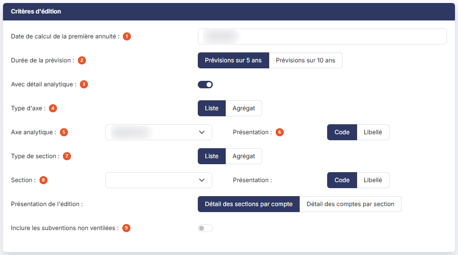

# Affectations prévisionnelles subventions


**Où le trouver :** Menu **Éditions › Affectations prévisionnelles subventions**



**En bref** — Cette édition prévoit, sur les cinq ou les dix années à venir, l'affectation au résultat de vos subventions d'investissement.

* Pour éditer la prévision : indiquez la date de calcul de la première annuité et la durée de la prévision, choisissez le format, puis bouton \[Editer].


Cette édition permet de prévoir, sur les cinq ou les dix années à venir, l'affectation au résultat de vos subventions d'investissement. C'est la transposition, pour les subventions, de l'édition « Dotations prévisionnelles ».

<figure><figcaption>
Écran « Affectations prévisionnelles subventions » de la nouvelle interface
</figcaption></figure>

L'écran se compose de deux rubriques, sans onglet ni liste. Dans un dossier où la comptabilité analytique est activée, la rubrique « Critères d'édition » propose en plus un détail analytique, décrit ci-dessous.

## Rubrique « Critères d'édition »

<figure><figcaption>
Rubrique « Critères d'édition »
</figcaption></figure>

| Champ                                        | Ce qu'il faut savoir                                                                                                                                                                                                                                                                                                                                                                                                                                                                                                                                                                                                                                          |
| -------------------------------------------- | ------------------------------------------------------------------------------------------------------------------------------------------------------------------------------------------------------------------------------------------------------------------------------------------------------------------------------------------------------------------------------------------------------------------------------------------------------------------------------------------------------------------------------------------------------------------------------------------------------------------------------------------------------------- |
| 1. **Date de calcul de la première annuité** | 
Indiquez la date à laquelle la première annuité doit être calculée ; le calcul des années suivantes se fera sur cette base, en ajoutant un an à chaque fois. Le logiciel propose par défaut la date de fin de votre exercice. Cette date est obligatoire, bien qu'aucun astérisque ne le signale à l'écran : si vous la videz, le logiciel refuse l'édition et affiche le message « Le champ Date de calcul de la première annuité est requis. » Saisissez la date, ou choisissez-la à l'aide du pictogramme de calendrier placé à côté de la zone. Le calendrier ne vous laisse choisir qu'une date comprise dans les bornes de votre exercice.
 |
| 2. **Durée de la prévision**                 | Choisissez entre « Prévisions sur 5 ans », proposé par défaut, et « Prévisions sur 10 ans ». C'est ce choix qui détermine le nombre de colonnes d'affectation de l'édition.                                                                                                                                                                                                                                                                                                                                                                                                                                                                                   |
| 3. **Avec détail analytique**                | Interrupteur désactivé à l'ouverture ; tant qu'il l'est, aucun autre critère n'est proposé. Dans un dossier où la comptabilité analytique est activée, vous pouvez l'activer, et la rubrique s'enrichit alors des critères suivants :                                                                                                                                                                                                                                                                                                                                                                                                                         |
| 4. **Type d'axe**                            | « Liste », proposé par défaut, ou « Agrégat ».                                                                                                                                                                                                                                                                                                                                                                                                                                                                                                                                                                                                                |
| 5. **Axe analytique**                        | Liste déroulante, ouverte sur « Sélectionnez » (dans le dossier consulté : « Axe 1 » et « Axe 2 »), accompagnée d'un choix de **Présentation :** « Code », proposé par défaut, ou « Libellé ».                                                                                                                                                                                                                                                                                                                                                                                                                                                                |
| 6. **Présentation de l'édition**             | « Détail des sections par compte », proposé par défaut, ou « Détail des comptes par section ».                                                                                                                                                                                                                                                                                                                                                                                                                                                                                                                                                                |
| 7. **Type de section**                       | « Liste », proposé par défaut, ou « Agrégat ».                                                                                                                                                                                                                                                                                                                                                                                                                                                                                                                                                                                                                |
| 8. **Section**                               | Liste déroulante qui se remplit quand vous choisissez un axe, et s'ouvre alors sur « Toutes » ; elle a elle aussi sa **Présentation :** « Code », proposé par défaut, ou « Libellé ».                                                                                                                                                                                                                                                                                                                                                                                                                                                                         |
| 9. **Inclure les subventions non ventilées** | Interrupteur désactivé à l'ouverture. Tant qu'il l'est, seuls les éléments ventilés sur l'axe choisi figurent dans l'édition ; activez-le pour y ajouter les autres.                                                                                                                                                                                                                                                                                                                                                                                                                                                                                          |

## Rubrique « Format d'édition »

| Champ                              | Ce qu'il faut savoir                                                                                                                                                                                                                                                                                                                                                                                                                                                                                                                                                                                                                                                                                                                                                                                    |
| ---------------------------------- | ------------------------------------------------------------------------------------------------------------------------------------------------------------------------------------------------------------------------------------------------------------------------------------------------------------------------------------------------------------------------------------------------------------------------------------------------------------------------------------------------------------------------------------------------------------------------------------------------------------------------------------------------------------------------------------------------------------------------------------------------------------------------------------------------------- |
| 4. **Avec la page des paramètres** | Répondez « Oui » pour qu'un récapitulatif des critères que vous avez retenus soit imprimé en tête de votre édition. La réponse proposée est « Non ».                                                                                                                                                                                                                                                                                                                                                                                                                                                                                                                                                                                                                                                    |
| 5. **Format**                      | 
Vous avez le choix entre trois formats : • Html : c'est le format proposé par défaut, et le plus rapide à s'afficher. L'édition s'ouvre dans un nouvel onglet de votre navigateur, ce qui vous laisse l'écran des critères en place pour relancer une autre édition. • Pdf : l'édition est produite sous forme de fichier, dont la largeur est ajustée à celle de la page. Ce format demande une précision de mise en page, décrite ci-dessous. • Excel : l'édition est produite sous forme de fichier tableur, ce qui vous permet de reprendre les montants dans vos propres calculs. Ce choix de format commande l'apparition du champ suivant : il ne s'affiche que pour le format Pdf, les formats Html et Excel n'en appelant aucun. Avec le format Pdf s'affiche un champ :
 |
| **Orientation**                    | Choisissez « Portrait », proposé par défaut, ou « Paysage ».                                                                                                                                                                                                                                                                                                                                                                                                                                                                                                                                                                                                                                                                                                                                            |

## Bouton \[Editer]

C'est le seul bouton de l'écran : il lance l'édition. Il n'y a ni retour, ni mémorisation des paramètres : pour quitter sans éditer, passez par le menu.

## Ce que contient l'édition

L'édition s'intitule « Affectation prévisionnelle des subventions sur 5 ans au » suivi de votre date de calcul, ou « sur 10 ans » selon la durée retenue. Avec le détail analytique, le titre devient « Affectation prévisionnelle des subventions - », suivi de l'axe choisi (son code ou son libellé, selon la présentation retenue), puis de « sur 5 ans » ou « sur 10 ans » et des dates (par exemple « Affectation prévisionnelle des subventions - A1 sur 5 ans au 01/01/2024 au 31/12/2024 ») ; une colonne « Section » s'ajoute alors entre « Date d'octroi » et « Libellé ».

Elle présente une ligne par subvention, groupée par compte de subvention : une ligne annonce le numéro de compte et son libellé, les subventions rattachées à ce compte la suivent, puis une ligne « Total compte » clôt le groupe. Une ligne « Total subventions » totalise l'ensemble en fin d'édition.

Les colonnes sont, dans l'ordre : le code de la subvention, sa date d'octroi, son libellé, le montant octroyé, l'affectation déjà réalisée à la date de début de votre exercice, puis autant de colonnes d'affectation que d'années prévues — quatre ou neuf de plus que la première annuité —, et enfin le cumul et le reste à affecter à la date de la dernière annuité.

Les montants sont arrondis au nombre de décimales monétaires de votre dossier. Le logiciel reporte le reste de chaque arrondi sur l'annuité suivante dès qu'il le peut, afin que le total de la ligne reste juste.
