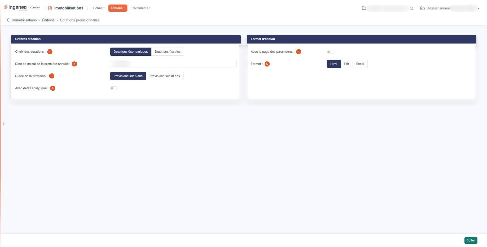

# Dotations prévisionnelles


**Où le trouver :** Menu **Éditions › Dotations prévisionnelles**



**En bref** — Cette édition calcule les dotations prévisionnelles aux amortissements, économiques ou fiscales, pour les 5 ou les 10 années à venir, avec un détail analytique possible.

* Pour éditer les prévisions : indiquez la date de calcul de la première annuité et la durée de la prévision, choisissez le format, puis bouton \[Editer].
* Pour ventiler par axe et par section : répondez « Oui » à « Avec détail analytique », puis choisissez l'axe et la section.


Cette édition permet le calcul des dotations prévisionnelles aux amortissements pour les 5 ou les 10 années à venir. Vous indiquez la date de calcul de la première annuité ; le calcul des années suivantes se fait sur cette base, d'année en année à la même date.

<figure><figcaption>
Écran « Dotations prévisionnelles » de la nouvelle interface
</figcaption></figure>

Ne la confondez pas avec l'option « Dotations » du même menu, qui calcule les dotations d'une période écoulée ou en cours : celle-ci porte sur l'avenir.

L'écran se compose de deux rubriques, sans onglet ni liste.

## Rubrique « Critères d'édition »

| Champ                                        | Ce qu'il faut savoir                                                                                                                                                                                                                                                                                                                                                                                                                              |
| -------------------------------------------- | ------------------------------------------------------------------------------------------------------------------------------------------------------------------------------------------------------------------------------------------------------------------------------------------------------------------------------------------------------------------------------------------------------------------------------------------------- |
| 1. **Choix des dotations**                   | Choisissez entre « Dotations économiques », proposé par défaut, et « Dotations fiscales ».                                                                                                                                                                                                                                                                                                                                                        |
| 2. **Date de calcul de la première annuité** | Le logiciel propose la date de fin de votre exercice. Saisissez la date, ou choisissez-la à l'aide du pictogramme de calendrier placé à côté de la zone. Cette date doit rester dans votre exercice : le calendrier ne vous laisse pas en sortir, et si vous saisissez une date hors exercice, le logiciel refuse l'édition et affiche le message « Le champ "Date de calcul de la première annuité" doit être dans le dossier annuel en cours. » |
| 3. **Durée de la prévision**                 | Choisissez entre « Prévisions sur 5 ans », proposé par défaut, et « Prévisions sur 10 ans ».                                                                                                                                                                                                                                                                                                                                                      |
| 4. **Avec détail analytique**                | Répondez « Oui » pour ventiler les dotations par axe et par section analytiques. La réponse proposée est « Non », et tant qu'elle reste à « Non » la rubrique s'arrête ici. La réponse « Oui » fait apparaître les huit champs décrits ci-dessous, entre cette option et la rubrique suivante.                                                                                                                                                    |
| **Type d'axe**                               | Choisissez « Liste » pour désigner un seul axe, ou « Agrégat » pour en cumuler plusieurs. Le champ qui suit change selon votre réponse.                                                                                                                                                                                                                                                                                                           |
| **Axe analytique**                           | Avec le type « Liste », déroulez la liste et choisissez l'axe à détailler.                                                                                                                                                                                                                                                                                                                                                                        |
| **Axes**                                     | Avec le type « Agrégat », ce champ remplace la liste déroulante. Saisissez plusieurs axes, ou recherchez-les à l'aide du pictogramme « Loupe » placé à côté de la zone.                                                                                                                                                                                                                                                                           |
| **Présentation**                             | Sur la même ligne que l'axe, à droite, choisissez « Code » ou « Libellé » selon ce que vous voulez voir imprimé pour l'axe. « Code » est proposé par défaut.                                                                                                                                                                                                                                                                                      |
| **Type de section**                          | Même choix « Liste » ou « Agrégat » que pour l'axe, et il est indépendant de lui : vous pouvez très bien cumuler plusieurs axes et ne retenir qu'une section.                                                                                                                                                                                                                                                                                     |
| **Section**                                  | Avec le type « Liste », déroulez la liste et choisissez la section. Les sections proposées sont celles de l'axe que vous avez retenu, et une entrée vous permet de les prendre toutes.                                                                                                                                                                                                                                                            |
| **Sections**                                 | Avec le type « Agrégat », ce champ remplace la liste déroulante, avec le même pictogramme « Loupe » que pour les axes.                                                                                                                                                                                                                                                                                                                            |
| **Présentation**                             | Sur la même ligne que la section, à droite, choisissez « Code » ou « Libellé » selon ce que vous voulez voir imprimé pour la section.                                                                                                                                                                                                                                                                                                             |
| **Présentation de l'édition**                | Choisissez « Détail des sections par compte », proposé par défaut, pour regrouper les immobilisations par catégorie et par compte, chaque section apparaissant à l'intérieur ; ou « Détail des comptes par section » pour regrouper d'abord par section.                                                                                                                                                                                          |
| **Inclure les écritures non ventilées**      | Répondez « Oui » pour conserver dans l'édition les immobilisations dont la dotation n'est pas ventilée sur l'axe retenu. La réponse proposée est « Non », et dans ce cas seules les immobilisations effectivement ventilées sur cet axe sont retenues.                                                                                                                                                                                            |

Lorsqu'une immobilisation est ventilée sur plusieurs sections, ses montants sont répartis au prorata du pourcentage affecté à chaque section.

## Rubrique « Format d'édition »

| Champ                              | Ce qu'il faut savoir                                                                                                                                                                                                                                                                                                                                                                                                                                                                                                                                                                                                                |
| ---------------------------------- | ----------------------------------------------------------------------------------------------------------------------------------------------------------------------------------------------------------------------------------------------------------------------------------------------------------------------------------------------------------------------------------------------------------------------------------------------------------------------------------------------------------------------------------------------------------------------------------------------------------------------------------- |
| 5. **Avec la page des paramètres** | Répondez « Oui » pour qu'un récapitulatif des critères que vous avez retenus soit imprimé en tête de votre édition. La réponse proposée est « Non ».                                                                                                                                                                                                                                                                                                                                                                                                                                                                                |
| 6. **Format**                      | 
Vous avez le choix entre trois formats : • Html : c'est le format proposé par défaut, et le plus rapide à s'afficher. L'édition s'ouvre dans un nouvel onglet de votre navigateur, ce qui vous laisse l'écran des critères en place pour relancer une autre édition. • Pdf : l'édition est produite sous forme de fichier. Ce format demande une précision de mise en page, décrite ci-dessous. • Excel : l'édition est produite sous forme de fichier tableur, ce qui vous permet de reprendre les montants dans vos propres calculs. Avec le format Pdf, et avec lui seul, s'affiche un champ supplémentaire :
 |
| **Orientation**                    | Choisissez « Portrait », proposé par défaut, ou « Paysage ».                                                                                                                                                                                                                                                                                                                                                                                                                                                                                                                                                                        |

## Bouton \[Editer]

C'est le seul bouton de l'écran : il lance l'édition. Il n'y a ici ni retour, ni mémorisation des critères : pour quitter sans éditer, passez par le menu. Le bouton n'apparaît que si votre profil vous autorise à lancer cette édition.
