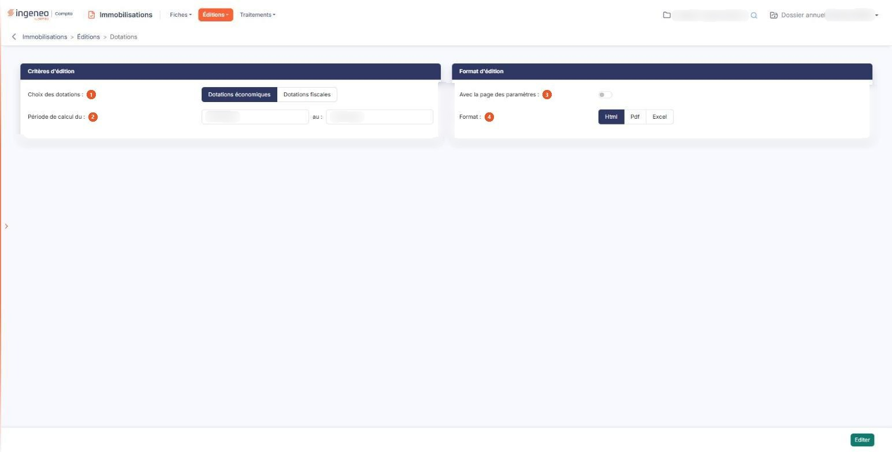

# Dotations


**Où le trouver :** Menu **Éditions › Dotations**



**En bref** — Cette édition calcule les dotations, économiques ou fiscales, de l'exercice en cours, sur tout l'exercice ou sur une période restreinte.

* Pour éditer les dotations : choisissez le type de dotations, la période de calcul et le format, puis bouton \[Editer].
* Pour n'obtenir qu'une partie de l'exercice : réduisez les dates « Période de calcul du » et « au », par exemple à un trimestre.


Cette édition permet le calcul des dotations de l'exercice en cours. Vous avez le choix entre les dotations économiques et les dotations fiscales, et vous pouvez restreindre la période de calcul.

<figure><figcaption>
Écran « Dotations » de la nouvelle interface
</figcaption></figure>

Ne la confondez pas avec l'option « Dotations prévisionnelles » du même menu, qui calcule les dotations des années à venir : celle-ci porte sur une période écoulée ou en cours.

L'écran se compose de deux rubriques, sans onglet ni liste.

## Rubrique « Critères d'édition »

| Champ                       | Ce qu'il faut savoir                                                                                                                                                                                                                                                                      |
| --------------------------- | ----------------------------------------------------------------------------------------------------------------------------------------------------------------------------------------------------------------------------------------------------------------------------------------- |
| 1. **Choix des dotations**  | Choisissez entre « Dotations économiques », proposé par défaut, et « Dotations fiscales ».                                                                                                                                                                                                |
| 2. **Période de calcul du** | **au :** les deux dates encadrent la période sur laquelle les dotations sont calculées. Elles sont affichées sur la même ligne, et le logiciel propose les dates de début et de fin de votre exercice. Réduisez-les pour n'obtenir qu'une partie de l'exercice, par exemple un trimestre. |

Saisissez chaque date, ou choisissez-la à l'aide du pictogramme de calendrier placé à côté de la zone. Les deux dates sont obligatoires, bien qu'aucun astérisque ne le signale à l'écran : si vous videz l'une des deux, le logiciel refuse l'édition et affiche le message « Le champ Période de calcul du est requis. » ou « Le champ au est requis. »

## Rubrique « Format d'édition »

| Champ                              | Ce qu'il faut savoir                                                                                                                                                                                                                                                                                                                                                                                                                                                                                                                                                                                                         |
| ---------------------------------- | ---------------------------------------------------------------------------------------------------------------------------------------------------------------------------------------------------------------------------------------------------------------------------------------------------------------------------------------------------------------------------------------------------------------------------------------------------------------------------------------------------------------------------------------------------------------------------------------------------------------------------- |
| 3. **Avec la page des paramètres** | Répondez « Oui » pour qu'un récapitulatif des critères que vous avez retenus soit imprimé en tête de votre édition. La réponse proposée est « Non ».                                                                                                                                                                                                                                                                                                                                                                                                                                                                         |
| 4. **Format**                      | 
Vous avez le choix entre trois formats : • Html : c'est le format proposé par défaut, et le plus rapide à s'afficher. L'édition s'ouvre dans un nouvel onglet de votre navigateur, ce qui vous laisse l'écran des critères en place pour relancer une autre édition. • Pdf : l'édition est produite sous forme de fichier. Ce format demande deux précisions de mise en page, décrites ci-dessous. • Excel : l'édition est produite sous forme de fichier tableur, ce qui vous permet de reprendre les montants dans vos propres calculs. Avec le format Pdf, et avec lui seul, s'affichent deux champs :
 |
| **Orientation**                    | Choisissez « Portrait », proposé par défaut, ou « Paysage ».                                                                                                                                                                                                                                                                                                                                                                                                                                                                                                                                                                 |
| **Largeur**                        | Choisissez entre « Fixe » et « Ajustée ». Comme l'indique le pictogramme d'information placé à côté, la largeur ajustée « Ajuste la taille si la largeur des colonnes dépasse la largeur de la page ». Le logiciel sélectionne « Ajustée » chaque fois que vous choisissez le format Pdf ; vous pouvez lui préférer « Fixe », mais si vous changez de format puis revenez au Pdf, la sélection est ramenée à « Ajustée ».                                                                                                                                                                                                    |

## Bouton \[Editer]

C'est le seul bouton de l'écran : il lance l'édition. Il n'y a ni retour, ni mémorisation des paramètres : pour quitter sans éditer, passez par le menu.
