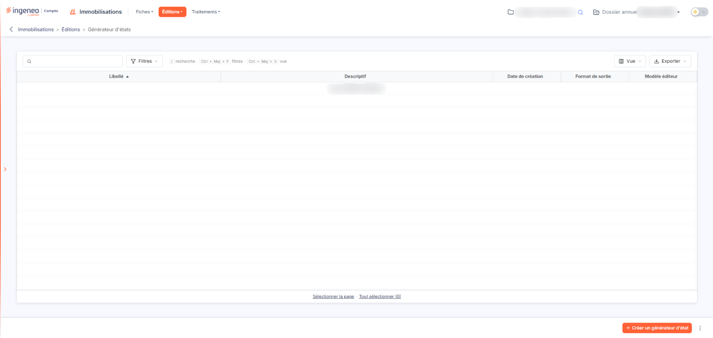
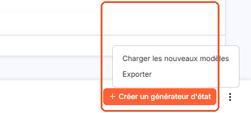
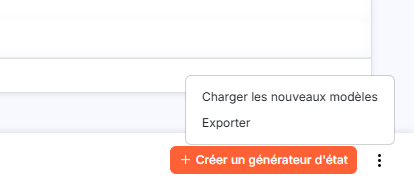
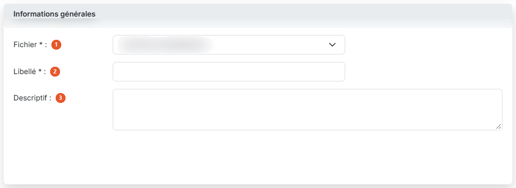
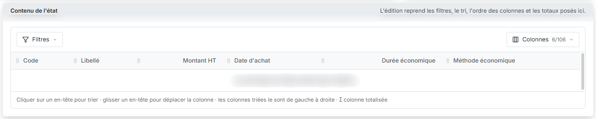
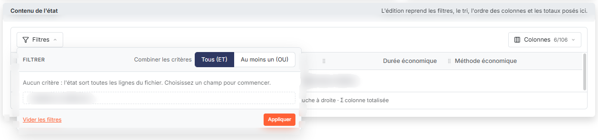
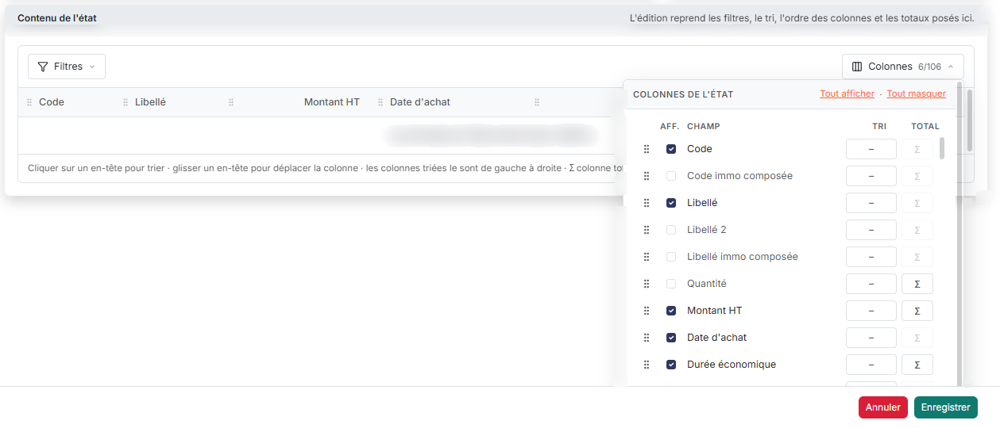
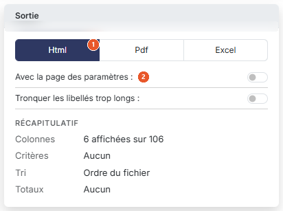
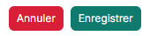

# Générateur d'états


**Où le trouver :** Menu **Éditions › Générateur d'états**



**En bref** — Cet écran permet d'élaborer et de mémoriser vos propres éditions de listes à partir des fichiers du module : colonnes à imprimer, ordre, tri et conditions de sélection.

* Pour créer un état : bouton \[Créer un générateur d'état], choisissez le fichier, donnez un libellé, réglez les colonnes, puis bouton \[Enregistrer].
* Pour produire l'édition : commande de lancement de l'édition sur la ligne de l'état dans la liste, puis choisissez le format dans la fenêtre « Format de l'édition » ; la fiche n'a plus de bouton \[Lancer l'édition].
* Pour récupérer les états livrés par l'éditeur : menu « Autres actions », bouton \[Charger les nouveaux modèles].


Le générateur d'états d'édition permet d'élaborer et de mémoriser vos propres éditions de listes, à partir des fichiers du module : vous choisissez le fichier, les colonnes à imprimer, leur ordre, leur tri et les conditions de sélection des lignes.

<figure><figcaption>
Écran « Générateur d'états » de la nouvelle interface
</figcaption></figure>

Son fonctionnement est commun à tous les modules du logiciel où il est présent, et une aide générale lui est consacrée dans le chapitre en tête de la présente aide. La présente page décrit ce que cet écran propose dans le module des immobilisations.

L'écran se présente en deux temps : la liste de vos états, puis la fiche de l'un d'entre eux.

## La liste des états

Les états que vous avez déjà créés pour ce module apparaissent dans une liste, avec leur libellé, leur descriptif, leur date de création, leur format de sortie et une colonne « Modèle éditeur ». Cette dernière indique par « Oui » les états fournis par l'éditeur du logiciel : ceux-là, vous pouvez les utiliser et les dupliquer, mais non les modifier. Si vous n'avez encore créé aucun état, la liste affiche « Aucun élément à afficher. »

Comme sur toutes les listes du logiciel, une barre placée au-dessus de la liste porte trois boutons nommés — bouton **\[Filtres]**, bouton **\[Vue]** et bouton **\[Exporter]** — ainsi que deux liens de sélection : **Sélectionner la page**, qui coche toutes les lignes de la page affichée, et **Tout sélectionner**, qui étend la sélection à toutes les pages et rappelle entre parenthèses le nombre d'états concernés. Chaque ligne porte quatre commandes : modifier l'état, le supprimer, le dupliquer, et lancer son édition. Cette dernière commande ouvre une fenêtre intitulée « Format de l'édition » où vous choisissez le format avant de lancer l'impression, sans passer par la fiche. Ces commandes n'apparaissent que si votre profil vous y autorise, chacune répondant à un droit distinct.

## Bouton \[Créer un générateur d'état]

<figure><figcaption>
Bouton [Créer un générateur d'état]
</figcaption></figure>

<figure><figcaption>
Bouton [Créer un générateur d'état]
</figcaption></figure>

Placé dans la barre du bas de l'écran, à droite, il ouvre à droite de l'écran le panneau « Nouvel état », qui est la fiche de création d'un état, décrite ci-dessous.

## Bouton \[Charger les nouveaux modèles]

<figure><figcaption>
Bouton [Charger les nouveaux modèles]
</figcaption></figure>

Cette action se trouve dans le menu « Autres actions » de la barre du bas, selon vos droits. Elle ouvre une fenêtre intitulée « Nouveaux modèles », qui vous invite à choisir les nouveaux modèles que vous voulez charger puis à valider. Ce sont les états livrés par l'éditeur du logiciel et que vous ne possédez pas encore. Une fois le chargement fait, le logiciel vous indique combien de modèles ont été chargés ; s'il n'y en a aucun de nouveau, il vous le dit également.

## Bouton \[Exporter]

Cette action se trouve elle aussi dans le menu « Autres actions » de la barre du bas, selon vos droits. Si vous gérez plusieurs sociétés, elle vous permet de recopier vers les autres les états que vous avez créés dans celle-ci. Sélectionnez les états à exporter dans la liste à l'aide des cases à cocher, puis choisissez cette entrée.

## Bouton \[Supprimer]

Il supprime en une fois tous les états que vous avez cochés dans la liste.

## Carte « Informations générales »

<figure><figcaption>
Rubrique « Informations générales »
</figcaption></figure>

| Champ                                                      | Ce qu'il faut savoir                                                                                                                                                                                                                                                                                                                                                                                                                                                              |
| ---------------------------------------------------------- | --------------------------------------------------------------------------------------------------------------------------------------------------------------------------------------------------------------------------------------------------------------------------------------------------------------------------------------------------------------------------------------------------------------------------------------------------------------------------------- |
| 
1. <strong>Fichier</strong> <em>Obligatoire</em>
 | 
Déroulez la liste et choisissez le fichier sur lequel porte votre édition. Ce choix est obligatoire, et il commande tout le reste : c'est lui qui détermine les colonnes disponibles. Le module des immobilisations en propose sept : • Contrats de location, • Crédits-bails, • Emprunts, • Liste des immobilisations, de loin le plus riche, avec plus de cent champs, • Liste des immobilisations composées, • Liste des subventions, • Véhicules.
 |
| 
2. <strong>Libellé</strong> <em>Obligatoire</em>
 | Donnez un nom à votre état. Il est obligatoire, et il doit être unique dans le module : si vous reprenez un nom déjà employé, le logiciel refuse l'enregistrement et vous invite à en choisir un autre. C'est ce libellé qui identifiera votre état dans la liste.                                                                                                                                                                                                                |
| 3. **Descriptif**                                          | Zone de saisie libre, facultative, pour vous rappeler à quoi sert cet état. Il apparaît dans la liste, à côté du libellé.                                                                                                                                                                                                                                                                                                                                                         |
| **Opérateur logique entre les conditions**                 | Il ne figure plus dans cette carte : il se règle dans le menu « Filtres » de la carte « Contenu de l'état », décrit ci-dessous.                                                                                                                                                                                                                                                                                                                                                   |

## Carte « Contenu de l'état »

<figure><figcaption>
Rubrique « Contenu de l'état »
</figcaption></figure>

<figure><figcaption>
Rubrique « Contenu de l'état »
</figcaption></figure>

<figure><figcaption>
Rubrique « Contenu de l'état »
</figcaption></figure>

Tant que vous n'avez pas choisi de fichier, la carte se contente d'indiquer « Choisissez un fichier : ses champs apparaîtront ici. » Dès que vous en choisissez un, elle présente un aperçu des colonnes de l'édition — par exemple, pour « Emprunts », Code, Libellé, Date de début, Capital emprunté, Taux annuel et Type de remboursement — et deux menus : bouton **\[Filtres]** à gauche et bouton **\[Colonnes]** à droite. Une phrase sous l'aperçu rappelle que l'on clique sur un en-tête pour trier, que l'on glisse un en-tête pour déplacer la colonne, que les colonnes triées le sont de gauche à droite et que le signe Σ marque une colonne totalisée. Tant que l'aperçu n'a rien à montrer, il affiche « Les données de l'état sortent dans l'édition. »

| Champ                  | Ce qu'il faut savoir                                                                                                                                                                                                                                                                                                                                                                                                                                                                                                                                                                                                                                                                                                    |
| ---------------------- | ----------------------------------------------------------------------------------------------------------------------------------------------------------------------------------------------------------------------------------------------------------------------------------------------------------------------------------------------------------------------------------------------------------------------------------------------------------------------------------------------------------------------------------------------------------------------------------------------------------------------------------------------------------------------------------------------------------------------- |
| **Bouton \[Filtres]**  | Il sert à poser des conditions sur les champs du fichier. Il ouvre un volet « Filtrer » dans lequel vous réglez « Combiner les critères » sur « Tous (ET) », pour que toutes les conditions soient respectées, ou sur « Au moins un (OU) », pour qu'une condition au moins le soit. Tant qu'aucun critère n'est posé, le volet indique « Aucun critère : l'état sort toutes les lignes du fichier. Choisissez un champ pour commencer. » ; la liste « + Ajouter un critère sur… » sert à choisir le champ, et le volet porte aussi le lien « Vider les filtres » et le bouton \[Appliquer].                                                                                                                             |
| **Bouton \[Colonnes]** | Il indique le nombre de colonnes affichées sur le nombre de champs du fichier (par exemple « 6/38 » pour « Emprunts ») et ouvre la liste « Colonnes de l'état », avec les liens « Tout afficher » et « Tout masquer ». Chaque champ y est une ligne qui se déplace à la souris (c'est ainsi que l'on réorganise l'ordre des colonnes) et qui porte une case d'affichage (colonne « Aff. »), un choix de tri (colonne « Tri », sans tri par défaut) et, pour les champs totalisables, un bouton Σ (colonne « Total ») ; ce bouton est grisé sur les champs qui ne se totalisent pas, un libellé ou une date par exemple. À l'ouverture du fichier, quelques champs sont déjà affichés : le code et le libellé notamment. |

## Carte « Sortie »

<figure><figcaption>
Rubrique « Sortie »
</figcaption></figure>

La carte se compose, de haut en bas, d'un choix de format, d'interrupteurs d'options et d'un « Récapitulatif » (Colonnes, Critères, Tri, Totaux) qui résume l'état en cours de composition, par exemple « 6 affichées sur 38 » pour les colonnes.

| Champ                              | Ce qu'il faut savoir                                                                                                                                                                                                                                                                                                                                                                                                                                                                                                                                                                                                                                                                                                                                                                                                                                                                                                                |
| ---------------------------------- | ----------------------------------------------------------------------------------------------------------------------------------------------------------------------------------------------------------------------------------------------------------------------------------------------------------------------------------------------------------------------------------------------------------------------------------------------------------------------------------------------------------------------------------------------------------------------------------------------------------------------------------------------------------------------------------------------------------------------------------------------------------------------------------------------------------------------------------------------------------------------------------------------------------------------------------- |
| 1. **Format de sortie**            | 
Vous avez le choix entre trois formats, Html, Pdf et Excel, et chacun apporte ses propres options : • Html : c'est le format proposé par défaut, et le plus rapide à s'afficher. Il ajoute l'interrupteur <strong>Tronquer les libellés trop longs :</strong>, à activer si une première impression vous a montré des libellés trop longs pour la largeur de leur colonne. Il est désactivé à l'ouverture. • Pdf : il ajoute deux options, <strong>Masquer les entêtes et pieds de page :</strong>, interrupteur à activer pour supprimer l'en-tête et le pied de page de l'édition ; et <strong>Orientation :</strong>, avec le choix « Portrait », proposé par défaut, ou « Paysage », qui convient mieux dès que votre état compte beaucoup de colonnes. • Excel : il ajoute la seule option de masquage des en-têtes et pieds de page. Ce format vous permet de reprendre les valeurs dans vos propres calculs.
 |
| 2. **Avec la page des paramètres** | Activez l'interrupteur pour qu'un récapitulatif des critères que vous avez retenus soit imprimé en tête de votre édition. Il est désactivé à l'ouverture.                                                                                                                                                                                                                                                                                                                                                                                                                                                                                                                                                                                                                                                                                                                                                                           |

Seul « Avec la page des paramètres » est commun aux trois formats : l'option de troncature n'existe qu'en Html, et celle de masquage des en-têtes n'existe pas en Html.

## Bouton \[Enregistrer]

<figure><figcaption>
Bouton [Enregistrer]
</figcaption></figure>

Il enregistre votre état afin de pouvoir le réutiliser. Le fichier et le libellé sont obligatoires, et vous devez afficher au moins un champ : sinon le logiciel refuse l'enregistrement et vous l'indique.

## Bouton \[Annuler]

<figure><figcaption>
Bouton [Annuler]
</figcaption></figure>

Placé à gauche de \[Enregistrer], au pied du panneau, il referme le panneau sans rien enregistrer. Si vous avez commencé à saisir ou à choisir quelque chose, le logiciel ouvre d'abord une fenêtre « Abandon des modifications » : « Les modifications non enregistrées de cet état seront perdues. Veuillez confirmer l'abandon. » ; « Confirmer » referme le panneau et abandonne la saisie, « Annuler » vous la laisse. Vous retrouvez ensuite la liste de vos états. Le pied du panneau ne porte pas d'autre bouton : la fiche n'a plus de bouton \[Lancer l'édition] ni de bouton \[Retour].
