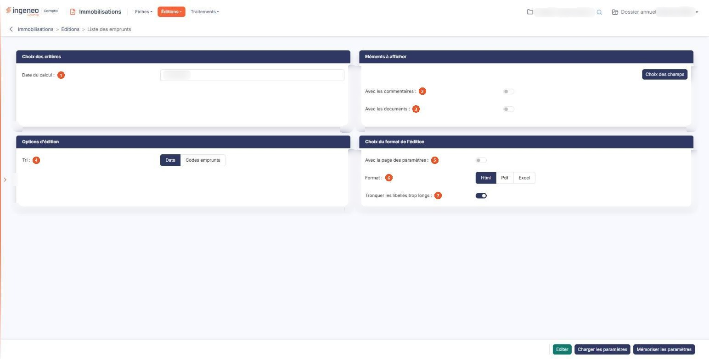

# Liste des emprunts


**Où le trouver :** Menu **Éditions › Liste des emprunts**



**En bref** — Cette édition présente la liste de vos emprunts, avec le capital emprunté, les échéances à date et leur cumul depuis l'origine, sans modifier vos fiches.

* Pour éditer la liste : indiquez la date du calcul, choisissez le tri et le format, puis bouton \[Editer].
* Pour ajouter des colonnes : bouton \[Choix des champs], puis bouton \[Mémoriser les paramètres] pour conserver ce choix.


Cette édition présente la liste de vos emprunts, à partir de l'échéancier calculé sur chaque fiche. Elle donne notamment, pour chaque emprunt :

<figure><figcaption>
Écran « Liste des emprunts » de la nouvelle interface
</figcaption></figure>

* le capital emprunté,
* les échéances à date, c'est-à-dire celles qui tombent entre le premier jour de votre exercice et la date de calcul que vous indiquez,
* le cumul des échéances depuis l'origine de l'emprunt jusqu'à cette même date.

Les emprunts dont la dernière échéance est antérieure au premier jour de votre exercice ne sont pas retenus : un emprunt soldé avant l'ouverture de l'exercice ne figure donc pas dans la liste.

L'écran se compose de quatre rubriques, sans onglet ni liste, et d'une barre de trois boutons en pied d'écran.

## Rubrique « Choix des critères »

**Date du calcul** : c'est la date à laquelle les échéances sont arrêtées. Le logiciel propose la date de fin de votre exercice. Saisissez-la, ou choisissez-la à l'aide du pictogramme de calendrier placé à côté de la zone. Elle doit rester comprise dans votre exercice : sinon le logiciel refuse l'édition et affiche, sous la zone, le message « La date de calcul doit être comprise dans la période de l'exercice. »

Cette date ne modifie aucune de vos fiches : elle sert seulement à arrêter le calcul de l'édition.

## Rubrique « Eléments à afficher »

bouton **\[Choix des champs]** : son emploi est facultatif, des colonnes étant déjà retenues par défaut. Il ouvre une fenêtre intitulée « Eléments à afficher » qui présente les 39 colonnes disponibles, une par ligne, avec trois informations :

| Champ                        | Ce qu'il faut savoir                                                                                                                                                                                                                                                                                                                                                                                                                                                                                                                                                                                                                                     |
| ---------------------------- | -------------------------------------------------------------------------------------------------------------------------------------------------------------------------------------------------------------------------------------------------------------------------------------------------------------------------------------------------------------------------------------------------------------------------------------------------------------------------------------------------------------------------------------------------------------------------------------------------------------------------------------------------------- |
| 2. **Avec les commentaires** | La réponse proposée est « Non ».                                                                                                                                                                                                                                                                                                                                                                                                                                                                                                                                                                                                                         |
| 3. **Avec les documents**    | La réponse proposée est « Non ».                                                                                                                                                                                                                                                                                                                                                                                                                                                                                                                                                                                                                         |
| **Sélection**                | Répondez « Oui » pour que la colonne figure dans l'édition. Cinq colonnes seulement sont retenues à l'ouverture : le code, le libellé, le capital emprunté, les échéances à date et le cumul des échéances. La première ligne, « Code », affiche un « Oui » figé : cette colonne est indispensable à l'édition et ne peut pas être retirée. Les 34 autres colonnes disponibles portent l'organisme prêteur, la valeur du bien financé, les caractéristiques de l'échéancier, le taux, l'assurance, les frais, les comptes et le journal de l'emprunt, ses modalités de comptabilisation, et les informations de création et de modification de la fiche. |
| **Nom de la colonne**        | Son intitulé, tel qu'il sera imprimé.                                                                                                                                                                                                                                                                                                                                                                                                                                                                                                                                                                                                                    |
| **Largeur**                  | 
La zone est vide et affiche en gris clair la largeur que le logiciel appliquera. Saisissez une valeur pour l'élargir ou la réduire ; effacez votre saisie pour revenir à la largeur proposée. Le bouton d'enregistrement de la fenêtre valide vos choix, celui de fermeture les abandonne, tout comme le pictogramme « Croix » en haut à droite. Attention : ces choix ne valent que le temps où vous restez sur l'écran. Si vous naviguez dans les menus puis revenez à cette édition, vous retrouvez les colonnes par défaut ; pour les conserver, servez-vous du bouton de mémorisation des paramètres décrit plus bas.
                     |

## Rubrique « Options d'édition »

Cette rubrique ne contient qu'un seul champ.

**Tri** : choisissez « Date », proposé par défaut, pour classer les emprunts par date d'emprunt, les emprunts de même date étant alors classés par code ; ou « Codes emprunts » pour les classer par code.

## Rubrique « Choix du format de l'édition »

| Champ                                   | Ce qu'il faut savoir                                                                                                                                                                                                                                                                                                                                                                                                                                                                                                                                                                                                                                                                                                                                                                                |
| --------------------------------------- | --------------------------------------------------------------------------------------------------------------------------------------------------------------------------------------------------------------------------------------------------------------------------------------------------------------------------------------------------------------------------------------------------------------------------------------------------------------------------------------------------------------------------------------------------------------------------------------------------------------------------------------------------------------------------------------------------------------------------------------------------------------------------------------------------- |
| 5. **Avec la page des paramètres**      | Répondez « Oui » pour qu'un récapitulatif des critères que vous avez retenus soit imprimé en tête de votre édition. La réponse proposée est « Non ».                                                                                                                                                                                                                                                                                                                                                                                                                                                                                                                                                                                                                                                |
| 6. **Format**                           | 
Vous avez le choix entre trois formats : • Html : c'est le format proposé par défaut, et le plus rapide à s'afficher. L'édition s'ouvre dans un nouvel onglet de votre navigateur, ce qui vous laisse l'écran des critères en place pour relancer une autre édition. Si votre navigateur refuse d'ouvrir cet onglet, le logiciel vous en avertit par le message « L'édition n'a pu être générée. Veuillez vérifier le paramétrage de votre navigateur. » • Pdf : l'édition est produite sous forme de fichier. Ce format demande deux précisions de mise en page, décrites ci-dessous. • Excel : l'édition est produite sous forme de fichier tableur, ce qui vous permet de reprendre les montants dans vos propres calculs. Avec le format Html, et avec lui seul, s'affiche :
 |
| 7. **Tronquer les libellés trop longs** | 
La réponse proposée est « Oui ». Répondez « Non » si vous préférez voir les libellés en entier, quitte à ce que le tableau s'élargisse. Avec le format Pdf, et avec lui seul, s'affichent deux champs :
                                                                                                                                                                                                                                                                                                                                                                                                                                                                                                                                                                                   |
| **Orientation**                         | Choisissez « Portrait », proposé par défaut, ou « Paysage ». Le paysage convient mieux dès que vous retenez beaucoup de colonnes.                                                                                                                                                                                                                                                                                                                                                                                                                                                                                                                                                                                                                                                                   |
| **Largeur**                             | Choisissez entre « Fixe » et « Ajustée ». Comme l'indique le pictogramme d'information placé à côté, la largeur ajustée « Ajuste la taille si la largeur des colonnes dépasse la largeur de la page ». Le logiciel sélectionne « Ajustée » chaque fois que vous choisissez le format Pdf ; vous pouvez lui préférer « Fixe », mais si vous changez de format puis revenez au Pdf, la sélection est ramenée à « Ajustée ».                                                                                                                                                                                                                                                                                                                                                                           |

## Bouton \[Editer]

Il lance l'édition au format demandé. Il n'apparaît que si votre profil vous autorise à lancer cette édition.

## Bouton \[Mémoriser les paramètres]

Il sauvegarde tous les critères de l'édition en cours, colonnes retenues comprises, afin de pouvoir les réutiliser plus tard. Il ouvre une fenêtre intitulée « Mémoriser les paramètres de l'édition » qui vous demande d'indiquer le libellé du modèle d'édition : saisissez-le, puis validez avec le bouton d'enregistrement de la fenêtre. Le libellé est obligatoire ; s'il est déjà utilisé, le logiciel vous propose de mettre à jour le modèle existant plutôt que d'en créer un second.

## Bouton \[Charger les paramètres]

Il ouvre une fenêtre intitulée « Chargement des paramètres » présentant la liste des jeux de critères que vous avez mémorisés pour cette édition, sous leur libellé. Cliquez sur une ligne pour recharger ses critères dans l'écran, puis lancez votre édition. Chaque ligne porte aussi une commande de suppression, qui vous demande confirmation avant d'agir ; un jeu de paramètres utilisé par un point de contrôle d'un dossier de révision ou d'un modèle de dossier de révision ne peut pas être supprimé, et le logiciel vous le dit. Si vous n'avez encore rien mémorisé, la fenêtre affiche « Aucun élément à afficher. »
