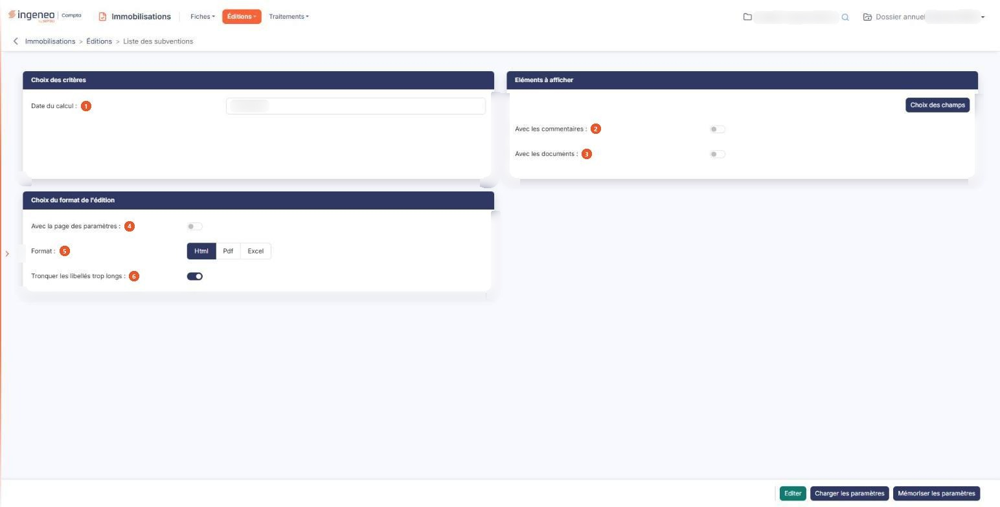

# Liste des subventions


**Où le trouver :** Menu **Éditions › Liste des subventions**



**En bref** — Cette édition liste vos subventions d'investissement avec leur étalement arrêté à une date : part déjà reprise, dotation de l'exercice, cumul et solde restant à reprendre.

* Pour éditer la liste : indiquez la date du calcul, choisissez le format, puis bouton \[Editer].
* Pour choisir les colonnes : bouton \[Choix des champs], puis bouton \[Mémoriser les paramètres] pour conserver ce choix.


Cette édition permet d'éditer la liste de vos subventions d'investissement, avec leur étalement arrêté à la date que vous indiquez : la part déjà reprise au résultat lors des exercices antérieurs, la dotation de l'exercice, leur cumul et le solde restant à reprendre.

<figure><figcaption>
Écran « Liste des subventions » de la nouvelle interface
</figcaption></figure>

Toutes vos subventions sont éditées, classées par code : il n'y a pas de sélection de comptes ni de filtre sur cet écran.

L'écran se compose de trois rubriques, sans onglet ni liste, et d'une barre de trois boutons en pied d'écran. Il n'a pas de rubrique d'options : cette édition ne propose ni tri ni sous-total.

## Rubrique « Choix des critères »

**Date du calcul** : c'est le seul critère de cette édition. Le logiciel propose la date de fin de votre exercice. Saisissez-la, ou choisissez-la à l'aide du pictogramme de calendrier placé à côté de la zone. Elle doit rester comprise dans votre exercice : sinon le logiciel refuse l'édition et affiche, sous la zone, le message « La date de calcul doit être comprise dans la période de l'exercice. »

Cette date sert uniquement à arrêter les montants d'étalement : elle sépare ce qui est antérieur de ce qui relève de l'exercice, et elle proratise la dotation de l'exercice lorsqu'elle tombe avant la fin de celui-ci. Contrairement à d'autres éditions du module, elle ne modifie aucune de vos fiches : les montants sont composés le temps de l'édition et rien n'est conservé. Vous pouvez donc éditer autant de fois que vous le souhaitez, à autant de dates que vous le souhaitez, sans effet sur vos subventions.

## Rubrique « Eléments à afficher »

bouton **\[Choix des champs]** : son emploi est facultatif, des colonnes étant déjà retenues par défaut. Il ouvre une fenêtre intitulée « Eléments à afficher » qui présente les 13 colonnes disponibles, une par ligne, avec trois informations :

| Champ                        | Ce qu'il faut savoir                                                                                                                                                                                                                                                                                                                                                                                                                                                                                                                                                                                                                 |
| ---------------------------- | ------------------------------------------------------------------------------------------------------------------------------------------------------------------------------------------------------------------------------------------------------------------------------------------------------------------------------------------------------------------------------------------------------------------------------------------------------------------------------------------------------------------------------------------------------------------------------------------------------------------------------------ |
| 2. **Avec les commentaires** | Répondez « Oui » pour que le commentaire saisi sur chaque subvention soit imprimé en italique sous sa ligne, précédé de la mention « Commentaire : ». La réponse proposée est « Non ». Une subvention sans commentaire n'occupe aucune ligne supplémentaire.                                                                                                                                                                                                                                                                                                                                                                         |
| 3. **Avec les documents**    | Répondez « Oui » pour que la liste des fichiers joints à chaque subvention soit imprimée sous sa ligne, chaque document étant précédé d'un pictogramme qui permet de l'ouvrir. Si vous n'avez pas donné de libellé à un document, c'est le nom de son fichier qui est imprimé. La réponse proposée est « Non ».                                                                                                                                                                                                                                                                                                                      |
| **Sélection**                | Répondez « Oui » pour que la colonne figure dans l'édition. Sept colonnes sont retenues à l'ouverture : le code, la date d'octroi, le montant hors taxes, les antérieurs, la dotation, le cumul des dotations et le solde. La première ligne, « Code », affiche un « Oui » figé : cette colonne est indispensable à l'édition et ne peut pas être retirée. Les six autres colonnes disponibles sont le libellé, l'organisme qui a versé la subvention, son régime et sa durée d'étalement, le montant de taxe sur la valeur ajoutée et le montant toutes taxes comprises.                                                            |
| **Nom de la colonne**        | Son intitulé, tel qu'il sera imprimé.                                                                                                                                                                                                                                                                                                                                                                                                                                                                                                                                                                                                |
| **Largeur**                  | 
La zone est vide et affiche en gris clair la largeur que le logiciel appliquera. Saisissez une valeur pour l'élargir ou la réduire ; effacez votre saisie pour revenir à la largeur proposée. Le bouton d'enregistrement de la fenêtre valide vos choix, celui de fermeture les abandonne, tout comme le pictogramme « Croix » en haut à droite. Attention : ces choix ne valent que le temps où vous restez sur l'écran. Si vous naviguez dans les menus puis revenez à cette édition, vous retrouvez les colonnes par défaut ; pour les conserver, servez-vous du bouton de mémorisation des paramètres décrit plus bas.
 |

## Rubrique « Choix du format de l'édition »

| Champ                                   | Ce qu'il faut savoir                                                                                                                                                                                                                                                                                                                                                                                                                                                                                                                                                                                                                                                                                                                                                                                |
| --------------------------------------- | --------------------------------------------------------------------------------------------------------------------------------------------------------------------------------------------------------------------------------------------------------------------------------------------------------------------------------------------------------------------------------------------------------------------------------------------------------------------------------------------------------------------------------------------------------------------------------------------------------------------------------------------------------------------------------------------------------------------------------------------------------------------------------------------------- |
| 4. **Avec la page des paramètres**      | Répondez « Oui » pour qu'un récapitulatif des critères que vous avez retenus soit imprimé en tête de votre édition. La réponse proposée est « Non ».                                                                                                                                                                                                                                                                                                                                                                                                                                                                                                                                                                                                                                                |
| 5. **Format**                           | 
Vous avez le choix entre trois formats : • Html : c'est le format proposé par défaut, et le plus rapide à s'afficher. L'édition s'ouvre dans un nouvel onglet de votre navigateur, ce qui vous laisse l'écran des critères en place pour relancer une autre édition. Si votre navigateur refuse d'ouvrir cet onglet, le logiciel vous en avertit par le message « L'édition n'a pu être générée. Veuillez vérifier le paramétrage de votre navigateur. » • Pdf : l'édition est produite sous forme de fichier. Ce format demande deux précisions de mise en page, décrites ci-dessous. • Excel : l'édition est produite sous forme de fichier tableur, ce qui vous permet de reprendre les montants dans vos propres calculs. Avec le format Html, et avec lui seul, s'affiche :
 |
| 6. **Tronquer les libellés trop longs** | 
La réponse proposée est « Oui » : un libellé plus large que sa colonne est coupé, ce qui garde le tableau lisible. Répondez « Non » si vous préférez voir les libellés en entier, quitte à ce que le tableau s'élargisse. Avec le format Pdf, et avec lui seul, s'affichent deux champs :
                                                                                                                                                                                                                                                                                                                                                                                                                                                                                                 |
| **Orientation**                         | Choisissez « Portrait », proposé par défaut, ou « Paysage ». Le paysage devient utile si vous retenez la plupart des treize colonnes.                                                                                                                                                                                                                                                                                                                                                                                                                                                                                                                                                                                                                                                               |
| **Largeur**                             | Choisissez entre « Fixe » et « Ajustée ». Comme l'indique le pictogramme d'information placé à côté, la largeur ajustée « Ajuste la taille si la largeur des colonnes dépasse la largeur de la page ». Le logiciel sélectionne « Ajustée » chaque fois que vous choisissez le format Pdf ; vous pouvez lui préférer « Fixe », mais si vous changez de format puis revenez au Pdf, la sélection est ramenée à « Ajustée ».                                                                                                                                                                                                                                                                                                                                                                           |

## Bouton \[Editer]

Il lance l'édition au format demandé, sous le titre « Liste des subventions au », suivi de la date du calcul que vous avez retenue. Il n'apparaît que si votre profil vous autorise à lancer cette édition.

L'édition présente une ligne par subvention, classée par code, et se termine par une ligne « Total subventions » qui totalise les colonnes de montants. Quatre colonnes méritent une explication :

* « Antérieurs » : la part de la subvention déjà reprise au résultat avant la date du calcul.
* « Dotation » : la reprise qui revient à l'exercice en cours. Si la date du calcul tombe avant la fin de l'exercice, cette dotation est proratisée à cette date.
* « Cumul des dotations » : la somme des deux précédentes.
* « Solde » : le montant hors taxes de la subvention diminué de ce cumul, autrement dit ce qui reste à reprendre.

Ces quatre colonnes restent à zéro pour une subvention dont le régime d'étalement est « Aucun » : sans étalement, il n'y a rien à répartir. Et lorsqu'une subvention est étalée sur des immobilisations ou sur des crédits-bails, le logiciel imprime sous sa ligne la liste des éléments concernés, sous l'intitulé « Liste des immobilisations : » ou « Liste des crédits-bails : », avec pour chacun son code, son libellé et le montant qui lui a été affecté.

## Bouton \[Mémoriser les paramètres]

Il sauvegarde tous les critères de l'édition en cours, colonnes retenues comprises, afin de pouvoir les réutiliser plus tard. Il ouvre une fenêtre intitulée « Mémoriser les paramètres de l'édition » qui vous demande d'indiquer le libellé du modèle d'édition : saisissez-le, puis validez avec le bouton d'enregistrement de la fenêtre. Le libellé est obligatoire ; s'il est déjà utilisé, le logiciel vous propose de mettre à jour le modèle existant plutôt que d'en créer un second.

## Bouton \[Charger les paramètres]

Il ouvre une fenêtre présentant la liste des jeux de critères que vous avez mémorisés pour cette édition, sous leur libellé. Cliquez sur une ligne pour recharger ses critères dans l'écran, puis lancez votre édition. Chaque ligne porte aussi une commande de suppression, qui vous demande confirmation avant d'agir ; un jeu de paramètres utilisé par un point de contrôle d'un dossier de révision ou d'un modèle de dossier de révision ne peut pas être supprimé, et le logiciel vous le dit.
