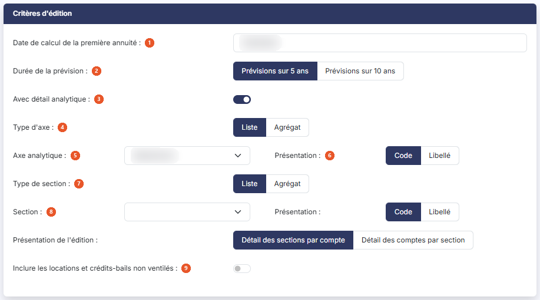

# Loyers prévisionnels


**Où le trouver :** Menu **Éditions › Loyers prévisionnels**



**En bref** — Cette édition présente les loyers que vos contrats de location et vos crédits-bails vous engagent à payer sur les cinq ou dix années à venir.

* Pour éditer les loyers prévisionnels : indiquez la date de calcul de la première annuité et la durée de la prévision, choisissez le format, puis bouton \[Editer].


Cette édition permet d'éditer les loyers que vos contrats de location et vos crédits-bails vous engagent à payer dans les années à venir, sur cinq ou dix ans, à compter de la date que vous indiquez. Elle donne, pour chaque contrat, ce qui a déjà été payé, le loyer de chaque année à venir, et ce qui restera dû au terme de la prévision.

<figure><figcaption>
Écran « Loyers prévisionnels » de la nouvelle interface
</figcaption></figure>

Deux rubriques et un seul bouton. Sans détail analytique, aucun critère de sélection : tous vos contrats de location et tous vos crédits-bails y figurent, sans filtre ni choix de colonnes. Dans un dossier où la comptabilité analytique est activée, la rubrique « Critères d'édition » propose en plus un détail analytique, décrit ci-dessous. À la différence des autres éditions du menu, elle ne propose pas de mémoriser ses paramètres.

## Rubrique « Critères d'édition »

<figure><figcaption>
Rubrique « Critères d'édition »
</figcaption></figure>

| Champ                                                      | Ce qu'il faut savoir                                                                                                                                                                                                                                                                                                                                                                                                                                                                                                                                                                               |
| ---------------------------------------------------------- | -------------------------------------------------------------------------------------------------------------------------------------------------------------------------------------------------------------------------------------------------------------------------------------------------------------------------------------------------------------------------------------------------------------------------------------------------------------------------------------------------------------------------------------------------------------------------------------------------- |
| 1. **Date de calcul de la première annuité**               | Le logiciel propose la date de fin de votre exercice. Saisissez-la, ou choisissez-la à l'aide du pictogramme de calendrier placé à côté de la zone ; ce calendrier ne vous laisse choisir qu'une date comprise dans votre exercice. C'est la date de la première année de la prévision : les années suivantes en découlent, le logiciel ajoutant un an à chaque colonne. Si vous saisissez une date hors de votre exercice, le logiciel refuse l'édition et affiche, à côté du libellé, le message « Le champ "Date de calcul de la première annuité" doit être dans le dossier annuel en cours. » |
| 2. **Durée de la prévision**                               | Choisissez « Prévisions sur 5 ans », proposé par défaut, ou « Prévisions sur 10 ans ». Ce choix commande le nombre de colonnes d'années de votre édition, et donc la date à laquelle le reste des engagements est arrêté.                                                                                                                                                                                                                                                                                                                                                                          |
| 3. **Avec détail analytique**                              | Interrupteur désactivé à l'ouverture ; tant qu'il l'est, aucun autre critère n'est proposé. Dans un dossier où la comptabilité analytique est activée, vous pouvez l'activer, et la rubrique s'enrichit alors des critères suivants :                                                                                                                                                                                                                                                                                                                                                              |
| 4. **Type d'axe**                                          | « Liste », proposé par défaut, ou « Agrégat ».                                                                                                                                                                                                                                                                                                                                                                                                                                                                                                                                                     |
| 5. **Axe analytique**                                      | Liste déroulante, ouverte sur « Sélectionnez » (dans le dossier consulté : « Axe 1 » et « Axe 2 »), accompagnée d'un choix de **Présentation :** « Code », proposé par défaut, ou « Libellé ».                                                                                                                                                                                                                                                                                                                                                                                                     |
| 6. **Présentation de l'édition**                           | « Détail des sections par compte », proposé par défaut, ou « Détail des comptes par section ».                                                                                                                                                                                                                                                                                                                                                                                                                                                                                                     |
| 7. **Type de section**                                     | « Liste », proposé par défaut, ou « Agrégat ».                                                                                                                                                                                                                                                                                                                                                                                                                                                                                                                                                     |
| 8. **Section**                                             | Liste déroulante qui se remplit quand vous choisissez un axe, et s'ouvre alors sur « Toutes » ; elle a elle aussi sa **Présentation :** « Code », proposé par défaut, ou « Libellé ».                                                                                                                                                                                                                                                                                                                                                                                                              |
| 9. **Inclure les locations et crédits-bails non ventilés** | Interrupteur désactivé à l'ouverture. Tant qu'il l'est, seuls les éléments ventilés sur l'axe choisi figurent dans l'édition ; activez-le pour y ajouter les autres.                                                                                                                                                                                                                                                                                                                                                                                                                               |

## Rubrique « Format d'édition »

| Champ                              | Ce qu'il faut savoir                                                                                                                                                                                                                                                                                                                                                                                                                                                                                                                                                                                        |
| ---------------------------------- | ----------------------------------------------------------------------------------------------------------------------------------------------------------------------------------------------------------------------------------------------------------------------------------------------------------------------------------------------------------------------------------------------------------------------------------------------------------------------------------------------------------------------------------------------------------------------------------------------------------- |
| 4. **Avec la page des paramètres** | Répondez « Oui » pour qu'un récapitulatif des critères que vous avez retenus soit imprimé en tête de votre édition. La réponse proposée est « Non ».                                                                                                                                                                                                                                                                                                                                                                                                                                                        |
| 5. **Format**                      | 
Vous avez le choix entre trois formats : • Html : c'est le format proposé par défaut, et le plus rapide à s'afficher. L'édition s'ouvre dans un nouvel onglet de votre navigateur, ce qui vous laisse l'écran des critères en place pour relancer une autre édition. • Pdf : l'édition est produite sous forme de fichier. Ce format demande une précision de mise en page, décrite ci-dessous. • Excel : l'édition est produite sous forme de fichier tableur, ce qui vous permet de reprendre les montants dans vos propres calculs. Avec le format Pdf, et avec lui seul, s'affiche :
 |
| **Orientation**                    | Choisissez « Portrait », proposé par défaut, ou « Paysage ». Le paysage est vivement conseillé pour une prévision sur dix ans, qui compte alors treize colonnes.                                                                                                                                                                                                                                                                                                                                                                                                                                            |

C'est le seul réglage de mise en page de cette édition. Vous ne trouverez pas ici les deux autres réglages présents sur les éditions voisines du menu, et c'est volontaire : le logiciel ajuste toujours la largeur du Pdf à celle de la page, et, sans détail analytique, il n'y a rien à tronquer, cette édition n'imprimant alors ni commentaire ni libellé de compte. Avec le détail, elle imprime un libellé de compte dans ses titres de groupe (voir c) ci-dessous), mais l'écran ne propose toujours aucune option de troncature. Le format Excel, quant à lui, ne demande aucun réglage.

## Bouton \[Editer]

Il lance l'édition au format demandé, sous le titre « Loyers prévisionnels sur », suivi du nombre d'années de la prévision. Avec le détail analytique, le titre devient « Loyers prévisionnels - », suivi de l'axe choisi (son code ou son libellé, selon la présentation retenue), puis de « sur 5 ans » ou « sur 10 ans » (par exemple « Loyers prévisionnels - A1 sur 5 ans »). C'est le seul bouton de cet écran. Il n'apparaît que si votre profil vous y autorise.

L'édition présente une ligne par contrat, contrats de location et crédits-bails mêlés, et se termine par une ligne « Total » qui totalise toutes les colonnes de montants. Sont retenus tous les contrats dont la date de début est antérieure ou égale à la dernière date de la prévision : un contrat déjà arrivé à son terme figure donc dans la liste, avec des colonnes d'années à venir vides. Les colonnes sont les suivantes :

* « Code », « Date de début » et « Libellé » : l'identification du contrat, reprise de sa fiche.
* « Loyer cumulé au » suivi du premier jour de votre exercice.
* « Loyer au » suivi d'une date, autant de fois que d'années dans la prévision : le loyer de l'année qui s'achève à cette date. La première colonne porte la date de calcul de la première annuité, les suivantes la même date augmentée d'un an, puis de deux, et ainsi de suite.
* « Cumul au » suivi de la dernière date de la prévision : le cumul des loyers payés à ce terme.
* « Reste des engagements au » suivi de la même date : ce qui restera dû au-delà de la prévision. Une colonne à zéro signifie que le contrat sera soldé dans l'intervalle.

Les montants nuls ne sont pas imprimés : une cellule vide se lit donc comme un montant à zéro.

Avec le détail analytique, l'édition ajoute une colonne « Section », entre « Date de début » et « Libellé », et regroupe les contrats sous un titre « Compte » suivi du numéro et du libellé du compte (par exemple « Compte 612200000000 Redevances crédit-bail mobilier »), chaque groupe se terminant par une ligne « Total Compte » suivie du même titre. Quand l'interrupteur « Inclure les locations et crédits-bails non ventilés » est activé, les contrats sans compte de charge des loyers sont regroupés sous le titre « Sans compte de charge des loyers », avec sa ligne « Total Sans compte de charge des loyers ». La ligne « Total » finale totalise l'ensemble.
