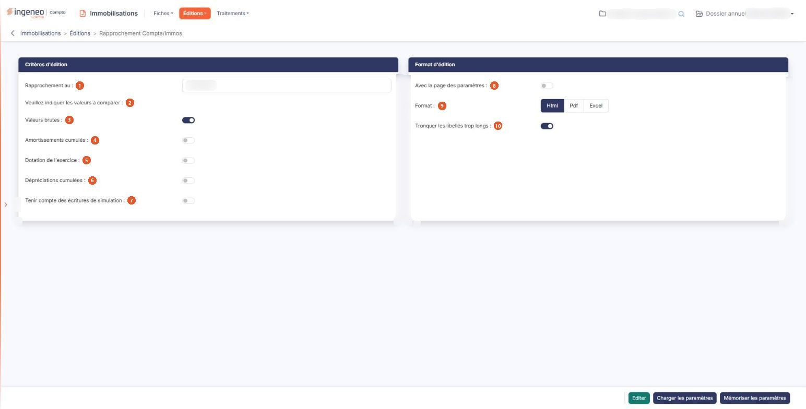

# Rapprochement Compta/Immos


**Où le trouver :** Menu **Éditions › Rapprochement Compta/Immos**



**En bref** — Cette édition vérifie la cohérence entre le module « Immobilisations » et la comptabilité : pour chaque compte, elle compare vos fiches au solde comptable et calcule l'écart.

* Pour lancer le rapprochement : indiquez la date « Rapprochement au », retenez au moins une valeur à comparer, puis bouton \[Editer].
* Pour contrôler sans recalculer vos fiches : ne demandez que les « Valeurs brutes ».
* Pour réutiliser vos critères : bouton \[Mémoriser les paramètres], puis, plus tard, bouton \[Charger les paramètres].


Cette édition permet de vérifier que les montants sont cohérents entre le module « Immobilisations » et la comptabilité. Pour chaque compte, elle place côte à côte ce que disent vos fiches d'immobilisations et le solde du compte en comptabilité, et elle calcule l'écart entre les deux.

<figure><figcaption>
Écran « Rapprochement Compta/Immos » de la nouvelle interface
</figcaption></figure>

Vous choisissez la date du rapprochement et les valeurs que vous voulez comparer : le logiciel produit un tableau par valeur retenue.

L'écran se compose de deux rubriques, sans onglet ni liste, et d'une barre de trois boutons en pied d'écran.

## Rubrique « Critères d'édition »

| Champ                                           | Ce qu'il faut savoir                                                                                                                                                                                                                                                                                                                                                                                                                                                                                                                                                                                                                                                                                                                                                                                                                                             |
| ----------------------------------------------- | ---------------------------------------------------------------------------------------------------------------------------------------------------------------------------------------------------------------------------------------------------------------------------------------------------------------------------------------------------------------------------------------------------------------------------------------------------------------------------------------------------------------------------------------------------------------------------------------------------------------------------------------------------------------------------------------------------------------------------------------------------------------------------------------------------------------------------------------------------------------- |
| 1. **Rapprochement au**                         | Le logiciel propose la date de fin de votre exercice. Saisissez-la, ou choisissez-la à l'aide du pictogramme de calendrier placé à côté de la zone. C'est la date à laquelle les deux côtés sont arrêtés : le logiciel retient les immobilisations acquises avant cette date, et lit les soldes comptables à cette même date.                                                                                                                                                                                                                                                                                                                                                                                                                                                                                                                                    |
| 2. **Veuillez indiquer les valeurs à comparer** | Cette ligne n'est pas une question mais une invitation ; elle introduit les quatre valeurs suivantes, que vous retenez indépendamment les unes des autres. Chaque valeur retenue donne un tableau dans l'édition.                                                                                                                                                                                                                                                                                                                                                                                                                                                                                                                                                                                                                                                |
| 3. **Valeurs brutes**                           | C'est la seule valeur proposée à « Oui ». Le logiciel compare, compte d'immobilisation par compte d'immobilisation, le total des valeurs brutes de vos fiches au solde du compte en comptabilité. Les immobilisations sorties à la date du rapprochement, ou avant, ne sont pas reprises du côté des immobilisations.                                                                                                                                                                                                                                                                                                                                                                                                                                                                                                                                            |
| 4. **Amortissements cumulés**                   | Proposé à « Non ». Le logiciel compare, compte d'amortissement par compte d'amortissement, le cumul des amortissements de vos fiches au solde du compte en comptabilité. Les comptes d'amortissement retenus sont ceux que vous avez renseignés dans vos fiches, et non un compte déduit du numéro de compte d'immobilisation : si un même compte d'immobilisation renvoie à plusieurs comptes d'amortissement, chacun a sa ligne. Là encore, les immobilisations sorties à la date du rapprochement ou avant ne sont pas reprises. Cette option demande que la racine des comptes d'amortissement soit renseignée : si elle ne l'est pas, le logiciel refuse et affiche le message « Pour utiliser cette option, vous devez indiquer la racine des comptes d'amortissement dans le menu "Paramétrage", sous-option "Comptes". », puis remet l'option à « Non ». |
| 5. **Dotation de l'exercice**                   | Proposé à « Non ». Le logiciel compare la dotation de l'exercice calculée sur vos fiches au solde des comptes de dotation en comptabilité. Pour une immobilisation sortie pendant la période rapprochée, c'est la dotation constatée lors de la sortie qui est reprise, et non la dotation courante. Cette comparaison ne porte que sur les immobilisations incorporelles, corporelles et financières. Elle demande qu'au moins une des deux racines de comptes de dotation soit renseignée : sinon le logiciel refuse et affiche le message « Pour utiliser cette option, vous devez indiquer au moins une des deux racines des comptes de dotation dans le menu "Paramétrage", sous-option "Comptes". », puis remet l'option à « Non ».                                                                                                                        |
| 6. **Dépréciations cumulées**                   | Proposé à « Non ». Le logiciel compare, compte de dépréciation par compte de dépréciation, le total des dépréciations constatées dans vos fiches au solde du compte en comptabilité. Seuls les comptes de dépréciation effectivement utilisés dans des fiches dépréciées figurent au tableau, et seules les immobilisations incorporelles, corporelles et financières sont prises en compte.                                                                                                                                                                                                                                                                                                                                                                                                                                                                     |
| 7. **Tenir compte des écritures de simulation** | Ce champ est affiché à la suite des quatre valeurs à comparer, mais ce n'est pas une cinquième valeur : il commande le côté comptable de tous les tableaux. Répondez « Oui » pour que les écritures de simulation soient comprises dans les soldes comptables lus à la date du rapprochement ; la réponse proposée est « Non », auquel cas seules les écritures définitives sont prises en compte. Ce choix ne change rien au côté immobilisations.                                                                                                                                                                                                                                                                                                                                                                                                              |

Deux points à connaître avant de lancer votre édition.

Si vous répondez « Non » aux quatre valeurs à comparer, l'édition est bien produite mais elle ne contient que la mention « Aucun résultat trouvé » : le logiciel ne vous en avertit pas au préalable. Retenez donc au moins une valeur.

Demander les amortissements cumulés ou la dotation de l'exercice déclenche, avant l'édition, un recalcul de toutes vos fiches immobilisations à la date du rapprochement, et ce recalcul est conservé sur les fiches. Ce n'est donc pas une simple mise en forme : rapprocher à une date donnée repositionne les valeurs calculées de vos fiches à cette date. Les valeurs brutes et les dépréciations cumulées, en revanche, se lisent telles quelles et ne déclenchent aucun recalcul. Le recalcul laisse en outre une trace nominative : le logiciel inscrit sur chaque fiche recalculée la date du calcul et le nom de l'utilisateur qui a lancé le rapprochement. C'est donc votre nom qui figurera sur ces fiches, à la place de celui du collaborateur qui les avait calculées avant vous. Si vous voulez seulement contrôler la présentation de cette édition sans rien modifier, demandez les seules valeurs brutes : aucune fiche n'est alors recalculée.

## Rubrique « Format d'édition »

| Champ                                    | Ce qu'il faut savoir                                                                                                                                                                                                                                                                                                                                                                                                                                                                                                                                                                                                                                                                                                                                                                                              |
| ---------------------------------------- | ----------------------------------------------------------------------------------------------------------------------------------------------------------------------------------------------------------------------------------------------------------------------------------------------------------------------------------------------------------------------------------------------------------------------------------------------------------------------------------------------------------------------------------------------------------------------------------------------------------------------------------------------------------------------------------------------------------------------------------------------------------------------------------------------------------------- |
| 8. **Avec la page des paramètres**       | Répondez « Oui » pour qu'un récapitulatif des critères que vous avez retenus soit imprimé en tête de votre édition. La réponse proposée est « Non ».                                                                                                                                                                                                                                                                                                                                                                                                                                                                                                                                                                                                                                                              |
| 9. **Format**                            | 
Vous avez le choix entre trois formats : • Html : c'est le format proposé par défaut, et le plus rapide à s'afficher. L'édition s'ouvre dans un nouvel onglet de votre navigateur, ce qui vous laisse l'écran des critères en place pour relancer une autre édition. Si votre navigateur refuse d'ouvrir cet onglet, le logiciel vous en avertit par le message « L'édition n'a pu être générée. Veuillez vérifier le paramétrage de votre navigateur. » • Pdf : l'édition est produite sous forme de fichier. Ce format demande deux précisions de mise en page, décrites ci-dessous. • Excel : l'édition est produite sous forme de fichier tableur, ce qui vous permet de reprendre les montants et les écarts dans vos propres calculs. Avec le format Html, et avec lui seul, s'affiche :
 |
| 10. **Tronquer les libellés trop longs** | 
La réponse proposée est « Oui » : un intitulé de compte plus large que sa colonne est coupé, ce qui garde le tableau lisible. Répondez « Non » si vous préférez voir les intitulés en entier, quitte à ce que le tableau s'élargisse. Avec le format Pdf, et avec lui seul, s'affichent deux champs :
                                                                                                                                                                                                                                                                                                                                                                                                                                                                                                   |
| **Orientation**                          | Choisissez « Portrait », proposé par défaut, ou « Paysage ».                                                                                                                                                                                                                                                                                                                                                                                                                                                                                                                                                                                                                                                                                                                                                      |
| **Largeur**                              | Choisissez entre « Fixe » et « Ajustée ». Comme l'indique le pictogramme d'information placé à côté, la largeur ajustée « Ajuste la taille si la largeur des colonnes dépasse la largeur de la page ». Le logiciel sélectionne « Ajustée » chaque fois que vous choisissez le format Pdf ; vous pouvez lui préférer « Fixe », mais si vous changez de format puis revenez au Pdf, la sélection est ramenée à « Ajustée ».                                                                                                                                                                                                                                                                                                                                                                                         |

## Bouton \[Editer]

Il lance l'édition au format demandé, sous le titre « Rapprochement comptabilité au », suivi de la date de rapprochement que vous avez retenue. Il n'apparaît que si votre profil vous autorise à lancer cette édition.

## Bouton \[Mémoriser les paramètres]

Il sauvegarde tous les critères de l'édition en cours afin de pouvoir les réutiliser plus tard. Il ouvre une fenêtre intitulée « Mémoriser les paramètres de l'édition » qui vous demande d'indiquer le libellé du modèle d'édition : saisissez-le, puis validez avec le bouton d'enregistrement de la fenêtre. Le libellé est obligatoire ; s'il est déjà utilisé, le logiciel vous propose de mettre à jour le modèle existant plutôt que d'en créer un second.

## Bouton \[Charger les paramètres]

Il ouvre une fenêtre présentant la liste des jeux de critères que vous avez mémorisés pour cette édition, sous leur libellé. Cliquez sur une ligne pour recharger ses critères dans l'écran, puis lancez votre édition. La date de rapprochement, elle, est toujours ramenée à la fin de votre exercice : vérifiez-la après un chargement. Chaque ligne porte aussi une commande de suppression, qui vous demande confirmation avant d'agir ; un jeu de paramètres utilisé par un point de contrôle d'un dossier de révision ou d'un modèle de dossier de révision ne peut pas être supprimé, et le logiciel vous le dit.
