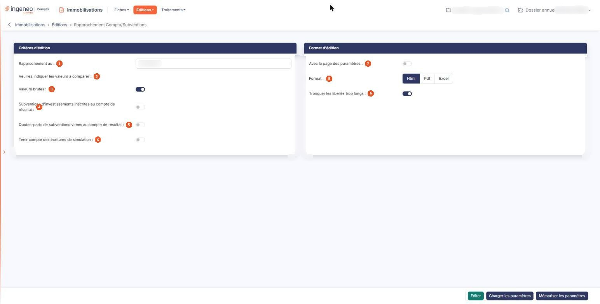

# Rapprochement Compta/Subventions


**Où le trouver :** Menu **Éditions › Rapprochement Compta/Subventions**



**En bref** — Cette édition vérifie la cohérence entre vos fiches subventions et la comptabilité : pour chaque compte, elle compare les montants des fiches au solde comptable et calcule l'écart.

* Pour lancer le rapprochement : indiquez la date « Rapprochement au », retenez au moins une valeur à comparer, puis bouton \[Editer].
* Pour réutiliser vos critères : bouton \[Mémoriser les paramètres], puis, plus tard, bouton \[Charger les paramètres].


Cette édition permet de vérifier que les montants sont cohérents entre vos fiches subventions et la comptabilité. Pour chaque compte, elle place côte à côte ce que disent vos fiches et le solde du compte en comptabilité, et elle calcule l'écart entre les deux.

<figure><figcaption>
Écran « Rapprochement Compta/Subventions » de la nouvelle interface
</figcaption></figure>

Vous choisissez la date du rapprochement et les valeurs que vous voulez comparer : le logiciel produit un tableau par valeur retenue, chacun sur sa propre page.

L'écran se compose de deux rubriques, sans onglet ni liste, et d'une barre de trois boutons en pied d'écran. Il n'y a pas de choix de colonnes sur cette édition : les colonnes du rapprochement sont toujours les mêmes.

## Rubrique « Critères d'édition »

| Champ                                                                | Ce qu'il faut savoir                                                                                                                                                                                                                                                                                                                                                                                                                                                                                                                                                                                                                                   |
| -------------------------------------------------------------------- | ------------------------------------------------------------------------------------------------------------------------------------------------------------------------------------------------------------------------------------------------------------------------------------------------------------------------------------------------------------------------------------------------------------------------------------------------------------------------------------------------------------------------------------------------------------------------------------------------------------------------------------------------------ |
| 1. **Rapprochement au**                                              | Le logiciel propose la date de fin de votre exercice. Saisissez-la, ou choisissez-la à l'aide du pictogramme de calendrier placé à côté de la zone. C'est la date à laquelle les deux côtés sont arrêtés : le logiciel retient les subventions dont la date d'octroi est antérieure ou égale à cette date, et lit les soldes comptables à cette même date.                                                                                                                                                                                                                                                                                             |
| 2. **Veuillez indiquer les valeurs à comparer**                      | Cette ligne n'est pas une question mais une invitation ; elle introduit les trois valeurs suivantes, que vous retenez indépendamment les unes des autres. Chaque valeur retenue donne un tableau dans l'édition.                                                                                                                                                                                                                                                                                                                                                                                                                                       |
| 3. **Valeurs brutes**                                                | C'est la seule valeur proposée à « Oui ». Le logiciel compare, compte par compte, le total des montants hors taxes octroyés de vos subventions au solde du compte en comptabilité. Les comptes retenus sont les comptes de subventions d'investissements, c'est-à-dire ceux dont le numéro commence par la racine que vous avez déclarée dans le panneau « Paramètres », rubrique « Immobilisations », option « Comptes » ; les comptes de subventions inscrites au compte de résultat en sont exclus, puisqu'ils font l'objet du tableau suivant. Un compte de subvention étant créditeur, la colonne « Comptabilité » présente son solde en positif. |
| 4. **Subventions d'investissements inscrites au compte de résultat** | Proposé à « Non ». Le logiciel compare, compte par compte, la part de vos subventions déjà virée au résultat au solde du compte en comptabilité. Du côté des fiches, cette part est le cumul des dotations d'étalement arrêté à la date du rapprochement, c'est-à-dire le total des annuités échues depuis l'octroi. Les comptes retenus sont ceux de la racine des comptes de subventions d'investissements inscrites au compte de résultat.                                                                                                                                                                                                          |
| 5. **Quotes-parts de subventions virées au compte de résultat**      | 
Proposé à « Non ». Le logiciel compare la quote-part de l'exercice au solde des comptes de quotes-parts virées au résultat. Du côté des fiches, c'est la seule dotation de l'exercice en cours, et non le cumul : si la date du rapprochement tombe avant la fin de votre exercice, cette dotation est réduite au prorata du temps écoulé. Ici encore, le compte étant créditeur, la colonne « Comptabilité » présente son solde en positif. Une subvention dont le régime d'étalement est « Aucun » n'a ni cumul ni dotation : elle pèse dans le premier tableau, pour son montant octroyé, et dans les deux autres pour zéro.
              |
| 6. **Tenir compte des écritures de simulation**                      | Ce champ est affiché à la suite des trois valeurs à comparer, mais ce n'est pas une quatrième valeur : il commande le côté comptable de tous les tableaux. Répondez « Oui » pour que les écritures de simulation soient comprises dans les soldes comptables lus à la date du rapprochement ; la réponse proposée est « Non », auquel cas seules les écritures définitives sont prises en compte. Ce choix ne change rien au côté subventions.                                                                                                                                                                                                         |

Un point à connaître avant de lancer votre édition : si vous répondez « Non » aux trois valeurs à comparer, l'édition est bien produite, mais elle ne contient que son titre — aucun tableau, et aucun message ne vous en avertit au préalable. Retenez donc au moins une valeur.

## Rubrique « Format d'édition »

| Champ                                   | Ce qu'il faut savoir                                                                                                                                                                                                                                                                                                                                                                                                                                                                                                                                                                                                                                                                                                                                                                                              |
| --------------------------------------- | ----------------------------------------------------------------------------------------------------------------------------------------------------------------------------------------------------------------------------------------------------------------------------------------------------------------------------------------------------------------------------------------------------------------------------------------------------------------------------------------------------------------------------------------------------------------------------------------------------------------------------------------------------------------------------------------------------------------------------------------------------------------------------------------------------------------- |
| 7. **Avec la page des paramètres**      | Répondez « Oui » pour qu'un récapitulatif des critères que vous avez retenus soit imprimé en tête de votre édition. La réponse proposée est « Non ».                                                                                                                                                                                                                                                                                                                                                                                                                                                                                                                                                                                                                                                              |
| 8. **Format**                           | 
Vous avez le choix entre trois formats : • Html : c'est le format proposé par défaut, et le plus rapide à s'afficher. L'édition s'ouvre dans un nouvel onglet de votre navigateur, ce qui vous laisse l'écran des critères en place pour relancer une autre édition. Si votre navigateur refuse d'ouvrir cet onglet, le logiciel vous en avertit par le message « L'édition n'a pu être générée. Veuillez vérifier le paramétrage de votre navigateur. » • Pdf : l'édition est produite sous forme de fichier. Ce format demande deux précisions de mise en page, décrites ci-dessous. • Excel : l'édition est produite sous forme de fichier tableur, ce qui vous permet de reprendre les montants et les écarts dans vos propres calculs. Avec le format Html, et avec lui seul, s'affiche :
 |
| 9. **Tronquer les libellés trop longs** | 
La réponse proposée est « Oui » : un intitulé de compte plus large que sa colonne est coupé, ce qui garde le tableau lisible. Répondez « Non » si vous préférez voir les intitulés en entier, quitte à ce que le tableau s'élargisse. Avec le format Pdf, et avec lui seul, s'affichent deux champs :
                                                                                                                                                                                                                                                                                                                                                                                                                                                                                                   |
| **Orientation**                         | Choisissez « Portrait », proposé par défaut, ou « Paysage ». Le rapprochement ne comportant que cinq colonnes, le portrait suffit dans la plupart des cas.                                                                                                                                                                                                                                                                                                                                                                                                                                                                                                                                                                                                                                                        |
| **Largeur**                             | Choisissez entre « Fixe » et « Ajustée ». Comme l'indique le pictogramme d'information placé à côté, la largeur ajustée « Ajuste la taille si la largeur des colonnes dépasse la largeur de la page ». Le logiciel sélectionne « Ajustée » chaque fois que vous choisissez le format Pdf ; vous pouvez lui préférer « Fixe », mais si vous changez de format puis revenez au Pdf, la sélection est ramenée à « Ajustée ».                                                                                                                                                                                                                                                                                                                                                                                         |

## Bouton \[Editer]

Il lance l'édition au format demandé, sous le titre « Rapprochement comptabilité au », suivi de la date de rapprochement que vous avez retenue. Il n'apparaît que si votre profil vous autorise à lancer cette édition.

L'édition comporte un tableau par valeur retenue, chacun sur sa propre page, sous les titres « Valeurs brutes », « Subventions d'investissements inscrites au compte de résultat » et « Quotes-parts de subventions virées au compte de résultat ». Chaque tableau présente une ligne par compte et cinq colonnes :

* « N° de compte » et « Intitulé » : le compte comparé. Les comptes présentés sont ceux de votre plan comptable qui relèvent de la racine attendue, et dont au moins un des deux montants n'est pas nul. C'est ainsi qu'apparaît une écriture passée sur un compte de subvention auquel aucune fiche ne correspond.
* « Subventions » : le montant issu de vos fiches subventions.
* « Comptabilité » : le solde du compte à la date du rapprochement.
* « Ecart » : la différence entre les deux, c'est-à-dire le montant des subventions moins le solde comptable. C'est la colonne à examiner : un écart non nul signale une discordance à expliquer.

Chaque tableau se termine par une ligne de total, intitulée « Total des subventions » et complétée du nom de la valeur comparée. Un compte dont les deux montants sont nuls n'est pas imprimé, ce qui évite d'allonger le tableau de lignes sans objet. Et si aucun compte ne ressort, le tableau affiche la seule mention « Aucun résultat trouvé ».

## Bouton \[Mémoriser les paramètres]

Il sauvegarde tous les critères de l'édition en cours afin de pouvoir les réutiliser plus tard. Il ouvre une fenêtre intitulée « Mémoriser les paramètres de l'édition » qui vous demande d'indiquer le libellé du modèle d'édition : saisissez-le, puis validez avec le bouton d'enregistrement de la fenêtre. Le libellé est obligatoire ; s'il est déjà utilisé, le logiciel vous propose de mettre à jour le modèle existant plutôt que d'en créer un second.

## Bouton \[Charger les paramètres]

Il ouvre une fenêtre présentant la liste des jeux de critères que vous avez mémorisés pour cette édition, sous leur libellé. Cliquez sur une ligne pour recharger ses critères dans l'écran, puis lancez votre édition. La date de rapprochement, elle, est toujours ramenée à la fin de votre exercice : vérifiez-la après un chargement. Chaque ligne porte aussi une commande de suppression, qui vous demande confirmation avant d'agir ; un jeu de paramètres utilisé par un point de contrôle d'un dossier de révision ou d'un modèle de dossier de révision ne peut pas être supprimé, et le logiciel vous le dit.
