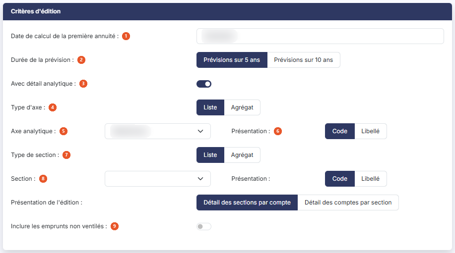

# Remboursement prévisionnel des emprunts


**Où le trouver :** Menu **Éditions › Remboursement prévisionnel des emprunts**



**En bref** — Cette édition présente le capital que vos emprunts vous engagent à rembourser sur les cinq ou dix années à venir, hors intérêts.

* Pour éditer la prévision : indiquez la date de calcul de la première annuité et la durée de la prévision, choisissez le format, puis bouton \[Editer].


Cette édition permet d'éditer le capital que vos emprunts vous engagent à rembourser dans les années à venir, sur cinq ou dix ans, à compter de la date que vous indiquez. Elle donne, pour chaque emprunt, le capital emprunté, celui qui a déjà été remboursé, celui de chaque année à venir, et ce qui restera dû au terme de la prévision.

<figure><figcaption>
Écran « Remboursement prévisionnel des emprunts » de la nouvelle interface
</figcaption></figure>

Les montants portés dans cette édition sont des montants de capital : les intérêts n'y figurent pas. Une échéance n'y compte donc que pour sa part de capital remboursé, et non pour son montant total.

Deux rubriques et un seul bouton. Sans détail analytique, aucun critère de sélection ; elle ne propose ni choix de colonnes ni mémorisation de ses paramètres. Dans un dossier où la comptabilité analytique est activée, la rubrique « Critères d'édition » propose en plus un détail analytique, décrit ci-dessous.

## Rubrique « Critères d'édition »

<figure><figcaption>
Rubrique « Critères d'édition »
</figcaption></figure>

| Champ                                        | Ce qu'il faut savoir                                                                                                                                                                                                                                                                                                                                                                                                                                                                                                                                                                               |
| -------------------------------------------- | -------------------------------------------------------------------------------------------------------------------------------------------------------------------------------------------------------------------------------------------------------------------------------------------------------------------------------------------------------------------------------------------------------------------------------------------------------------------------------------------------------------------------------------------------------------------------------------------------- |
| 1. **Date de calcul de la première annuité** | Le logiciel propose la date de fin de votre exercice. Saisissez-la, ou choisissez-la à l'aide du pictogramme de calendrier placé à côté de la zone ; ce calendrier ne vous laisse choisir qu'une date comprise dans votre exercice. C'est la date de la première année de la prévision : les années suivantes en découlent, le logiciel ajoutant un an à chaque colonne. Si vous saisissez une date hors de votre exercice, le logiciel refuse l'édition et affiche, à côté du libellé, le message « Le champ "Date de calcul de la première annuité" doit être dans le dossier annuel en cours. » |
| 2. **Durée de la prévision**                 | Choisissez « Prévisions sur 5 ans », proposé par défaut, ou « Prévisions sur 10 ans ». Ce choix commande le nombre de colonnes d'années de votre édition, et donc la date à laquelle le reste à rembourser est arrêté.                                                                                                                                                                                                                                                                                                                                                                             |
| 3. **Avec détail analytique**                | Interrupteur désactivé à l'ouverture ; tant qu'il l'est, aucun autre critère n'est proposé. Dans un dossier où la comptabilité analytique est activée, vous pouvez l'activer, et la rubrique s'enrichit alors des critères suivants :                                                                                                                                                                                                                                                                                                                                                              |
| 4. **Type d'axe**                            | « Liste », proposé par défaut, ou « Agrégat ».                                                                                                                                                                                                                                                                                                                                                                                                                                                                                                                                                     |
| 5. **Axe analytique**                        | Liste déroulante, ouverte sur « Sélectionnez » (dans le dossier consulté : « Axe 1 » et « Axe 2 »), accompagnée d'un choix de **Présentation :** « Code », proposé par défaut, ou « Libellé ».                                                                                                                                                                                                                                                                                                                                                                                                     |
| 6. **Présentation de l'édition**             | « Détail des sections par compte », proposé par défaut, ou « Détail des comptes par section ».                                                                                                                                                                                                                                                                                                                                                                                                                                                                                                     |
| 7. **Type de section**                       | « Liste », proposé par défaut, ou « Agrégat ».                                                                                                                                                                                                                                                                                                                                                                                                                                                                                                                                                     |
| 8. **Section**                               | Liste déroulante qui se remplit quand vous choisissez un axe, et s'ouvre alors sur « Toutes » ; elle a elle aussi sa **Présentation :** « Code », proposé par défaut, ou « Libellé ».                                                                                                                                                                                                                                                                                                                                                                                                              |
| 9. **Inclure les emprunts non ventilés**     | Interrupteur désactivé à l'ouverture. Tant qu'il l'est, seuls les éléments ventilés sur l'axe choisi figurent dans l'édition ; activez-le pour y ajouter les autres.                                                                                                                                                                                                                                                                                                                                                                                                                               |

## Rubrique « Format d'édition »

| Champ                              | Ce qu'il faut savoir                                                                                                                                                                                                                                                                                                                                                                                                                                                                                                                                                                                        |
| ---------------------------------- | ----------------------------------------------------------------------------------------------------------------------------------------------------------------------------------------------------------------------------------------------------------------------------------------------------------------------------------------------------------------------------------------------------------------------------------------------------------------------------------------------------------------------------------------------------------------------------------------------------------- |
| 4. **Avec la page des paramètres** | Répondez « Oui » pour qu'un récapitulatif des critères que vous avez retenus soit imprimé en tête de votre édition. La réponse proposée est « Non ».                                                                                                                                                                                                                                                                                                                                                                                                                                                        |
| 5. **Format**                      | 
Vous avez le choix entre trois formats : • Html : c'est le format proposé par défaut, et le plus rapide à s'afficher. L'édition s'ouvre dans un nouvel onglet de votre navigateur, ce qui vous laisse l'écran des critères en place pour relancer une autre édition. • Pdf : l'édition est produite sous forme de fichier. Ce format demande une précision de mise en page, décrite ci-dessous. • Excel : l'édition est produite sous forme de fichier tableur, ce qui vous permet de reprendre les montants dans vos propres calculs. Avec le format Pdf, et avec lui seul, s'affiche :
 |
| **Orientation**                    | Choisissez « Portrait », proposé par défaut, ou « Paysage ». Le paysage est vivement conseillé, et indispensable pour une prévision sur dix ans, qui compte alors dix-sept colonnes.                                                                                                                                                                                                                                                                                                                                                                                                                        |

C'est le seul réglage de mise en page de cette édition. Vous ne trouverez pas ici les deux autres réglages présents sur plusieurs éditions voisines du menu, et c'est volontaire : le logiciel ajuste toujours la largeur du Pdf à celle de la page, et, sans détail analytique, il n'y a rien à tronquer, cette édition n'imprimant alors ni commentaire ni intitulé de compte. Avec le détail, elle imprime un intitulé de compte dans ses titres de groupe (voir c) ci-dessous), mais l'écran ne propose toujours aucune option de troncature. Le format Excel, quant à lui, ne demande aucun réglage.

## Bouton \[Editer]

Il lance l'édition au format demandé, sous le titre « Remboursement prévisionnel des emprunts sur », suivi du nombre d'années de la prévision, puis de « au » et de la date de début de votre exercice, puis à nouveau de « au » et de la date de la première annuité saisie dans la fenêtre (par exemple « … sur 5 ans au 01/01/2024 au 31/12/2024 »). Avec le détail analytique, le titre devient « Remboursement prévisionnel des emprunts - », suivi de l'axe choisi (son code ou son libellé, selon la présentation retenue), puis de « sur 5 ans » ou « sur 10 ans » et des mêmes dates (par exemple « Remboursement prévisionnel des emprunts - A1 sur 5 ans au 01/01/2024 au 31/12/2024 »). C'est le seul bouton de cet écran. Il n'apparaît que si votre profil vous y autorise.

L'édition présente une ligne par emprunt, classée par code d'emprunt, et se termine par une ligne « Total » qui totalise toutes les colonnes de montants. Sont retenus les emprunts contractés au plus tard à la dernière date de la prévision et qui ne sont pas arrivés à leur terme avant le début de votre exercice : un emprunt entièrement remboursé lors d'un exercice antérieur ne figure donc pas dans la liste. Les colonnes sont les suivantes :

* « Code de l'emprunt », « Date de l'emprunt » et « Libellé » : l'identification de l'emprunt, reprise de sa fiche.
* « Capital emprunté » : le capital emprunté à l'origine, tel qu'il figure dans la fiche.
* « Capital remboursé au » suivi du premier jour de votre exercice : le capital déjà remboursé avant la période couverte par la prévision, c'est-à-dire le total des échéances antérieures d'un an à la date de la première annuité.
* « Remboursement au » suivi d'une date, autant de fois que d'années dans la prévision : le capital remboursé au cours des douze mois qui s'achèvent à cette date. La première colonne porte la date de calcul de la première annuité, les suivantes la même date augmentée d'un an, puis de deux, et ainsi de suite.
* « Cumul au » suivi de la dernière date de la prévision : le capital remboursé au total à ce terme, remboursements antérieurs compris.
* « Reste à rembourser au » suivi de la même date : le capital qui restera dû au-delà de la prévision. Une colonne à zéro signifie que l'emprunt sera soldé dans l'intervalle.

Avec le détail analytique, l'édition ajoute une colonne « Section », entre « Date de l'emprunt » et « Libellé », et regroupe les emprunts sous un titre « Compte » suivi du numéro et de l'intitulé du compte (par exemple « Compte 661100000000 Interets des emprunts et dettes »), chaque groupe se terminant par une ligne « Total Compte » suivie du même titre ; la ligne « Total » finale totalise l'ensemble.

Les échéances retenues sont celles de l'échéancier de chaque emprunt, : cette édition ne modifie aucune de vos fiches. Les montants nuls ne sont pas imprimés : une cellule vide se lit comme un montant à zéro.
