# Contrats de location


**Où le trouver :** Menu **Fiches › Contrats de location**



**En bref** — Cet écran gère les contrats de location du dossier, sans option d'achat : la fiche décrit le bien, la durée, les loyers, les frais et l'assurance ; le logiciel calcule l'échéancier et le comptabilise.

* Pour créer un contrat : bouton \[Ajouter un contrat de location], renseignez la nature, les caractéristiques et les loyers, puis bouton \[Enregistrer].
* Pour consulter l'échéancier des loyers : bouton \[Tableau des échéances].
* Pour comptabiliser les frais et les loyers d'une période : bouton \[Comptabilisation manuelle], puis bouton \[Valider].


Cette option permet de gérer tous les contrats de location du dossier. Une fiche de contrat de location décrit la location d'un bien telle que le loueur vous l'a consentie : le bien loué, la durée, les loyers, les frais et l'assurance. À partir de ces informations, le logiciel calcule l'échéancier des loyers et sait comptabiliser les frais puis chaque échéance.

<figure>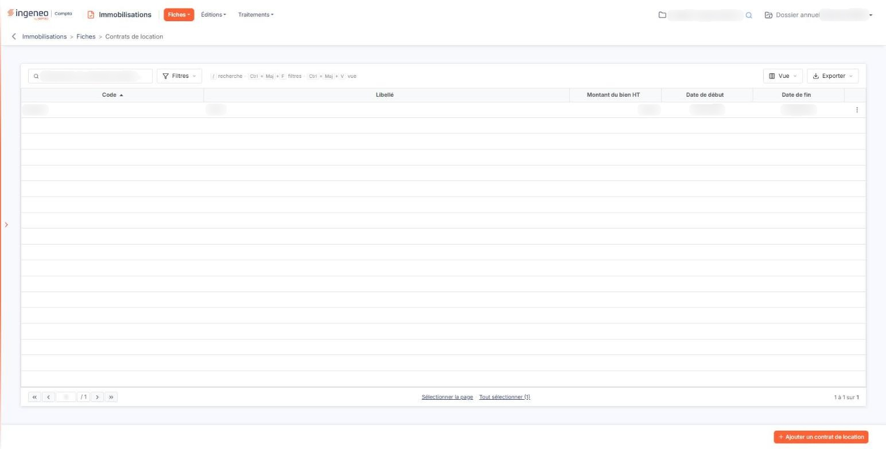<figcaption>
Écran « Contrats de location » de la nouvelle interface
</figcaption></figure>

Un contrat de location se distingue d'un crédit-bail sur un point : il ne comporte pas d'option d'achat. Vous ne trouverez donc sur cette fiche ni montant d'option, ni transfert en immobilisation.

## La liste des contrats de location

Il n'y a pas de sélecteur de filtre au-dessus de cette grille, contrairement aux listes des emprunts et des crédits-bails.

La grille présente cinq colonnes : **Code** (colonne sur laquelle la liste est triée à l'ouverture, dans l'ordre croissant), **Libellé**, **Montant du bien HT**, **Date de début** et **Date de fin**. Toutes sont triables.

Vous pouvez cocher plusieurs lignes, y compris au-delà de la page affichée, puis employer le bouton **\[Supprimer]** de la barre basse pour supprimer la sélection en une fois. Lorsque la liste ne contient encore aucun contrat, elle affiche « Aucun élément à afficher. »

## Bouton \[Ajouter un contrat de location]

Il ouvre une fiche de contrat de location vide. La fiche s'organise en rubriques, décrites ci-dessous dans l'ordre où elles s'affichent. Deux d'entre elles n'apparaissent que selon la nature du bien loué.

Trois comptes de la rubrique « Paramètres comptables » peuvent arriver déjà renseignés sur une fiche neuve — le compte d'assurance, le compte de frais de dossier et le compte de TVA. Ils sont repris du paramétrage des comptes du module, rubrique « Contrats de location » : ils ne sont donc préremplis que si votre cabinet y a déclaré un compte par défaut, et la fiche s'ouvre avec ces trois zones vides dans le cas contraire. Vous pouvez de toute façon les remplacer.

## Rubrique « Informations générales »

<figure>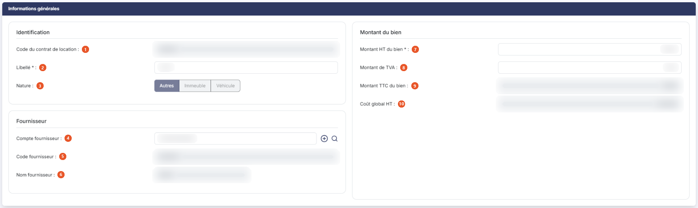<figcaption>
Rubrique « Informations générales »
</figcaption></figure>

| Champ                                                                          | Ce qu'il faut savoir                                                                                                                                                                                                                                                                                                                                                                                      |
| ------------------------------------------------------------------------------ | --------------------------------------------------------------------------------------------------------------------------------------------------------------------------------------------------------------------------------------------------------------------------------------------------------------------------------------------------------------------------------------------------------- |
| 
1. <strong>Code du contrat de location</strong> <em>Obligatoire</em>
 | 20 caractères au maximum. Il doit être unique ; si vous reprenez un code déjà employé, le logiciel refuse l'enregistrement en indiquant que le code est déjà utilisé et vous demande d'en choisir un autre. Seules les lettres, les chiffres, le tiret, le souligné et le point sont admis. **Le code n'est plus modifiable après le premier enregistrement** : en modification, il s'affiche verrouillé. |
| 
2. <strong>Libellé</strong> <em>Obligatoire</em>
                     | 50 caractères au maximum.                                                                                                                                                                                                                                                                                                                                                                                 |
| 3. **Nature**                                                                  | Trois choix, « Autres » (valeur par défaut), « Immeuble » et « Véhicule ». Ce choix commande l'affichage des deux rubriques complémentaires décrites ci-dessous : c'est donc la première chose à renseigner. **La nature n'est plus modifiable après le premier enregistrement** ; les boutons s'affichent alors inactifs.                                                                                |
| 4. **Compte fournisseur**                                                      | C'est le compte du loueur. Vous pouvez saisir directement le numéro, ou taper quelques caractères pour laisser le logiciel vous proposer les comptes correspondants. La ligne comporte un bouton **\[+]** qui crée le compte auxiliaire s'il n'existe pas encore, et une loupe qui ouvre la recherche.                                                                                                    |
| 5. **Code fournisseur**                                                        | 20 caractères au maximum.                                                                                                                                                                                                                                                                                                                                                                                 |
| 6. **Nom fournisseur**                                                         | 40 caractères au maximum. Il reste à votre saisie tant que le compte fournisseur n'est pas renseigné ; dès qu'il l'est, le nom est repris de l'intitulé du compte auxiliaire.                                                                                                                                                                                                                             |
| 
7. <strong>Montant HT du bien</strong> <em>Obligatoire</em>
          | C'est la valeur du bien loué. Le champ porte encore l'astérisque des champs obligatoires, mais **il ne l'est plus** : vous pouvez enregistrer la fiche sans l'avoir renseigné.                                                                                                                                                                                                                            |
| 8. **Montant de TVA**                                                          | —                                                                                                                                                                                                                                                                                                                                                                                                         |
| 9. **Montant TTC du bien**                                                     | Calculé automatiquement, non modifiable.                                                                                                                                                                                                                                                                                                                                                                  |
| 10. **Coût global HT**                                                         | Calculé automatiquement, non modifiable. Il correspond au total des loyers HT augmenté des frais HT.                                                                                                                                                                                                                                                                                                      |

## Rubrique « Informations complémentaires du véhicule »

Cette rubrique n'apparaît que si la nature retenue est « Véhicule ». Elle sert à renseigner ce que la taxation des véhicules de société exige de connaître ; la plupart des champs se lisent directement sur la carte grise, et leur infobulle vous indique dans quelle rubrique de celle-ci les trouver.

| Champ                                                             | Ce qu'il faut savoir                                                                                                                                                                                                                                                                     |
| ----------------------------------------------------------------- | ---------------------------------------------------------------------------------------------------------------------------------------------------------------------------------------------------------------------------------------------------------------------------------------- |
| 
<strong>Immatriculation</strong> <em>Obligatoire</em>
   | 9 caractères au maximum — rubrique A de la carte grise. À la création, l'immatriculation doit être unique : le logiciel refuse un véhicule déjà connu du dossier.                                                                                                                        |
| **Modèle**                                                        | 40 caractères au maximum — rubriques D.1 et D.3 de la carte grise.                                                                                                                                                                                                                       |
| **Date de première immatriculation en France**                    | — rubrique B de la carte grise.                                                                                                                                                                                                                                                          |
| **Emission CO2**                                                  | En gramme par kilomètre — rubrique V.7 de la carte grise.                                                                                                                                                                                                                                |
| 
<strong>Type de véhicule</strong> <em>Obligatoire</em>
  | — rubrique J.1 de la carte grise. Quatre choix : « Véhicule de tourisme » (valeur par défaut), « Véhicule utilitaire », « Moto » et « Vélomoteur, scooter ».                                                                                                                             |
| 
<strong>Norme euro</strong> <em>Obligatoire</em>
        | — rubrique V.9 de la carte grise. Le sélecteur affiche « Sélectionnez » tant que vous n'avez pas choisi, et propose les normes de EURO 1 à EURO 6d-TEMP puis de EURO 0 à EURO VI.                                                                                                        |
| 
<strong>Puissance fiscale</strong> <em>Obligatoire</em>
 | De 1 à 99 — rubrique P.6 de la carte grise.                                                                                                                                                                                                                                              |
| 
<strong>Motorisation</strong> <em>Obligatoire</em>
      | Quatre choix : « Thermique », « Hydrogène », « Hybride » et « Electrique ». **Aucune valeur n'est présélectionnée** : vous devez impérativement en choisir une, sans quoi l'enregistrement est refusé.                                                                                   |
| 
<strong>Type de carburant</strong> <em>Obligatoire</em>
 | Il ne s'affiche, et ne devient obligatoire, que pour les motorisations « Thermique » et « Hybride ». Quatre choix, sans présélection : « Diesel », « Super sans plomb », « Superéthanol E85 » et « GPL ». Pour les motorisations « Electrique » et « Hydrogène », le champ n'existe pas. |
| **Motif d'exonération sur le CO2**                                | Saisie libre.                                                                                                                                                                                                                                                                            |
| **Motif d'exonération sur les polluants**                         | Saisie libre.                                                                                                                                                                                                                                                                            |

## Rubrique « Informations complémentaires de l'immeuble »

<figure>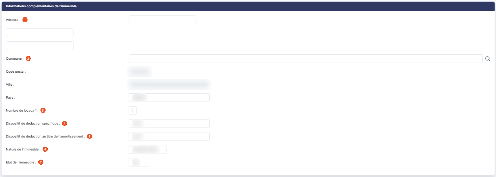<figcaption>
Rubrique « Informations complémentaires de l'immeuble »
</figcaption></figure>

Cette rubrique n'apparaît que si la nature retenue est « Immeuble ». Elle renseigne les informations que la liasse fiscale attend d'un immeuble.

| Champ                                                               | Ce qu'il faut savoir                                                                                                                                                                                                                                                                                                                                                                                                                                                                                                                                                                                                                                          |
| ------------------------------------------------------------------- | ------------------------------------------------------------------------------------------------------------------------------------------------------------------------------------------------------------------------------------------------------------------------------------------------------------------------------------------------------------------------------------------------------------------------------------------------------------------------------------------------------------------------------------------------------------------------------------------------------------------------------------------------------------- |
| 1. **Adresse**                                                      | Un seul libellé, mais trois lignes de saisie, de 38 caractères chacune.                                                                                                                                                                                                                                                                                                                                                                                                                                                                                                                                                                                       |
| 2. **Commune**                                                      | Saisissez le début de son nom : la zone propose des communes sous la forme « code - nom (département) », par exemple « 109 - Nantes (44) » ; la loupe placée à droite de la zone ouvre un panneau « Sélection d'une commune », dont la liste (Code INSEE, Ville, Département) se filtre par nom ou par code INSEE. **Code postal :** et **Ville :** sont en lecture seule (« Déduit de la commune ») : ils se remplissent d'après la commune choisie ; quand la commune compte plusieurs codes postaux (Nantes, par exemple), le code postal devient une liste « Sélectionnez » où vous choisissez le vôtre. **Pays :** « FRANCE » est proposé à l'ouverture. |
| 
3. <strong>Nombre de locaux</strong> <em>Obligatoire</em>
 | De 1 à 999. La valeur 1 est proposée par défaut.                                                                                                                                                                                                                                                                                                                                                                                                                                                                                                                                                                                                              |
| 4. **Dispositif de déduction spécifique**                           | Le sélecteur propose « Aucun » par défaut, puis les dispositifs de déduction des revenus fonciers : « Besson ancien », les variantes « Scellier », « Carrières et gisements minéraux productifs de revenus », les conventionnements ANAH — Borloo ancien, secteur intermédiaire, social ou très social, puis les conventionnements Cosse avec leur taux de déduction.                                                                                                                                                                                                                                                                                         |
| 5. **Dispositif de déduction au titre de l'amortissement**          | Le sélecteur propose « Aucun » par défaut, puis « Périssol », « Robien classique », « Robien classique en zone de revitalisation rurale », « Robien recentré », « Robien recentré en zone de revitalisation rurale », « Borloo neuf » et « Besson neuf ».                                                                                                                                                                                                                                                                                                                                                                                                     |
| 6. **Nature de l'immeuble**                                         | À la saisie mais nécessaire à l'enregistrement. Sept choix : « Immeuble urbain » (valeur par défaut), « Immeuble rural », « Immeuble de rapport », « Appartement », « Maison », « Parking » et « Autre qualification ».                                                                                                                                                                                                                                                                                                                                                                                                                                       |
| 7. **Etat de l'immeuble**                                           | Deux choix, « Bâti » (valeur par défaut) et « Non bâti ».                                                                                                                                                                                                                                                                                                                                                                                                                                                                                                                                                                                                     |

## Rubrique « Caractéristiques du contrat de location »

<figure>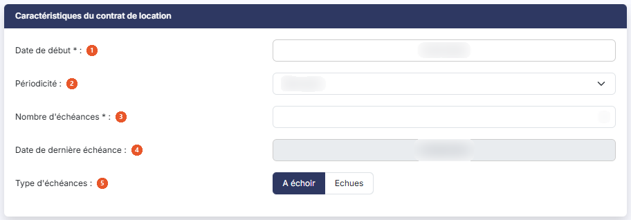<figcaption>
Rubrique « Caractéristiques du contrat de location »
</figcaption></figure>

C'est la rubrique qui commande le calcul de l'échéancier.

| Champ                                                                 | Ce qu'il faut savoir                                                                                                                                                                                                                                                                                                                       |
| --------------------------------------------------------------------- | ------------------------------------------------------------------------------------------------------------------------------------------------------------------------------------------------------------------------------------------------------------------------------------------------------------------------------------------ |
| 
1. <strong>Date de début</strong> <em>Obligatoire</em>
      | Un pictogramme de calendrier vous permet de la choisir.                                                                                                                                                                                                                                                                                    |
| 2. **Périodicité**                                                    | Vous avez le choix entre « Mensuelle » (valeur par défaut), « Trimestrielle » et « Annuelle ». La périodicité semestrielle, disponible sur les emprunts, n'est pas proposée pour les contrats de location.                                                                                                                                 |
| 
3. <strong>Nombre d'échéances</strong> <em>Obligatoire</em>
 | De 1 à 999. Renseignez-le tôt : plusieurs contrôles de la fiche en dépendent.                                                                                                                                                                                                                                                              |
| 4. **Date de dernière échéance**                                      | Non modifiable. Elle est calculée automatiquement à partir de la date de début, de la périodicité et du nombre d'échéances. Comme son nom l'indique, c'est la date de la **dernière échéance**, et non la date de fin du contrat : pour un contrat démarrant le 01/01 avec douze échéances mensuelles, elle vaut le 01/12 et non le 31/12. |
| 5. **Type d'échéances**                                               | Choisissez entre « A échoir » et « Echues » ; la valeur retenue par défaut est **« A échoir »**.                                                                                                                                                                                                                                           |

## Rubrique « Loyers »

<figure>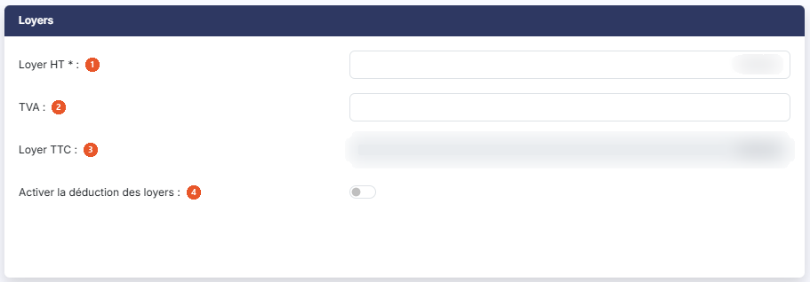<figcaption>
Rubrique « Loyers »
</figcaption></figure>

| Champ                                                       | Ce qu'il faut savoir                                                                                                                                                                                                                          |
| ----------------------------------------------------------- | --------------------------------------------------------------------------------------------------------------------------------------------------------------------------------------------------------------------------------------------- |
| 
1. <strong>Loyer HT</strong> <em>Obligatoire</em>
 | Entrez le montant de chaque échéance.                                                                                                                                                                                                         |
| 2. **TVA**                                                  | —                                                                                                                                                                                                                                             |
| 3. **Loyer TTC**                                            | Calculé automatiquement, non modifiable.                                                                                                                                                                                                      |
| 4. **Activer la déduction des loyers**                      | « Non » par défaut. Répondez « Oui » pour faire apparaître les deux champs suivants, qui concernent la part de loyer que la fiscalité n'autorise pas à déduire.                                                                               |
| **Plafond applicable**                                      | Il ne s'affiche que si vous avez répondu « Oui ». Son infobulle précise que la base d'amortissement fiscal est renseignée par rapport au plafond de déductibilité des amortissements des véhicules de tourisme selon le BOI-BIC-AMT-20-40-50. |
| **Part anuelle des loyers non déductible**                  | Il ne s'affiche que si vous avez répondu « Oui », et il n'est pas modifiable : le logiciel le calcule. Son libellé comporte une faute de frappe — un seul « n » à « anuelle » — que vous retrouverez telle quelle à l'écran.                  |

## Rubrique « Premier loyer »

<figure><figcaption>
Rubrique « Premier loyer »
</figcaption></figure>

| Champ                                      | Ce qu'il faut savoir                                                                                                                                                         |
| ------------------------------------------ | ---------------------------------------------------------------------------------------------------------------------------------------------------------------------------- |
| 1. **Le premier loyer est-il différent ?** | « Non » par défaut, et la rubrique ne contient alors que cette question. Répondez « Oui » si le contrat prévoit un premier loyer majoré, et trois champs apparaissent :      |
| **Premier loyer HT**                       | Il ne porte pas d'astérisque lorsqu'il vient d'apparaître, mais il est bien **obligatoire** dès que vous avez répondu « Oui » : l'enregistrement est refusé s'il reste vide. |
| **TVA**                                    | —                                                                                                                                                                            |
| **Premier loyer TTC**                      | Calculé automatiquement, non modifiable.                                                                                                                                     |

## Rubrique « Coûts annexes »

<figure>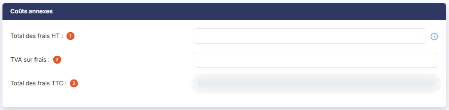<figcaption>
Rubrique « Coûts annexes »
</figcaption></figure>

Aucun champ de cette rubrique n'est obligatoire.

| Champ                      | Ce qu'il faut savoir                                                                      |
| -------------------------- | ----------------------------------------------------------------------------------------- |
| 1. **Total des frais HT**  | Une infobulle rappelle qu'il s'agit des frais de dossier et de tous types d'autres frais. |
| 2. **TVA sur frais**       | —                                                                                         |
| 3. **Total des frais TTC** | Calculé automatiquement, non modifiable.                                                  |

## Rubrique « Assurance »

<figure>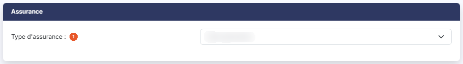<figcaption>
Rubrique « Assurance »
</figcaption></figure>

| Champ                                                                     | Ce qu'il faut savoir                                                                               |
| ------------------------------------------------------------------------- | -------------------------------------------------------------------------------------------------- |
| 1. **Type d'assurance**                                                   | Deux choix seulement, « Sans assurance » (valeur par défaut) et « Montant fixe par échéance ».     |
| 
<strong>Montant fixe par échéance</strong> <em>Obligatoire</em>
 | Il ne s'affiche, et ne devient obligatoire, que si vous avez retenu « Montant fixe par échéance ». |
| **Montant total**                                                         | Non modifiable, calculé par le logiciel. Il ne s'affiche que dans le même cas.                     |

Si vous basculez sur « Montant fixe par échéance » sans avoir renseigné le nombre d'échéances, le logiciel ouvre une fenêtre d'erreur portant « Le nombre d'échéances doit être renseigné. » : sans ce nombre, il ne peut pas calculer le montant total de l'assurance.

## Rubrique « Commentaires »

<figure>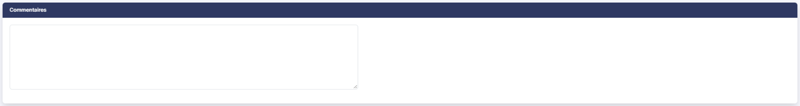<figcaption>
Rubrique « Commentaires »
</figcaption></figure>

C'est une zone de saisie libre, facultative, de 1 024 caractères au maximum, modifiable à tout moment.

## Rubrique « Documents »

<figure>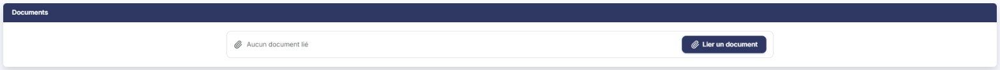<figcaption>
Rubrique « Documents »
</figcaption></figure>

Vous pouvez joindre des documents à la fiche du contrat de location : le contrat, l'échéancier remis par le loueur, la facture du bien. Le tableau présente quatre colonnes — **Description**, **Nom du fichier**, **Date** et **Créé par** — et affiche « Liste vide » tant qu'aucun document n'est rattaché.

Trois boutons vous sont proposés selon l'origine du document : bouton **\[Nouveau doc depuis mon poste]**, bouton **\[Nouveau doc depuis la GED]** et bouton **\[Nouveau doc depuis l'OCR]**.

## Rubrique « Paramètres comptables »

<figure>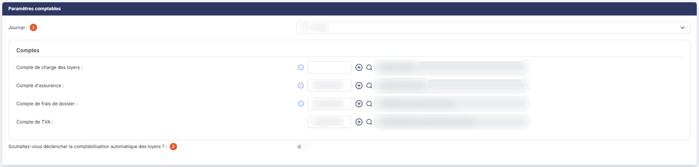<figcaption>
Rubrique « Paramètres comptables »
</figcaption></figure>

Cette rubrique réunit le journal et les comptes nécessaires à la comptabilisation des écritures du contrat de location.

| Champ                                                                             | Ce qu'il faut savoir                                                                                                                                                                                                                                                                                                                                                                                                                                                                                                                                                                                                                                                                                                                                                                                                                                                                                                                                                                                                                                                                                                                                              |
| --------------------------------------------------------------------------------- | ----------------------------------------------------------------------------------------------------------------------------------------------------------------------------------------------------------------------------------------------------------------------------------------------------------------------------------------------------------------------------------------------------------------------------------------------------------------------------------------------------------------------------------------------------------------------------------------------------------------------------------------------------------------------------------------------------------------------------------------------------------------------------------------------------------------------------------------------------------------------------------------------------------------------------------------------------------------------------------------------------------------------------------------------------------------------------------------------------------------------------------------------------------------- |
| 1. **Journal**                                                                    | 
Le sélecteur propose les journaux du dossier ; il affiche « Sélectionnez » tant que vous n'avez pas choisi. Viennent ensuite quatre comptes, tous facultatifs : <strong>Compte de charge des loyers</strong>, <strong>Compte d'assurance</strong>, <strong>Compte de frais de dossier</strong> et <strong>Compte de TVA</strong>. Notez la différence avec la fiche d'un crédit-bail, où le compte de charge des loyers est obligatoire. Il n'y a pas ici de compte d'immobilisations, puisqu'un contrat de location ne débouche sur aucune acquisition. Chaque ligne de compte comporte le numéro, l'intitulé du compte en regard — non modifiable, il se remplit dès que le numéro est reconnu — puis deux commandes : le bouton <strong>[+]</strong> qui crée le compte s'il n'existe pas encore, et une loupe qui ouvre la recherche dans le plan comptable. Un numéro qui ne correspond à aucun compte existant est refusé à l'enregistrement, de même qu'un numéro dont la racine ne correspond pas à celle paramétrée pour cet emploi dans le paramétrage des comptes du module ; le message d'erreur vous rappelle alors la racine attendue.
 |
| 2. **Souhaitez-vous déclencher la comptabilisation automatique des loyers ?**     | « Non » par défaut. Si vous répondez « Oui », le logiciel vérifie chaque nuit s'il a des écritures de loyers à comptabiliser pour ce contrat, les génère et les enregistre en comptabilité sans autre intervention de votre part.                                                                                                                                                                                                                                                                                                                                                                                                                                                                                                                                                                                                                                                                                                                                                                                                                                                                                                                                 |
| 
<strong>Date de début de comptabilisation</strong> <em>Obligatoire</em>
 | Elle ne s'affiche, et ne devient obligatoire, que si vous avez répondu « Oui » à la question précédente. Elle doit être comprise dans la période de saisie ou dans les dates de l'exercice. Attention à ce que dit son infobulle : la comptabilisation automatique porte sur les **loyers**, mais la comptabilisation des **frais** du contrat de location reste à demander une fois, à l'aide du bouton \[Comptabilisation manuelle] décrit plus bas.                                                                                                                                                                                                                                                                                                                                                                                                                                                                                                                                                                                                                                                                                                            |

## Bouton \[Enregistrer]

<figure><figcaption>
Bouton [Enregistrer]
</figcaption></figure>

Il enregistre la fiche. Selon les droits qui vous sont accordés, il peut ne pas vous être proposé.

## Bouton \[Tableau des échéances]

<figure><figcaption>
Bouton [Tableau des échéances]
</figcaption></figure>

<figure>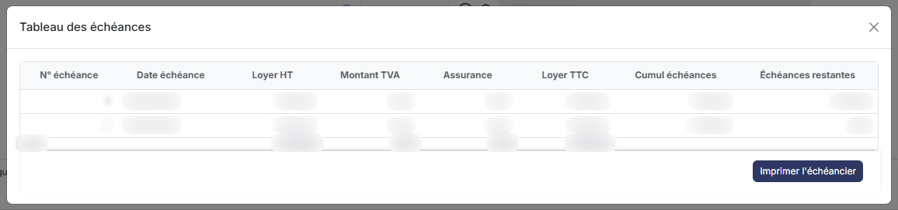<figcaption>
Bouton [Tableau des échéances]
</figcaption></figure>

Il n'est proposé que sur une fiche déjà enregistrée, et selon les droits qui vous sont accordés. Il enregistre au passage les valeurs en cours de la fiche, si elles sont valides et si votre profil vous autorise la modification, puis ouvre l'échéancier des loyers calculé à partir de ses caractéristiques, sous la forme d'un tableau d'une ligne par échéance : **N° échéance**, **Date échéance**, **Loyer HT**, **Montant TVA**, **Assurance**, **Loyer TTC**, **Cumul échéances** et **Échéances restantes**. Une ligne de totaux ferme le tableau. Si aucune échéance ne peut être calculée, le tableau affiche « Aucune échéance à afficher. »

Cet échéancier est en consultation seule : comme celui d'un crédit-bail, et contrairement à celui d'un emprunt, il ne peut pas être personnalisé ligne à ligne. Deux boutons seulement y figurent, bouton **\[Imprimer l'échéancier]** et bouton **\[Retour]**.

## Bouton \[Comptabilisation manuelle]

<figure><figcaption>
Bouton [Comptabilisation manuelle]
</figcaption></figure>

Il n'est proposé que sur une fiche déjà enregistrée, et selon les droits qui vous sont accordés. Il ouvre une fenêtre qui vous rappelle d'abord ceci : la comptabilisation manuelle génère des écritures sur la base de ce qui figure dans la fiche, et si les écritures ont déjà été générées — manuellement ou automatiquement — de nouvelles écritures seront générées, à vous de faire les ajustements nécessaires en comptabilité. Autrement dit, le logiciel ne détecte pas les doublons à votre place.

**Comptabilisation des frais** : répondez « Oui » pour comptabiliser en même temps les frais de dossier du contrat de location. C'est une opération à ne faire qu'une seule fois, à la mise en place du contrat.

**Date de début** et **Date de fin :** obligatoires. Elles délimitent la période dont vous souhaitez comptabiliser les loyers, et doivent toutes deux être comprises dans la période de saisie.

bouton **\[Valider]** : il lance la comptabilisation. Le logiciel vous indique ensuite le nombre de lignes d'écriture générées, ou vous répond qu'aucune ligne n'a été générée. S'il ne peut pas comptabiliser, il vous donne la liste des raisons — le plus souvent un compte ou une information manquante dans la rubrique « Paramètres comptables ».

bouton **\[Annuler]** : il ferme la fenêtre sans rien comptabiliser.

## Bouton \[Imprimer l'échéancier]

<figure><figcaption>
Bouton [Imprimer l'échéancier]
</figcaption></figure>

Selon les droits qui vous sont accordés, il peut ne pas vous être proposé. Il est également disponible en création, avant tout enregistrement. Il ouvre une fenêtre d'édition où vous choisissez :

| Champ                           | Ce qu'il faut savoir                                |
| ------------------------------- | --------------------------------------------------- |
| **Avec des sous-totaux par an** | Répondez « Oui » pour obtenir un sous-total annuel. |
| **Format**                      | HTML, PDF ou Excel.                                 |

**Orientation** et **Largeur :** ces deux choix n'apparaissent que pour le format PDF. L'infobulle de la largeur précise qu'elle ajuste la taille si la largeur des colonnes dépasse la largeur de la page.

bouton **\[Edition]** génère le document ; bouton **\[Annuler]** ferme la fenêtre.

## Bouton \[Retour]

Il revient à la liste des contrats de location sans rien enregistrer.
