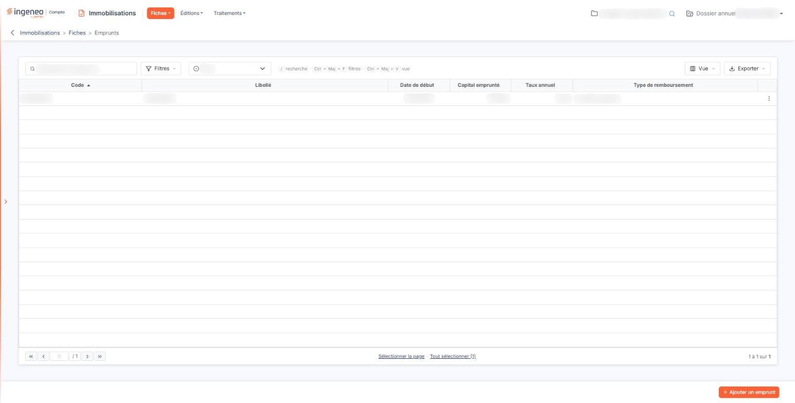
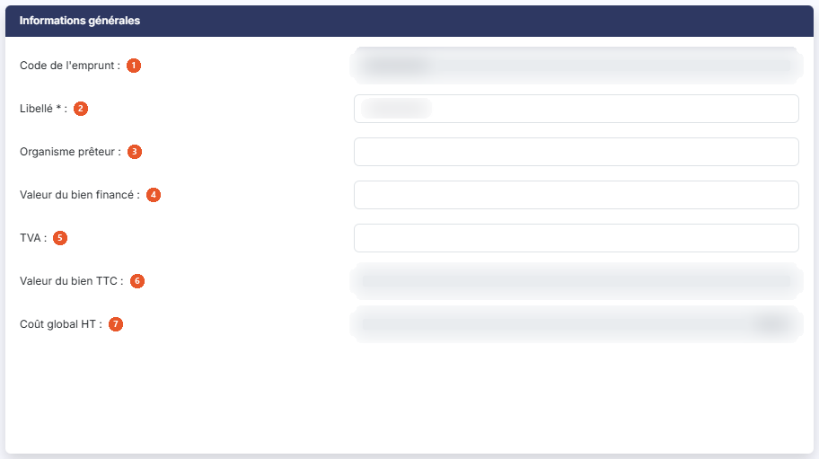
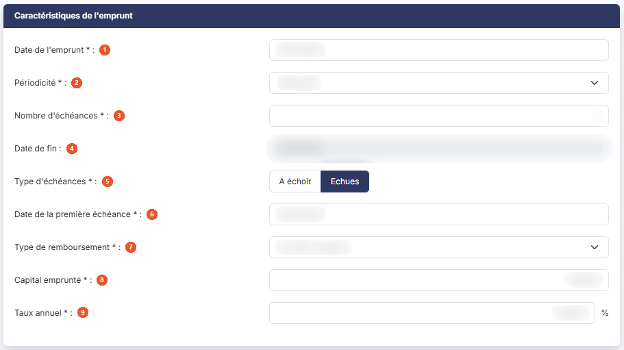
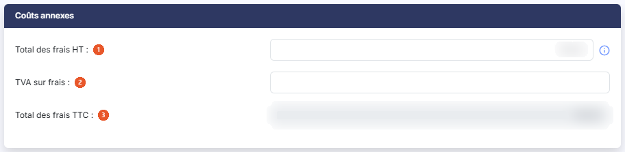
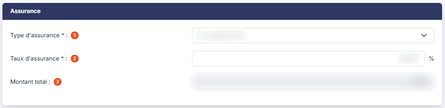
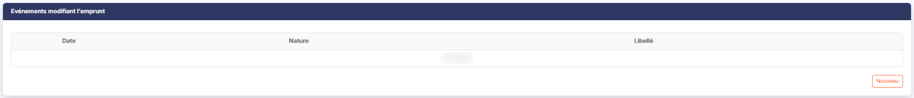
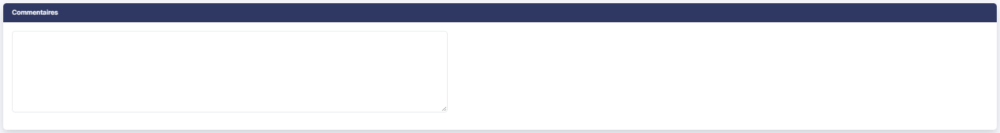
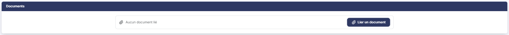
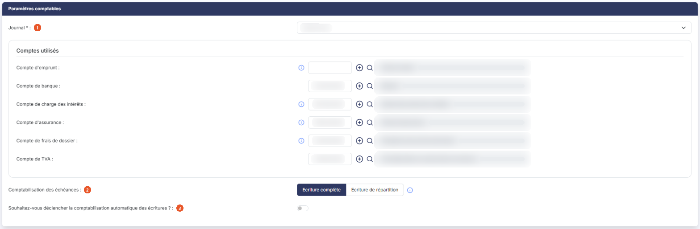
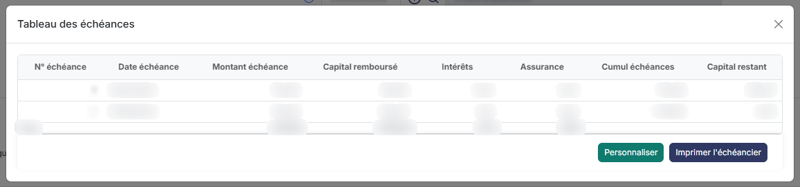

# Emprunts


**Où le trouver :** Menu **Fiches › Emprunts**



**En bref** — Cet écran gère les emprunts du dossier : la fiche décrit le prêt (capital, taux, périodicité, assurance, frais), et le logiciel en calcule l'échéancier et sait le comptabiliser.

* Pour créer un emprunt : bouton \[Ajouter un emprunt], renseignez les caractéristiques et les paramètres comptables, puis bouton \[Enregistrer].
* Pour consulter ou personnaliser l'échéancier : bouton \[Tableau des échéances], puis, si besoin, bouton \[Personnaliser].
* Pour comptabiliser l'emprunt et ses échéances : bouton \[Comptabilisation manuelle], indiquez la période, puis bouton \[Valider].


Cette option permet de gérer tous les emprunts du dossier, ceux en cours comme ceux totalement remboursés. Une fiche d'emprunt décrit le prêt tel que la banque vous l'a consenti : son capital, son taux, sa périodicité, ses assurances et ses frais. À partir de ces informations, le logiciel calcule l'échéancier complet, et sait comptabiliser l'emprunt lui-même puis chacune de ses échéances.

<figure><figcaption>
Écran « Emprunts » de la nouvelle interface
</figcaption></figure>

Un sélecteur au-dessus de la grille permet de filtrer la liste selon le statut de l'emprunt.

## La liste des emprunts

**Statuts** : ce sélecteur, au-dessus de la grille, propose « Tous » (valeur par défaut), « Emprunts actifs » et « Emprunts remboursés ».

La grille présente six colonnes : **Code** (colonne sur laquelle la liste est triée à l'ouverture, dans l'ordre croissant), **Libellé**, **Date de début**, **Capital emprunté**, **Taux annuel** et **Type de remboursement**. Toutes sont triables.

Chaque ligne porte des commandes qui vous permettent de modifier l'emprunt, de le supprimer et de le dupliquer. Selon les droits qui vous sont accordés, certaines peuvent ne pas vous être proposées.

Vous pouvez cocher plusieurs lignes, y compris au-delà de la page affichée, puis employer le bouton **\[Supprimer]** de la barre basse pour supprimer la sélection en une fois.

## Bouton \[Ajouter un emprunt]

Il ouvre une fiche d'emprunt vide. La fiche comporte huit rubriques, décrites ci-dessous dans l'ordre où elles s'affichent.

## Rubrique « Informations générales »

<figure><figcaption>
Rubrique « Informations générales »
</figcaption></figure>

| Champ                                                                | Ce qu'il faut savoir                                                                                                                                                                                                                                                                                                                                                                                                                        |
| -------------------------------------------------------------------- | ------------------------------------------------------------------------------------------------------------------------------------------------------------------------------------------------------------------------------------------------------------------------------------------------------------------------------------------------------------------------------------------------------------------------------------------- |
| 
1. <strong>Code de l'emprunt</strong> <em>Obligatoire</em>
 | 20 caractères au maximum. Il doit être unique ; si vous reprenez un code déjà employé, le logiciel refuse l'enregistrement en indiquant que le code est déjà utilisé et vous demande d'en choisir un autre. Seules les lettres, les chiffres, le tiret, le souligné et le point sont admis ; tout autre caractère est refusé. **Le code n'est plus modifiable après le premier enregistrement** : en modification, il s'affiche verrouillé. |
| 
2. <strong>Libellé</strong> <em>Obligatoire</em>
           | 50 caractères au maximum.                                                                                                                                                                                                                                                                                                                                                                                                                   |
| 3. **Organisme prêteur**                                             | 50 caractères au maximum. C'est l'établissement qui vous a accordé le prêt.                                                                                                                                                                                                                                                                                                                                                                 |
| 4. **Valeur du bien financé**                                        | Il s'agit de la valeur du bien que l'emprunt finance, information documentaire qui n'entre pas dans le calcul de l'échéancier.                                                                                                                                                                                                                                                                                                              |
| 5. **TVA**                                                           | —                                                                                                                                                                                                                                                                                                                                                                                                                                           |
| 6. **Valeur du bien TTC**                                            | Calculé automatiquement, non modifiable. C'est la valeur du bien financé augmentée de la TVA.                                                                                                                                                                                                                                                                                                                                               |
| 7. **Coût global HT**                                                | Calculé automatiquement, non modifiable. Il correspond au total des frais HT augmenté du total de l'assurance ; il se met donc à jour au fur et à mesure que vous complétez les rubriques « Coûts annexes » et « Assurance ».                                                                                                                                                                                                               |

## Rubrique « Caractéristiques de l'emprunt »

<figure><figcaption>
Rubrique « Caractéristiques de l'emprunt »
</figcaption></figure>

C'est la rubrique qui commande le calcul de l'échéancier.

| Champ                                                                           | Ce qu'il faut savoir                                                                                                                                                                                                                                                                                                                                                                                                                                                                                                                                                                                                                                                                                                                                                                                                                                                                                                                                                                                                                                                                                                        |
| ------------------------------------------------------------------------------- | --------------------------------------------------------------------------------------------------------------------------------------------------------------------------------------------------------------------------------------------------------------------------------------------------------------------------------------------------------------------------------------------------------------------------------------------------------------------------------------------------------------------------------------------------------------------------------------------------------------------------------------------------------------------------------------------------------------------------------------------------------------------------------------------------------------------------------------------------------------------------------------------------------------------------------------------------------------------------------------------------------------------------------------------------------------------------------------------------------------------------- |
| 
1. <strong>Date de l'emprunt</strong> <em>Obligatoire</em>
            | Un pictogramme de calendrier vous permet de la choisir.                                                                                                                                                                                                                                                                                                                                                                                                                                                                                                                                                                                                                                                                                                                                                                                                                                                                                                                                                                                                                                                                     |
| 
2. <strong>Périodicité</strong> <em>Obligatoire</em>
                  | Vous avez le choix entre « Mensuelle » (valeur par défaut), « Trimestrielle », « Semestrielle » et « Annuelle ».                                                                                                                                                                                                                                                                                                                                                                                                                                                                                                                                                                                                                                                                                                                                                                                                                                                                                                                                                                                                            |
| 
3. <strong>Nombre d'échéances</strong> <em>Obligatoire</em>
           | De 1 à 999.                                                                                                                                                                                                                                                                                                                                                                                                                                                                                                                                                                                                                                                                                                                                                                                                                                                                                                                                                                                                                                                                                                                 |
| 4. **Date de fin**                                                              | Non modifiable. Elle est calculée automatiquement à partir de la date de la première échéance, de la périodicité et du nombre d'échéances.                                                                                                                                                                                                                                                                                                                                                                                                                                                                                                                                                                                                                                                                                                                                                                                                                                                                                                                                                                                  |
| 
5. <strong>Type d'échéances</strong> <em>Obligatoire</em>
             | Choisissez entre « A échoir » et « Echues » ; la valeur retenue par défaut est **« Echues »**.                                                                                                                                                                                                                                                                                                                                                                                                                                                                                                                                                                                                                                                                                                                                                                                                                                                                                                                                                                                                                              |
| 
6. <strong>Date de la première échéance</strong> <em>Obligatoire</em>
 | Elle ne peut pas être antérieure à la date de l'emprunt.                                                                                                                                                                                                                                                                                                                                                                                                                                                                                                                                                                                                                                                                                                                                                                                                                                                                                                                                                                                                                                                                    |
| 
7. <strong>Type de remboursement</strong> <em>Obligatoire</em>
        | 
Vous avez le choix entre « Amortissement constant », « Annuité constante » (valeur par défaut) et « In Fine ». Ce choix ne modifie pas les champs affichés, seulement la façon dont l'échéancier est calculé : • <strong>Amortissement constant</strong> : les échéances de l'emprunt sont dégressives. La part d'amortissement est la même pour chaque échéance, et correspond donc au capital emprunté divisé par le nombre d'échéances. À cet amortissement constant s'ajoutent les intérêts de chaque échéance, qui eux ne sont pas constants et diminuent lentement au cours de la durée du prêt. • <strong>Annuité constante</strong> : les échéances sont les mêmes pendant toute la durée de l'emprunt. Chaque échéance est composée des intérêts de la période et d'une part d'amortissement. Les intérêts diminuent au fil du prêt tandis que la part d'amortissement augmente, de façon que le total reste constant. • <strong>In Fine</strong> : les échéances sont constantes et ne comprennent que les intérêts et l'assurance. La totalité du capital est remboursée à la dernière échéance.
 |
| 
8. <strong>Capital emprunté</strong> <em>Obligatoire</em>
             | C'est la base de calcul de l'échéancier.                                                                                                                                                                                                                                                                                                                                                                                                                                                                                                                                                                                                                                                                                                                                                                                                                                                                                                                                                                                                                                                                                    |
| 
9. <strong>Taux annuel</strong> <em>Obligatoire</em>
                  | Exprimé en pourcentage. Sa valeur doit être comprise entre 0 et 99,9999 ; un taux nul est donc admis.                                                                                                                                                                                                                                                                                                                                                                                                                                                                                                                                                                                                                                                                                                                                                                                                                                                                                                                                                                                                                       |

## Rubrique « Coûts annexes »

<figure><figcaption>
Rubrique « Coûts annexes »
</figcaption></figure>

Aucun champ de cette rubrique n'est obligatoire.

| Champ                      | Ce qu'il faut savoir                                                                      |
| -------------------------- | ----------------------------------------------------------------------------------------- |
| 1. **Total des frais HT**  | Une infobulle rappelle qu'il s'agit des frais de dossier et de tous types d'autres frais. |
| 2. **TVA sur frais**       | —                                                                                         |
| 3. **Total des frais TTC** | Calculé automatiquement, non modifiable.                                                  |

## Rubrique « Assurance »

<figure><figcaption>
Rubrique « Assurance »
</figcaption></figure>

Cette rubrique change de contenu selon le type d'assurance retenu : ne cherchez pas un champ qui ne s'affiche pas, il ne concerne pas votre choix.

| Champ                                                               | Ce qu'il faut savoir                                                                                                                                                                                                                                                                                                                                                                                                                                                                                                                                                                                                                                                                                                                                                                               |
| ------------------------------------------------------------------- | -------------------------------------------------------------------------------------------------------------------------------------------------------------------------------------------------------------------------------------------------------------------------------------------------------------------------------------------------------------------------------------------------------------------------------------------------------------------------------------------------------------------------------------------------------------------------------------------------------------------------------------------------------------------------------------------------------------------------------------------------------------------------------------------------- |
| 
1. <strong>Type d'assurance</strong> <em>Obligatoire</em>
 | 
Il peut prendre les valeurs « Montant fixe annuel », « Sans assurance », « Sur capital initial » (valeur par défaut) et « Sur capital restant ». Les trois modes de calcul fonctionnent ainsi : • <strong>Montant fixe annuel</strong> : le montant d'assurance d'une échéance correspond au montant fixe divisé par le nombre d'échéances de l'année. • <strong>Sur capital initial</strong> : le montant d'assurance d'une échéance correspond au montant emprunté multiplié par le taux, divisé par le nombre d'échéances de l'année. • <strong>Sur capital restant</strong> : le montant d'assurance d'une échéance correspond au capital restant à rembourser à la fin de l'année précédente, multiplié par le taux d'assurance, divisé par le nombre d'échéances de l'année.
 |
| 
2. <strong>Taux d'assurance</strong> <em>Obligatoire</em>
 | Il ne s'affiche que pour les types « Sur capital initial » et « Sur capital restant », et devient alors obligatoire. Sa valeur doit être comprise entre 0,001 et 999,999.                                                                                                                                                                                                                                                                                                                                                                                                                                                                                                                                                                                                                          |
| 3. **Montant total**                                                | Non modifiable, calculé par le logiciel. Il n'est pas affiché pour le type « Sans assurance ».                                                                                                                                                                                                                                                                                                                                                                                                                                                                                                                                                                                                                                                                                                     |
| 
<strong>Montant fixe annuel</strong> <em>Obligatoire</em>
 | Il ne s'affiche que pour le type « Montant fixe annuel », et devient alors obligatoire.                                                                                                                                                                                                                                                                                                                                                                                                                                                                                                                                                                                                                                                                                                            |

Si vous choisissez « Sans assurance », la rubrique ne contient plus que le sélecteur du type.

## Rubrique « Evénements modifiant l'emprunt »

<figure><figcaption>
Rubrique « Evénements modifiant l'emprunt »
</figcaption></figure>

Un emprunt vit : un report d'échéances, une renégociation de taux, un allongement de durée, un remboursement par anticipation. Plutôt que de refaire la fiche, vous saisissez ici les événements successifs, et le logiciel recalcule l'échéancier en conséquence.

La rubrique présente un tableau à trois colonnes — **Date**, **Nature** et **Libellé** — qui affiche « Liste vide » tant qu'aucun événement n'a été saisi.

bouton **\[Nouveau]** : il ouvre le formulaire de saisie d'un événement, directement dans la rubrique. Ce bouton exige que la périodicité et le nombre d'échéances soient déjà renseignés : sans eux, le logiciel ouvre une fenêtre d'erreur portant « La périodicité et le nombre d'échéances doivent être renseignés. » C'est logique — sans ces deux informations, il n'existe pas encore d'échéancier sur lequel appliquer un événement.

| Champ                                                                  | Ce qu'il faut savoir                                                                                                                                                                                                                                                                                                                                                                                                                                                                                                                                                                                                                                                                                                                                                                                                                                                                                                                                                                                                                                                                                                                                                                                                                                                                                                                                                                                                                                                                                                                                                                                                                                                                                     |
| ---------------------------------------------------------------------- | -------------------------------------------------------------------------------------------------------------------------------------------------------------------------------------------------------------------------------------------------------------------------------------------------------------------------------------------------------------------------------------------------------------------------------------------------------------------------------------------------------------------------------------------------------------------------------------------------------------------------------------------------------------------------------------------------------------------------------------------------------------------------------------------------------------------------------------------------------------------------------------------------------------------------------------------------------------------------------------------------------------------------------------------------------------------------------------------------------------------------------------------------------------------------------------------------------------------------------------------------------------------------------------------------------------------------------------------------------------------------------------------------------------------------------------------------------------------------------------------------------------------------------------------------------------------------------------------------------------------------------------------------------------------------------------------------------- |
| 
<strong>Date de l'événement</strong> <em>Obligatoire</em>
    | Elle doit être comprise dans la durée de l'emprunt, et respecter le jour du mois des échéances initiales. Si un événement a déjà été saisi, la date doit être postérieure à celle du dernier. Le logiciel refuse également deux événements de même nature à la même date.                                                                                                                                                                                                                                                                                                                                                                                                                                                                                                                                                                                                                                                                                                                                                                                                                                                                                                                                                                                                                                                                                                                                                                                                                                                                                                                                                                                                                                |
| 
<strong>Libellé de l'événement</strong> <em>Obligatoire</em>
 | Il doit être différent de celui des autres événements de l'emprunt.                                                                                                                                                                                                                                                                                                                                                                                                                                                                                                                                                                                                                                                                                                                                                                                                                                                                                                                                                                                                                                                                                                                                                                                                                                                                                                                                                                                                                                                                                                                                                                                                                                      |
| **Nature de l'événement**                                              | 
Quatre choix, qui déterminent les champs affichés ensuite. « Différé d'échéances » est retenu par défaut. • <strong>Différé d'échéances</strong> : indiquez la date de la première échéance à différer, le nombre d'échéances reportées, puis le mode de <strong>Gestion des intérêts :</strong> « Règlement aux échéances initiales » (valeur par défaut — à la date de chaque échéance différée, seuls les intérêts et l'assurance sont débités), « Capitalisation avec report à la 1re échéance » (seule l'assurance est débitée pendant le différé, les intérêts étant réglés à la première échéance qui suit le différé) ou « Capitalisation » (les intérêts restent capitalisés et ne sont pas réglés à la première échéance qui suit). Le nombre d'échéances reportées doit rester inférieur au nombre d'échéances restantes ; le logiciel vous rappelle ce nombre s'il le refuse. • <strong>Modification du taux d'intérêt</strong> : indiquez simplement le nouveau taux d'intérêt annuel. • <strong>Modification de la durée</strong> : indiquez le nombre d'échéances restantes à compter de l'événement. Vous pouvez en même temps modifier le taux : répondez « Oui » à la question <strong>Le taux d'intérêt est-il modifié ?</strong> — la réponse est « Non » par défaut — puis saisissez le nouveau taux annuel. • <strong>Remboursement anticipé</strong> : indiquez le montant du capital remboursé et, le cas échéant, les frais sur remboursement anticipé. Si le montant dépasse le capital restant, le logiciel le refuse en vous rappelant le capital dû à la date de l'événement. Un remboursement anticipé ne peut pas être saisi sur la dernière échéance.
 |

Le formulaire d'événement se valide par son bouton **\[Enregistrer]** et s'abandonne par son bouton **\[Annuler]**.

Chaque ligne du tableau porte trois commandes : le pictogramme de modification, la croix de suppression et le pictogramme de duplication. **Seul le dernier événement saisi est supprimable** : sur les lignes précédentes, la croix n'est pas proposée. C'est cohérent avec le calcul, chaque événement s'appliquant à l'échéancier issu du précédent.

Deux règles encadrent la coexistence des événements et de la personnalisation de l'échéancier : vous ne pouvez pas saisir d'événement sur un emprunt dont l'échéancier a été personnalisé — il faut alors modifier l'échéancier directement — et réciproquement, vous ne pouvez pas personnaliser l'échéancier d'un emprunt qui porte un événement.

## Rubrique « Commentaires »

<figure><figcaption>
Rubrique « Commentaires »
</figcaption></figure>

C'est une zone de saisie libre, facultative, de 1 024 caractères au maximum, modifiable à tout moment.

## Rubrique « Documents »

<figure><figcaption>
Rubrique « Documents »
</figcaption></figure>

Vous pouvez joindre des documents à la fiche de l'emprunt : le tableau d'amortissement remis par la banque, l'offre de prêt, l'attestation d'assurance. Le tableau présente quatre colonnes — **Description**, **Nom du fichier**, **Date** et **Créé par** — et affiche « Liste vide » tant qu'aucun document n'est rattaché.

Trois boutons vous sont proposés selon l'origine du document : bouton **\[Nouveau doc depuis mon poste]**, bouton **\[Nouveau doc depuis la GED]** et bouton **\[Nouveau doc depuis l'OCR]**.

## Rubrique « Paramètres comptables »

<figure><figcaption>
Rubrique « Paramètres comptables »
</figcaption></figure>

Cette rubrique réunit le journal et les comptes nécessaires à la comptabilisation des écritures de l'emprunt.

| Champ                                                                             | Ce qu'il faut savoir                                                                                                                                                                                                                                                                                                                                                                                                                                                                                                                                                                                                                                                                                                                                                                                                                                                                                                                                                                                                |
| --------------------------------------------------------------------------------- | ------------------------------------------------------------------------------------------------------------------------------------------------------------------------------------------------------------------------------------------------------------------------------------------------------------------------------------------------------------------------------------------------------------------------------------------------------------------------------------------------------------------------------------------------------------------------------------------------------------------------------------------------------------------------------------------------------------------------------------------------------------------------------------------------------------------------------------------------------------------------------------------------------------------------------------------------------------------------------------------------------------------- |
| 
1. <strong>Journal</strong> <em>Obligatoire</em>
                        | 
Le sélecteur propose les journaux du dossier ; il affiche « Sélectionnez » tant que vous n'avez pas choisi. Viennent ensuite six comptes, tous facultatifs : <strong>Compte d'emprunt</strong>, <strong>Compte de banque</strong>, <strong>Compte de charge des intérêts</strong>, <strong>Compte d'assurance</strong>, <strong>Compte de frais de dossier</strong> et <strong>Compte de TVA</strong>. Chaque ligne comporte le numéro de compte, l'intitulé du compte en regard — non modifiable, il se remplit dès que le numéro est reconnu — puis deux commandes : le bouton <strong>[+]</strong> qui crée le compte s'il n'existe pas encore, et une loupe qui ouvre la recherche dans le plan comptable. La loupe est également accessible au clavier par la combinaison Ctrl + Alt + L. Ces comptes sont facultatifs à l'enregistrement de la fiche, mais ils sont nécessaires à la comptabilisation : si l'un manque au moment de comptabiliser, le logiciel vous l'indique et ne génère rien.
 |
| 2. **Comptabilisation des échéances**                                             | Deux choix, « Ecriture complète » (valeur par défaut) et « Ecriture de répartition ». Le premier génère une écriture dans le compte de banque avec sa contrepartie dans les comptes d'emprunt, d'intérêts et d'assurance : c'est le choix à retenir si vous ne récupérez pas les écritures bancaires de façon automatisée. Le second est à préférer si vous utilisez la récupération bancaire — le logiciel ne génère alors qu'une écriture de répartition au crédit du compte d'emprunt, avec sa contrepartie au débit des comptes d'intérêts et d'assurance, l'écriture de banque venant du relevé.                                                                                                                                                                                                                                                                                                                                                                                                               |
| 3. **Souhaitez-vous déclencher la comptabilisation automatique des écritures ?**  | « Non » par défaut. Si vous répondez « Oui », le logiciel vérifie chaque nuit s'il a des écritures d'échéances à comptabiliser pour cet emprunt, les génère et les enregistre en comptabilité sans autre intervention de votre part.                                                                                                                                                                                                                                                                                                                                                                                                                                                                                                                                                                                                                                                                                                                                                                                |
| 
<strong>Date de début de comptabilisation</strong> <em>Obligatoire</em>
 | Elle ne s'affiche, et ne devient obligatoire, que si vous avez répondu « Oui » à la question précédente. Elle doit être comprise dans la période de saisie ou dans les dates de l'exercice ; sinon le logiciel refuse l'enregistrement. Attention à ce que dit son infobulle : la comptabilisation automatique porte sur les **échéances**, mais la comptabilisation de l'emprunt lui-même — le capital et les frais de dossier — reste à demander une fois, à l'aide du bouton \[Comptabilisation manuelle].                                                                                                                                                                                                                                                                                                                                                                                                                                                                                                       |

## Bouton \[Enregistrer]

<figure><figcaption>
Bouton [Enregistrer]
</figcaption></figure>

Il enregistre la fiche. Selon les droits qui vous sont accordés, il peut ne pas vous être proposé.

## Bouton \[Tableau des échéances]

<figure><figcaption>
Bouton [Tableau des échéances]
</figcaption></figure>

<figure><figcaption>
Bouton [Tableau des échéances]
</figcaption></figure>

Il n'est proposé que sur une fiche déjà enregistrée, et selon les droits qui vous sont accordés. Il ouvre l'échéancier calculé à partir des caractéristiques de la fiche et des événements éventuels, sous la forme d'un tableau d'une ligne par échéance : **N° échéance**, **Date échéance**, **Montant échéance**, **Capital remboursé**, **Intérêts**, **Assurance**, **Cumul échéances** et **Capital restant**. Une colonne **Intérêts capitalisés** s'ajoute lorsque l'emprunt porte un différé d'échéances avec capitalisation. Une ligne de totaux ferme le tableau. Si aucune échéance ne peut être calculée, le tableau affiche « Aucune échéance à afficher. »

bouton **\[Personnaliser]** : il rend saisissables, pour chaque échéance, les colonnes « Capital remboursé », « Intérêts » et « Assurance ». Une ligne que vous avez modifiée s'affiche sur un fond de couleur différente.

**Attention à l'ordre dans lequel vous saisissez.** Dès que vous modifiez le **capital remboursé** d'une échéance, le logiciel recalcule immédiatement **toutes les échéances suivantes**, sans vous demander confirmation. Les intérêts, l'assurance, les dates et les montants que vous aviez saisis à la main sur ces échéances suivantes sont remplacés par les valeurs calculées : **ces saisies sont perdues**, et le fond de couleur qui les signalait disparaît. En revanche, les échéances qui précèdent celle que vous modifiez, ainsi que cette échéance elle-même, sont conservées telles quelles. Modifier seulement les **intérêts** ou l'**assurance** d'une échéance ne déclenche aucun recalcul.

Par conséquent, si vous devez personnaliser plusieurs échéances, saisissez d'abord tous les capitaux remboursés en descendant le tableau, et les intérêts et assurances seulement ensuite.

La personnalisation fait apparaître de nouveaux boutons :

bouton **\[Enregistrer]** : il enregistre les modifications. Plusieurs contrôles de cohérence sont effectués : en particulier, le nombre d'échéances du tableau doit correspondre à celui de la fiche, et le total des échéances doit correspondre au capital emprunté. Le cas échéant, un message vous indique la correction à opérer.

bouton **\[Recopier vers le bas]** : il recopie la valeur de la cellule en cours de saisie dans la même colonne de toutes les échéances suivantes.

bouton **\[Annuler la personnalisation]** : il rétablit l'échéancier calculé et abandonne toutes les personnalisations enregistrées pour l'emprunt. Vous devez ensuite cliquer sur \[Enregistrer] pour valider cette annulation.

bouton **\[Imprimer l'échéancier]** : il ouvre la fenêtre d'édition décrite plus bas.

bouton **\[Retour]** : il ferme l'échéancier en abandonnant les modifications faites depuis le dernier appui sur \[Personnaliser].

## Bouton \[Comptabilisation manuelle]

<figure><figcaption>
Bouton [Comptabilisation manuelle]
</figcaption></figure>

Il n'est proposé que sur une fiche déjà enregistrée, et selon les droits qui vous sont accordés. Il ouvre une fenêtre qui vous rappelle d'abord ceci : la comptabilisation manuelle génère des écritures sur la base de ce qui figure dans la fiche, et si les écritures ont déjà été générées — manuellement ou automatiquement — de nouvelles écritures seront générées, à vous de faire les ajustements nécessaires en comptabilité. Autrement dit, le logiciel ne détecte pas les doublons à votre place.

**Comptabilisation de l'emprunt** : répondez « Oui » pour comptabiliser en même temps le capital emprunté et les frais de dossier. C'est une opération à ne faire qu'une seule fois, à la mise en place de l'emprunt. Son infobulle précise qu'il faut, pour l'activer, que la date de l'emprunt soit incluse dans la période de saisie.

**Date de début** et **Date de fin :** obligatoires. Elles délimitent la période dont vous souhaitez comptabiliser les échéances, et doivent toutes deux être comprises dans la période de saisie.

bouton **\[Valider]** : il lance la comptabilisation. Le logiciel vous indique ensuite le nombre de lignes d'écriture générées, ou vous répond qu'aucune ligne n'a été générée. S'il ne peut pas comptabiliser, il vous en donne la liste des raisons — le plus souvent un compte ou une information manquante dans la rubrique « Paramètres comptables ».

bouton **\[Annuler]** : il ferme la fenêtre sans rien comptabiliser.

## Bouton \[Imprimer l'échéancier]

<figure><figcaption>
Bouton [Imprimer l'échéancier]
</figcaption></figure>

Selon les droits qui vous sont accordés, il peut ne pas vous être proposé. Il ouvre une fenêtre d'édition où vous choisissez :

| Champ                                 | Ce qu'il faut savoir                                                                                                                                              |
| ------------------------------------- | ----------------------------------------------------------------------------------------------------------------------------------------------------------------- |
| **Avec des sous-totaux par exercice** | Répondez « Oui » pour obtenir, après le mois de clôture du dossier, un sous-total du montant des échéances, du capital remboursé, des intérêts et de l'assurance. |
| **Format**                            | HTML, PDF ou Excel.                                                                                                                                               |

**Orientation** et **Largeur :** ces deux choix n'apparaissent que pour le format PDF. L'infobulle de la largeur précise qu'elle ajuste la taille si la largeur des colonnes dépasse la largeur de la page.

bouton **\[Edition]** génère le document ; bouton **\[Annuler]** ferme la fenêtre.

## Bouton \[Retour]

Il revient à la liste des emprunts sans rien enregistrer.
