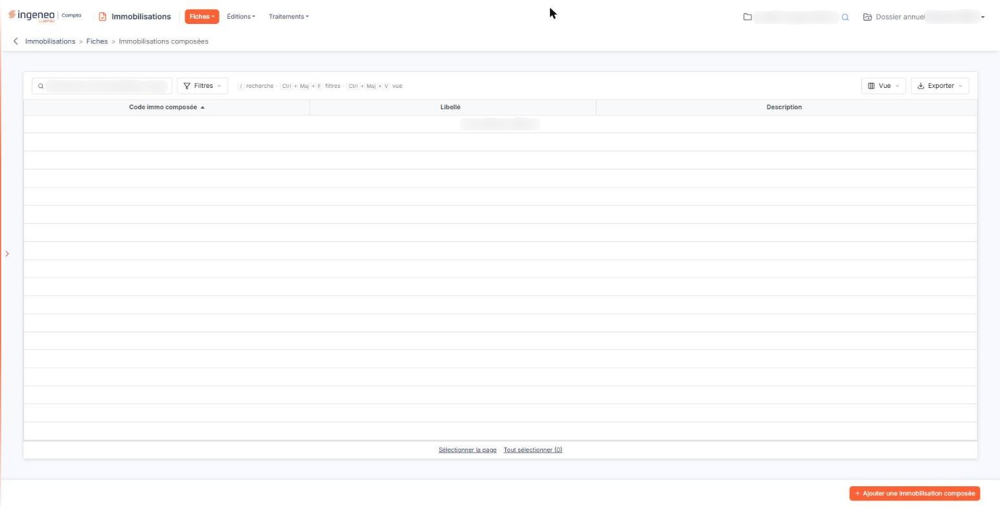
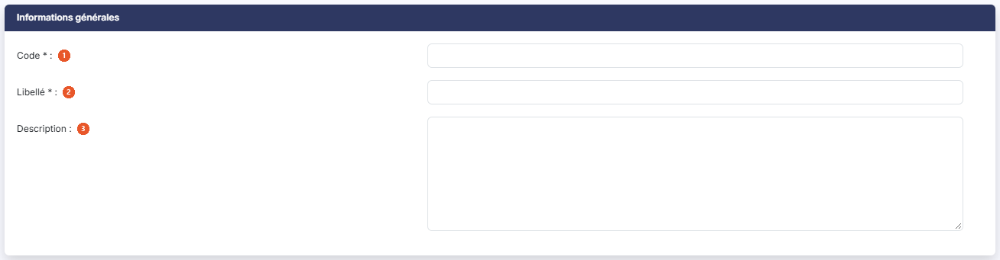
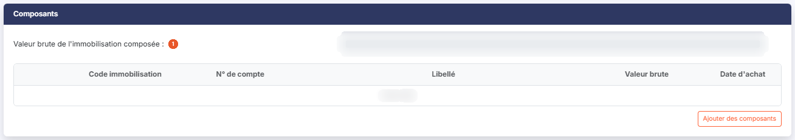

# Immobilisations composées


**Où le trouver :** Menu **Fiches › Immobilisations composées**



**En bref** — Cet écran regroupe sous un même code plusieurs immobilisations formant un ensemble, pour en suivre la valeur brute totale ; chaque composant garde sa propre fiche et son amortissement.

* Pour créer une immobilisation composée : bouton \[Ajouter une immobilisation composée], saisissez le code et le libellé, puis bouton \[Enregistrer].
* Pour rattacher des composants : bouton \[Ajouter des composants], cochez les immobilisations voulues, puis bouton \[Enregistrer].
* Pour retirer un composant : croix de sa ligne dans la rubrique « Composants », puis confirmez.


Une immobilisation composée regroupe plusieurs immobilisations qui forment un même ensemble : un bâtiment et ses agencements, une ligne de production et ses machines, un véhicule et ses équipements. Chaque élément garde sa fiche propre, son plan d'amortissement et sa durée ; l'immobilisation composée ne fait que les rassembler sous un même code, pour que vous puissiez suivre l'ensemble et en connaître la valeur brute totale.

<figure><figcaption>
Écran « Immobilisations composées » de la nouvelle interface
</figcaption></figure>

Pour saisir une immobilisation composée, vous devez donc avoir préalablement saisi chaque composant dans le menu « Fiches », sous-menu « Immobilisations ». Cet écran ne crée pas d'immobilisation : il en assemble.

## La liste des immobilisations composées

La grille présente trois colonnes : **Code immo composée** (colonne sur laquelle la liste est triée à l'ouverture, dans l'ordre croissant), **Libellé** et **Description**. Toutes sont triables, et vous pouvez les redimensionner ou les déplacer.

Chaque ligne porte des commandes qui vous permettent de modifier la fiche, de la supprimer et de la dupliquer : la duplication ouvre une fiche préremplie. Selon les droits qui vous sont accordés, certaines peuvent ne pas vous être proposées.

Vous pouvez cocher plusieurs lignes, y compris au-delà de la page affichée, puis employer le bouton **\[Supprimer]** de la barre basse pour supprimer la sélection en une fois. Une immobilisation composée n'est pas supprimable si l'exercice est clôturé, ni si la fiche a été créée avant le début de l'exercice sur lequel vous travaillez : dans ce dernier cas, il faut vous placer sur l'exercice où la fiche a été créée.


Notez que cette liste ne propose ni modification groupée ni sorties multiples, contrairement à la liste des immobilisations : ces deux traitements portent sur les composants eux-mêmes, donc sur leurs propres fiches.


## Bouton \[Ajouter une immobilisation composée]

Il ouvre une fiche vide. La fiche est nettement plus simple que celle d'une immobilisation : trois rubriques seulement, décrites ci-dessous dans l'ordre où elles s'affichent. Aucune n'est conditionnelle.

## Rubrique « Informations générales »

<figure><figcaption>
Rubrique « Informations générales »
</figcaption></figure>

| Champ                                                      | Ce qu'il faut savoir                                                                                                                                                                                                                                                                                                                                                                                                                                                                                                                                             |
| ---------------------------------------------------------- | ---------------------------------------------------------------------------------------------------------------------------------------------------------------------------------------------------------------------------------------------------------------------------------------------------------------------------------------------------------------------------------------------------------------------------------------------------------------------------------------------------------------------------------------------------------------- |
| 
1. <strong>Code</strong> <em>Obligatoire</em>
    | 
Il doit être unique. Si vous avez activé la numérotation automatique — panneau « Paramètres », rubrique « Immobilisations », option « Configuration » — le code vous est proposé prérempli et n'est pas modifiable ; c'est la même numérotation que celle des immobilisations simples. Si la numérotation automatique n'est pas activée, vous saisissez le code vous-même, sur 30 caractères au maximum. <strong>Dans tous les cas, le code n'est plus modifiable après le premier enregistrement</strong> : en modification, il s'affiche verrouillé.
 |
| 
2. <strong>Libellé</strong> <em>Obligatoire</em>
 | 30 caractères au maximum.                                                                                                                                                                                                                                                                                                                                                                                                                                                                                                                                        |
| 3. **Description**                                         | 1 024 caractères au maximum. C'est une zone de plusieurs lignes. Notez que la colonne correspondante de la liste s'intitule bien « Description », comme ce champ.                                                                                                                                                                                                                                                                                                                                                                                                |

## Rubrique « Composants »

<figure><figcaption>
Rubrique « Composants »
</figcaption></figure>

C'est dans cette rubrique que vous administrez la liste des composants de l'immobilisation.

**Valeur brute de l'immobilisation composée** : non modifiable. Elle est calculée comme la somme des valeurs brutes des composants rattachés, et **recalculée à chaque affichage de la fiche** : si la valeur brute d'un composant change sur sa propre fiche, la valeur de l'ensemble suit d'elle-même, sans que vous ayez à intervenir ici. Elle est vide tant qu'aucun composant n'est rattaché.

Le tableau des composants présente cinq colonnes : **Code immobilisation**, **N° de compte**, **Libellé**, **Valeur brute** et **Date d'achat**. Il affiche « Liste vide » tant qu'aucun composant n'est rattaché.

Chaque ligne porte deux commandes : le pictogramme « Œil », qui vous permet de visualiser la fiche du composant, et une croix, qui retire le composant de l'ensemble. Le logiciel vous demande confirmation avant de retirer un composant.

bouton **\[Ajouter des composants]** : il ouvre une fenêtre intitulée « Ajout de composants », qui vous invite à sélectionner ci-dessous la ou les immobilisations que vous souhaitez rattacher à l'immobilisation composée, puis à cliquer sur le bouton \[Enregistrer]. La fenêtre présente les immobilisations du dossier avec une case à cocher par ligne et six colonnes : **Code**, **Libellé**, **Montant HT**, **Date d'achat**, **Durée économique** et **Méthode économique** — de quoi reconnaître sans hésiter le bien à rattacher. La liste est paginée ; vous pouvez la filtrer et la trier comme les autres grilles du logiciel. Vous validez par le bouton **\[Enregistrer]**, ou renoncez par le bouton **\[Annuler]** ou par la croix de l'en-tête.

Lorsque votre choix est enregistré, la valeur brute de l'immobilisation composée est mise à jour, ainsi que l'historique, avec une ligne pour chaque composant ajouté.

Si vous cliquez à nouveau sur ce bouton, les immobilisations déjà rattachées à cette fiche ne figurent plus dans la liste proposée : vous ne risquez donc pas de rattacher deux fois le même bien. Plus largement, **une immobilisation ne peut appartenir qu'à une seule immobilisation composée** : pour la déplacer d'un ensemble à un autre, retirez-la du premier avant de l'ajouter au second.

## Rubrique « Historique »

<figure><figcaption>
Rubrique « Historique »
</figcaption></figure>

C'est une zone de plusieurs lignes, en lecture seule, que le logiciel alimente lui-même : vous ne pouvez pas y écrire. Son infobulle précise qu'elle est mise à jour lors de chaque enregistrement de la fiche de l'immobilisation composée. Elle est vide sur une fiche que vous venez d'ouvrir en création.

L'historique conserve la trace de la création de la fiche, de chaque ajout et de chaque retrait de composant, mais aussi — et c'est ce qui en fait l'intérêt réel — des opérations faites sur les fiches des composants eux-mêmes : la sortie d'un composant, l'annulation d'une sortie, une dépréciation, une reprise de dépréciation. C'est donc le seul endroit où vous lisez d'un coup d'œil ce qui est arrivé à l'ensemble, sans avoir à ouvrir chaque fiche de composant.

## Bouton \[Enregistrer]

<figure><figcaption>
Bouton [Enregistrer]
</figcaption></figure>

Il enregistre la fiche. Selon les droits qui vous sont accordés, il peut ne pas vous être proposé.

## Bouton \[Retour]

Il revient à la liste des immobilisations composées sans rien enregistrer.
