# Immobilisations


**Où le trouver :** Menu **Fiches › Immobilisations**



**En bref** — Cet écran tient le fichier des immobilisations du dossier : une fiche par bien, avec sa valeur, ses plans d'amortissement économique et fiscal, ses documents et ses comptes de comptabilisation.

* Pour créer une immobilisation : bouton \[Ajouter une immobilisation], renseignez les rubriques de la fiche, puis bouton \[Enregistrer].
* Pour sortir une immobilisation : bouton \[Sortie] depuis sa fiche, ou bouton \[Sorties multiples] pour plusieurs fiches cochées dans la liste.
* Pour consulter le plan d'amortissement d'une fiche : bouton \[Plan d'amortissement].


C'est ici que vous tenez le fichier des immobilisations du dossier : une fiche par bien, sa valeur, son plan d'amortissement économique et, le cas échéant, son plan fiscal, ses documents justificatifs et les comptes sur lesquels il sera comptabilisé.

<figure>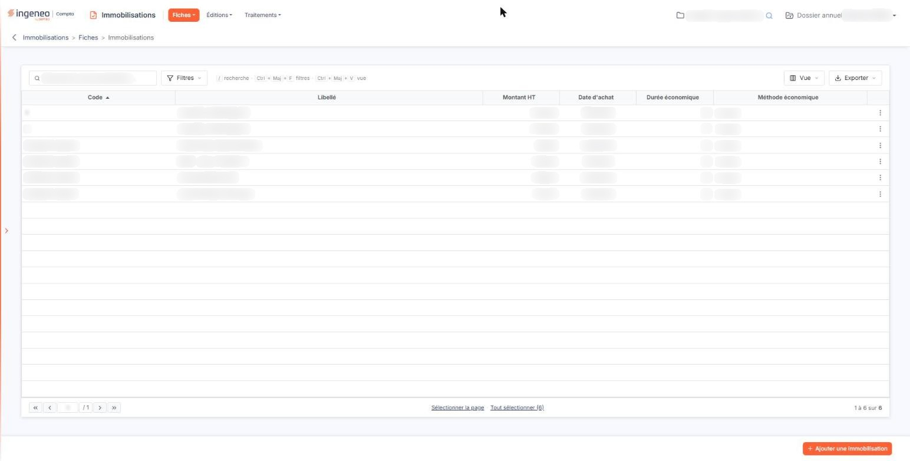<figcaption>
Écran « Immobilisations » de la nouvelle interface
</figcaption></figure>

L'option s'ouvre sur la liste des fiches existantes. De là, vous créez une fiche, vous en ouvrez une pour la modifier, vous la dupliquez ou vous la supprimez. Les traitements qui portent sur l'ensemble du fichier — le recalcul, l'intégration des écritures, les imports — se trouvent dans le menu « Traitements », et les états dans le menu « Editions ».

## La liste des immobilisations

La liste affiche les colonnes que vous avez choisies. Dans un dossier neuf, elle en présente six : **Code**, sur lequel les fiches sont triées à l'ouverture, **Libellé**, **Montant HT**, **Date d'achat**, **Durée économique** et **Méthode économique**. Toutes les colonnes se trient en cliquant sur leur titre, et se redimensionnent ou se déplacent en tirant sur leur bord ou sur leur titre.

Le bas de la liste rappelle le nombre de fiches et la page affichée. Au-dessus de la liste, une barre porte trois boutons nommés — bouton **\[Filtres]**, que vous pouvez aussi appeler au clavier par Ctrl + Maj + F, bouton **\[Vue]**, par Ctrl + Maj + V, et bouton **\[Exporter]** — ainsi que deux liens de sélection : **Sélectionner la page**, qui coche toutes les lignes de la page affichée, et **Tout sélectionner**, qui étend la sélection à toutes les pages et rappelle entre parenthèses le nombre de fiches concernées.

Les fenêtres de ces boutons, la sélection de la page ou de toutes les pages et le menu du bouton \[Exporter] sont communs à toutes les listes : ils sont décrits dans la page « Les listes ».

Chaque ligne porte, à gauche, quatre commandes dont le nom apparaît au survol : « Sélectionner » pour cocher la ligne, « Modifier » pour ouvrir la fiche, « Supprimer » pour la supprimer et « Dupliquer » pour en créer une copie.

## Bouton \[Ajouter une immobilisation]

Ce bouton est placé en bas à droite de l'écran. Il ouvre une fiche vierge. Les rubriques de cette fiche sont décrites plus bas : elles sont les mêmes en création et en modification, à quelques différences près qui sont signalées au fil du texte.

## Bouton \[Modification groupée]

Il vous permet de porter la même valeur sur plusieurs fiches à la fois, sans les ouvrir une par une. Cochez d'abord les lignes concernées dans la liste : **il en faut au moins deux**, faute de quoi le logiciel vous répond « Veuillez sélectionner au moins deux lignes pour effectuer une modification groupée ».

## Bouton \[Sorties multiples]

<figure><figcaption>
Bouton [Sortie]
</figcaption></figure>

<figure>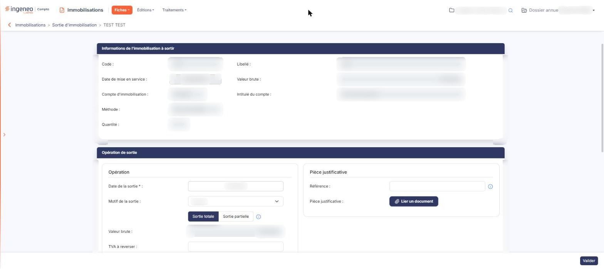<figcaption>
Bouton [Sortie]
</figcaption></figure>

<figure>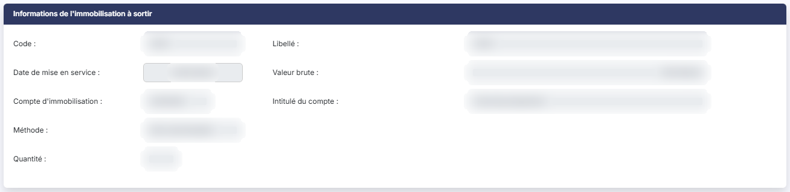<figcaption>
Bouton [Sortie]
</figcaption></figure>

<figure>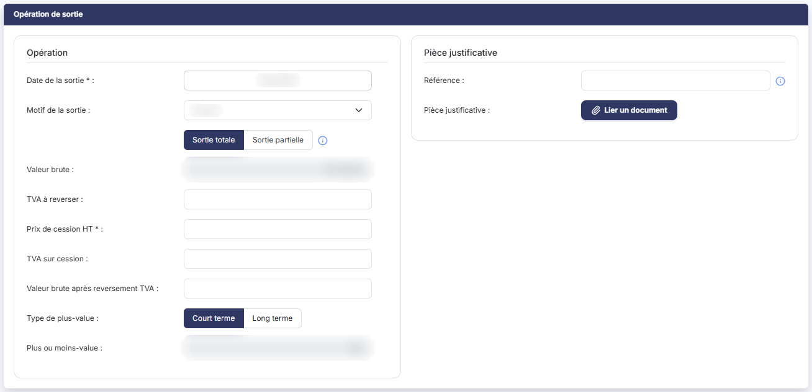<figcaption>
Bouton [Sortie]
</figcaption></figure>

<figure>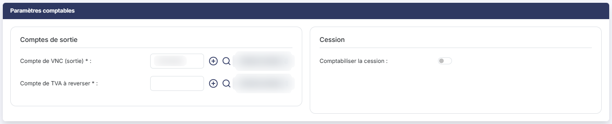<figcaption>
Bouton [Sortie]
</figcaption></figure>

<figure><figcaption>
Bouton [Sortie]
</figcaption></figure>

<figure>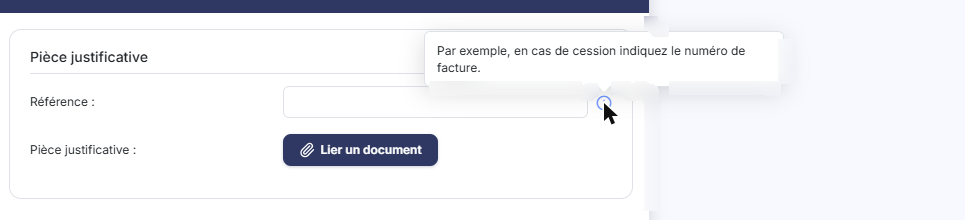<figcaption>
Bouton [Sortie]
</figcaption></figure>

<figure>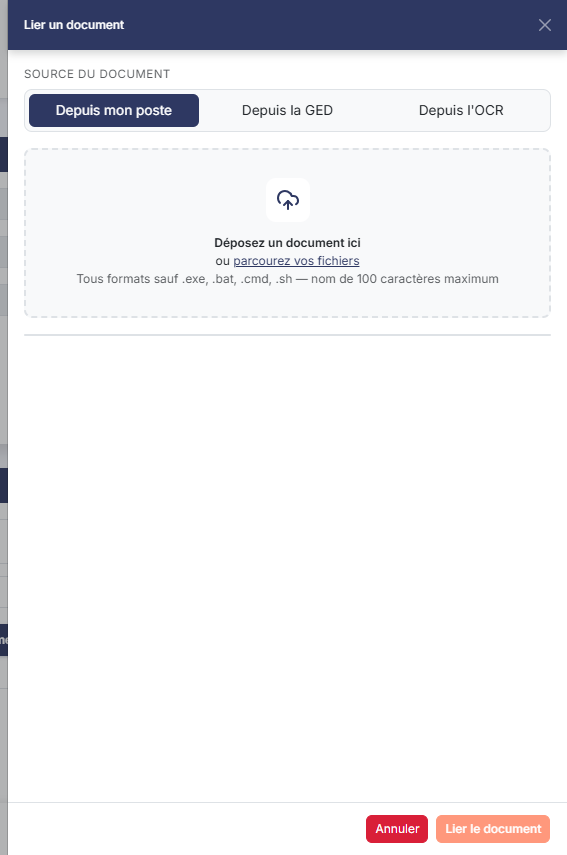<figcaption>
Bouton [Sortie]
</figcaption></figure>

<figure>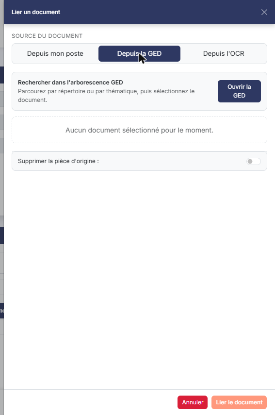<figcaption>
Bouton [Sortie]
</figcaption></figure>

<figure>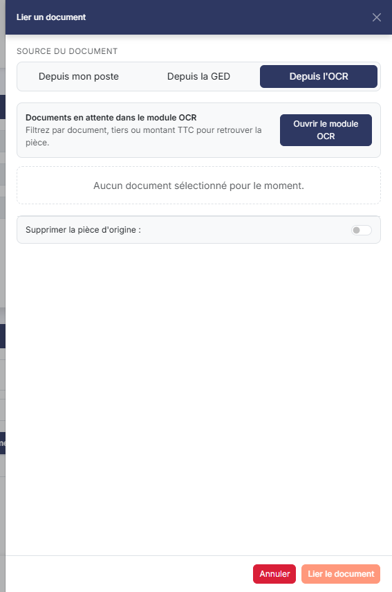<figcaption>
Bouton [Sortie]
</figcaption></figure>

Il vous permet de sortir en une seule fois toutes les fiches que vous avez cochées dans la liste, sur les mêmes date et motif de sortie. La sortie d'une fiche isolée se demande depuis la fiche elle-même, par son bouton **\[Sortie]**.

## Bouton \[Supprimer]

Il supprime les fiches dont vous avez coché la ligne. Une immobilisation n'est plus supprimable dès lors que l'exercice en cours est clôturé.

Selon les droits qui vous sont accordés, ce bouton et les trois précédents peuvent ne pas vous être proposés.

## Dupliquer une immobilisation

La duplication ne se demande que par le pictogramme de la ligne : aucun bouton du bas de l'écran ne la propose. Elle ouvre une fiche neuve préremplie avec les caractéristiques de la fiche d'origine. Si la numérotation automatique n'est pas activée, le logiciel vous propose le code de la fiche d'origine, que vous devez donc changer avant d'enregistrer.

## Ce qui reste modifiable sur une fiche existante

C'est la question la plus fréquente sur cet écran, et la fiche n'y répond pas : quand une fiche est verrouillée, la plupart de ses champs s'affichent en grisé **sans aucun message d'explication**.

Une fiche est intégralement verrouillée dans trois cas :

* elle a été **créée avant le début de l'exercice en cours**, c'est-à-dire lors d'un exercice précédent. C'est le cas le plus courant, et il ne dépend ni de la date d'achat, ni du fait que la fiche soit amortie ou comptabilisée : c'est la date de création de la fiche qui compte ;
* l'**exercice en cours est clôturé** ;
* l'immobilisation a été **sortie**.

Lorsqu'une fiche est verrouillée du seul fait qu'elle vient d'un exercice précédent, vous conservez la main sur ce qui n'a pas de conséquence comptable : le **Libellé** et la zone de saisie qui le suit, les **Commentaires**, la **Localisation**, la **Famille**, les rubriques « Informations complémentaires du véhicule » et « Informations complémentaires de l'immeuble », le **Compte de dotation**, le **Compte de reprise sur dérogatoire** et le **Compte de provision sur dérogatoire**. Vous pouvez aussi passer la **Nature** de « Autres » à « Immeuble » ou « Véhicule » — mais pas revenir en arrière, ni changer une nature déjà positionnée sur « Immeuble » ou « Véhicule ». Les documents restent administrables en toutes circonstances.

Sur une immobilisation **sortie**, il ne vous reste que le libellé et les commentaires ; c'est voulu, pour que vous puissiez expliquer la sortie après coup.

Une immobilisation qui a fait l'objet d'une **dépréciation** n'est verrouillée que partiellement : ce sont les valeurs qui servent au calcul de l'amortissement qui se figent, pas la fiche entière.

## Rubrique « Informations générales »

<figure>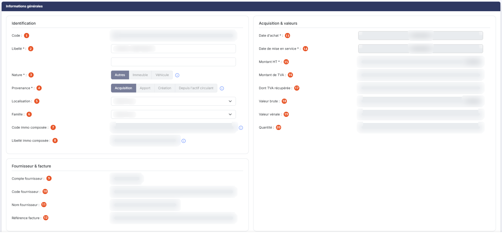<figcaption>
Rubrique « Informations générales »
</figcaption></figure>

| Champ                                                                       | Ce qu'il faut savoir                                                                                                                                                                                                                                                                                                                                                                                                                          |
| --------------------------------------------------------------------------- | --------------------------------------------------------------------------------------------------------------------------------------------------------------------------------------------------------------------------------------------------------------------------------------------------------------------------------------------------------------------------------------------------------------------------------------------- |
| 1. **Code**                                                                 | Il doit être unique. Si vous avez activé la numérotation automatique dans le panneau « Paramètres », rubrique « Immobilisations », option « Configuration », le logiciel l'attribue et vous ne pouvez pas le saisir ; sinon vous le saisissez librement. Il n'est plus modifiable une fois la fiche enregistrée. Notez que la fiche de création le signale comme obligatoire par un astérisque, ce que la fiche de modification ne fait plus. |
| 
2. <strong>Libellé</strong> <em>Obligatoire</em>
                  | 
C'est le nom sous lequel l'immobilisation apparaîtra partout. Juste en dessous se trouve <strong>une seconde zone de saisie, qui ne porte aucun libellé</strong>. C'est le champ que la liste, les filtres et les éditions appellent « Libellé 2 ». Il est facultatif et vous en faites l'usage que vous voulez : un complément de désignation, une référence interne, la traduction du libellé dans une autre langue.
              |
| 
3. <strong>Nature</strong> <em>Obligatoire</em>
                   | À choisir entre « Autres », « Immeuble » et « Véhicule ». La fiche s'ouvre sur « Autres ». Les choix « Immeuble » et « Véhicule » font apparaître une rubrique complémentaire, décrite plus bas. Le pictogramme d'information rappelle que « La nature permet les sélections d'imports dans certains formulaires de la liasse. »                                                                                                              |
| 
4. <strong>Provenance</strong> <em>Obligatoire</em>
               | À choisir entre « Acquisition », « Apport », « Création » et « Depuis l'actif circulant ». La fiche s'ouvre sur « Acquisition ». Le pictogramme d'information rappelle que « La provenance permet de faire des distinctions lors des imports contextuels des formulaires de l'annexe ».                                                                                                                                                       |
| 5. **Localisation**                                                         | Le sélecteur reprend les localisations que vous avez saisies dans le panneau « Paramètres », rubrique « Données », groupe « Analytique et immobilisations », option « Localisations ».                                                                                                                                                                                                                                                        |
| 6. **Famille**                                                              | Le sélecteur reprend les familles que vous avez saisies dans le panneau « Paramètres », rubrique « Données », groupe « Analytique et immobilisations », option « Familles d'immobilisations ».                                                                                                                                                                                                                                                |
| 7. **Code immo composée**                                                   | Jamais saisissable. Son pictogramme d'information l'explique : « Si l'immobilisation fait partie d'une immobilisation composée, ce champ contient son code. »                                                                                                                                                                                                                                                                                 |
| 8. **Libellé immo composée**                                                | De même, « Si l'immobilisation fait partie d'une immobilisation composée, ce champ contient son libellé ».                                                                                                                                                                                                                                                                                                                                    |
| 9. **Compte fournisseur**                                                   | Facultatif, sauf si vous souhaitez comptabiliser l'immobilisation au moment de son enregistrement. Saisissez quelques caractères du code ou de la raison sociale pour que le logiciel vous fasse des propositions, ou utilisez la loupe pour ouvrir la fenêtre de recherche. Le pictogramme « + » vous permet de créer un nouveau compte fournisseur sans quitter la fiche. Ce champ ne se saisit qu'à la création de la fiche.               |
| 10. **Code fournisseur**                                                    | —                                                                                                                                                                                                                                                                                                                                                                                                                                             |
| 11. **Nom fournisseur**                                                     | —                                                                                                                                                                                                                                                                                                                                                                                                                                             |
| 12. **Référence facture**                                                   | —                                                                                                                                                                                                                                                                                                                                                                                                                                             |
| 
13. <strong>Date d'achat</strong> <em>Obligatoire</em>
            | C'est cette date qui sert de point de départ à l'amortissement dégressif.                                                                                                                                                                                                                                                                                                                                                                     |
| 
14. <strong>Date de mise en service</strong> <em>Obligatoire</em>
 | Le logiciel la prérenseigne avec la date d'achat si celle-ci a déjà été saisie. C'est elle qui sert de point de départ à l'amortissement linéaire.                                                                                                                                                                                                                                                                                            |
| 
15. <strong>Montant HT</strong> <em>Obligatoire</em>
              | —                                                                                                                                                                                                                                                                                                                                                                                                                                             |
| 16. **Montant de TVA**                                                      | —                                                                                                                                                                                                                                                                                                                                                                                                                                             |
| 17. **Dont TVA récupérée**                                                  | Dès que vous saisissez un montant de TVA, le logiciel propose le même montant ici ; il reste modifiable.                                                                                                                                                                                                                                                                                                                                      |
| 18. **Valeur brute**                                                        | Jamais saisissable. Elle est calculée, et vaut le montant hors taxes augmenté de la TVA et diminué de la TVA récupérée.                                                                                                                                                                                                                                                                                                                       |
| 19. **Valeur vénale**                                                       | C'est une valeur indicative de ce que vaudra encore le bien une fois totalement amorti.                                                                                                                                                                                                                                                                                                                                                       |
| 20. **Quantité**                                                            | —                                                                                                                                                                                                                                                                                                                                                                                                                                             |

## Rubrique « Informations complémentaires du véhicule »

Elle n'apparaît que si la **Nature** est « Véhicule ». Les renseignements demandés sont ceux de la carte grise, et chaque pictogramme d'information vous indique la rubrique de la carte grise où trouver la valeur.

| Champ                                                             | Ce qu'il faut savoir                                                                                                                                                                                                             |
| ----------------------------------------------------------------- | -------------------------------------------------------------------------------------------------------------------------------------------------------------------------------------------------------------------------------- |
| 
<strong>Immatriculation</strong> <em>Obligatoire</em>
   | Rubrique A de la carte grise.                                                                                                                                                                                                    |
| **Modèle**                                                        | Rubriques D.1 et D.3 de la carte grise.                                                                                                                                                                                          |
| **Date de première immatriculation en France**                    | Rubrique B de la carte grise.                                                                                                                                                                                                    |
| **Emission CO2**                                                  | En gramme par kilomètre, rubrique V.7 de la carte grise.                                                                                                                                                                         |
| 
<strong>Type de véhicule</strong> <em>Obligatoire</em>
  | « Véhicule de tourisme », « Véhicule utilitaire », « Moto » ou « Vélomoteur, scooter ». Rubrique J.1 de la carte grise.                                                                                                          |
| 
<strong>Norme euro</strong> <em>Obligatoire</em>
        | Rubrique V.9 de la carte grise.                                                                                                                                                                                                  |
| 
<strong>Puissance fiscale</strong> <em>Obligatoire</em>
 | Rubrique P.6 de la carte grise.                                                                                                                                                                                                  |
| 
<strong>Motorisation</strong> <em>Obligatoire</em>
      | « Thermique », « Hydrogène », « Hybride » ou « Electrique ».                                                                                                                                                                     |
| 
<strong>Type de carburant</strong> <em>Obligatoire</em>
 | « Diesel », « Super sans plomb », « Superéthanol E85 » ou « GPL ». Ce champ ne concerne que les motorisations « Thermique » et « Hybride » : il disparaît de la rubrique pour les motorisations « Electrique » et « Hydrogène ». |
| **Motif d'exonération sur le CO2**                                | Le motif pour lequel le véhicule est exonéré de la taxe sur les émissions de dioxyde de carbone.                                                                                                                                 |
| **Motif d'exonération sur les polluants**                         | Le motif pour lequel il est exonéré de la taxe sur les émissions de polluants atmosphériques.                                                                                                                                    |

Ces informations alimentent l'option « Véhicules » du menu « Fiches » et, par elle, l'édition « Calcul TVS » du menu « Editions » : dès que vous décrivez ici un véhicule, il est inscrit dans la liste des véhicules du dossier, avec l'origine « Immobilisation ».

## Rubrique « Informations complémentaires de l'immeuble »

<figure>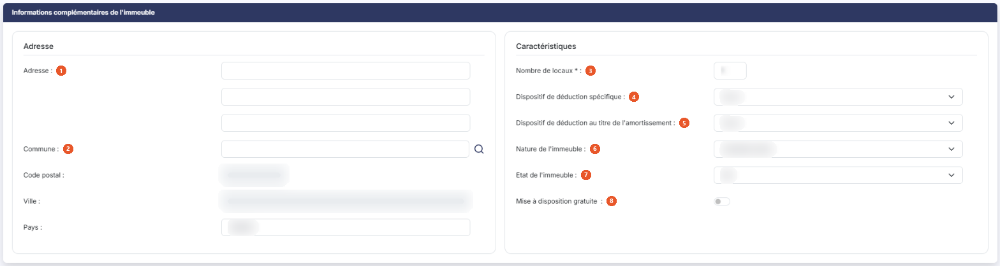<figcaption>
Rubrique « Informations complémentaires de l'immeuble »
</figcaption></figure>

Elle n'apparaît que si la **Nature** est « Immeuble ».

| Champ                                                               | Ce qu'il faut savoir                                                                                                                                                                                                                                                                                                                                                                                                                                                                                                                                                                                                                                          |
| ------------------------------------------------------------------- | ------------------------------------------------------------------------------------------------------------------------------------------------------------------------------------------------------------------------------------------------------------------------------------------------------------------------------------------------------------------------------------------------------------------------------------------------------------------------------------------------------------------------------------------------------------------------------------------------------------------------------------------------------------- |
| 1. **Adresse**                                                      | Trois zones de saisie superposées sous un seul libellé.                                                                                                                                                                                                                                                                                                                                                                                                                                                                                                                                                                                                       |
| 2. **Commune**                                                      | Saisissez le début de son nom : la zone propose des communes sous la forme « code - nom (département) », par exemple « 109 - Nantes (44) » ; la loupe placée à droite de la zone ouvre un panneau « Sélection d'une commune », dont la liste (Code INSEE, Ville, Département) se filtre par nom ou par code INSEE. **Code postal :** et **Ville :** sont en lecture seule (« Déduit de la commune ») : ils se remplissent d'après la commune choisie ; quand la commune compte plusieurs codes postaux (Nantes, par exemple), le code postal devient une liste « Sélectionnez » où vous choisissez le vôtre. **Pays :** « FRANCE » est proposé à l'ouverture. |
| 
3. <strong>Nombre de locaux</strong> <em>Obligatoire</em>
 | La fiche propose 1.                                                                                                                                                                                                                                                                                                                                                                                                                                                                                                                                                                                                                                           |
| 4. **Dispositif de déduction spécifique**                           | Le dispositif fiscal dont relève l'immeuble. La liste va de « Aucun », valeur d'ouverture, aux différents conventionnements. Choisissez celui qui correspond à votre situation.                                                                                                                                                                                                                                                                                                                                                                                                                                                                               |
| 5. **Dispositif de déduction au titre de l'amortissement**          | « Aucun » à l'ouverture, puis « Périssol », « Robien classique », « Robien classique en zone de revitalisation rurale », « Robien recentré », « Robien recentré en zone de revitalisation rurale », « Borloo neuf » et « Besson neuf ».                                                                                                                                                                                                                                                                                                                                                                                                                       |
| 6. **Nature de l'immeuble**                                         | « Immeuble urbain » à l'ouverture, puis « Immeuble rural », « Immeuble de rapport », « Appartement », « Maison », « Parking » et « Autre qualification ».                                                                                                                                                                                                                                                                                                                                                                                                                                                                                                     |
| 7. **Etat de l'immeuble**                                           | « Bâti » à l'ouverture, ou « Non bâti ».                                                                                                                                                                                                                                                                                                                                                                                                                                                                                                                                                                                                                      |
| 8. **Mise à disposition gratuite**                                  | Répondez « Oui » si l'immeuble est mis gratuitement à la disposition d'un tiers ; une rubrique supplémentaire s'ouvre alors.                                                                                                                                                                                                                                                                                                                                                                                                                                                                                                                                  |

## Rubrique « Immeuble - Mise à disposition gratuite »

<figure><figcaption>
Rubrique « Immeuble - Mise à disposition gratuite »
</figcaption></figure>

Elle n'apparaît que si la **Nature** est « Immeuble » et que vous avez répondu « Oui » à **Mise à disposition gratuite**. Elle sert à décrire l'occupant et ce que la location aurait rapporté.

| Champ                                             | Ce qu'il faut savoir                                                                                                                                                                                                                                                                                                                                        |
| ------------------------------------------------- | ----------------------------------------------------------------------------------------------------------------------------------------------------------------------------------------------------------------------------------------------------------------------------------------------------------------------------------------------------------- |
| 1. **Recettes qu'aurait pu produire la location** | Le loyer que vous auriez perçu si l'immeuble avait été loué.                                                                                                                                                                                                                                                                                                |
| 2. **Lien avec la société**                       | « Associé » ou « Autres ».                                                                                                                                                                                                                                                                                                                                  |
| 3. **Type**                                       | « Personne morale » ou « Personne physique ». Selon votre réponse, vous renseignez la **Raison sociale**, le **SIREN** et la **Forme juridique**, ou bien le **Nom** et le **Prénom**.                                                                                                                                                                      |
| 4. **Adresse**                                    | Indiquez d'abord si l'adresse de l'occupant est celle de l'immeuble, en choisissant « Immeuble » ou « Autres », puis, dans le second cas, saisissez l'**Adresse** (trois zones), choisissez la **Commune** comme ci-dessus — le **Code postal** et la **Ville** s'en déduisent et restent en lecture seule — et vérifiez le **Pays**, proposé à « FRANCE ». |

## Rubrique « Amortissement économique »

<figure>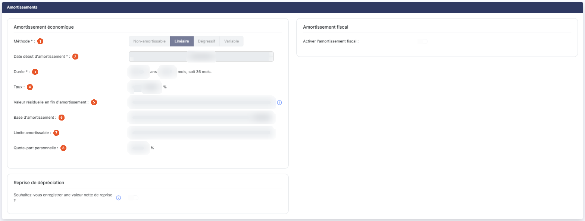<figcaption>
Rubrique « Amortissement économique »
</figcaption></figure>

C'est la méthode d'amortissement qui commande le contenu de cette rubrique : tant qu'elle vaut « Non-amortissable », la rubrique ne contient rien d'autre que le choix de la méthode.

| Champ                                                                         | Ce qu'il faut savoir                                                                                                                                                                                                                                                                                                                                                                                                                                                                                         |
| ----------------------------------------------------------------------------- | ------------------------------------------------------------------------------------------------------------------------------------------------------------------------------------------------------------------------------------------------------------------------------------------------------------------------------------------------------------------------------------------------------------------------------------------------------------------------------------------------------------ |
| 
1. <strong>Méthode</strong> <em>Obligatoire</em>
                    | À choisir entre « Non-amortissable », « Linéaire », « Dégressif » et « Variable ». Une fiche neuve s'ouvre sur « Non-amortissable ».                                                                                                                                                                                                                                                                                                                                                                         |
| 
2. <strong>Date début d'amortissement</strong> <em>Obligatoire</em>
 | Le logiciel la prérenseigne avec la date de mise en service pour un amortissement linéaire, et avec le premier jour du mois d'acquisition pour un amortissement dégressif.                                                                                                                                                                                                                                                                                                                                   |
| 
3. <strong>Durée</strong> <em>Obligatoire</em>
                      | Exprimée en deux zones, un nombre d'années et un nombre de mois ; le total en mois est rappelé à côté. Pour un amortissement linéaire la durée ne peut pas être inférieure à un an, et pour un amortissement dégressif elle ne peut pas être inférieure à trois ans.                                                                                                                                                                                                                                         |
| 4. **Taux**                                                                   | Calculé par le logiciel d'après la durée que vous avez indiquée.                                                                                                                                                                                                                                                                                                                                                                                                                                             |
| 5. **Valeur résiduelle en fin d'amortissement**                               | Son pictogramme d'information la définit : « Valeur anticipée de l'immobilisation à la fin de la période d'amortissement, qui sera retranchée de la base d'amortissement. »                                                                                                                                                                                                                                                                                                                                  |
| 6. **Base d'amortissement**                                                   | Calculée, elle vaut la valeur brute diminuée de la valeur résiduelle en fin d'amortissement.                                                                                                                                                                                                                                                                                                                                                                                                                 |
| 7. **Limite amortissable**                                                    | À ne renseigner que si le bien est soumis à une limite d'amortissement. Elle se substitue alors à la base d'amortissement pour le calcul des dotations, mais elle ne change pas la valeur nette comptable du bien, qui reste la base d'amortissement diminuée des amortissements cumulés.                                                                                                                                                                                                                    |
| 8. **Quote-part personnelle**                                                 | Exprimé en pourcentage. C'est la part d'usage personnel du bien, celle qui n'a pas à rester en charge de l'entreprise.                                                                                                                                                                                                                                                                                                                                                                                       |
| **Non-amortissable**                                                          | Le bien ne s'amortit pas — terrains, droits au bail, fonds de commerce, immobilisations financières. Il n'y a alors rien d'autre à saisir. C'est d'ailleurs la seule méthode acceptée pour une immobilisation financière : si le compte d'immobilisation appartient à la racine des immobilisations financières et que vous avez choisi une autre méthode, le logiciel refuse l'enregistrement en affichant, sous le choix de la méthode, « Il n'est pas possible d'amortir une immobilisation financière. » |
| **Linéaire**                                                                  | La même valeur est amortie chaque année. C'est le type d'amortissement le plus courant, et il est obligatoire pour les biens d'occasion et pour les immobilisations dont la durée de vie est inférieure à trois ans.                                                                                                                                                                                                                                                                                         |
| **Dégressif**                                                                 | Le bien s'amortit plus fortement en début de vie qu'en fin de vie. Ce type d'amortissement concerne les biens d'équipement dont la durée de vie est d'au moins trois ans. Le coefficient s'ajoute alors à la rubrique, sous le libellé **Coefficient dégressif :** ; il est paramétré dans le panneau « Paramètres », rubrique « Immobilisations », option « Coefficients dégressifs ».                                                                                                                      |
| **Variable**                                                                  | 
Aussi appelé amortissement sur la base des unités d'œuvre, il module les annuités en fonction des conditions prévues d'utilisation du bien. Le taux n'a alors plus de sens et disparaît de la rubrique ; c'est vous qui répartissez l'amortissement, au moyen du bouton décrit au paragraphe suivant. Dès que la méthode est autre que « Non-amortissable », la rubrique se complète des champs suivants.
                                                                                          |

Enfin, lorsque la date de début d'amortissement est antérieure au début de l'exercice, la rubrique intercale, juste après **Base d'amortissement :**, la question **Souhaitez-vous enregistrer une valeur nette de reprise ? :**. Répondez « Oui » si vous reprenez une immobilisation déjà amortie dans un autre logiciel et que la valeur nette à la fin du dernier exercice diffère de celle que calcule Ingeneo Compta : vous saisissez alors la **Valeur nette comptable de reprise :**, le logiciel affiche la **Date de calcul pour la reprise :** qu'il retient, et vous choisissez l'**Imputation de l'écart :** entre « Sur la dernière annuité » et « Lissé ». Le plan d'amortissement est ensuite calculé à partir de cette valeur.

## Bouton \[Saisie du plan d'amortissement variable]

Il n'apparaît que si la méthode est « Variable » et vous ouvre la saisie des unités d'œuvre, c'est-à-dire la répartition de l'amortissement que le logiciel ne peut pas déduire d'une durée. Sur une fiche déjà enregistrée, le même bouton s'intitule bouton **\[Visualiser le plan d'amortissement variable]**.

Le logiciel contrôle que la totalité de la base est répartie : tant qu'il reste un montant à affecter, l'enregistrement du plan est refusé.

## Rubrique « Valeur calculées pour l'amortissement économique »

<figure>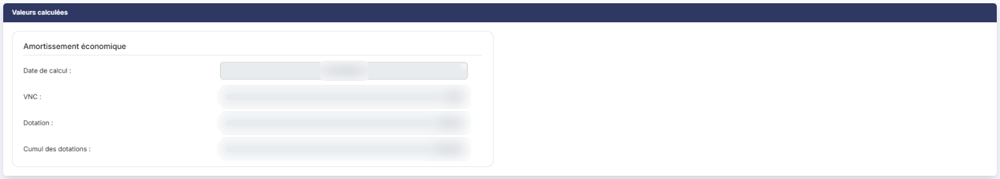<figcaption>
Rubrique « Valeur calculées pour l'amortissement économique »
</figcaption></figure>

Cette rubrique s'intitule « Valeurs calculées » sur une fiche en création et « Valeur calculées pour l'amortissement économique » sur une fiche en modification. C'est la même rubrique.

Elle contient les valeurs de la fiche à la date du dernier recalcul, et aucune n'est saisissable : **Date de calcul :**, **VNC :** pour la valeur nette comptable, **Dotation :** et **Cumul des dotations :**.

Ne vous étonnez pas de voir une date de calcul qui n'est pas celle du jour : c'est la date à laquelle le dernier recalcul a été demandé, et elle peut remonter à la clôture de l'exercice précédent. Le recalcul se relance fiche par fiche avec le bouton **\[Recalculer]** ou pour l'ensemble du fichier par le menu « Traitements », option « Recalcul ».

## Rubrique « Amortissement fiscal »

L'amortissement fiscal s'utilise dans des cas bien précis : il permet d'obtenir un plan d'amortissement différent de l'amortissement économique.

Dans son état d'ouverture, la rubrique ne contient qu'une question, **Activer l'amortissement fiscal :**, à laquelle la fiche répond « Non ». Répondez « Oui » et la rubrique se complète.

## Rubrique « Valeurs calculées pour l'amortissement fiscal »

Elle n'apparaît que si vous avez activé l'amortissement fiscal et que des valeurs fiscales ont déjà été calculées. Comme sa symétrique économique, elle contient les valeurs de la fiche à la date du dernier recalcul, et aucune n'est saisissable.

## Rubrique « Subventions »

Elle n'apparaît que si au moins une subvention est rattachée à l'immobilisation. Le rattachement ne se fait pas ici mais depuis la fiche de la subvention, dans le menu « Fiches », option « Subventions ».

## Rubrique « Commentaires »

<figure>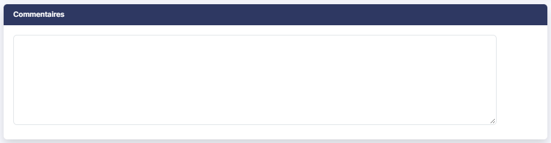<figcaption>
Rubrique « Commentaires »
</figcaption></figure>

Une zone de texte libre, sans libellé de champ, où vous notez ce que vous voulez. Elle reste modifiable en toutes circonstances, y compris sur une fiche verrouillée et sur une immobilisation sortie : vous pouvez donc y apporter des précisions après coup, jusqu'à la clôture.

Ne la confondez pas avec la rubrique « Historique », que le logiciel alimente lui-même et que vous ne pouvez pas modifier.

## Rubrique « Documents »

<figure>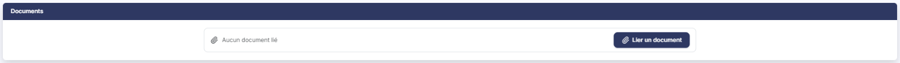<figcaption>
Rubrique « Documents »
</figcaption></figure>

Vous pouvez joindre à la fiche tous les justificatifs utiles : la facture d'achat, la carte grise, l'acte de cession. Le tableau affiche « Liste vide » tant qu'aucun document n'est joint, puis, pour chacun, sa **Description**, le **Nom du fichier**, sa **Date** et la mention **Créé par**.

Les documents restent administrables même lorsque la fiche est verrouillée ou que l'immobilisation est sortie.

Trois boutons vous permettent de joindre un document, selon l'endroit où il se trouve.

## Bouton \[Nouveau doc depuis mon poste]

Pour un fichier enregistré sur votre ordinateur.

## Bouton \[Nouveau doc depuis la GED]

Pour un document déjà classé dans la gestion électronique de documents.

## Bouton \[Nouveau doc depuis l'OCR]

Pour un document déjà présent dans le module de reconnaissance de documents.

## Rubrique « Historique »

<figure><figcaption>
Rubrique « Historique »
</figcaption></figure>

Une zone de texte que vous ne pouvez pas modifier. Le logiciel y inscrit lui-même les opérations qui ont marqué la fiche : sa création, avec sa date et son auteur, puis les imports, les dépréciations, les sorties, les sorties partielles et les virements de poste à poste.

## Rubrique « Paramètres comptables »

<figure>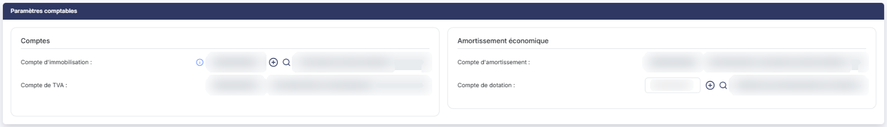<figcaption>
Rubrique « Paramètres comptables »
</figcaption></figure>

Cette rubrique porte les comptes sur lesquels l'immobilisation sera comptabilisée. Son contenu suit celui de la fiche : les comptes d'amortissement n'apparaissent que si l'immobilisation est amortissable, et les comptes dérogatoires que si vous avez activé l'amortissement fiscal.

Chaque compte est présenté sur une ligne, avec à sa droite une zone en lecture seule qui affiche l'**Intitulé du compte :**. Le pictogramme « + » crée un nouveau compte sans quitter la fiche, et la loupe ouvre la recherche dans le plan comptable, limitée aux comptes qui répondent à la racine attendue. Le pictogramme d'information rappelle justement cette racine — par exemple « Racine applicable : 68112 » sur le compte de dotation. Les racines se paramètrent dans le panneau « Paramètres », rubrique « Immobilisations », option « Comptes ».

Les comptes demandés sont, dans cet ordre, le **Compte d'immobilisation :** et le **Compte de TVA :**, puis, sous l'intertitre **Amortissement économique :**, le **Compte d'amortissement :** et le **Compte de dotation :** et, sous l'intertitre **Amortissement fiscal :**, le **Compte d'amortissement dérogatoire :**, le **Compte de reprise sur dérogatoire :** et le **Compte de provision sur dérogatoire :**.

Le compte de dotation, le compte de reprise sur dérogatoire et le compte de provision sur dérogatoire restent modifiables même sur une fiche verrouillée.

## Rubrique « Opération de sortie »

<figure>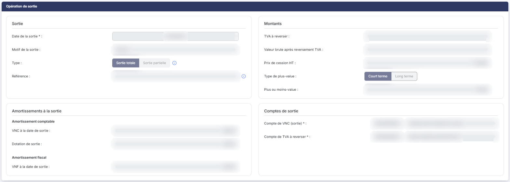<figcaption>
Rubrique « Opération de sortie »
</figcaption></figure>

Elle n'apparaît que sur une immobilisation déjà sortie, et rappelle les conditions de cette sortie.

## Bouton \[Enregistrer]

<figure><figcaption>
Bouton [Enregistrer]
</figcaption></figure>

Il enregistre la fiche après avoir vérifié que toutes les informations nécessaires sont présentes et cohérentes. Si une erreur est détectée, un message rouge apparaît à côté ou sous le champ concerné. L'enregistrement déclenche également un recalcul de la fiche.

**Comptabilisation de l'immobilisation** : au moment de l'enregistrement, le logiciel vous propose de comptabiliser l'immobilisation. Si vous acceptez, il vérifie que toutes les informations nécessaires sont présentes, soit dans la fiche, soit dans le panneau « Paramètres », rubrique « Immobilisations », option « Comptes », et vous indique le cas échéant ce qui manque. Si tout est en ordre, il vous présente l'écriture qu'il se propose de générer, que vous pouvez modifier avant de valider.

Si vous ne comptabilisez pas l'immobilisation au moment de sa création, vous ne pourrez plus le faire depuis le module des immobilisations : il faudra passer l'écriture en comptabilité.

De même, si vous modifiez une donnée d'une fiche déjà comptabilisée et que cette modification a un effet sur l'écriture, le logiciel ne corrige pas l'écriture lui-même : il vous prévient qu'il faut le faire depuis le module de comptabilité.

Selon les droits qui vous sont accordés, ce bouton peut ne pas vous être proposé.

## Bouton \[Plan d'amortissement]

<figure><figcaption>
Bouton [Plan d'amortissement]
</figcaption></figure>

Il affiche le plan d'amortissement économique de l'immobilisation ; le plan fiscal est affiché aussi lorsqu'il existe. Le « Mode d'affichage » vous permet de passer du « Plan » à un « Graphique », et le « Plan affiché » de choisir « Exercice » ou « Mois ». Le bouton **\[Editer]** ouvre la fenêtre « Edition plan d'amortissement ».

## Bouton \[Recalculer]

<figure><figcaption>
Bouton [Recalculer]
</figcaption></figure>

Il recalcule les valeurs de la fiche à une date que vous indiquez : le pictogramme d'information de la fenêtre vous le rappelle, « Indiquez la date pour laquelle vous voulez lancer le recalcul de la fiche immobilisation ». Les nouvelles valeurs s'affichent dans les rubriques de valeurs calculées.

## Bouton \[Sortie]

<figure><figcaption>
Bouton [Annuler la sortie]
</figcaption></figure>

Il vous permet de sortir l'immobilisation, totalement ou partiellement.

| Champ                   | Ce qu'il faut savoir                                                                                                                                                                                                                                                                                                                                                           |
| ----------------------- | ------------------------------------------------------------------------------------------------------------------------------------------------------------------------------------------------------------------------------------------------------------------------------------------------------------------------------------------------------------------------------ |
| **Date de la sortie**   | —                                                                                                                                                                                                                                                                                                                                                                              |
| **Motif de la sortie**  | À choisir entre « Cession », « Mise au rebut », « Destruction » et « Vol ». Un cinquième motif, « Remboursement », n'est proposé que pour les immobilisations financières.                                                                                                                                                                                                     |
| **Valeur brute**        | Rappelée pour mémoire.                                                                                                                                                                                                                                                                                                                                                         |
| **Pièce justificative** | Cette rubrique, à droite de l'opération, vous permet de rattacher la pièce qui justifie la sortie. Le champ **Référence** est facultatif ; son infobulle donne un exemple : en cas de cession, indiquez le numéro de facture. Le bouton bouton **\[Lier un document]** ouvre un volet qui propose trois sources : **Depuis mon poste**, **Depuis la GED** et **Depuis l'OCR**. |

La sortie peut être totale ou partielle.

### Sortie totale

| Champ                                 | Ce qu'il faut savoir                                                                                                                                                                                                                                                               |
| ------------------------------------- | ---------------------------------------------------------------------------------------------------------------------------------------------------------------------------------------------------------------------------------------------------------------------------------- |
| **TVA à reverser**                    | —                                                                                                                                                                                                                                                                                  |
| **Prix de cession**                   | Pour une cession, et pour un remboursement où le champ s'intitule « Montant remboursé », il est obligatoire et supérieur à zéro. Pour une destruction ou un vol, le champ s'intitule « Montant de l'indemnité ou du dédommagement ».                                               |
| **Type de plus-value**                | 
« Court terme » ou « Long terme ». <strong>Sortie partielle</strong> La sortie partielle scinde la fiche d'origine en deux. La première conserve la part que vous gardez, la seconde porte la part sortie.
                                                            |
| **Valeur brute à sortir**             | C'est la quote-part de valeur brute qui sort.                                                                                                                                                                                                                                      |
| **Code de l'immobilisation à sortir** | Comme le logiciel crée une seconde fiche, il lui faut un code distinct. Il vous propose celui de la fiche d'origine suivi d'un tiret et d'une lettre : une immobilisation « IMMO » donnera « IMMO-a » à la première sortie partielle, « IMMO-b » à la deuxième, et ainsi de suite. |
| **Libellé**                           | Le logiciel propose celui de la fiche d'origine, que vous pouvez modifier.                                                                                                                                                                                                         |
| **TVA à reverser**                    | —                                                                                                                                                                                                                                                                                  |
| **Prix de cession**                   | Comme pour la sortie totale.                                                                                                                                                                                                                                                       |

La sortie ajoute une ligne à l'historique de la fiche.

Une sortie peut être annulée : le bouton **\[Annuler la sortie]** apparaît dans le bas de la fiche d'une immobilisation sortie, selon vos droits. L'annulation est elle aussi inscrite à l'historique.

## Bouton \[Dépréciation]

<figure><figcaption>
Bouton [Dépréciation]
</figcaption></figure>

Il vous permet d'enregistrer une dépréciation de l'immobilisation et, si elle a déjà été dépréciée, d'en consulter les conditions.

| Champ                      | Ce qu'il faut savoir                                                                              |
| -------------------------- | ------------------------------------------------------------------------------------------------- |
| **Date de l'opération**    | Choisissez si la dépréciation s'applique en début ou en fin d'exercice.                           |
| **VNC avant dépréciation** | Calculée d'après la date d'opération choisie.                                                     |
| **Montant à déprécier**    | Inférieur à la valeur nette comptable avant dépréciation.                                         |
| **VNC après dépréciation** | Calculée, elle vaut la valeur nette comptable avant dépréciation diminuée du montant à déprécier. |

La dépréciation ajoute une ligne à l'historique de la fiche. Elle peut être annulée par le bouton **\[Annuler la dépréciation]**.

La reprise d'une dépréciation, elle, se demande par le bouton **\[Reprise dépréciation]**, qui apparaît lorsqu'une reprise est possible.

## Bouton \[Virement poste à poste]

<figure><figcaption>
Bouton [Virement poste à poste]
</figcaption></figure>

Il transfère l'immobilisation d'un compte vers un autre.

| Champ                   | Ce qu'il faut savoir                                                                                                                                                                                                                                 |
| ----------------------- | ---------------------------------------------------------------------------------------------------------------------------------------------------------------------------------------------------------------------------------------------------- |
| **Date de l'opération** | Comprise dans l'exercice en cours.                                                                                                                                                                                                                   |
| **Compte actuel**       | Rappelé pour mémoire.                                                                                                                                                                                                                                |
| **Nouveau compte**      | Le compte de destination. Il doit répondre aux racines paramétrées dans le panneau « Paramètres », rubrique « Immobilisations », option « Comptes ». La loupe ouvre la recherche dans le plan comptable et vous permet au besoin de créer le compte. |

Les virements de poste à poste sont inscrits dans l'historique de la fiche.

## Bouton \[Retour]

Il revient à la liste sans rien enregistrer.
