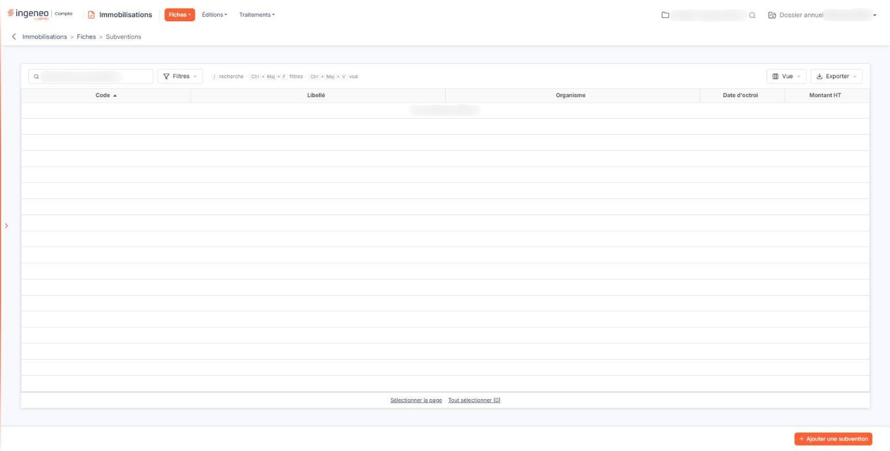
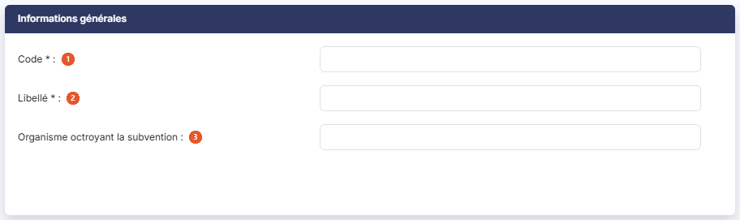
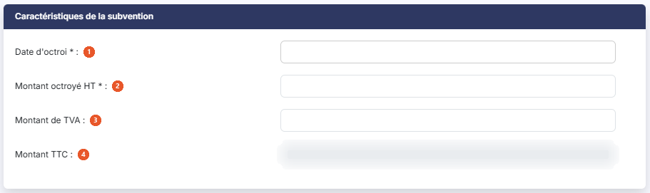

# Subventions


**Où le trouver :** Menu **Fiches › Subventions**



**En bref** — Cet écran gère les subventions d'investissement reçues : vous déclarez le montant octroyé et son régime d'étalement, et le logiciel calcule sa reprise au résultat année par année.

* Pour créer une subvention : bouton \[Ajouter une subvention], renseignez le montant octroyé et le régime d'étalement, puis bouton \[Enregistrer].
* Pour rattacher une immobilisation : bouton \[Ajouter une immobilisation], indiquez son code et le montant affecté ; la totalité de la subvention doit être affectée.
* Pour consulter la reprise année par année : bouton \[Tableau d'étalement].


Cette option permet de gérer toutes les subventions d'investissement reçues et, le cas échéant, de les rattacher aux immobilisations ou aux crédits-bails qu'elles financent.

<figure><figcaption>
Écran « Subventions » de la nouvelle interface
</figcaption></figure>

Une subvention d'investissement ne se comptabilise pas en produit d'un seul coup : elle s'étale, au même rythme que l'amortissement du bien qu'elle a servi à financer. C'est tout l'objet de cette fiche — vous y déclarez le montant octroyé, vous indiquez comment il doit s'étaler, et le logiciel en tire le tableau d'étalement année par année.

## La liste des subventions

La grille présente cinq colonnes : **Code** (colonne sur laquelle la liste est triée à l'ouverture, dans l'ordre croissant), **Libellé**, **Organisme**, **Date d'octroi** et **Montant HT**. Toutes sont triables, et vous pouvez les redimensionner ou les déplacer.

La colonne **Organisme** présente l'information que la fiche appelle « Organisme octroyant la subvention » : c'est la même donnée, sous un libellé raccourci pour tenir dans la largeur de la colonne.

Vous pouvez cocher plusieurs lignes, y compris au-delà de la page affichée, puis employer le bouton **\[Supprimer]** de la barre basse pour supprimer la sélection en une fois. Une subvention n'est pas supprimable si l'exercice est clôturé, ni si la fiche a été créée avant le début de l'exercice sur lequel vous travaillez : dans ce dernier cas, il faut vous placer sur l'exercice où la fiche a été créée.

## Bouton \[Ajouter une subvention]

Il ouvre une fiche de subvention vide. La fiche comporte six rubriques, toutes affichées d'emblée, décrites ci-dessous dans l'ordre où elles apparaissent.

## Rubrique « Informations générales »

<figure><figcaption>
Rubrique « Informations générales »
</figcaption></figure>

| Champ                                                      | Ce qu'il faut savoir                                                                                                                                                                                                                                                                                                                                     |
| ---------------------------------------------------------- | -------------------------------------------------------------------------------------------------------------------------------------------------------------------------------------------------------------------------------------------------------------------------------------------------------------------------------------------------------- |
| 
1. <strong>Code</strong> <em>Obligatoire</em>
    | 30 caractères au maximum. Contrairement aux fiches d'immobilisation, **ce code n'est pas prérempli** : vous le saisissez vous-même. Il doit être unique ; si vous reprenez un code déjà employé, le logiciel refuse l'enregistrement en indiquant « Code déjà utilisé. » Seules les lettres, les chiffres, le tiret, le souligné et le point sont admis. |
| 
2. <strong>Libellé</strong> <em>Obligatoire</em>
 | 50 caractères au maximum.                                                                                                                                                                                                                                                                                                                                |
| 3. **Organisme octroyant la subvention**                   | 50 caractères au maximum. C'est le financeur — région, département, agence, organisme professionnel.                                                                                                                                                                                                                                                     |

## Rubrique « Caractéristiques de la subvention »

<figure><figcaption>
Rubrique « Caractéristiques de la subvention »
</figcaption></figure>

| Champ                                                                 | Ce qu'il faut savoir                                                                                                                                               |
| --------------------------------------------------------------------- | ------------------------------------------------------------------------------------------------------------------------------------------------------------------ |
| 
1. <strong>Date d'octroi</strong> <em>Obligatoire</em>
      | Un pictogramme de calendrier vous permet de la choisir.                                                                                                            |
| 
2. <strong>Montant octroyé HT</strong> <em>Obligatoire</em>
 | **strictement positif** : la valeur zéro est refusée. Renseignez-le avant de vous occuper de l'étalement, plusieurs actions de la fiche en dépendent.              |
| 3. **Montant de TVA**                                                 | Il ne peut pas être supérieur au montant hors taxes ; le logiciel refuse l'enregistrement en indiquant « Le montant de TVA ne peut être supérieur au montant HT. » |
| 4. **Montant TTC**                                                    | Calculé automatiquement, non modifiable. C'est le montant octroyé hors taxes augmenté de la TVA.                                                                   |

## Rubrique « Etalement de la subvention »

<figure><figcaption>
Rubrique « Etalement de la subvention »
</figcaption></figure>

C'est la rubrique décisive, et celle qui change le plus d'aspect. Son contenu dépend entièrement du régime que vous retenez : ne vous étonnez pas de voir un tableau disparaître ou changer de colonnes quand vous changez de régime.

| Champ                                                        | Ce qu'il faut savoir                                                                                                                                                                                                                                                                                                                                                                                                                                                                                                                                                                                                                                                                                                                                                                                                                                                                                                                                                                                                                                                                                                                                                                                                                                                                                                                                                                                                                                                                                                                                                                                                                                                                                                                                                                                                                                                                                                                                                                                                                                                                                                                            |
| ------------------------------------------------------------ | ----------------------------------------------------------------------------------------------------------------------------------------------------------------------------------------------------------------------------------------------------------------------------------------------------------------------------------------------------------------------------------------------------------------------------------------------------------------------------------------------------------------------------------------------------------------------------------------------------------------------------------------------------------------------------------------------------------------------------------------------------------------------------------------------------------------------------------------------------------------------------------------------------------------------------------------------------------------------------------------------------------------------------------------------------------------------------------------------------------------------------------------------------------------------------------------------------------------------------------------------------------------------------------------------------------------------------------------------------------------------------------------------------------------------------------------------------------------------------------------------------------------------------------------------------------------------------------------------------------------------------------------------------------------------------------------------------------------------------------------------------------------------------------------------------------------------------------------------------------------------------------------------------------------------------------------------------------------------------------------------------------------------------------------------------------------------------------------------------------------------------------------------- |
| 1. **Régime d'étalement**                                    | Quatre choix, « Liée à une immobilisation » (valeur par défaut), « Liée à un crédit-bail », « Personnalisé » et « Aucun ». Tant que la fiche n'est pas enregistrée, changer de régime purge les informations que vous auriez saisies pour un autre régime. **Une fois la fiche enregistrée une première fois, le régime d'étalement n'est plus modifiable** : les boutons s'affichent inactifs. C'est le choix le plus important de la fiche, faites-le avant de saisir le reste.                                                                                                                                                                                                                                                                                                                                                                                                                                                                                                                                                                                                                                                                                                                                                                                                                                                                                                                                                                                                                                                                                                                                                                                                                                                                                                                                                                                                                                                                                                                                                                                                                                                               |
| **Liée à une immobilisation**                                | 
La subvention s'étale au rythme de l'amortissement des immobilisations qu'elle finance. Un tableau présente les immobilisations rattachées, avec neuf colonnes : <strong>Code immobilisation</strong>, <strong>N° de compte</strong>, <strong>Libellé</strong>, <strong>Valeur brute</strong>, <strong>Date d'achat</strong>, <strong>Méthode</strong>, <strong>Durée</strong>, <strong>Montant affecté</strong> et <strong>Durée d'inaliénabilité</strong>. Il affiche « Liste vide » tant que vous n'avez rattaché aucune immobilisation. bouton <strong>[Ajouter une immobilisation]</strong> : il ouvre une fenêtre intitulée « Lier à une immobilisation ». Ce n'est pas une liste à cocher mais un petit formulaire de deux champs, auxquels s'ajoutent, pour une immobilisation non amortissable, la question « Clause d'inaliénabilité » et, si vous y répondez « Oui », la « Durée d'inaliénabilité ». <strong>Code de l'immobilisation * :</strong> obligatoire ; saisissez le code, ou effectuez une recherche à l'aide de la loupe, ou tapez quelques caractères du code ou du libellé pour laisser le logiciel vous proposer les immobilisations correspondantes. <strong>Montant de la subvention affecté :</strong> le logiciel vous propose une valeur — le solde de la subvention restant à affecter s'il est inférieur au montant de l'immobilisation, sinon le montant de l'immobilisation. Vous pouvez modifier ce montant. Vous validez par le bouton <strong>[Enregistrer]</strong>, ou renoncez par le bouton <strong>[Annuler]</strong> ou par la croix de l'en-tête. Ce bouton exige que le montant octroyé soit déjà renseigné. Si vous le cliquez alors que le montant vaut zéro, le logiciel affiche le message « Veuillez saisir un montant de subvention supérieur à 0. » — il ne saurait pas quoi vous proposer comme montant à affecter. Retenez surtout ceci : <strong>pour pouvoir enregistrer la fiche, vous devez avoir affecté la totalité de la subvention.</strong> Si le compte n'est pas fait, le logiciel refuse en indiquant « Tout le montant de la subvention doit être affecté. »
 |
| **Liée à un crédit-bail**                                    | Le fonctionnement est exactement le même, mais le tableau change de colonnes — **Code crédit-bail**, **Libellé**, **Date début**, **Durée** et **Montant affecté** — et le bouton devient bouton **\[Ajouter un crédit-bail]**. La même règle d'affectation totale s'applique.                                                                                                                                                                                                                                                                                                                                                                                                                                                                                                                                                                                                                                                                                                                                                                                                                                                                                                                                                                                                                                                                                                                                                                                                                                                                                                                                                                                                                                                                                                                                                                                                                                                                                                                                                                                                                                                                  |
| **Personnalisé**                                             | Il n'y a plus ni tableau ni bouton d'ajout. À la place, un seul champ, **Durée d'étalement \* :** obligatoire, exprimé en mois, qui doit être **supérieure ou égale à 12 mois**. C'est le régime à retenir quand la subvention ne se rattache à aucun bien précis du dossier.                                                                                                                                                                                                                                                                                                                                                                                                                                                                                                                                                                                                                                                                                                                                                                                                                                                                                                                                                                                                                                                                                                                                                                                                                                                                                                                                                                                                                                                                                                                                                                                                                                                                                                                                                                                                                                                                   |
| **Aucun**                                                    | 
La rubrique ne contient plus que le sélecteur de régime. Il n'y a aucune information complémentaire à saisir, et aucun étalement n'est calculé. Deux champs supplémentaires apparaissent dans cette rubrique dans un cas précis : lorsque le régime retenu est « Liée à une immobilisation » <strong>et</strong> que la date d'octroi est antérieure au début de l'exercice sur lequel vous travaillez. C'est la situation de la reprise d'un dossier venu d'un autre logiciel, où l'étalement a déjà commencé ailleurs.
                                                                                                                                                                                                                                                                                                                                                                                                                                                                                                                                                                                                                                                                                                                                                                                                                                                                                                                                                                                                                                                                                                                                                                                                                                                                                                                                                                                                                                                                                                                                                                                                              |
| **Souhaitez-vous enregistrer une valeur nette de reprise ?** | « Non » par défaut. Son infobulle explique le cas : dans une reprise d'immobilisation déjà amortie avec un autre logiciel, si la valeur nette à la fin du dernier exercice diffère de celle calculée par le logiciel, renseignez-la, et le logiciel calculera la suite du plan d'amortissement à partir de cette valeur.                                                                                                                                                                                                                                                                                                                                                                                                                                                                                                                                                                                                                                                                                                                                                                                                                                                                                                                                                                                                                                                                                                                                                                                                                                                                                                                                                                                                                                                                                                                                                                                                                                                                                                                                                                                                                        |

Si vous répondez « Oui », deux champs s'ajoutent : **Valeur nette comptable de reprise :** l'ancienne valeur, telle que votre logiciel précédent la donnait ; et **Date de calcul pour la reprise :** non modifiable, préremplie avec la date de début de l'exercice.

## Rubrique « Commentaires »

<figure><figcaption>
Rubrique « Commentaires »
</figcaption></figure>

C'est une zone de saisie libre, facultative, de 1 024 caractères au maximum, modifiable à tout moment.

## Rubrique « Documents »

<figure><figcaption>
Rubrique « Documents »
</figcaption></figure>

Vous pouvez joindre des documents à la fiche de la subvention : la notification d'attribution, la convention, les justificatifs demandés par le financeur. Le tableau présente quatre colonnes — **Description**, **Nom du fichier**, **Date** et **Créé par** — et affiche « Liste vide » tant qu'aucun document n'est rattaché.

Trois boutons vous sont proposés selon l'origine du document : bouton **\[Nouveau doc depuis mon poste]**, bouton **\[Nouveau doc depuis la GED]** et bouton **\[Nouveau doc depuis l'OCR]**.

## Rubrique « Paramètres comptables »

<figure><figcaption>
Rubrique « Paramètres comptables »
</figcaption></figure>

Cette rubrique réunit trois comptes, et **les trois sont obligatoires** — c'est une particularité de cette fiche, où les autres fiches du module se contentent d'un compte exigé, voire d'aucun.

| Champ                                                                                                     | Ce qu'il faut savoir                                                                                    |
| --------------------------------------------------------------------------------------------------------- | ------------------------------------------------------------------------------------------------------- |
| 
1. <strong>Compte de subvention</strong> <em>Obligatoire</em>
                                   | C'est le compte de bilan qui porte la subvention reçue.                                                 |
| 
2. <strong>Compte de subvention affecté au résultat</strong> <em>Obligatoire</em>
               | C'est le compte qui accueille la part déjà virée au résultat.                                           |
| 
3. <strong>Compte de quote-part des subventions virée au résultat</strong> <em>Obligatoire</em>
 | C'est le compte de produit. Son infobulle indique la racine applicable, celle que vous avez paramétrée. |

Chaque ligne comporte le numéro de compte, un bouton **\[+]** vert qui crée le compte s'il n'existe pas encore, une loupe qui ouvre la recherche dans le plan comptable, et à droite une zone en lecture seule qui affiche l'intitulé du compte — elle porte le texte indicatif « Intitulé compte » tant que le numéro n'est pas renseigné. Un numéro de plus de 12 caractères, ou qui ne correspond à aucun compte existant, est refusé à l'enregistrement.

Ces trois comptes peuvent vous être proposés préremplis. Ce préremplissage vient exclusivement du paramétrage du dossier — panneau « Paramètres », rubrique « Immobilisations », option « Comptes », partie des subventions. Si un compte arrive vide alors que d'autres sont remplis, ce n'est donc pas qu'il manquerait une valeur par défaut au logiciel : c'est que la ligne correspondante n'est pas renseignée dans le paramétrage de la société. C'est là qu'il faut aller la compléter, une fois pour toutes, plutôt que de ressaisir le compte sur chaque fiche.

## Bouton \[Enregistrer]

<figure><figcaption>
Bouton [Enregistrer]
</figcaption></figure>

Il enregistre la fiche. Selon les droits qui vous sont accordés, il peut ne pas vous être proposé.

## Bouton \[Tableau d'étalement]

<figure><figcaption>
Bouton [Tableau d'étalement]
</figcaption></figure>

Il vous est proposé quel que soit le régime d'étalement retenu, y compris « Aucun ». Il présente, année par année, la façon dont la subvention se reprend au résultat, et son contenu dépend du régime :

* pour un régime lié à une immobilisation, il donne la base amortissable de l'immobilisation, la base de la subvention, l'amortissement de l'immobilisation et la dotation de la subvention ;
* pour un régime lié à un crédit-bail, il donne le loyer annuel, la base de la subvention et la dotation de la subvention ;
* pour un régime personnalisé, il donne la base et la dotation de la subvention.

## Bouton \[Retour]

Il revient à la liste des subventions sans rien enregistrer.
