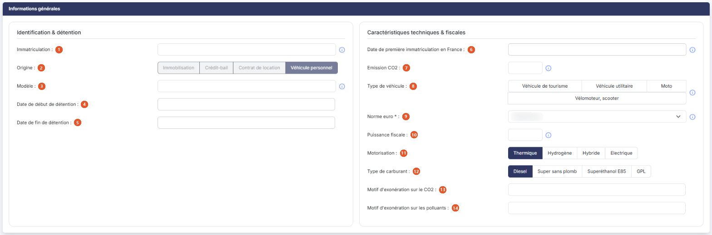

# Véhicules


**Où le trouver :** Menu **Fiches › Véhicules**



**En bref** — Cet écran rassemble les véhicules du dossier et les informations de leur carte grise servant au calcul des deux taxes annuelles sur les véhicules de tourisme.

* Pour créer un véhicule : bouton \[Ajouter un véhicule], renseignez les informations de la carte grise, puis bouton \[Enregistrer].
* Pour saisir l'affectation et le kilométrage d'une année : bouton \[Nouvelle ligne] de la rubrique « Informations annuelles ».


Cette option rassemble les véhicules du dossier et les informations qui servent au calcul des deux taxes annuelles sur les véhicules de tourisme : la taxe sur les émissions de dioxyde de carbone et la taxe sur les émissions de polluants atmosphériques. C'est l'option « Calcul TVS » du menu « Éditions » qui édite ensuite la fiche d'aide au calcul de ces deux taxes.

<figure><figcaption>
Écran « Véhicules » de la nouvelle interface
</figcaption></figure>

Les informations demandées sont celles de la carte grise du véhicule. Chaque champ concerné rappelle, dans son pictogramme d'information, la rubrique de la carte grise où trouver la valeur à saisir.

Un véhicule peut arriver dans cette liste de deux façons : vous le créez ici, ou le logiciel l'y inscrit parce que vous avez décrit un véhicule dans une fiche immobilisation, un crédit-bail ou un contrat de location — dans ces trois fiches, positionner le champ « Nature » sur « Véhicule » fait apparaître la rubrique « Informations complémentaires du véhicule », qui demande les mêmes renseignements. Le champ « Origine » indique, pour chaque véhicule, de laquelle de ces provenances il s'agit.

## La liste des véhicules

Elle présente, dans cet ordre, les colonnes « Immatriculation », « Origine », « Modèle », « Première immatriculation », « Emission CO2 », « Type », « Norme euro », « Puissance fiscale », « Motorisation », « Carburant », « Créé le » et « Créé par ». Toutes se trient en cliquant sur leur titre. La liste étant large, une barre de défilement horizontale vous permet d'atteindre les dernières colonnes.

Tant qu'aucun véhicule n'existe dans le dossier, la liste affiche « Aucun élément à afficher. ».

Une barre de commandes située au-dessus de la liste propose bouton **\[Filtres]**, bouton **\[Vue]** et bouton **\[Exporter]**, ainsi que deux commandes de sélection, « Sélectionner la page » et « Tout sélectionner », cette dernière indiquant entre parenthèses le nombre de véhicules du dossier. Le menu du bouton **\[Exporter]** réunit l'impression et les exports : « Imprimer », « Aperçu édition HTML », « Exporter en Excel », « Exporter en PDF » et « Envoyer la liste par e-mail ».

## Bouton \[Ajouter un véhicule]

Il se trouve en bas à droite de l'écran. Il ouvre une fiche vierge, dont les trois rubriques sont décrites ci-dessous.

## Bouton \[Supprimer]

Il supprime les véhicules dont vous avez coché la ligne dans la liste.

Selon les droits qui vous sont accordés, ce bouton et le bouton **\[Ajouter un véhicule]** peuvent ne pas apparaître.

## Rubrique « Informations générales »

<figure><figcaption>
Rubrique « Informations générales »
</figcaption></figure>

| Champ                                                         | Ce qu'il faut savoir                                                                                                                                                                                                                                                                                                                                                                                                                                                                                                                                                               |
| ------------------------------------------------------------- | ---------------------------------------------------------------------------------------------------------------------------------------------------------------------------------------------------------------------------------------------------------------------------------------------------------------------------------------------------------------------------------------------------------------------------------------------------------------------------------------------------------------------------------------------------------------------------------- |
| 1. **Immatriculation**                                        | Le numéro d'immatriculation du véhicule, rubrique A de la carte grise.                                                                                                                                                                                                                                                                                                                                                                                                                                                                                                             |
| 2. **Origine**                                                | 
D'où vient le véhicule. Les quatre valeurs proposées sont « Immobilisation », « Crédit-bail », « Contrat de location » et « Véhicule personnel ». Ce choix n'est pas à votre main : il est renseigné par le logiciel et s'affiche en grisé. Un véhicule que vous créez depuis cette option est toujours d'origine « Véhicule personnel » ; les trois autres origines désignent les véhicules décrits dans une fiche immobilisation, un crédit-bail ou un contrat de location.
                                                                                            |
| 3. **Modèle**                                                 | Le modèle du véhicule, rubriques D.1 et D.3 de la carte grise.                                                                                                                                                                                                                                                                                                                                                                                                                                                                                                                     |
| 4. **Date de début de détention**                             | La date à partir de laquelle le véhicule est détenu.                                                                                                                                                                                                                                                                                                                                                                                                                                                                                                                               |
| 5. **Date de fin de détention**                               | La date à laquelle cette détention prend fin. Laissez-la vide tant que le véhicule est détenu. Pour un véhicule d'origine « Véhicule personnel », elle ne peut pas être antérieure à la date de début : le logiciel refuse alors l'enregistrement avec le message « La date de fin de détention doit être postérieure à la date début de détention. »                                                                                                                                                                                                                              |
| 6. **Date de première immatriculation en France**             | Rubrique B de la carte grise.                                                                                                                                                                                                                                                                                                                                                                                                                                                                                                                                                      |
| 7. **Emission CO2**                                           | Les émissions de dioxyde de carbone du véhicule, en gramme par kilomètre, rubrique V.7 de la carte grise.                                                                                                                                                                                                                                                                                                                                                                                                                                                                          |
| 8. **Type de véhicule**                                       | Choisissez entre « Véhicule de tourisme », « Véhicule utilitaire », « Moto » et « Vélomoteur, scooter ». La valeur figure à la rubrique J.1 de la carte grise. Aucun choix n'est présélectionné.                                                                                                                                                                                                                                                                                                                                                                                   |
| 
9. <strong>Norme euro</strong> <em>Obligatoire</em>
 | La norme antipollution du véhicule, rubrique V.9 de la carte grise. La liste propose « EURO 1 » à « EURO 6d-TEMP », puis « EURO 0 » et « EURO I » à « EURO VI » ; tant que vous n'avez rien choisi, elle affiche « Sélectionnez ». C'est le seul champ de la fiche signalé comme obligatoire par un astérisque ; à l'enregistrement, le logiciel exige pourtant aussi l'immatriculation (qui doit être unique), le type de véhicule, la puissance fiscale (comprise entre 1 et 99), la motorisation et, pour les motorisations « Thermique » et « Hybride », le type de carburant. |
| 10. **Puissance fiscale**                                     | La puissance administrative du véhicule, rubrique P.6 de la carte grise.                                                                                                                                                                                                                                                                                                                                                                                                                                                                                                           |
| 11. **Motorisation**                                          | Choisissez entre « Thermique », « Hydrogène », « Hybride » et « Electrique ». La fiche s'ouvre sur « Thermique ».                                                                                                                                                                                                                                                                                                                                                                                                                                                                  |
| 12. **Type de carburant**                                     | 
Choisissez entre « Diesel », « Super sans plomb », « Superéthanol E85 » et « GPL ». La fiche s'ouvre sur « Diesel ». Ce champ ne concerne pas les véhicules électriques : dès que vous positionnez la motorisation sur « Electrique », la ligne « Type de carburant » disparaît de la rubrique. Elle réapparaît pour les trois autres motorisations.
                                                                                                                                                                                                                     |
| 13. **Motif d'exonération sur le CO2**                        | Le motif pour lequel le véhicule est exonéré de la taxe sur les émissions de dioxyde de carbone.                                                                                                                                                                                                                                                                                                                                                                                                                                                                                   |
| 14. **Motif d'exonération sur les polluants**                 | Le motif pour lequel il est exonéré de la taxe sur les émissions de polluants atmosphériques.                                                                                                                                                                                                                                                                                                                                                                                                                                                                                      |

## Rubrique « Informations annuelles »

<figure><figcaption>
Rubrique « Informations annuelles »
</figcaption></figure>

Le calcul des deux taxes est annuel : cette rubrique porte donc, année par année, son pourcentage d'affectation et son kilométrage. Elle se présente sous la forme d'un tableau de trois colonnes — « Année », « Pourcentage d'affectation » et « Kilomètres » — qui affiche « Liste vide » tant que vous n'y avez rien saisi.

## Bouton \[Nouvelle ligne]

Il ajoute une ligne au tableau des informations annuelles. L'année en cours y est déjà inscrite ; il vous reste à saisir le pourcentage d'affectation et les kilomètres.

## Bouton \[Supprimer la dernière ligne]

Il retire la dernière ligne du tableau des informations annuelles. Il n'apparaît que lorsque ce tableau comporte au moins une ligne.

## Rubrique « Documents »

<figure><figcaption>
Rubrique « Documents »
</figcaption></figure>

Vous pouvez joindre à la fiche du véhicule tous les documents utiles, sa carte grise par exemple. Le tableau affiche « Liste vide » tant qu'aucun document n'est joint, puis, pour chacun, sa description, le nom du fichier, sa date et son auteur.

Trois boutons permettent de joindre un document, selon l'endroit où il se trouve.

## Bouton \[Nouveau doc depuis mon poste]

Pour un fichier enregistré sur votre ordinateur.

## Bouton \[Nouveau doc depuis la GED]

Pour un document déjà classé dans la gestion électronique de documents.

## Bouton \[Nouveau doc depuis l'OCR]

Pour un document déjà présent dans le module de reconnaissance de documents.

## Bouton \[Enregistrer]

<figure><figcaption>
Bouton [Enregistrer]
</figcaption></figure>

Il enregistre la fiche et vous ramène à la liste des véhicules.

## Bouton \[Retour]

Il vous ramène à la liste des véhicules sans rien enregistrer.
