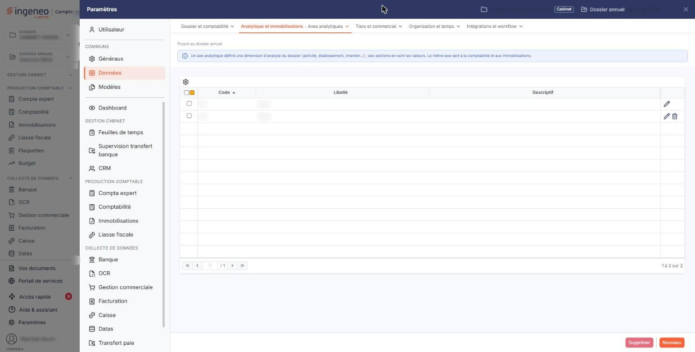

# Axes analytiques


**Où le trouver :** Panneau **Paramètres** › **Données** › **Analytique et immobilisations** › **Axes analytiques**



**En bref** — Cet écran tient les axes analytiques, vos critères d'analyse principaux, cinq au maximum ; communs à tout le dossier, ils servent ici à ventiler vos dotations.

* Pour créer un axe : bouton \[Nouveau], saisissez le code et le libellé, puis bouton \[Enregistrer].
* Pour supprimer des axes : cochez leurs lignes, puis bouton \[Supprimer] ; un axe employé sur des écritures ou des comptes est refusé.
* Pour reprendre vos axes et sections depuis un fichier : bouton \[Importer], lorsqu'il vous est proposé.


Les axes analytiques définissent vos critères d'analyse principaux : la localisation géographique, la catégorie de produits, le service, le chantier. Le logiciel vous permet de gérer jusqu'à cinq axes.

<figure><figcaption>
Écran « Axes analytiques » de la nouvelle interface
</figcaption></figure>

Dans le module des immobilisations, les axes vous servent à ventiler vos dotations : une immobilisation peut porter une affectation analytique, reprise ensuite dans les écritures produites par le module. Les axes et les sections sont communs à tout le dossier : ceux que vous créez ici sont les mêmes que ceux de la comptabilité, et inversement.

Une section est une valeur possible à l'intérieur d'un axe ; elles se tiennent dans l'option voisine « Sections analytiques ».

## Si l'écran affiche « Vous n'avez pas activé la gestion analytique. »

C'est la première chose que vous pouvez rencontrer sur cet écran, et le message ne dit pas quoi faire. La gestion analytique n'est pas active sur votre dossier : l'écran est alors réduit à cette seule phrase, sans liste, sans champ et sans aucun bouton.

Le réglage se trouve dans le panneau « Paramètres », rubrique « Généraux », option « Configuration », rubrique « Informations », champ « Activer la comptabilité analytique : ». Répondez « Oui » et enregistrez : l'écran des axes affiche alors sa liste.

Ne vous laissez pas troubler par le vocabulaire : le message parle de « gestion analytique » et le paramètre de « comptabilité analytique ». Il s'agit du même réglage. Il porte sur l'ensemble du dossier annuel et concerne donc aussi les autres modules, la comptabilité au premier chef ; si vous travaillez dans un cabinet, assurez-vous que cette activation est bien voulue pour le dossier avant de la faire.

## La liste des axes

Une fois la gestion analytique activée, l'écran s'ouvre sur la liste de vos axes, avec trois colonnes :

| Champ          | Ce qu'il faut savoir                                                                                                                                                                       |
| -------------- | ------------------------------------------------------------------------------------------------------------------------------------------------------------------------------------------ |
| **Code**       | Le code que vous avez donné à l'axe.                                                                                                                                                       |
| **Libellé**    | Son nom.                                                                                                                                                                                   |
| **Descriptif** | Le complément d'information que vous y avez associé. Notez que la colonne s'intitule « Descriptif » alors que le champ de la fiche s'intitule « Description » : c'est la même information. |

Vous ne pouvez pas avoir plus de cinq axes. Si vous en avez déjà cinq et demandez une création, le logiciel vous répond « Vous ne pouvez avoir que 5 axes au maximum. » et vous laisse sur la liste. Choisissez donc vos axes avec soin : ce sont les cinq angles sous lesquels vous analyserez le dossier.

## Bouton \[Nouveau]

Il ouvre une fiche vide.

## La fiche d'un axe — rubrique « Informations générales »

La fiche ne comporte qu'une rubrique et trois champs.

| Champ                                                   | Ce qu'il faut savoir                                                                                                                                                                                                                                                                                                                 |
| ------------------------------------------------------- | ------------------------------------------------------------------------------------------------------------------------------------------------------------------------------------------------------------------------------------------------------------------------------------------------------------------------------------ |
| 
<strong>Code</strong> <em>Obligatoire</em>
    | 12 caractères au maximum. Il doit être unique ; si vous reprenez un code existant, le logiciel refuse l'enregistrement en affichant « Code déjà utilisé ». **Il n'est plus modifiable après le premier enregistrement** : en modification, le champ s'affiche verrouillé. Réfléchissez-y donc avant de valider votre première fiche. |
| 
<strong>Libellé</strong> <em>Obligatoire</em>
 | 30 caractères au maximum. C'est le nom qui apparaîtra partout où l'axe est proposé, précédé de son code.                                                                                                                                                                                                                             |
| **Description**                                         | C'est une zone de plusieurs lignes.                                                                                                                                                                                                                                                                                                  |

## Bouton \[Enregistrer]

Il enregistre la fiche et vous ramène à la liste. Selon les droits qui vous sont accordés, il peut ne pas vous être proposé.

## Bouton \[Retour]

Il revient à la liste sans rien enregistrer.

## Supprimer un axe

La suppression s'obtient par le pictogramme de la ligne, ou par le bouton **\[Supprimer]** de la barre basse, qui agit sur les lignes que vous avez cochées.

Un axe n'est pas supprimable dès qu'il est employé. Le logiciel refuse dans deux cas : « L'axe est utilisé sur des lignes d'écriture. » et « L'axe est utilisé sur des comptes. » Ces messages sont rendus, avec le code de l'axe concerné, par la suppression groupée du bouton \[Supprimer] ; la suppression par le pictogramme de la ligne laisse simplement l'axe en place, sans message. Dans le premier cas, l'axe a servi à ventiler au moins une écriture du dossier ; dans le second, il est rattaché au paramétrage analytique d'au moins un compte.

Mesurez la portée de cette suppression avant de la demander : supprimer un axe emporte les ventilations types qui l'emploient. C'est bien parce que la manœuvre est lourde que le logiciel la refuse dès qu'une écriture ou un compte s'appuie sur l'axe.

Selon les droits qui vous sont accordés, la suppression peut ne pas vous être proposée.

## Bouton \[Importer]

Lorsqu'il vous est proposé, il ouvre une fenêtre d'import qui vous permet de reprendre vos axes et vos sections depuis un fichier, et de télécharger la trame à remplir. Ce bouton dépend d'un droit du module de comptabilité : il peut ne pas apparaître selon votre profil.
