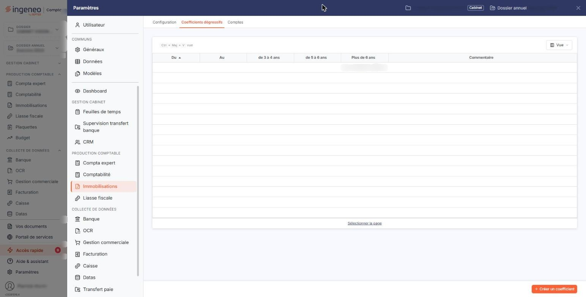

# Coefficients dégressifs


**Où le trouver :** Panneau **Paramètres** › **Immobilisations** › **Coefficients dégressifs**



**En bref** — Cet écran conserve, par période de validité, les coefficients dégressifs fixés par l'administration fiscale, qui déterminent les taux des amortissements dégressifs selon la durée d'amortissement du bien.

* Pour enregistrer de nouveaux coefficients : bouton \[Nouveau], saisissez la date de début et les trois coefficients, puis bouton \[Enregistrer].
* Pour corriger ou supprimer la période en cours : pictogramme « Modifier » ou « Supprimer » de la dernière ligne, la seule modifiable.


Les coefficients dégressifs sont définis par l'administration fiscale et servent à déterminer les taux des amortissements dégressifs. Le coefficient retenu dépend de la durée d'amortissement du bien : de 3 à 4 ans, de 5 à 6 ans, ou plus de 6 ans.

<figure><figcaption>
Écran « Coefficients dégressifs » de la nouvelle interface
</figcaption></figure>

Leur modification n'est pas fréquente, et le logiciel conserve l'historique de leurs évolutions : chaque ligne de la liste est une période de validité, la dernière étant celle qui s'applique aujourd'hui. Vous n'avez donc rien à saisir ici tant que l'administration fiscale ne publie pas de nouveaux coefficients ; le paramétrage est fourni à la création de l'exercice.

Si vous décidez d'enregistrer de nouveaux coefficients, vous indiquez la date à partir de laquelle ils s'appliquent, puis leurs valeurs pour chacune des trois durées.

## La liste des coefficients

Elle présente une ligne par période de validité, de la plus ancienne à la plus récente, avec les colonnes « Du » et « Au » qui délimitent la période, les trois coefficients « de 3 à 4 ans », « de 5 à 6 ans » et « Plus de 6 ans », puis votre « Commentaire ». Toutes les colonnes se trient en cliquant sur leur titre.

Les périodes s'enchaînent sans trou ni chevauchement : la période la plus ancienne commence au 01/01/1900 et la dernière se termine au 31/12/2099. C'est pourquoi vous ne saisissez jamais de date de fin — le logiciel la calcule.

## Les commandes de chaque ligne

Le pictogramme « Modifier » ouvre la période en modification, le pictogramme « Supprimer » la supprime.

Ces deux commandes ne s'exercent que sur la DERNIERE période, celle qui est en cours. Les périodes antérieures constituent l'historique : elles ont servi à calculer des plans d'amortissement, et les modifier reviendrait à réécrire le passé. Si vous les demandez sur une autre ligne, le logiciel refuse et affiche « Seul le dernier coefficient est modifiable. » ou « Seul le dernier coefficient est supprimable. ».

De même, la liste ne peut pas être vidée : s'il ne reste qu'une seule période, le logiciel répond « L'unique coefficient n'est pas supprimable. ».

Lorsque vous supprimez la dernière période, celle qui la précède redevient la période en cours et sa date de fin repasse au 31/12/2099.

Selon les droits qui vous sont accordés, ces commandes et le bouton \[Nouveau] peuvent ne pas apparaître.

## Bouton \[Nouveau]

Il ouvre une nouvelle période de validité, sous le titre « Coefficients dégressifs - création ».

## Les champs d'une période

| Champ                         | Ce qu'il faut savoir                                                                                                                                                                                                                                                                                                                                                                                                                              |
| ----------------------------- | ------------------------------------------------------------------------------------------------------------------------------------------------------------------------------------------------------------------------------------------------------------------------------------------------------------------------------------------------------------------------------------------------------------------------------------------------- |
| **Date de début**             | 
La date à partir de laquelle les coefficients que vous saisissez s'appliquent. Le logiciel propose la date du jour. Elle doit être postérieure à la date de début de la dernière période enregistrée, sinon le logiciel refuse l'enregistrement et affiche « Date non valide ». En créant une période, vous fermez la précédente : le logiciel donne à celle-ci, comme date de fin, la veille de la date de début que vous avez saisie.
 |
| **Date de fin**               | Ce champ n'est pas saisissable. Il affiche 31/12/2099 sur la période en cours, qui reste ouverte jusqu'à ce qu'une période suivante la ferme.                                                                                                                                                                                                                                                                                                     |
| **Coefficient de 3 à 4 ans**  | Le coefficient qui s'applique aux biens amortis sur une durée de 3 à 4 ans, ces deux durées incluses.                                                                                                                                                                                                                                                                                                                                             |
| **Coefficient de 5 à 6 ans**  | Le coefficient qui s'applique aux biens amortis sur une durée de 5 à 6 ans, ces deux durées incluses.                                                                                                                                                                                                                                                                                                                                             |
| **Coefficient plus de 6 ans** | Le coefficient qui s'applique aux biens amortis sur plus de 6 ans.                                                                                                                                                                                                                                                                                                                                                                                |
| **Commentaire**               | Une zone libre, où vous pouvez rappeler le texte qui a institué ces coefficients.                                                                                                                                                                                                                                                                                                                                                                 |

Aucun de ces champs ne porte l'astérisque des champs obligatoires.

## La modification d'une période

La fiche s'ouvre sous le titre « Coefficients dégressifs - édition » et présente les mêmes champs, dans le même ordre. Une seule différence : la « Date de début » n'y est plus saisissable, la période étant déjà ouverte. Les trois coefficients et le commentaire, eux, restent modifiables.

## Bouton \[Enregistrer]

Il enregistre la période et vous ramène à la liste.

## Bouton \[Retour]

Il vous ramène à la liste sans rien enregistrer.
