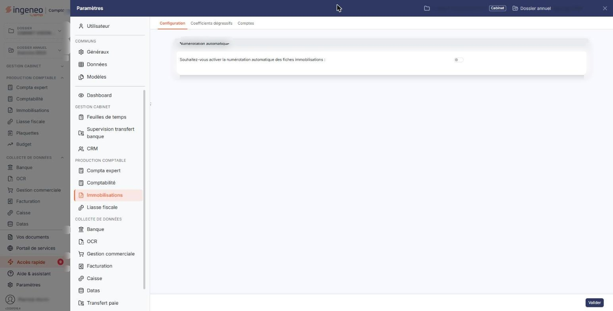

# Configuration


**Où le trouver :** Panneau **Paramètres** › **Immobilisations** › **Configuration**



**En bref** — Cet écran permet d'activer la numérotation automatique des fiches immobilisations et de fixer le prochain numéro à attribuer.

* Pour activer la numérotation automatique : répondez « Oui », indiquez le « Prochain numéro d'immobilisation à utiliser », puis bouton \[Valider].
* Pour quitter sans rien enregistrer : bouton \[Retour].


Cette option permet de mettre en place la numérotation automatique des fiches immobilisations.

<figure><figcaption>
Écran « Configuration » de la nouvelle interface
</figcaption></figure>

Si vous l'activez, vous indiquez le premier numéro à utiliser : il est ensuite proposé automatiquement lors de la création de la prochaine fiche, puis incrémenté de 1 en 1 pour les créations suivantes.

L'écran ne comporte qu'une rubrique et deux champs, dont aucun n'est obligatoire.

## Rubrique « Numérotation automatique »

| Champ                                                                             | Ce qu'il faut savoir                                                                                                                                                                                                                                                                                                                                         |
| --------------------------------------------------------------------------------- | ------------------------------------------------------------------------------------------------------------------------------------------------------------------------------------------------------------------------------------------------------------------------------------------------------------------------------------------------------------ |
| **Souhaitez-vous activer la numérotation automatique des fiches immobilisations** | 
Répondez « Oui » pour que le logiciel attribue lui-même un numéro à chaque nouvelle fiche immobilisation. Répondez « Non » pour continuer à saisir vous-même le code de chaque fiche. Répondre « Non » fait disparaître le champ suivant, qui n'a alors plus d'objet ; l'interrupteur reste seul à l'écran. Répondre « Oui » le fait réapparaître.
 |
| **Prochain numéro d'immobilisation à utiliser**                                   | Indiquez le numéro que le logiciel doit attribuer à la prochaine fiche créée. Comme le rappelle son pictogramme d'information, « Ce numéro sera incrémenté automatiquement à chaque création de fiche immobilisation. »                                                                                                                                      |

La saisie est un nombre entier, sans décimale, de six chiffres au maximum.

Trois précisions sur la façon dont le logiciel gère ensuite cette numérotation :

* le numéro est mémorisé et affiché complété par des zéros en tête, par exemple 000032, afin que le classement des fiches reste correct ;
* si vous supprimez une fiche immobilisation et que le prochain numéro à utiliser est exactement celui de la fiche supprimée augmenté de 1, le logiciel diminue ce prochain numéro de 1, pour éviter de laisser un trou dans la numérotation ;
* si le numéro à attribuer est déjà utilisé par une fiche existante, le logiciel ne comble pas le vide : il recherche le numéro le plus élevé et lui ajoute 1, afin de respecter la chronologie des créations.

## Bouton \[Valider]

Il enregistre les deux réponses de la rubrique. Ce bouton n'apparaît que si vous avez le droit d'enregistrer les options du module.
