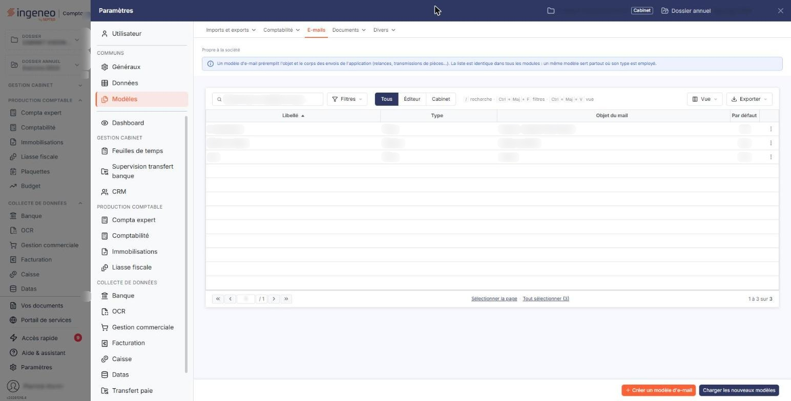

# E-mails


**Où le trouver :** Panneau **Paramètres** › **Modèles** › **E-mails**



**En bref** — Cet écran prépare l'objet et le texte des e-mails que le logiciel envoie pour vous, avec des champs dynamiques ; les modèles sont communs à tous les modules.

* Pour créer un modèle : bouton de création de la barre du bas, renseignez le libellé, le type, l'objet et le corps de l'e-mail, puis bouton \[Enregistrer].
* Pour insérer un champ dynamique : pictogramme « Insérer un champ dynamique », puis cliquez sur la ligne du champ.
* Pour récupérer les modèles de l'éditeur : bouton \[Charger les nouveaux modèles].


Cette option permet de préparer à l'avance l'objet et le texte des e-mails que le logiciel envoie pour vous : envoi de pièces, relance d'un client, courrier client, envoi de déclarations, envoi d'un dossier au commissaire aux comptes, demande d'informations à un client, création d'un utilisateur, changement de mot de passe.

<figure><figcaption>
Écran « E-mails » de la nouvelle interface
</figcaption></figure>

Un modèle vous évite de réécrire le même message à chaque envoi, et il s'adapte à son destinataire : vous y insérez des champs dynamiques — le nom du client, son adresse, la liste des pièces envoyées — que le logiciel remplace au moment de l'envoi.

Les modèles sont communs à l'ensemble du logiciel : ceux que vous voyez ici sont les mêmes que ceux qu'emploient les autres modules, et un modèle enregistré depuis les immobilisations est disponible partout ailleurs.

## La liste des modèles

Elle présente, dans cet ordre, les colonnes « Libellé », « Type », « Objet du mail » et « Par défaut » — cette dernière indiquant si le modèle est celui que le logiciel propose d'emblée. Toutes les colonnes se trient en cliquant sur leur titre, et la liste s'ouvre triée sur le libellé.

Les commandes de la barre placée au-dessus de la liste, communes à toutes les listes, sont décrites dans la page « Les listes ».

## Les commandes de chaque ligne

Le pictogramme « Modifier » ouvre le modèle en modification, le pictogramme « Supprimer » le supprime, et le pictogramme « Dupliquer » le duplique : le logiciel ouvre alors une copie du modèle, que vous n'avez plus qu'à renommer et à ajuster.

Selon les droits qui vous sont accordés, ces commandes et les boutons de bas de page peuvent ne pas apparaître.

## Création d'un modèle

Le bouton de création de la barre du bas ouvre une fiche vierge, dont les deux rubriques sont décrites ci-dessous.

## Rubrique « Informations générales »

| Champ                                                                                  | Ce qu'il faut savoir                                                                                                                                                                                                                                                                                                                                                                                                                                                                                                                                                                                                                         |
| -------------------------------------------------------------------------------------- | -------------------------------------------------------------------------------------------------------------------------------------------------------------------------------------------------------------------------------------------------------------------------------------------------------------------------------------------------------------------------------------------------------------------------------------------------------------------------------------------------------------------------------------------------------------------------------------------------------------------------------------------- |
| 
<strong>Libellé</strong> <em>Obligatoire</em>
                                | Le nom sous lequel vous retrouverez ce modèle dans la liste.                                                                                                                                                                                                                                                                                                                                                                                                                                                                                                                                                                                 |
| **Type**                                                                               | Le cas d'emploi du modèle. La liste propose « Changement de mot de passe », « Courrier client », « Création utilisateur », « Demandes infos client », « Envoi de pièces », « Envoi déclarations », « Envoi dossier CAC » et « Relance ». La fiche s'ouvre sur « Envoi de pièces ».                                                                                                                                                                                                                                                                                                                                                           |
| 
<strong>Texte modifiable lors de l’utilisation</strong> <em>Obligatoire</em>
 | Répondez « Oui » pour pouvoir retoucher le texte du message au moment de l'envoi, « Non » pour que le modèle s'impose tel quel. La fiche s'ouvre sur « Non ».                                                                                                                                                                                                                                                                                                                                                                                                                                                                                |
| **E-mail par défaut**                                                                  | Répondez « Oui » pour que ce modèle soit celui que le logiciel propose d'emblée. La fiche s'ouvre sur « Non ». C'est ce champ que la colonne « Par défaut » de la liste restitue.                                                                                                                                                                                                                                                                                                                                                                                                                                                            |
| 
<strong>Objet de l'e-mail</strong> <em>Obligatoire</em>
                      | L'objet du message. Le pictogramme placé à sa droite, « Insérer un champ dynamique », ouvre la fenêtre décrite au paragraphe e).                                                                                                                                                                                                                                                                                                                                                                                                                                                                                                             |
| 
<strong>Corps de l'e-mail</strong> <em>Obligatoire</em>
                      | Le texte du message, saisi dans un éditeur qui vous donne les mêmes moyens qu'un traitement de texte : gras, italique et souligné, copie et suppression de la mise en forme, listes numérotées et à puces, retraits, citation, alignements, lien, tableau, filet horizontal, caractère spécial, insertion de champs, couper, copier et coller sous trois formes, annuler et refaire, affichage du code source, puis, sur une seconde ligne, styles, format, police, taille, hauteur de ligne, couleur du texte, couleur de fond, plein écran et affichage des blocs. La poignée située en bas à droite de la zone vous permet de l'agrandir. |

Les quatre champs suivis d'un astérisque sont obligatoires.

## La fenêtre « Champs »

Elle liste les champs dynamiques que vous pouvez insérer dans le message. Elle s'ouvre de deux endroits : le pictogramme placé à droite du champ « Objet de l'e-mail », et le bouton « Insérer des champs » de la barre d'outils du corps de l'e-mail. Chaque ligne montre à gauche le jeton qui sera inséré, entre crochets, et à droite ce qu'il désigne.

Les champs sont rangés en trois groupes, replié à l'ouverture : « Emetteur », qui porte la civilité, le nom, le prénom et la fonction de l'émetteur ; « Client », de loin le plus fourni, qui porte le code, l'identité, l'adresse, les coordonnées, les identifiants et les informations bancaires du client, la même série de champs pour son adresse de livraison, et dix champs dynamiques libres ; et « Pièces commerciales », qui porte la liste des pièces.

Pour insérer un champ, cliquez sur sa ligne : il n'y a pas de bouton de validation. La croix située en haut à droite de la fenêtre, comme le Bouton \[Annuler] situé en bas à droite, la referment sans rien insérer.

## Rubrique « Documents »

Vous pouvez joindre au modèle les documents qui accompagneront le message. Le tableau affiche « Liste vide » tant qu'aucun document n'est joint, puis, pour chacun, sa description, le nom du fichier, sa date et son auteur.

Trois boutons permettent de joindre un document, selon l'endroit où il se trouve.

## Bouton \[Nouveau doc depuis mon poste]

Pour un fichier enregistré sur votre ordinateur.

## Bouton \[Nouveau doc depuis la GED]

Pour un document déjà classé dans la gestion électronique de documents.

## Bouton \[Nouveau doc depuis l'OCR]

Pour un document déjà présent dans le module de reconnaissance de documents.

## Bouton \[Enregistrer]

Il enregistre le modèle et vous ramène à la liste.

## Bouton \[Retour]

Il vous ramène à la liste sans rien enregistrer.

## Bouton \[Charger les nouveaux modèles]

Le logiciel est livré avec des modèles préparés par l'éditeur, et ceux-ci évoluent. Ce bouton vous montre, dans une fenêtre, ceux qui vous manquent et ceux qui ont été mis à jour depuis leur chargement, avec leur libellé et leur date de modification ; vous cochez ceux que vous voulez, et le logiciel vous indique ensuite combien de modèles ont été ajoutés et combien ont été mis à jour.

Vos propres modèles ne sont jamais écrasés par ce chargement, même s'ils portent le même nom qu'un modèle de l'éditeur. Si vous êtes déjà à jour, le logiciel vous le dit et n'ouvre rien.

## Bouton \[Exporter]

Il recopie les modèles que vous avez cochés dans la liste vers d'autres sociétés gérées. Cochez au moins un modèle avant de le demander, sinon le logiciel vous répond « Veuillez sélectionner au moins un élément à exporter. ».

## Bouton \[Supprimer]

Il supprime les modèles dont vous avez coché la ligne dans la liste.
