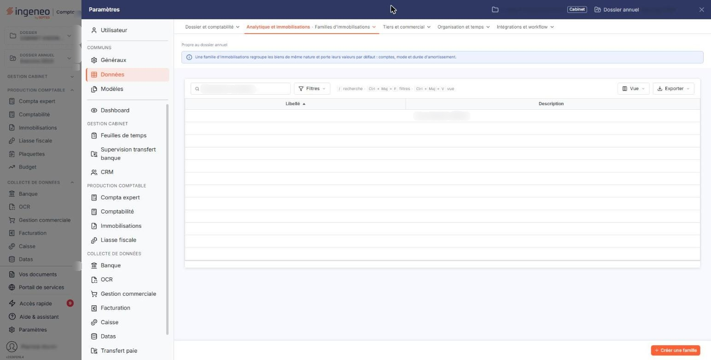

# Familles d'immobilisations


**Où le trouver :** Panneau **Paramètres** › **Données** › **Analytique et immobilisations** › **Familles d'immobilisations**



**En bref** — Cet écran tient la liste de vos familles d'immobilisations, un critère de classement pour retrouver, filtrer, éditer et regrouper vos biens ; une famille ne prérenseigne rien dans les fiches.

* Pour créer une famille : bouton \[Nouveau], saisissez un libellé unique et, si besoin, une description, puis bouton \[Enregistrer].
* Pour supprimer une famille : retirez-la d'abord des fiches immobilisations qui l'emploient, puis pictogramme « Supprimer » de sa ligne.


Cette option permet de tenir la liste des familles d'immobilisations, c'est-à-dire vos propres regroupements de biens : le matériel roulant, l'outillage, le mobilier de bureau, l'informatique, les agencements. Une famille créée ici devient proposée dans la liste « Famille » de la rubrique « Informations générales » de vos fiches immobilisations.

<figure><figcaption>
Écran « Familles d'immobilisations » de la nouvelle interface
</figcaption></figure>

Retenez bien ce que la famille est, et ce qu'elle n'est pas. Elle est un **critère de classement**, qui vous sert à retrouver, filtrer, éditer et regrouper vos immobilisations. Elle n'est **pas un modèle de fiche** : une famille ne porte ni compte comptable, ni durée d'amortissement, ni méthode d'amortissement, et affecter une famille à une immobilisation ne prérenseigne rien dans sa fiche.

Une famille ne comporte que deux informations : un libellé et une description. Le logiciel ne vous impose ni codification, ni nombre de familles, et n'en crée aucune de lui-même.

## Ce que la famille vous apporte réellement

Une fois vos immobilisations rattachées à des familles, vous retrouvez ce classement à deux endroits :

* dans la fiche d'une immobilisation, par la liste « Famille » de la rubrique « Informations générales » ;
* dans la modification groupée des immobilisations, qui vous permet d'affecter une même famille à plusieurs fiches en une fois.

## La liste des familles

L'écran s'ouvre sur la liste de vos familles, triée par ordre croissant de libellé. Elle ne comporte ni onglet, ni barre de filtre.

Elle présente deux colonnes :

| Champ           | Ce qu'il faut savoir                                 |
| --------------- | ---------------------------------------------------- |
| **Libellé**     | Le nom que vous avez donné à la famille.             |
| **Description** | Le complément d'information que vous y avez associé. |

Prenez garde à un contresens fréquent : **il n'y a pas de colonne « Code »**. Si vous numérotez vos familles et saisissez par exemple « 010 », ce qui ressemble à un code est bien le **libellé**, et c'est lui qui est repris dans les fiches immobilisations. Pour numéroter et nommer à la fois, faites-le dans un seul et même libellé.

Tant qu'aucune famille n'a été créée, la liste affiche « Aucun élément à afficher. ». C'est l'état normal d'un dossier neuf : le logiciel ne fournit aucune famille de départ.

## Les deux pictogrammes de chaque ligne

Le pictogramme « Modifier » ouvre la fiche de la famille.

Le pictogramme « Supprimer » supprime la famille. Une famille déjà affectée à une immobilisation n'est pas supprimable : le logiciel refuse et affiche « Suppression impossible car la famille … a été affectée à au moins une immobilisation. », en rappelant le libellé concerné. Pour vous en défaire, modifiez d'abord les fiches immobilisations qui l'emploient.

Contrairement à l'option « Localisations », qui lui ressemble en tout point, cet écran **ne propose pas de duplication** : une famille se recrée par le bouton \[Nouveau].

Selon les droits qui vous sont accordés, l'un ou l'autre de ces pictogrammes peut ne pas vous être proposé.

## Bouton \[Nouveau]

Il ouvre une fiche vide. C'est le seul bouton de la barre basse de la liste, et il vous est proposé même lorsque la liste est vide.

## La fiche d'une famille — rubrique « Informations générales »

La fiche ne comporte qu'une rubrique et deux champs.

| Champ                                                   | Ce qu'il faut savoir                                                                                                                                                                                    |
| ------------------------------------------------------- | ------------------------------------------------------------------------------------------------------------------------------------------------------------------------------------------------------- |
| 
<strong>Libellé</strong> <em>Obligatoire</em>
 | 30 caractères au maximum. Deux familles ne peuvent pas avoir le même libellé ; si vous reprenez un libellé existant, le logiciel refuse l'enregistrement en affichant « Ce libellé est déjà utilisé. ». |
| **Description**                                         | C'est une zone de plusieurs lignes, où vous pouvez préciser ce que la famille regroupe.                                                                                                                 |

C'est le même formulaire que celui de l'option « Localisations » : les deux fichiers se tiennent exactement de la même façon.

## Bouton \[Enregistrer]

Il enregistre la fiche et vous ramène à la liste. Selon les droits qui vous sont accordés, il peut ne pas vous être proposé : la fiche s'affiche alors en consultation.

## Bouton \[Retour]

Il revient à la liste sans rien enregistrer.

## Reprendre vos familles d'un autre logiciel

Vous n'êtes pas obligé de saisir vos familles une par une. Deux options du menu « Traitements » les reprennent en masse : l'option « Import », qui les reçoit dans un onglet de la trame Excel du logiciel, et l'option « Imports spécifiques », qui les récupère dans un fichier produit par Cegid Expert © ou par Quadra ©. En revanche, un fichier Sage Génération Experts (Coala) © n'apporte que les comptes et les immobilisations : vos familles restent alors à créer.
