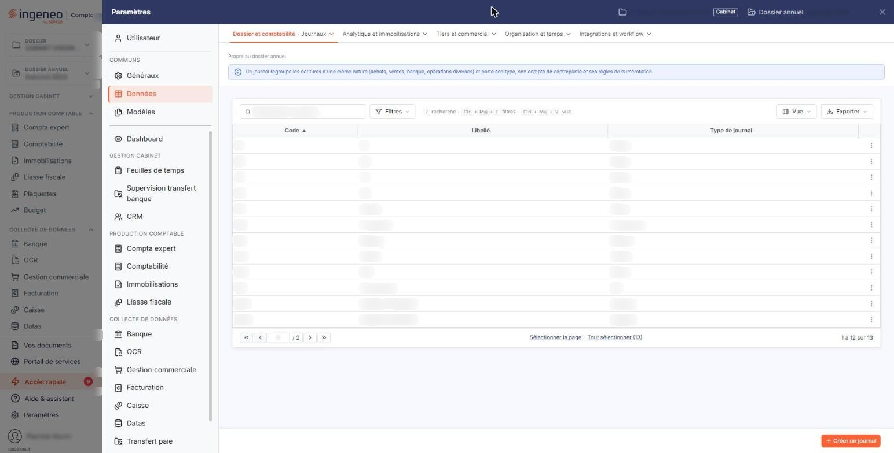

# Journaux


**Où le trouver :** Panneau **Paramètres** › **Données** › **Dossier et comptabilité** › **Journaux**



**En bref** — Cet écran donne accès aux journaux comptables du dossier, communs à tous les modules, dont le journal d'opérations diverses qui reçoit les écritures produites par le module.

* Pour créer un journal : bouton \[Nouveau], saisissez le code, le libellé et le type de journal, puis bouton \[Enregistrer].
* Pour le journal d'intégration des écritures des immobilisations : retenez le type « OD ».
* Pour supprimer des journaux : cochez leurs lignes, puis bouton \[Supprimer].


Cette option vous donne accès aux journaux comptables du dossier annuel. Ce sont eux qui reçoivent les écritures, et notamment celles que le module des immobilisations produit lorsque vous intégrez vos dotations en comptabilité.

<figure><figcaption>
Écran « Journaux » de la nouvelle interface
</figcaption></figure>

Le fichier des journaux est celui de la comptabilité : il est commun à tous les modules qui l'exposent, et un journal créé ici est aussitôt disponible partout ailleurs. Vous y accédez par le panneau « Paramètres », rubrique « Données », sous-groupe « Dossier et comptabilité », option « Journaux ». Le module des immobilisations a besoin d'un journal d'opérations diverses pour comptabiliser ses écritures : c'est celui que vous désignez dans le panneau « Paramètres », rubrique « Immobilisations », option « Comptes », à sa rubrique « Autres paramètres ». Cette option vous évite de changer de module pour le créer ou le corriger.

Depuis les immobilisations, la fiche d'un journal ne présente que ce qui est utile hors de la comptabilité : deux rubriques sur trois, et un seul paramètre de la rubrique « Propriétés ». Les options de saisie en journal, elles, se règlent depuis le module « Comptabilité ». Le paragraphe f) vous dit précisément ce qui ne s'affiche pas ici, pour que vous ne le cherchiez pas.

## La liste des journaux

Elle présente trois colonnes : « Code », « Libellé » et « Type de journal ». Elle s'ouvre triée sur le code, du plus petit au plus grand, et chacune des trois colonnes se trie en cliquant sur son titre.

Les pictogrammes situés au-dessus de la liste vous permettent de cocher toutes les lignes de la page affichée, d'étendre la sélection à toutes les pages, de choisir les colonnes affichées, de filtrer la liste et de l'imprimer. Sous la liste, les commandes de pagination vous déplacent d'une page, de dix ou de cent pages, ou directement à la première et à la dernière, et le compteur vous rappelle combien de journaux le dossier contient.

## Les commandes de chaque ligne

Quatre commandes figurent à gauche de chaque ligne. La case à cocher, dont l'infobulle indique « Sélectionner », retient la ligne pour la suppression groupée. Le pictogramme « Crayon » ouvre le journal en modification, le pictogramme « Croix » le supprime, et le quatrième le duplique.

La duplication ouvre une copie de la fiche et vous prévient par le message « Vous êtes positionné sur la fiche dupliquée. » : donnez-lui un code et un libellé, tous deux encore libres, puis enregistrez. Rien n'est créé tant que vous n'avez pas enregistré.

Selon les droits qui vous sont accordés, ces commandes et les boutons de bas de page peuvent ne pas apparaître.

## Bouton \[Nouveau]

Il ouvre une fiche vierge, dont les rubriques sont décrites ci-dessous.

Sachez qu'à la création, le logiciel active d'emblée les options de saisie du journal : les accélérateurs de saisie, la reprise de l'intitulé du compte dans le libellé de l'écriture, la réplication du libellé d'une ligne à la suivante et le contrôle des doublons. Ces options ne s'affichent pas depuis les immobilisations : si le journal que vous créez ici est destiné à être saisi à la main en comptabilité, faites-les revoir depuis le module « Comptabilité ».

## Rubrique « Informations générales »

| Champ                                                              | Ce qu'il faut savoir                                                                                                                                                                                                                                                                                                                                                                                                                                                                                                                                                                                       |
| ------------------------------------------------------------------ | ---------------------------------------------------------------------------------------------------------------------------------------------------------------------------------------------------------------------------------------------------------------------------------------------------------------------------------------------------------------------------------------------------------------------------------------------------------------------------------------------------------------------------------------------------------------------------------------------------------- |
| 
<strong>Code</strong> <em>Obligatoire</em>
               | De un à quatre caractères. C'est lui qui désigne le journal dans toute la comptabilité, et il doit être unique. Il est obligatoire à la création et n'est plus modifiable ensuite : la fiche d'un journal existant l'affiche en grisé. Le code « ANT » est refusé, le logiciel le réserve aux à-nouveaux temporaires qu'il crée lui-même.                                                                                                                                                                                                                                                                  |
| 
<strong>Libellé du journal</strong> <em>Obligatoire</em>
 | Le nom du journal, obligatoire, unique lui aussi, dans la limite de vingt-cinq caractères. C'est ce libellé que vous retrouverez dans les sélecteurs de journaux des autres écrans, précédé du code.                                                                                                                                                                                                                                                                                                                                                                                                       |
| **Compte de contrepartie**                                         | L'infobulle placée à sa droite le résume ainsi : « Compte utilisé pour solder l'écriture en saisie ». Saisissez-en les premiers caractères pour que le logiciel vous propose les comptes correspondants ; le pictogramme « Loupe », accessible aussi par le raccourci Ctrl + Alt + L, ouvre la recherche dans le plan comptable, et le pictogramme « Plus » permet de créer le compte sans quitter la fiche. Seul un compte standard est admis, jamais un compte collectif. Le compte de contrepartie est facultatif, sauf pour un journal de banque ou de caisse.                                         |
| **Intitulé**                                                       | L'intitulé du compte de contrepartie. Vous ne le saisissez pas : le logiciel le renseigne dès que le compte est choisi, et il le laisse en grisé. Il est là pour vous confirmer que vous avez désigné le bon compte.                                                                                                                                                                                                                                                                                                                                                                                       |
| 
<strong>Type de journal</strong> <em>Obligatoire</em>
    | La nature des opérations que le journal recevra. Obligatoire, il se choisit parmi « Achat », « Vente », « OD » pour les opérations diverses, « Banque », « Caisse », « Reprise de balance », « Divers » et « A-nouveaux ». Le type ne change ni les colonnes de la liste, ni les champs de la fiche : il détermine la place du journal dans les traitements et dans les éditions, et c'est lui qui fait qu'un journal vous est proposé ou non ailleurs. Retenez-le pour les immobilisations : le journal d'intégration des écritures que vous désignez dans l'option « Comptes » doit être de type « OD ». |

Deux points à connaître sur ce champ.

1. La liste des types proposés est plus courte que celle des types affichés dans la colonne « Type de journal ». Vous pouvez ainsi rencontrer dans la liste un journal de type « Situation », qui ne figure pas dans le choix : ces journaux sont créés par le logiciel lorsqu'un dossier de révision de type « Situation » est ouvert, et non par vous. Leur libellé et leur type sont alors verrouillés dans la fiche. Il en va de même des à-nouveaux temporaires.
2. Le type d'un journal déjà créé reste modifiable, mais le logiciel s'y oppose quand le journal est engagé ailleurs. Il vous répond alors, selon le cas, « Vous ne pouvez pas changer le type de journal d'un journal de caisse possédant un paramétrage de caisse. », la même phrase pour un journal de banque, ou « Vous ne pouvez pas changer le type de journal d'un journal de situation possédant un paramétrage sur un dossier de révision. »

## Rubrique « Propriétés »

Depuis les immobilisations, cette rubrique ne présente qu'un seul paramètre.

| Champ                          | Ce qu'il faut savoir                                                                                                                                                                                                                                                                                                                                                                                                                  |
| ------------------------------ | ------------------------------------------------------------------------------------------------------------------------------------------------------------------------------------------------------------------------------------------------------------------------------------------------------------------------------------------------------------------------------------------------------------------------------------- |
| **Gérer les quantités**        | Répondez « Oui » pour que les lignes d'écritures de ce journal admettent la saisie de quantités. L'interrupteur ne s'anime que si la gestion des quantités a d'abord été ouverte pour le dossier, dans le menu « Paramètres », option « Multimodules », champ « Gérer les quantités » : sinon il s'affiche mais reste inerte. C'est ici que vous désignez, journal par journal, ceux pour lesquels la saisie de quantités est admise. |
| **Nombre de champs de saisie** | Ce second champ n'apparaît que si vous avez répondu « Oui » au précédent. Indiquez si la fenêtre des quantités comportera « 1 champ » ou « 2 champs ». Il est alors obligatoire.                                                                                                                                                                                                                                                      |

## Ce qui ne s'affiche pas depuis les immobilisations

Le journal porte d'autres paramètres, que cette option ne vous montre pas : ils ne concernent que la saisie des écritures à la main, et se règlent depuis le module « Comptabilité », sur la même fiche. Ne les cherchez donc pas ici, et ne vous étonnez pas de les voir décrits dans l'aide de la comptabilité.

Il s'agit de la rubrique « Saisie » en entier — activation des accélérateurs de saisie, contrepartie automatique, reprise de l'intitulé du compte dans le libellé, réplication du libellé de la première ligne, contrôle des doublons et liste des racines de comptes interdites —, du champ « Type des écritures » de la rubrique « Informations générales », et des six autres paramètres de la rubrique « Propriétés » : gestion des échéances, gestion des devises, affichage du numéro d'écriture, du numéro de mouvement et du type d'écriture, et interdiction du journal.

Ces paramètres continuent de s'appliquer : les masquer ne les désactive pas.

## Bouton \[Enregistrer]

Il enregistre la fiche et vous ramène à la liste. Si un contrôle échoue, la fiche reste affichée et le message apparaît sous le champ en cause. Les plus fréquents sont les suivants.

* « Le code que vous indiquez est déjà utilisé, veuillez en choisir un autre s'il vous plait. », et la même phrase pour le libellé ;
* « Compte inexistant » ou « Seuls les comptes standards sont autorisés » sur le compte de contrepartie ;
* « Le compte de contrepartie doit être renseigné pour un journal de banque. », et « Le compte de contrepartie pour un journal de banque doit être un compte de banque. » ; pour un journal de caisse, les phrases sont « Le compte de contrepartie doit être renseigné pour la saisie de caisse. » et « Le compte de contrepartie pour un journal de caisse doit être un compte de caisse. » ;
* « Ce compte est déjà utilisé pour un autre journal de banque, veuillez en choisir un autre. », et son équivalent pour la caisse : deux journaux de banque ne peuvent pas partager le même compte de contrepartie.

## Bouton \[Retour]

Il vous ramène à la liste sans rien enregistrer.

## La suppression d'un journal

Le logiciel vous demande d'abord de confirmer : « Veuillez confirmer la suppression de l'élément sélectionné. »

Un journal ne se supprime que s'il ne sert plus à rien ni à personne. Le logiciel refuse la suppression, et vous dit laquelle de ces raisons s'y oppose, en nommant le code du journal :

* des écritures sont présentes sur le journal, y compris une saisie non encore enregistrée ;
* des emprunts, des crédits-bails ou des contrats de location l'utilisent — ce sont les trois cas qui vous concernent directement dans les immobilisations ;
* des banques, des modes de règlement ou des remises de chèque l'utilisent ;
* les paramètres généraux de la comptabilité, la connexion comptabilité de la facturation ou celle de la reconnaissance de documents le désignent ;
* des dossiers de révision l'utilisent — le logiciel vous en donne alors la liste, pour que vous sachiez lesquels reprendre ;
* des modèles d'import d'écritures ou des abonnements d'écritures l'utilisent.

Dans tous les cas, le message vous indique quoi corriger avant de recommencer. Plutôt que de supprimer un journal devenu inutile, vous pouvez aussi l'interdire, mais ce paramètre-là ne se règle pas depuis les immobilisations.

## Bouton \[Supprimer]

Il supprime les journaux dont vous avez coché la ligne dans la liste. Les mêmes contrôles s'appliquent, et le premier journal qui ne peut pas être supprimé interrompt l'opération avec son message. Si vous n'avez rien coché, le logiciel vous répond « Aucun journal sélectionné. »
