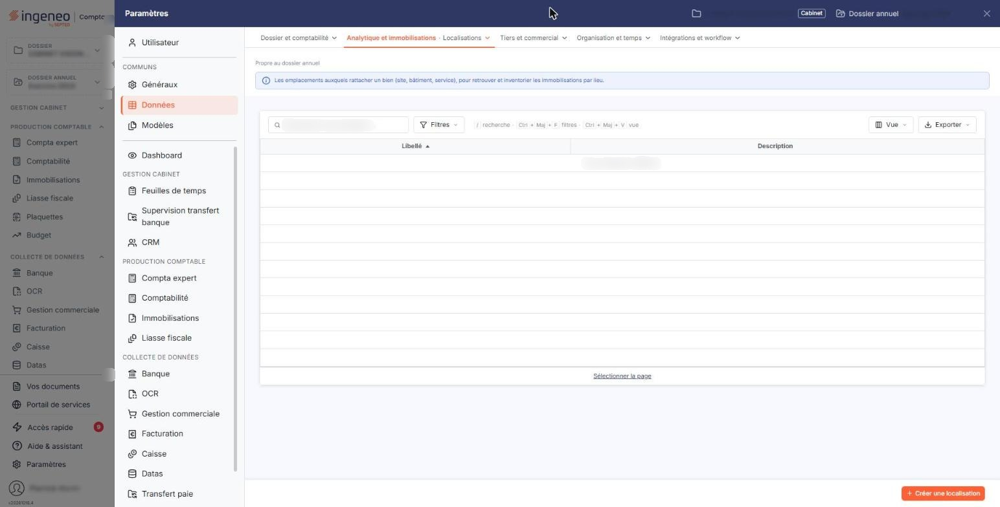

# Localisations


**Où le trouver :** Panneau **Paramètres** › **Données** › **Analytique et immobilisations** › **Localisations**



**En bref** — Cet écran tient la liste des lieux où se trouvent vos immobilisations (site, bâtiment, atelier, agence) ; chaque localisation est ensuite proposée dans vos fiches immobilisations.

* Pour créer une localisation : bouton \[Nouveau], saisissez un libellé unique et, si besoin, une description, puis bouton \[Enregistrer].
* Pour partir d'une localisation existante : pictogramme « Dupliquer », changez le libellé, puis bouton \[Enregistrer].


Cette option permet de tenir la liste des localisations de vos immobilisations, c'est-à-dire des endroits où vos biens se trouvent : un site, un bâtiment, un atelier, une agence, un étage. Une localisation créée ici devient proposée dans la liste « Localisation » de la rubrique « Informations générales » de vos fiches immobilisations.

<figure><figcaption>
Écran « Localisations » de la nouvelle interface
</figcaption></figure>

C'est un fichier libre : le logiciel ne vous impose ni codification, ni nombre de localisations, et n'en crée aucune de lui-même. À vous de définir le découpage qui vous est utile, sachant que la localisation vous servira ensuite à retrouver, filtrer et éditer vos immobilisations par lieu.

Une localisation ne comporte que deux informations : un libellé et une description. Elle ne porte ni compte comptable, ni durée, ni méthode d'amortissement.

## La liste des localisations

L'écran s'ouvre sur la liste de vos localisations, triée par ordre croissant de libellé. Elle ne comporte ni onglet, ni barre de filtre.

Elle présente deux colonnes :

| Champ           | Ce qu'il faut savoir                                 |
| --------------- | ---------------------------------------------------- |
| **Libellé**     | Le nom que vous avez donné à la localisation.        |
| **Description** | Le complément d'information que vous y avez associé. |

Prenez garde à un contresens fréquent : **il n'y a pas de colonne « Code »**. Beaucoup de cabinets numérotent leurs localisations et saisissent par exemple « 001 » comme libellé, en réservant la description au nom en clair ; ce qui ressemble alors à un code est bien le **libellé**, et c'est lui qui est repris dans les fiches immobilisations. Si vous souhaitez à la fois numéroter et nommer vos localisations, faites-le dans un seul et même libellé.

## Les trois pictogrammes de chaque ligne

Le pictogramme « Modifier » ouvre la fiche de la localisation.

Le pictogramme « Supprimer » supprime la localisation. Une localisation déjà affectée à une immobilisation n'est pas supprimable : le logiciel refuse et affiche « Suppression impossible car la localisation … a été affectée à au moins une immobilisation. », en rappelant le libellé concerné. Pour vous en défaire, modifiez d'abord les fiches immobilisations qui l'emploient — la modification groupée des immobilisations vous permet de le faire en une fois.

Le pictogramme « Dupliquer » ouvre une nouvelle fiche préremplie avec le contenu de la localisation choisie, et le logiciel vous prévient par le message « Vous êtes positionné sur la fiche dupliquée. ». Vous devez alors changer le libellé avant d'enregistrer, deux localisations ne pouvant pas porter le même.

Selon les droits qui vous sont accordés, l'un ou l'autre de ces pictogrammes peut ne pas vous être proposé.

## Bouton \[Nouveau]

Il ouvre une fiche vide. C'est le seul bouton de la barre basse de la liste.

## La fiche d'une localisation — rubrique « Informations générales »

La fiche ne comporte qu'une rubrique et deux champs. La création et la modification présentent le même formulaire, et les deux champs restent modifiables après enregistrement — y compris le libellé.

| Champ                                                   | Ce qu'il faut savoir                                                                                                                                                                                         |
| ------------------------------------------------------- | ------------------------------------------------------------------------------------------------------------------------------------------------------------------------------------------------------------ |
| 
<strong>Libellé</strong> <em>Obligatoire</em>
 | 30 caractères au maximum. Deux localisations ne peuvent pas avoir le même libellé ; si vous reprenez un libellé existant, le logiciel refuse l'enregistrement en affichant « Ce libellé est déjà utilisé. ». |
| **Description**                                         | C'est une zone de plusieurs lignes, où vous pouvez détailler l'adresse ou l'usage du lieu.                                                                                                                   |

## Bouton \[Enregistrer]

Il enregistre la fiche et vous ramène à la liste. Selon les droits qui vous sont accordés, il peut ne pas vous être proposé : la fiche s'affiche alors en consultation.

## Bouton \[Retour]

Il revient à la liste sans rien enregistrer.

## Reprendre vos localisations d'un autre logiciel

Vous n'êtes pas obligé de saisir vos localisations une par une. Deux options du menu « Traitements » les reprennent en masse : l'option « Import », qui les reçoit dans un onglet de la trame Excel du logiciel, et l'option « Imports spécifiques », qui les récupère dans un fichier produit par Cegid Expert © ou par Quadra ©. Reportez-vous à ces deux options pour le mode opératoire.
