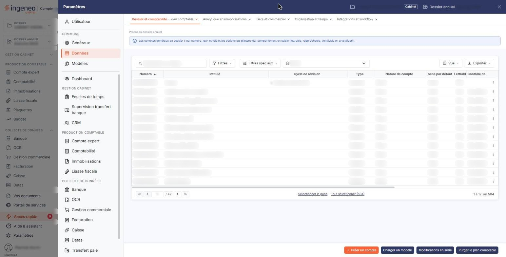

# Plan comptable


**Où le trouver :** Panneau **Paramètres** › **Données** › **Dossier et comptabilité** › **Plan comptable**



**En bref** — Cet écran donne accès au plan comptable du dossier, commun à tous les modules, pour créer sans changer de module les comptes dont les immobilisations ont besoin.

* Pour n'afficher que les comptes d'immobilisations : choisissez le cycle « E. Immobilisations » ou saisissez 2 dans « N° de compte », puis bouton \[Filtrer].
* Pour créer un compte : bouton \[Nouveau], saisissez le numéro et l'intitulé, puis bouton \[Enregistrer].
* Pour garnir le plan comptable d'un coup : bouton \[Charger un modèle].


Cette option vous donne accès au plan comptable du dossier annuel, c'est-à-dire à la liste des comptes généraux sur lesquels les écritures sont passées.

<figure><figcaption>
Écran « Plan comptable » de la nouvelle interface
</figcaption></figure>

Le plan comptable est celui de la comptabilité : il est commun à tous les modules qui l'exposent, et un compte créé ici est aussitôt disponible partout ailleurs. Vous y accédez par le panneau « Paramètres », rubrique « Données », sous-groupe « Dossier et comptabilité », option « Plan comptable ». Le module des immobilisations a besoin de comptes pour comptabiliser ses écritures : comptes d'immobilisations, d'amortissements, de dotations, de subventions, d'emprunts et de crédits-bails, tous désignés dans le panneau « Paramètres », rubrique « Immobilisations », option « Comptes ». Cette option vous évite de changer de module pour créer le compte qui vous manque.

Un compte d'immobilisation n'est pas un compte à part : sa fiche est exactement celle d'un compte de capitaux propres ou de charges. Ce qui le distingue tient à deux informations que le logiciel déduit de son numéro, sa **nature** et son **cycle de révision**, et sur lesquelles vous pouvez trier et filtrer la liste.

Depuis les immobilisations, la fiche d'un compte ne présente pas toutes ses rubriques, et la liste ne propose pas tous les traitements de masse. Le paragraphe k) vous dit précisément ce qui ne s'affiche pas ici, pour que vous ne le cherchiez pas.

## La barre de filtres

Elle surmonte la liste et sert à réduire l'affichage, qui compte facilement plusieurs centaines de comptes.

| Champ                   | Ce qu'il faut savoir                                                                                                                                                                                                                                                                                                                                                                                                                                                                                                                                                                                                                                                                                                               |
| ----------------------- | ---------------------------------------------------------------------------------------------------------------------------------------------------------------------------------------------------------------------------------------------------------------------------------------------------------------------------------------------------------------------------------------------------------------------------------------------------------------------------------------------------------------------------------------------------------------------------------------------------------------------------------------------------------------------------------------------------------------------------------- |
| **N° de compte**        | Saisissez un numéro ou son début pour ne conserver que les comptes correspondants. C'est le moyen le plus rapide d'atteindre une classe entière : saisissez 2 pour les comptes d'immobilisations, 28 pour leurs amortissements.                                                                                                                                                                                                                                                                                                                                                                                                                                                                                                    |
| **Cycle**               | Le cycle de révision du compte. La liste propose « Tous », puis les onze cycles du dossier : « A. Trésorerie / Financement », « B. Fournisseurs / Achats & chg externes », « C. Clients / ventes », « D. Stocks et en-cours », « E. Immobilisations », « F. Personnel », « G. Etat - Impôts & taxes », « H. Capitaux propres, prov. », « I. Autres comptes de bilan », « J. Autres comptes de résultat » et « K. Engagements hors-bilan ». Le cycle « E. Immobilisations » vous donne d'un coup les comptes qui vous intéressent. Le logiciel affecte lui-même le cycle d'après le numéro du compte ; sachez que depuis les immobilisations, la fiche du compte ne vous le montre pas, alors que la liste et ce filtre l'exposent. |
| **Comptes mouvementés** | Les trois boutons-bascule « Tous les comptes », « Comptes mouvementés » et « Comptes non mouvementés » s'excluent l'un l'autre. La liste s'ouvre sur « Tous les comptes ». Un compte mouvementé est un compte qui porte au moins une écriture sur l'exercice ; c'est aussi celui que vous ne pourrez pas supprimer.                                                                                                                                                                                                                                                                                                                                                                                                                |

## Bouton \[Filtrer]

Il applique les trois critères ensemble : un compte doit satisfaire chacun d'eux pour rester affiché.

## Bouton \[Annuler les filtres]

Il rend à la liste son affichage complet. Ne le cherchez pas au premier affichage : il n'apparaît qu'une fois un filtre appliqué.

## La liste des comptes

Elle s'ouvre triée sur le numéro de compte, du plus petit au plus grand, et présente ses colonnes dans cet ordre : « Numéro », « Intitulé », « Cycle de révision », « Type », « Nature de compte », « Sens par défaut », « Lettrable », « Contrôle de cycle », « Analytique », « Période d'effet », « Code devise », « Saisie en devise », « Solde n-1 », « Solde n-2 » et « Ecart n-1 vs n-2 ».

Toutes se trient en cliquant sur leur titre, sauf la dernière. Les colonnes de droite dépassent la largeur de la fenêtre : servez-vous de la barre de défilement placée sous la liste pour les atteindre, ou retirez celles dont vous n'avez pas besoin par le pictogramme de choix des colonnes.

Les pictogrammes situés au-dessus de la liste vous permettent de cocher toutes les lignes de la page affichée, d'étendre la sélection à toutes les pages, de choisir les colonnes affichées, de filtrer la liste et de l'imprimer. Sous la liste, les commandes de pagination vous déplacent d'une page, de dix ou de cent pages, ou directement à la première et à la dernière, et le compteur vous rappelle combien de comptes le dossier contient. Le nombre de lignes par page s'adapte à la hauteur de votre écran.

## Les commandes de chaque ligne

Quatre commandes figurent à gauche de chaque ligne. La case à cocher, dont l'infobulle indique « Sélectionner », retient la ligne pour la suppression groupée. Le pictogramme « Modifier » ouvre le compte en modification, le pictogramme « Supprimer » le supprime, et le pictogramme « Dupliquer » le duplique : le logiciel ouvre alors une copie de la fiche, à laquelle il ne vous reste qu'à donner un numéro encore libre. Rien n'est créé tant que vous n'avez pas enregistré.

Selon les droits qui vous sont accordés, ces commandes et les boutons de bas de page peuvent ne pas apparaître.

## Bouton \[Nouveau]

Il ouvre une fiche vierge. Deux rubriques y sont présentées, « Informations générales » et « TVA » ; les rubriques « Devises » et « Soldes », décrites plus bas, n'existent que sur la fiche d'un compte déjà créé.

## Rubrique « Informations générales »

| Champ                                                    | Ce qu'il faut savoir                                                                                                                                                                                                                                                                                                                                                                                                                                                                                                                                                                                                                                                                                                                                                                                                                                                                                                     |
| -------------------------------------------------------- | ------------------------------------------------------------------------------------------------------------------------------------------------------------------------------------------------------------------------------------------------------------------------------------------------------------------------------------------------------------------------------------------------------------------------------------------------------------------------------------------------------------------------------------------------------------------------------------------------------------------------------------------------------------------------------------------------------------------------------------------------------------------------------------------------------------------------------------------------------------------------------------------------------------------------ |
| 
<strong>Numéro</strong> <em>Obligatoire</em>
   | 
Il ne se saisit qu'à la création et n'est plus modifiable ensuite. Son infobulle rappelle la règle : « Les caractères autorisés sont les lettres majuscules et les chiffres. Le numéro doit commencer par 3 chiffres. » Le numéro doit être unique ; le logiciel refuse un doublon par « Numéro déjà utilisé » et une forme incorrecte par « Format incorrect ». Si le dossier est réglé pour vous proposer le référentiel comptable — menu « Paramètres », option « Multimodules » —, le logiciel vous suggère des comptes au fur et à mesure de votre saisie, et le pictogramme « Loupe » placé à droite du champ ouvre la recherche dans ce référentiel. Si le dossier exige en outre que la racine d'un nouveau compte figure au référentiel, la vérification a lieu à l'enregistrement et le logiciel répond, le cas échéant, « Le numéro du compte n'est pas compatible avec le référentiel comptable. »
 |
| **Description du référentiel**                           | Ce champ n'apparaît qu'à la création, et seulement si le dossier utilise le référentiel comptable. Il n'est pas saisissable : il vous restitue, à titre d'information, ce que le référentiel dit du compte que vous venez de choisir.                                                                                                                                                                                                                                                                                                                                                                                                                                                                                                                                                                                                                                                                                    |
| 
<strong>Intitulé</strong> <em>Obligatoire</em>
 | Le nom du compte. C'est lui que le logiciel reprend dans les libellés d'écritures et dans les éditions. Il reste modifiable à tout moment.                                                                                                                                                                                                                                                                                                                                                                                                                                                                                                                                                                                                                                                                                                                                                                               |
| **Intitulé 2**                                           | Un second libellé, par exemple dans une autre langue.                                                                                                                                                                                                                                                                                                                                                                                                                                                                                                                                                                                                                                                                                                                                                                                                                                                                    |
| **Type de compte**                                       | « Standard » ou « Collectif ». Ce choix se fait à la création : sur la fiche d'un compte existant, il vous est présenté sans être modifiable.                                                                                                                                                                                                                                                                                                                                                                                                                                                                                                                                                                                                                                                                                                                                                                            |
| **Nature**                                               | Vous ne la saisissez pas. Le logiciel la déduit du numéro du compte, selon les racines définies dans les paramètres généraux de la comptabilité, et il l'affiche en grisé. Douze natures existent : « Divers », « Clients », « Fournisseurs », « Banque », « Caisse », « Charges », « Produits », « Immobilisations », « TVA déductible », « TVA collectée », « Salariés » et « Comptes d'attente ». C'est la nature « Immobilisations » que le module reconnaît, et elle vaut donc d'être vérifiée sur un compte que vous venez de créer pour vos immobilisations.                                                                                                                                                                                                                                                                                                                                                      |
| **Observations**                                         | Une zone de texte libre pour vos propres notes, jusqu'à mille vingt-quatre caractères.                                                                                                                                                                                                                                                                                                                                                                                                                                                                                                                                                                                                                                                                                                                                                                                                                                   |
| **Créé le**                                              | **Par :** puis **Modifié le :** et **Par :** la date et l'auteur de la création, puis de la dernière modification. Vous ne les saisissez pas. Chacun n'apparaît que si le logiciel en a l'information : un compte venu du chargement d'un modèle de plan comptable n'a pas d'auteur de création, et sa fiche n'affiche donc que la modification. Ces quatre champs sont absents de la fiche d'un compte en cours de création.                                                                                                                                                                                                                                                                                                                                                                                                                                                                                            |

## Rubrique « TVA »

Cette rubrique commande la façon dont les mouvements du compte alimenteront les états préparatoires et les déclarations de TVA. Si la société gérée n'est pas soumise à la TVA, vous n'avez rien à y renseigner : le logiciel affiche à la place « Pour modifier les paramètres concernant la gestion de la TVA, veuillez vous rendre dans le menu « Paramètres », option « Paramètres généraux », rubrique « Régime de TVA ».

| Champ               | Ce qu'il faut savoir                                                                                                                                                                                                                                                                                                                        |
| ------------------- | ------------------------------------------------------------------------------------------------------------------------------------------------------------------------------------------------------------------------------------------------------------------------------------------------------------------------------------------- |
| **Régime de TVA**   | Le régime en cours sur le dossier, rappelé en grisé. Vous ne le modifiez pas ici, et son infobulle vous dit où le faire : « Si vous souhaitez modifier le régime de TVA, veuillez vous rendre dans le menu "Paramètres", sous-option "Paramètres généraux", rubrique "Régime de TVA". » Cet écran-là appartient au module « Comptabilité ». |
| **Soumis à la TVA** | Répondez « Oui » si les mouvements de ce compte doivent être pris en compte pour la TVA.                                                                                                                                                                                                                                                    |

## Rubrique « Devises »

Cette rubrique n'apparaît que sur la fiche d'un compte déjà créé.

| Champ                                | Ce qu'il faut savoir                                                                                                                                                                                         |
| ------------------------------------ | ------------------------------------------------------------------------------------------------------------------------------------------------------------------------------------------------------------ |
| **Autoriser la saisie en devises**   | Répondez « Oui » pour pouvoir passer sur ce compte des écritures libellées dans une autre devise que la devise locale du dossier, celle que vous fixez dans le menu « Paramètres », option « Multimodules ». |
| **Devise par défaut pour ce compte** | Ce second champ n'apparaît que si vous avez répondu « Oui » au précédent. Choisissez la devise que le logiciel proposera d'emblée en saisie ; elle restera modifiable écriture par écriture.                 |

## Rubrique « Soldes »

Cette rubrique n'apparaît elle aussi que sur la fiche d'un compte déjà créé, et rien n'y est saisissable : le logiciel calcule ces valeurs au moment où vous ouvrez la fiche. Elle présente, dans cet ordre, le **Solde à date**, le **Solde n-1**, l'**Ecart n vs n-1** et le **Solde n-2** sur la gauche, **Mouvementé en n-1** et l'**Ecart n-1 vs n-2** sur la droite. C'est le moyen le plus court de vérifier qu'un compte d'immobilisation évolue comme vous l'attendiez d'un exercice à l'autre.

## Ce qui ne s'affiche pas depuis les immobilisations

Le compte porte quatre autres rubriques, que cette option ne vous montre pas. Elles concernent la saisie et la révision comptables, et se règlent depuis le module « Comptabilité », sur la même fiche. Ne les cherchez donc pas ici, et ne vous étonnez pas de les voir décrites dans l'aide de la comptabilité :

* « Propriétés » : sens par défaut, caractère lettrable, détail en réouverture, centralisation dans le grand-livre, saisie d'une période d'effet, compte utilisable, envoi systématique en demande d'informations au client et commentaire par défaut ;
* « Accélérateur de saisie » : le compte de contrepartie et le code de TVA qui génèrent automatiquement une écriture ;
* « Gestion analytique » : la ventilation analytique du compte ;
* « Quantités » : les unités saisissables sur les lignes d'écritures.

Le champ « Cycle » de la rubrique « Informations générales » est masqué de la même façon, alors que la liste et le filtre l'exposent.

Ces paramètres continuent de s'appliquer : les masquer ne les désactive pas.

Trois traitements de masse de la liste ne vous sont pas proposés non plus : l'import et l'export du plan comptable, et la réaffectation des écritures d'un compte vers un autre. Ils restent accessibles depuis le module « Comptabilité ». Le bouton **\[Modifications en série]** et le bouton **\[Auxiliariser]** figurent en revanche parmi les boutons de cette liste ; ce qu'ils font est décrit dans l'aide du module « Comptabilité ».

## Bouton \[Enregistrer]

Il enregistre la fiche et vous ramène à la liste. Si un contrôle échoue, la fiche reste affichée et le message apparaît sous le champ en cause.

## Bouton \[Retour]

Il vous ramène à la liste sans rien enregistrer.

## La suppression d'un compte

Un compte ne se supprime que s'il ne sert plus à rien ni à personne. Le logiciel refuse la suppression et vous dit pourquoi :

* « Le compte est mouvementé. » : au moins une écriture est passée sur ce compte pour l'exercice ;
* « Le compte est actuellement utilisé dans une saisie non encore enregistrée dans le journal. » : le logiciel vous précise alors depuis quand et par qui ;
* « Le compte … est utilisé dans un paramétrage. » : le message nomme l'écran et le paramètre à corriger d'abord — par exemple le compte de contrepartie d'un journal, ou l'un des comptes de l'option « Comptes » du paramétrage ;
* « Ce compte est géré analytiquement, il ne peut pas être supprimé. »

Plutôt que de supprimer un compte devenu inutile, vous pouvez le rendre inutilisable, mais ce paramètre-là appartient à la rubrique « Propriétés », qui ne s'affiche pas depuis les immobilisations.

## Bouton \[Charger un modèle]

Il vous permet de garnir d'un coup un plan comptable, à partir d'un modèle fourni par Ingeneo Compta ou constitué par votre cabinet.

Le logiciel ouvre la fenêtre « Sélection d'un modèle de plan comptable », qui liste les modèles avec leur libellé et leur description, et vous rappelle en pied : « Choisissez le plan comptable à charger. Si votre plan comptable contient déjà des comptes, seuls les comptes du modèle n'existant pas encore dans votre plan comptable seront créés. » Vos comptes ne sont donc jamais écrasés. Seuls vous sont proposés les modèles dont les numéros de comptes ne sont pas plus longs que ceux du dossier.

Le logiciel vous demande ensuite de confirmer, en nommant le modèle retenu, puis vous rend compte du chargement. Il refuse de charger un modèle vide, et un modèle qui contient deux fois le même compte : dans ce dernier cas il ne charge rien et vous nomme les comptes en double.

## Bouton \[Purger le plan comptable]

Il vide le plan comptable, par exemple pour en charger un autre. La fenêtre de confirmation vous prévient : « Cette action va supprimer définitivement tous les comptes non utilisés dans les paramètres du module et pour lesquels aucune écriture n'a été enregistrée. » Elle vous pose en outre une question, « Conserver les comptes mouvementés en N-1 : », dont la réponse est « Oui » d'emblée.

Les comptes mouvementés et ceux qui servent à un paramétrage sont donc préservés. Le logiciel vous montre l'avancement du traitement, qui peut être long, puis rafraîchit la liste.

## Bouton \[Supprimer]

Il supprime les comptes dont vous avez coché la ligne dans la liste. Les contrôles du paragraphe n) s'appliquent compte par compte : le logiciel supprime ceux qu'il peut, et vous rend la liste de ceux qu'il n'a pas pu supprimer, chacun avec sa raison.

## Bouton \[Migration 2025]

Ce bouton vous accompagne dans le passage au plan comptable général de 2025, qui s'applique aux exercices ouverts à compter du 1er janvier 2025. Il ne s'affiche que tant que la migration reste à faire : sur un dossier annuel commençant avant cette date, ou déjà migré, il disparaît. Le millésime « 2025 » désigne donc la réforme, pas l'année de votre dossier — il est normal de le voir sur un exercice postérieur.

Le logiciel ouvre la fenêtre « Migration du plan comptable 2025 », qui liste vos comptes à reprendre et, pour chacun, le compte de remplacement qu'il propose et le nombre de lignes d'écritures concernées. Vous pouvez modifier une ligne, en modifier plusieurs d'un coup, en retirer de la liste, ou tout remettre à l'état initial. Un compte de destination doit appartenir au référentiel 2025, sinon le logiciel répond « Ce compte n'est pas présent dans le référentiel 2025. »

Avant de valider, le logiciel récapitule ce que le traitement va faire : supprimer les comptes obsolètes, créer les nouveaux, reprendre les paramétrages de comptes par défaut, et remplacer les numéros de comptes dans les écritures et partout où ils sont employés. Il vous avertit que les feuilles de calcul des dossiers de révision créés avant la migration ne seront pas reprises, vous conseille de conserver une trace du tableau par le pictogramme « Imprimante », et vous prévient que l'opération peut demander plusieurs minutes.
